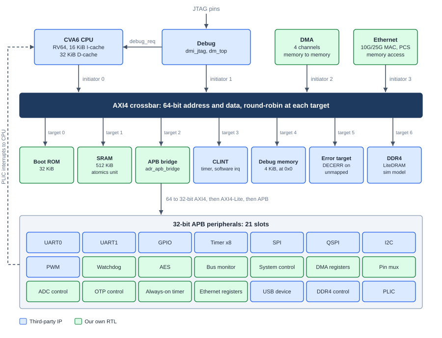
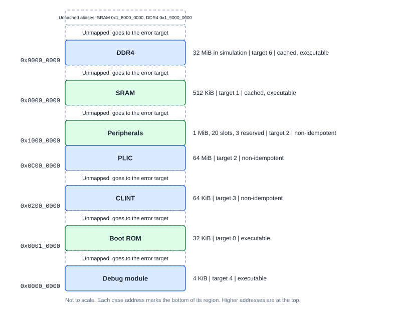
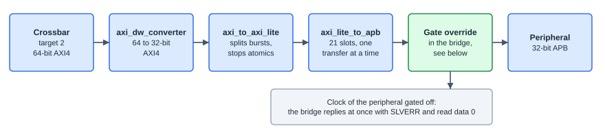
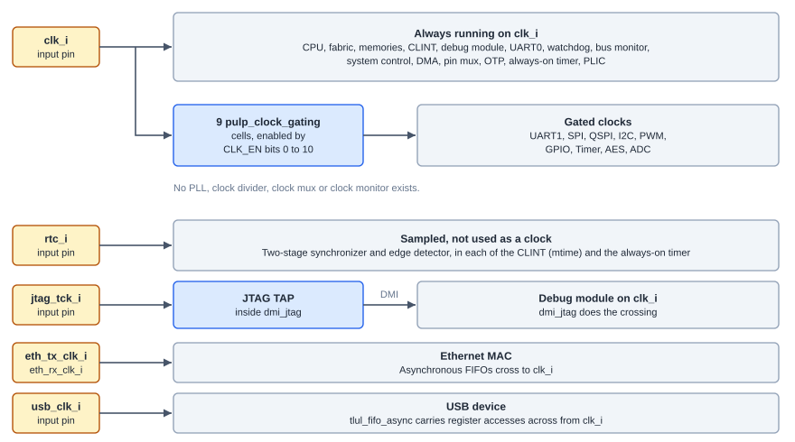
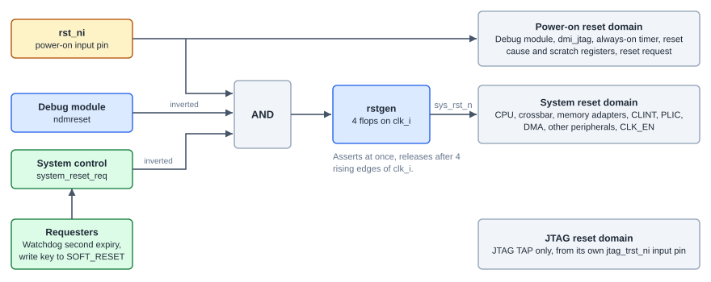
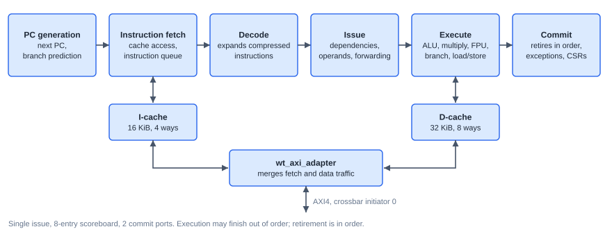
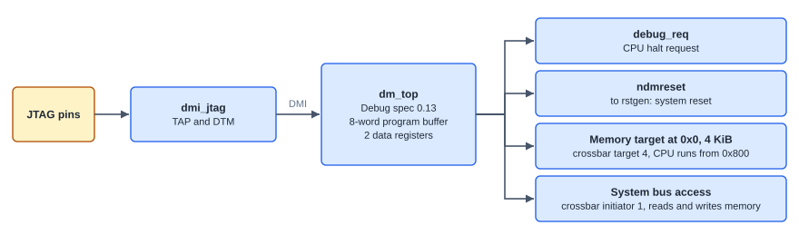
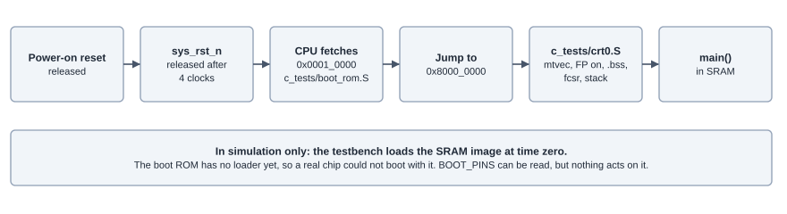
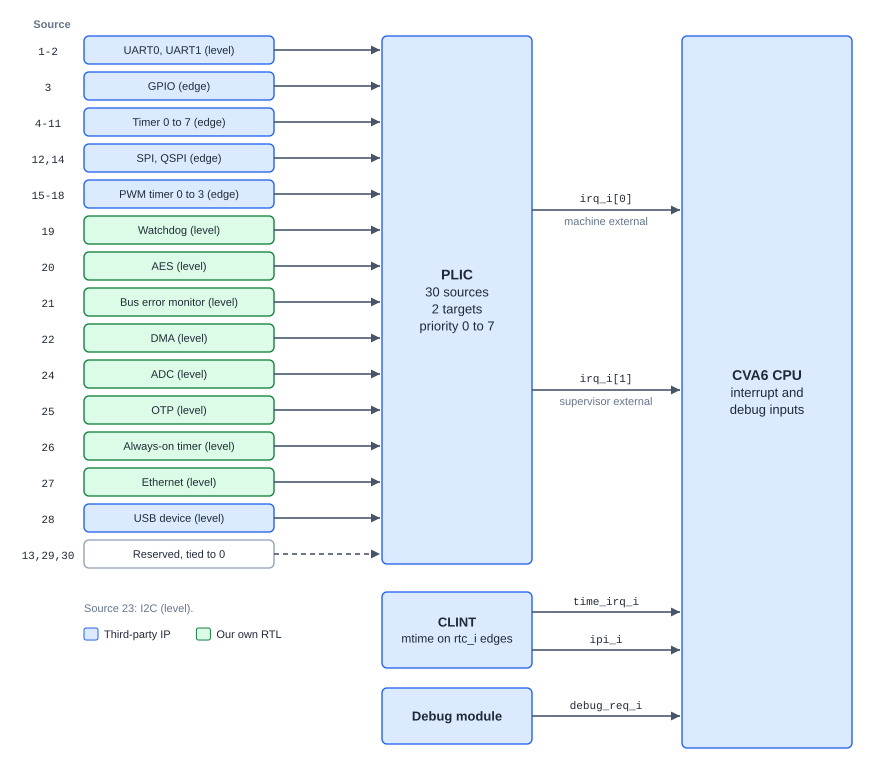

# ADR SoC microarchitecture specification

| | |
|---|---|
| Version | 0.2 draft |
| Date | 2026-11-14 |
| Describes | The RTL in `rtl/adr_soc`, `rtl/adr_ip` and the third-party IP in `rtl/third_party_ip` |

## 1. Introduction

### 1.1 What ADR is

ADR stands for *Aadhar*, meaning "foundation". The ADR SoC is a foundation, or reference, SoC: a complete, working RISC-V system built from open-source IP and our own integration code. It has two aims:
- To help industry engineers and technology enthusiasts understand how an SoC is put together: the CPU, buses, memories, clocks, resets, interrupts, debug and peripherals, and how they connect.
- To be an open-source SoC platform, from which larger, application-specific SoCs can be built.

ADR therefore keeps the parts every SoC needs, kept separate and readable: a CPU and its interrupt controllers, an interconnect, memories, debug, DMA, high-speed interfaces and low-speed peripherals, each in its own subsystem (section 2). A derived SoC keeps this base and adds the blocks its domain needs.

### 1.2 Domains a derived SoC can target

The base is meant to grow into SoCs for these domains. The right-hand column is the kind of block such an SoC typically adds on top of ADR; none of these is part of ADR today.

| Domain | Examples | Typical additions on top of ADR |
|---|---|---|
| Consumer and multimedia | Mobile application processors (smartphones, tablets); AR/VR/XR headsets; smart TV, set-top box and media streaming; gaming consoles and handhelds; camera, vision and image signal processing (ISP); audio, voice assistants and hearables | Multi-core CPU cluster, GPU and display, ISP, video and audio codecs, MIPI CSI and DSI, LPDDR, power domains |
| Communications and networking | 5G/6G baseband and modem SoCs; Wi-Fi, Bluetooth and UWB connectivity SoCs; switches, routers and gateways; satellite and non-terrestrial network (NTN) communication | DSP and baseband accelerators, RF and analog front ends, faster Ethernet and packet processing, PCIe, crypto engines |
| AI and compute | Edge AI and TinyML inference; AI accelerators and NPU-centric SoCs; data-center and cloud server SoCs; HPC and storage controllers (SSD/NVMe, SmartNIC/DPU) | NPU or vector units, coherent multi-core, HBM or LPDDR, PCIe and CXL, NVMe, larger on-chip memory |
| Edge and embedded | IoT endpoints and smart sensors (MCU-class, ultra-low-power); industrial IoT, PLCs and factory automation; smart home, building automation and wearables; energy and smart grid (smart meters, BMS, solar inverters) | Low-power modes and power gating, analog front ends, CAN and industrial Ethernet, secure boot, smaller CPU option |
| Automotive and mobility | ADAS and autonomous-driving SoCs; in-vehicle infotainment and digital cockpit; EV powertrain, BMS and zonal or domain controllers; drones, robotics and UAVs | Functional safety (lockstep CPUs, ECC, ISO 26262 process), CAN FD and automotive Ethernet, camera and radar inputs, accelerators |
| Healthcare and life sciences | Medical imaging and diagnostics; wearable and implantable health monitors; point-of-care and portable medical devices | Ultra-low-power operation, biosensor analog front ends, signal-processing accelerators, security and privacy features |
| Aerospace, defence and security | Rad-hard and mission-critical avionics SoCs; secure communication and encryption SoCs; radar, EW and sensor-fusion processors; hardware root of trust and security processors | Radiation hardening (TMR, ECC, scrubbing), root of trust and secure boot, side-channel-resistant crypto, DSP accelerators |
| Education and open hardware | RISC-V learning and research platforms; FPGA prototyping and academic SoC reference designs; open-source silicon tape-outs (shuttle programs) | Little beyond ADR itself: an FPGA or process target, pads, and timing closure |

### 1.3 Where ADR stands today

ADR is a working base in simulation, not yet a chip:
- **Digital only.** Analog parts (PHYs, SerDes, ADC, OTP macro, clock generation) are outside the SoC and modelled in the testbench.
- **Simulation only.** Every block passes bring-up tests on Verilator. The full chip synthesizes with Yosys to generic gates; there is no timing, FPGA or silicon result yet. DDR4 uses a simulation model of LiteDRAM.
- **Placeholders** for PCIe, MIPI and graphics mark where those blocks would go, outside the build.
- **Limitations** to revisit before any derived design are tracked in `LIMITATIONS.md`.

### 1.4 About this document

This specification describes how the ADR SoC is built: its structure, buses, clocks, resets, interrupts, registers and known constraints. `FEATURES.md` lists what the SoC offers, `LIMITATIONS.md` tracks decisions to revisit, and `THIRD_PARTY.md` records IP versions and licenses.

**Changes in 0.2 (2026-11-14):** Appendix B (every register block with its bus, interrupt, clock gate, reset and datasheet), Appendix C (transaction flows), Appendix D (control state machines of our own blocks), Appendix E (notes for physical design). Field-level registers, timing diagrams and programming guides of our own blocks are now in their datasheets in `docs/ip/adr_ip/`.

**How to read the facts here:**
- Addresses, widths, parameters, register maps and reset values come from the RTL. If this document and the RTL disagree, the RTL is correct and this document needs fixing.
- Timings marked *derived* were worked out by reading the RTL. They have not been measured.
- For third-party IP, this document covers how the SoC configures and connects each block, plus the registers software needs. The upstream source remains the full reference.
- No frequency target, process or synthesis result exists yet. Any figure given at 100 MHz uses the simulation clock only, and is not a timing claim.

## 2. Overview

The SoC has one RV64 CVA6 CPU on a 64-bit AXI4 crossbar, with a boot ROM, SRAM, DDR4, CLINT, JTAG debug, a DMA engine and an Ethernet MAC. A chain of bridges connects the crossbar to 32-bit APB, which carries the peripherals and the PLIC.



### SoC hierarchy

`adr_soc_top` only connects the subsystems below; it holds no logic of its own apart from the mapping of interrupt sources to PLIC numbers and the Ethernet register-ready tie-off. Each subsystem has its own folder under `rtl/adr_soc/`. Our IP blocks are in `rtl/adr_ip/<ip>/`.

```
adr_soc_top
├─ i_rst_gen      adr_rst_gen        every reset: system, USB, Ethernet TX and RX
├─ i_core         adr_core_complex   cva6 CPU, CLINT, PLIC
├─ i_debug        adr_debug          dmi_jtag, dm_top, its target and initiator ports
├─ i_interconnect adr_interconnect   axi_xbar, axi_err_slv, bus observation,
│                                    adr_apb_bridge (64 to 32-bit AXI4, AXI4-Lite, APB,
│                                    21-slot decode, replies for gated peripherals)
├─ i_mem          adr_mem_subsys     adr_rom, adr_sram, adr_ddr
├─ i_dma          adr_dma            DMA engine
├─ i_eth          adr_eth            10G/25G Ethernet
├─ i_usb          adr_usb            USB 2.0 full-speed device
├─ i_lsio         adr_lsio_subsys    UART0, UART1, GPIO, SPI, QSPI, I2C, pin mux
└─ i_periph       adr_periph_subsys  timer, PWM, watchdog, AES, bus monitor, system control,
                                     ADC, OTP, always-on timer, input synchronizers
```

| Connection | How |
|---|---|
| AXI4 | Each initiator and target has its own named port on `adr_interconnect`. The peripheral and error targets are inside it. |
| APB | `adr_apb_bridge` decodes the slots in `adr_soc_pkg` (`SlotXxx`). Each block takes its own slot. |
| Interrupts | Each block's interrupt goes to the PLIC in `adr_core_complex`, mapped to source numbers `IrqXxx` in the top. |
| Clock gating | `CLK_EN` from system control in `adr_periph_subsys` goes to the gates in both peripheral subsystems and to the APB bridge. |


### Main parameters

Defined in `rtl/adr_soc/adr_soc_pkg.sv`, unless noted.

| Parameter | Value |
|---|---|
| Fabric address and data width | 64 bits each |
| Peripheral data width | 32 bits |
| Crossbar initiators and targets | 4 and 7 |
| AXI ID width | 4 bits at initiators, 6 bits at targets |
| AXI user width | 64 bits, unused |
| Harts | 1 |
| PLIC sources and targets | 30 and 2, with 7 as the highest priority |
| GPIO pins, timers, PWM pins | 16, 8, 8 |
| Clock inputs | `clk_i`, the slow `rtc_i` time base, JTAG `jtag_tck_i`, `eth_tx_clk_i`, `eth_rx_clk_i` and `usb_clk_i` |

## 3. Memory map



| Region | Base | Size | Crossbar target | Executable | Cached | Non-idempotent |
|---|---|---|---|---|---|---|
| Debug module | `0x0000_0000` | 4 KiB | 4 | Yes | No | No |
| Boot ROM | `0x0001_0000` | 32 KiB | 0 | Yes | No | No |
| CLINT | `0x0200_0000` | 64 KiB | 3 | No | No | Yes |
| PLIC | `0x0C00_0000` | 64 MiB | 2 | No | No | Yes |
| Peripherals | `0x1000_0000` | 1 MiB | 2 | No | No | Yes |
| SRAM | `0x8000_0000` | 512 KiB | 1 | Yes | Yes | No |
| SRAM, uncached alias | `0x1_8000_0000` | 512 KiB | 1 | No | No | No |
| DDR4 | `0x9000_0000` | 32 MiB in simulation | 6 | Yes | Yes | No |
| DDR4, uncached alias | `0x1_9000_0000` | 32 MiB in simulation | 6 | No | No | No |
| Anything else | | | 5 (error) | | | |

The last three columns come from the CPU configuration, not from the crossbar:
- **Non-idempotent:** `cpu_user_cfg()` sets `0x0200_0000` to `0x0FFF_FFFF` and `0x1000_0000` to `0x1FFF_FFFF`, so reads with side effects are never speculated.
- **Executable:** upstream rules allow `0x0` for 4 KiB, `0x1_0000` for 64 KiB and `0x8000_0000` for 1 GiB. These are wider than the ROM and SRAM, and the 1 GiB rule also covers DDR4.
- **Cached:** upstream rule of `0x8000_0000` for 1 GiB, which covers SRAM and DDR4. The aliases are outside it, so they are uncached. See section 8.3.

### Peripheral slots

Each slot is 4 KiB, at `0x1000_0000` plus the offset, except DDR4 control. A free or reserved slot has no block behind it, so an access returns a decode error, with no trap.

| Offset | Block | IP | PLIC source |
|---|---|---|---|
| `0x00000` | UART0 | Third-party | 1 |
| `0x01000` | UART1 | Third-party | 2 |
| `0x02000` | GPIO | Third-party | 3 |
| `0x03000` | Timer | Third-party | 4-11 |
| `0x04000` | SPI | Third-party | 12 |
| `0x05000` | Free | | |
| `0x06000` | QSPI | Third-party | 14 |
| `0x07000` | I2C | Third-party engine, our own registers | 23 |
| `0x08000` | Free | | |
| `0x09000` | PWM | Third-party | 15-18 |
| `0x0A000` | Watchdog | Our own | 19 |
| `0x0B000` | AES | Our own | 20 |
| `0x0C000` | Bus error monitor | Our own | 21 |
| `0x0D000` | System control | Our own | None |
| `0x0E000` | DMA registers | Our own | 22 |
| `0x0F000` | Free | | |
| `0x10000` | Pin mux | Our own | None |
| `0x11000` | ADC | Our own | 24 |
| `0x12000` | OTP | Our own | 25 |
| `0x13000` | Always-on timer | Our own | 26 |
| `0x14000` | Ethernet registers | Our own wrapper, third-party MAC | 27 |
| `0x15000` | USB device, with its packet buffer at `+0x800` | Our own wrapper, third-party core | 28 |
| `0x16000` | **Reserved:** PCIe placeholder | Stub, not connected | 29, reserved |
| `0x17000` | **Reserved:** MIPI placeholder | Stub, not connected | 30, reserved |
| `0x18000` | **Reserved:** graphics placeholder | Stub, not connected | 13, reserved |
| `0x19000` to `0x1FFFF` | Free | | |
| `0x20000` to `0x2FFFF` | DDR4 control registers, 64 KiB | Generated, third-party | None |
| `0x30000` to `0xFFFFF` | Free | | |

The reservations only hold the addresses and interrupt sources, as constants in `adr_soc_pkg.sv`, so nothing in the RTL decodes them yet. Every PLIC source is now used or reserved: source 23, the last free one, went to I2C on 2026-11-07. The PLIC itself isn't in this window: it has its own 64 MiB at `0x0C00_0000`, and shares crossbar target 2. Real PCIe and graphics blocks would also need memory windows and crossbar ports, which aren't reserved here, as their sizes depend on the IP chosen.

## 4. Interconnect

### 4.1 Crossbar

The crossbar is `axi_xbar`, configured in `adr_soc_top`:

| Setting | Value | Meaning |
|---|---|---|
| `MaxMstTrans`, `MaxSlvTrans` | 8, 8 | Outstanding transactions per port |
| `LatencyMode` | `CUT_ALL_AX` | Registers on the address channels |
| `FallThrough` | 0 | Internal FIFOs do not fall through |
| `UniqueIds` | 0 | Initiators may reuse IDs |
| `ATOPs` | 1 | AXI atomic operations are passed through |
| Address rules | 9 | PLIC and peripheral window both go to target 2. SRAM and DDR4 each have a second rule for their uncached alias |
| Default target | Error target | Enabled on all initiator ports |

| Initiator port | Block | Notes |
|---|---|---|
| 0 | CVA6 | Instruction and data misses share this port |
| 1 | Debug system bus access | Through `axi_adapter`; one access at a time, of the size the debugger selects (1, 2, 4 or 8 bytes), naturally aligned |
| 2 | DMA | |
| 3 | Ethernet | |

Each target arbitrates between initiators round-robin, with no CPU priority.

### 4.2 APB bridge



`adr_apb_bridge`, inside `adr_interconnect`, takes the crossbar's peripheral port down to the APB slots. An access passes through:

1. `axi_dw_converter`: 64-bit to 32-bit AXI4. A 64-bit access becomes two 32-bit ones.
2. `axi_to_axi_lite`: splits bursts, and stops atomics at this point.
3. `axi_lite_to_apb`: decodes 21 slots and runs one APB transfer at a time, with registers on request and response.
4. The clock-gate response override (section 5.2), then the block's own APB slot, in whichever subsystem it sits.

A UART register read takes about 8 clocks through this path (see `LIMITATIONS.md`).

**Software rules for this bus:**
- Use 32-bit, word-aligned accesses. Only the I2C path carries APB byte strobes. Every other block, including the PLIC, ignores them, so a byte or halfword write can change a whole register.
- Our own blocks decode only the low address bits they need, so registers repeat within a slot. Don't rely on these aliases.
- Reserved registers in our own blocks read as 0, and writes to them are ignored. Our blocks are always ready (no wait states) and never report an APB error, with two exceptions (also listed in appendix B):
  - USB device (`adr_usb`, slot 19): every access takes wait states, as it crosses to the USB clock and back (`pready` only in the wrapper's Done state), and `pslverr` carries the TL-UL `d_error` from the core. If `usb_clk_i` stops, the access never completes.
  - DDR4 control port (`adr_ddr`, the generated core's Wishbone CSR bus): `pready` is the Wishbone `ack`, so accesses take wait states. `pslverr` is wired to the Wishbone `err`, but the generated core ties that to 0, so this port never reports an error. An access that gets no answer is ended by the core's bus timeout after 1,000,000 clocks with read data `0xFFFF_FFFF` and no error.

### 4.3 Error responses

| Case | AXI response | Read data | Source |
|---|---|---|---|
| Address hits no crossbar rule | DECERR | `0xCA11AB1EBADCAB1E` | `axi_err_slv` |
| Empty slot in the peripheral window | DECERR | `0xDEA110C8` | `axi_lite_to_apb` |
| Peripheral with its clock gated off | SLVERR | 0 | Override in `adr_apb_bridge` |

**The CPU does not trap on any of these.** The write-through cache ignores AXI error responses, so the instruction completes with the data above. The bus error monitor records the error and can raise an interrupt, but only after the instruction has finished. Use PMP where a precise fault is needed.

### 4.4 Atomic operations

| Target | Behaviour |
|---|---|
| SRAM | Resolved by `axi_riscv_atomics_wrap` in front of the memory, inside `adr_sram`, with a 64-bit word width |
| DDR4 | The same, with its own `axi_riscv_atomics_wrap` inside `adr_ddr` |
| Boot ROM | Stopped by `axi_atop_filter_intf` inside `adr_rom`: SLVERR, with an R beat when the atomic needs one |
| APB peripherals and PLIC | Stopped by the `axi_atop_filter` inside `axi_to_axi_lite` in `adr_apb_bridge`, with the same responses |
| CLINT | Stopped by an `axi_atop_filter` in front of the CLINT in `adr_core_complex`, with the same responses |
| Debug memory | Stopped by an `axi_atop_filter` in front of `axi2mem` in `adr_debug`, with the same responses |

Before 2026-11-15 the CLINT and debug memory had no filter: their front ends ignore `aw.atop`, so an atomic became a plain write of the operand and the R beat an AtomicLoad, Swap or Compare waits for never came, hanging the CPU. This was recorded as an exception (design behaviour missing from the specification, `LIMITATIONS.md` item 12) and fixed by the two filters. Software should still use atomics only on SRAM and DDR4: elsewhere they now fail with an error response, which the CPU does not trap on (section 4.3). The negative tests (`ADR_TEST_PLAN.pdf` NEG-06 to NEG-10) pass in the `amo` test.

## 5. Clocks



### 5.1 Clock sources

| Clock | Source | Used by |
|---|---|---|
| `clk_i` | One input pin | CPU, fabric, memories including DDR4, CLINT, debug module, Ethernet's registers and memory engine, and all peripherals except the USB core |
| Gated `clk_i` | 9 gates from `clk_i` | The gateable peripherals below |
| `rtc_i` | Input pin, sampled by `clk_i` | CLINT time base and always-on timer. Not used as a clock by either |
| `jtag_tck_i` | Input pin | JTAG TAP. `dmi_jtag` crosses into `clk_i` |
| `eth_tx_clk_i` | Input pin, from the SerDes. 390.625 MHz for 25G, 156.25 MHz for 10G | Ethernet transmit |
| `eth_rx_clk_i` | Input pin, from the SerDes, at the same rate | Ethernet receive |
| `usb_clk_i` | Input pin. 48 MHz on a real part | The whole USB device |

There is no PLL, clock divider, clock mux or clock monitor. The testbench uses a 10 ns `clk_i` period, a `rtc_i` of `clk_i` divided by 16, and TCK at one eighth of `clk_i`.

### 5.2 Clock gating

Each gate is a `pulp_clock_gating` cell, enabled by a bit of `CLK_EN` in system control. The gates sit beside their blocks: UART1, SPI, QSPI, I2C and GPIO in `adr_lsio_subsys`; timer, PWM, AES and ADC in `adr_periph_subsys`. The bit numbers are `ClkXxx` in `adr_soc_pkg`. All bits are 1 after any reset. Bits 2, 5 and 11 to 31 are stored but have no effect.

| `CLK_EN` bit | Block | `CLK_EN` bit | Block |
|---|---|---|---|
| 0 | UART1 | 6 | PWM |
| 1 | SPI | 7 | GPIO |
| 2 | Free | 8 | Timer |
| 3 | QSPI | 9 | AES |
| 4 | I2C | 10 | ADC |
| 5 | Free | | |

These blocks have no gate and always run: CPU, fabric, memories, DDR4, UART0, watchdog, bus monitor, system control, DMA, pin mux, OTP, always-on timer, PLIC, CLINT, Ethernet and USB.

A gated peripheral can't answer the bus, so the bridge replies for it at once with SLVERR and read data 0. Without this, the access would wait forever. The block's interrupt and output pins hold their last values while it is gated.

### 5.3 Clock domain crossings

| Signal | Handling |
|---|---|
| JTAG to `clk_i` | Inside `dmi_jtag` |
| `rtc_i` | Two-stage synchronizer and edge detector, separately in the CLINT and the always-on timer |
| GPIO inputs | Two-stage synchronizer inside `apb_gpio` |
| `boot_pins_i` | Two-stage synchronizer per pin, in `adr_periph_subsys`. Fixed on 2026-11-07 |
| `adc_compare_i` | Two-stage synchronizer in `adr_periph_subsys`, so DIV must be at least 2. Fixed on 2026-11-07 |
| `otp_done_i`, `otp_rdata_i` | **None.** The macro is assumed to be synchronous to `clk_i` |
| Ethernet frames | Asynchronous FIFOs inside `eth_mac_phy_10g_fifo` |
| USB registers | `tlul_fifo_async` in `adr_usb` |

No crossing analysis has been run, and gating timing has not been analysed.

## 6. Resets



### 6.1 Reset domains

| Reset | Source | Resets |
|---|---|---|
| `rst_ni` (power-on) | Input pin, from outside the SoC | Debug module, `dmi_jtag`, system control's cause and scratch registers and its reset request, always-on timer, the warm-reset sequencer in `adr_rst_gen` |
| `sys_rst_n` (system) | `rstgen` in `adr_rst_gen` | CPU, crossbar, memories' adapters (including the DDR4 drain gate), CLINT, PLIC, DMA, all other peripherals, `CLK_EN` |
| `jtag_trst_ni` | Input pin | JTAG TAP |
| Ethernet and USB clock domains | `sys_rst_n`, through their own `rstgen` in `adr_rst_gen` | Released in step with `eth_tx_clk_i`, `eth_rx_clk_i` and `usb_clk_i` |
| None | | The DDR4 core, which has no reset input, so its contents survive a warm reset. Its drain gate and atomics unit use `sys_rst_n` |

All of these synchronizers are in `adr_rst_gen`, so the whole reset tree is in one file, and a new clock domain gets its synchronizer there. Power-on reset also causes a system reset, because it feeds `rstgen`. The debug module stays out of the system reset so that a debugger remains attached while it resets the rest of the SoC.

### 6.2 System reset generation

Power-on reset asserts `sys_rst_n` immediately. A warm reset (debug module, watchdog, software) first drains the DDR4 port, because the DDR4 core is not reset and a transaction open in it would otherwise answer an initiator that has been reset. A state machine on the power-on reset holds the request, raises `ddr_drain` (the gate `adr_ddr_drain` in `adr_ddr` then accepts no new address and lets open transactions finish), and asserts the system reset when the port reports idle: two clocks after the request when nothing is outstanding. If the port is not idle within 1,024 clocks the reset goes ahead anyway and `RESET_CAUSE[4]` records it. The reset stays asserted while the request stays high, at least one clock.

`rstgen` releases `sys_rst_n` after 4 rising edges of `clk_i`, so release is synchronous. The blocks with synchronous resets, I2C, the DMA copy engine and Ethernet's memory engine and MAC, therefore see clock edges during reset. `CLK_EN` returns to all-ones asynchronously, which keeps their gated clocks running.

### 6.3 Reset sources and cause

| Source | Path | `RESET_CAUSE` bit |
|---|---|---|
| Power-on | `rst_ni` | 0 |
| Debug module | `ndmreset` | 1 |
| Watchdog | Second expiry, through system control | 2 |
| Software | Write the key to `SOFT_RESET` | 3 |
| DDR4 drain timeout | A warm reset went ahead before the DDR4 port was idle | 4 (with the cause of that reset) |

Watchdog and software requests leave through one clocked output in `adr_sysctrl`. Otherwise a requester cleared by the system reset would drop its request before it could be recorded.

Cause bits are only cleared by power-on reset or by writing 1, so they accumulate. A boot routine should read the cause, then clear it. `SCRATCH0` and `SCRATCH1` also survive system resets.

### 6.4 State after a system reset

| Survives | Is reset |
|---|---|
| `RESET_CAUSE`, `SCRATCH0`, `SCRATCH1` | CPU state and CLINT, including `mtime` |
| Always-on timer: count, compare, enable, match | `CLK_EN`, returning to all-ones |
| Debug module state | All other peripheral registers |
| SRAM contents (no reset, model only) | |
| DDR4 contents and controller state (no reset) | |

## 7. Power management

Peripheral clock gating is the only power feature. There are no sleep modes, power domains, retention or wake-up logic. The always-on timer is named for its reset behaviour: it uses the same `clk_i` and power as everything else, and its interrupt wakes nothing. Regulators and other analog parts are outside the current digital scope.

## 8. CPU

### 8.1 Configuration

The CPU is CVA6 `v5.3.0`, using upstream `cv64a6_imafdc_sv39`, with two changes made by `cpu_user_cfg()`: the non-idempotent rules are set for the device regions, and the coprocessor port is turned off.

| Item | Setting |
|---|---|
| ISA | RV64IMAFDC, plus `B`, `Zcb`, `Zicond`, `Zicntr` and `Zihpm` |
| Not enabled | `H`, `V`, `Zcmp`, `Zcmt`, half-precision and 8-bit floating point |
| Privilege modes | Machine, supervisor, user |
| Issue width | Single issue (`SuperscalarEn` = 0), with 2 commit ports |
| Scoreboard | 8 entries |
| Instruction cache | 16 KiB, 4 ways, 128-bit lines |
| Data cache | 32 KiB, 8 ways, 128-bit lines, write-through, 8-entry write buffer |
| Load buffer, outstanding stores | 2, 7 |
| Branch prediction | 128-entry BHT, 32-entry BTB, 2-entry return address stack |
| MMU | Sv39, 16-entry instruction TLB, 16-entry data TLB, no shared TLB |
| PMP | 8 entries, NAPOT enabled |
| Performance counters | Enabled |
| AXI | 64-bit, ID width 4, with atomics. CPU writes are single beats (`AxiBurstWriteEn` = 0) |
| Reset vector | `0x0001_0000` |
| Hart ID | 0 |

`FEATURES.md` lists the CPU as RV64GC. The extra extensions above are enabled by the upstream configuration, and no test exercises them directly.

### 8.2 Pipeline



CVA6 has six stages. This table maps them to the upstream source in `rtl/third_party_ip/cva6/core`.

| Stage | Source | Function |
|---|---|---|
| PC generation | `frontend/frontend.sv`, `bht.sv`, `btb.sv`, `ras.sv` | Next PC, and branch prediction |
| Instruction fetch | `frontend/frontend.sv`, `instr_queue.sv`, `instr_scan.sv` | Fetch from the instruction cache, and queue instructions |
| Decode | `id_stage.sv`, `decoder.sv`, `compressed_decoder.sv` | Decode, and expand compressed instructions |
| Issue | `issue_stage.sv`, `scoreboard.sv`, `issue_read_operands.sv` | Track dependencies, read operands and forward results |
| Execute | `ex_stage.sv`, `alu.sv`, `branch_unit.sv`, `mult.sv`, `load_store_unit.sv`, `fpu_wrap.sv`, `csr_buffer.sv` | Functional units, which may finish out of order |
| Commit | `commit_stage.sv`, `csr_regfile.sv` | Retire in order, raise exceptions and update CSRs |

`controller.sv` handles flushes for mispredicts, exceptions and fences.

### 8.3 Caches and memory ordering

The cache subsystem is `wt_cache_subsystem`. Every store goes to the bus through the write buffer, and `wt_axi_adapter` merges instruction and data traffic onto the single AXI port.

In this configuration `DcacheFlushOnFence` is 0, so **`fence` and `fence.i` do not flush the data cache**. `fence.i` flushes the instruction cache.

**DMA coherency:** there is no hardware coherency, so the data cache doesn't see writes from DMA or any other bus master. A cached read of a buffer that DMA just wrote can return stale data. `test_coherency()` in `tb/verilator/c_tests/dma.c` shows this, and checks both ways of avoiding it:

| Method | How | Use it for |
|---|---|---|
| Uncached alias | Add `0x1_0000_0000` to an SRAM or DDR4 address. It reaches the same memory, with no caching. `UNCACHED()` in `tb/verilator/c_tests/adr_lib.h` does this | Descriptors and DMA buffers. The buffer must only be read through the alias |
| Invalidate | `dcache_invalidate()` in `tb/verilator/c_tests/adr_lib.h` writes 0 then 1 to CSR `0x7C1`, CVA6's data cache enable. Enabling the cache invalidates all of it | Large buffers that benefit from caching. Machine mode only, and it costs the whole cache |

CPU writes are always safe for DMA to read, because the cache is write-through, but a write to an address leaves any cached line of its alias unchanged. Software must not mix both views of one buffer without invalidating. `fence` doesn't help, as noted above.

### 8.4 Interrupt inputs

| CVA6 input | Source |
|---|---|
| `irq_i[0]` | PLIC target 0, machine external |
| `irq_i[1]` | PLIC target 1, supervisor external |
| `time_irq_i` | CLINT machine timer |
| `ipi_i` | CLINT machine software |
| `debug_req_i` | Debug module |

### 8.5 Coprocessor port

`CvxifEn` is 1 in the upstream configuration, and `cpu_user_cfg()` sets it to 0 because no coprocessor is connected. `adr_soc_top` ties `cvxif_resp_i` to 0. An illegal instruction therefore traps with `mcause` 2, which `smoke` checks. See section 18, item 1, for what happened with the port on. A future coprocessor would need the setting turned back on and a real connection to this port.

### 8.6 What has been exercised

The tests run in machine mode. Supervisor mode, user mode, the MMU, and Linux boot have not been run, and neither have the RISC-V architecture tests.

## 9. Debug

The debug system follows version 0.13 of the RISC-V debug specification, using `pulp-platform/riscv-dbg`.




| Item | Setting |
|---|---|
| JTAG IDCODE | `0x0000_0001`, a placeholder |
| Program buffer | 8 words |
| Data registers | 2 words, memory-mapped |
| Halt, resume, exception entry | `0x800`, `0x804`, `0x808` in the debug module region |
| Bus width | 64 bits |
| System bus access sizes | 8, 16, 32 and 64 bits (`sbaccess8` to `sbaccess64` read as 1); `sbaccess` resets to 2 (32-bit) |
| System bus access errors (`sberror`) | 2: the access got DECERR (no target at the address); 3: the address is not aligned to the size; 4: unsupported size (128-bit); 7: the access got SLVERR. Errors 3 and 4 are found before any bus access. While `sberror` is not 0, no new access starts; the debugger clears it by writing 1s to it |
| Reset | Power-on reset only, so it survives `ndmreset` |

**How a halt works:** the debugger sets `haltreq`, and the debug module raises `debug_req`. The CPU then enters debug mode and runs from the debug module's memory at `0x800`, fetching through crossbar target 4. Abstract commands run as generated code from the same region. **System bus access** reads and writes memory and registers through initiator 1 without halting the CPU. A 32-bit access to an APB register touches only that register; a 64-bit access touches the register and its neighbour at +4. The SBA error handling comes from upstream `riscv-dbg` v0.5.0, backported (`THIRD_PARTY.md`), and `adr_debug` turns the AXI response into `sberror`.

**Constraints:**
- There is no authentication and no trigger module.
- JTAG must run slower than the system clock. Only TCK at one eighth of `clk_i` has been tested.
- The `debug` test uses our own JTAG driver in `tb/verilator/tb_top.sv`. OpenOCD and GDB have not been connected.

## 10. Memories and boot

### 10.1 Boot ROM and SRAM

DDR4 is described in section 13.11.

| | Boot ROM | SRAM |
|---|---|---|
| Size | 32 KiB | 512 KiB |
| Organization | 4096 x 64 bits | 65536 x 64 bits |
| Module | `adr_rom` | `adr_sram` |
| Path | `axi_atop_filter`, write buffer, `axi2mem`, `adr_mem_model` | `axi_riscv_atomics_wrap`, write buffer, `axi2mem`, `adr_mem_model` |
| Writes | Ignored, with no error | Byte writes supported |
| Image | `+rom=<hex>` | `+sram=<hex>` |

`adr_mem_model` is a single-port synchronous behavioural model, and needs replacing with a technology macro wrapper for implementation. `axi2mem` serves one burst at a time, so accesses to SRAM from the CPU, DMA and Ethernet are fully serialized. Because of that, `adr_axi_mem` has a write buffer, which collects each write and only starts it when its whole burst has arrived, up to 16 beats. Otherwise the memory could wait for write data while that data waits for a read which the memory won't serve until the write ends.

### 10.2 Boot flow




The stack starts at the top of SRAM, `0x8008_0000`, and the linker places everything in SRAM.

**In simulation only, the SRAM image is loaded by the testbench at time zero.** The current boot ROM has no loader, so a real chip could not boot with it. `BOOT_PINS` is readable, but nothing acts on it, and QSPI has no memory-mapped flash access.

## 11. Interrupts



### 11.1 Interrupt map

Source `n` is bit `n-1` of the PLIC source vector. Source 0 means "no interrupt".

| Source | Block | Type | Signal |
|---|---|---|---|
| 1 | UART0 | Level | `INT` |
| 2 | UART1 | Level | `INT` |
| 3 | GPIO | Edge | `interrupt` |
| 4-11 | Timer 0-7 | Edge | Overflow OR compare, per timer |
| 12 | SPI | Edge | Threshold OR end of transfer |
| 13 | Reserved for graphics | | Tied to 0 |
| 14 | QSPI | Edge | Threshold OR end of transfer |
| 15-18 | PWM timer 0-3 | Edge | `events_o` |
| 19 | Watchdog | Level | `EXPIRED` |
| 20 | AES | Level | Done AND enable |
| 21 | Bus error monitor | Level | Any status AND enable |
| 22 | DMA | Level | Any channel done AND enable |
| 23 | I2C | Level | Any IRQ_STATUS bit AND its enable |
| 24 | ADC | Level | Done AND enable |
| 25 | OTP | Level | Done AND enable |
| 26 | Always-on timer | Level | Match |
| 27 | Ethernet | Level | Done AND enable |
| 28 | USB device | Level | Any enabled USB event |
| 29 | Reserved for PCIe | | Tied to 0 |
| 30 | Reserved for MIPI | | Tied to 0 |

Clear a level source's cause in the peripheral before completing it in the PLIC, or it fires again.

### 11.2 PLIC

`plic_top` connects through `apb_to_reg`. The register block is generated for exactly 30 sources and 2 targets, and supports 32-bit accesses only.

| Offset from `0x0C00_0000` | Register |
|---|---|
| `0x0000 + 4 * source` | Priority, 0 to 7 |
| `0x1000` | Pending |
| `0x2000 + 0x80 * context` | Enable |
| `0x20_0000 + 0x1000 * context` | Threshold |
| `0x20_0004 + 0x1000 * context` | Claim and complete |

Context 0 is machine mode, and context 1 is supervisor mode.

**Edge sources have no event counter.** An edge that arrives while the same source is waiting to be completed is lost, so software should re-check the peripheral's state after completing an interrupt.

### 11.3 CLINT

Machine software and timer interrupts for one hart. `mtime` counts rising edges of `rtc_i`, and resets with the system.

| Offset from `0x0200_0000` | Register |
|---|---|
| `0x0000` | `msip` |
| `0x4000` | `mtimecmp` |
| `0xBFF8` | `mtime` |

## 12. Third-party peripherals

All registers below are 32-bit, at offsets from the block's slot.

### 12.1 UART0, UART1

`apb_uart` wrapping `obi_uart`, 16550-style. Register `n` is at offset `4 * n`.

| Offset | Read | Write |
|---|---|---|
| `0x00` | RBR, or DLL when DLAB = 1 | THR, or DLL when DLAB = 1 |
| `0x04` | IER, or DLM when DLAB = 1 | IER, or DLM when DLAB = 1 |
| `0x08` | IIR | FCR |
| `0x0C` | LCR | LCR |
| `0x10` | MCR | MCR |
| `0x14` | LSR | |
| `0x18` | MSR | |
| `0x1C` | SCR | SCR |

- A bit takes 16 x divisor clocks. A divisor of 1 is rejected, so the fastest rate is `clk_i` / 32.
- The active-low modem inputs are tied so that CTS, DSR and DCD look asserted and RI does not. Modem outputs are unconnected.

### 12.2 GPIO

`apb_gpio`, with 16 pads. Only the low-order registers are relevant.

| Offset | Register | Notes |
|---|---|---|
| `0x00` | PADDIR | 1 = output |
| `0x04` | GPIOEN | An input pin's logic runs only with its bit set |
| `0x08` | PADIN | Synchronized input |
| `0x0C` | PADOUT | |
| `0x10` | PADOUTSET | Write 1 to set |
| `0x14` | PADOUTCLR | Write 1 to clear |
| `0x18` | INTEN | |
| `0x1C` | INTTYPE | 2 bits per pin, pins 0-15 |
| `0x24` | INTSTATUS | **Clears on read** |

Interrupts are edge-only: rising, falling or both. Pad configuration outputs are unused. Outputs go through the pin mux (section 13.6).

### 12.3 Timer

`apb_timer`, with 8 channels. Each channel `k` is at `0x10 * k`.

| Offset | Register | Notes |
|---|---|---|
| `0x0` | TIMER | Current count |
| `0x4` | CTRL | `[0]` enable, `[5:3]` prescaler |
| `0x8` | CMP | **Writing it also resets the count** |

Compare and overflow share one PLIC source per channel, and no status register tells them apart. The count restarts at compare or overflow, and a compare value of 0 is ignored.

### 12.4 SPI, QSPI

Two instances of `apb_spi_master`, with `BUFFER_DEPTH` 10.

| Offset | Register | Notes |
|---|---|---|
| `0x00` | STATUS | Write: `[0]` read, `[1]` write, `[2]` quad read, `[3]` quad write, `[4]` soft reset, `[11:8]` chip select |
| `0x04` | CLKDIV | `[7:0]` |
| `0x08` | SPICMD | Command word |
| `0x0C` | SPIADR | Address word |
| `0x10` | SPILEN | `[5:0]` command bits, `[13:8]` address bits, `[31:16]` data bits |
| `0x14` | SPIDUM | `[15:0]` read dummy, `[31:16]` write dummy |
| `0x18` | TXFIFO | |
| `0x20` | RXFIFO | |
| `0x24` | INTCFG | Thresholds and counters; `[31]` interrupt enable |
| `0x28` | INTSTA | |

| Instance | Pins |
|---|---|
| SPI | SCLK, 4 chip selects, MOSI on `sdo0`, MISO on `sdi1`. Other data lines are tied off |
| QSPI | SCLK, 4 chip selects, 4 data out, 4 data in, and a mode output (0 single, 1 quad out, 2 quad in) |

SPI is half-duplex, sending and then receiving, with no CPOL or CPHA settings. Quad mode covers the whole transfer, including command and address, so 1-1-4 reads aren't possible. QSPI has no memory-mapped access.

### 12.5 I2C

Our own `adr_i2c` (`rtl/adr_ip/i2c/rtl/adr_i2c.sv`), an APB target like the other peripherals. It drives the unmodified `verilog-i2c` engine `i2c_master` through three unmodified 32-deep `axis_fifo` queues, for commands, write data and read data. It replaced that project's AXI4-Lite register wrapper `i2c_master_axil` and our APB to AXI4-Lite adapter on 2026-11-07. Offsets `0x00` to `0x0C` keep that wrapper's layout and behaviour, so software didn't change. The interrupt registers are new.

| Offset | Register | Fields |
|---|---|---|
| `0x00` | Status | `[0]` busy, `[1]` bus control, `[2]` bus active, `[3]` missed ACK (write 1 to clear), `[8]` command FIFO empty, `[9]` full, `[10]` overflow (write 1 to clear), `[11]` write FIFO empty, `[12]` full, `[13]` overflow (write 1 to clear), `[14]` read FIFO empty, `[15]` full |
| `0x04` | Command | `[6:0]` address, `[8]` start, `[9]` read, `[10]` write, `[11]` write multiple, `[12]` stop. A write with any of bits 8-12 set queues a command; reads return the last one written |
| `0x08` | Data | Write: `[7:0]` byte, `[9]` last byte of a write multiple. Read: `[7:0]` byte, `[8]` valid, `[9]` last; a valid read removes the byte. Reads 0 when nothing is waiting |
| `0x0C` | Prescale | `[15:0]`, `clk_i` / (I2C clock x 4). Reset value 1 |
| `0x10` | IRQ_ENABLE | `[3:0]`, one bit per IRQ_STATUS bit |
| `0x14` | IRQ_STATUS | `[0]` done: went idle with no command queued (write 1 to clear). `[1]` missed ACK, the same flag as Status `[3]` (write 1 to clear). `[2]` received data waiting. `[3]` command or write FIFO overflow (clear in Status) |

The interrupt, PLIC source 23, is level-triggered: it is high while any enabled IRQ_STATUS bit is set, so clear the cause before completing the claim. PREADY is always high, so accesses take no wait states. Byte strobes are honoured: Data `[9]` is only taken from a write covering both low bytes.

Pins are open-drain: a line is released when its `_t` output is high.

### 12.6 PWM

`apb_adv_timer` with 16-bit counters. Each of the 4 timers `t` is at `0x40 * t`.

| Offset | Register |
|---|---|
| `0x00` | CMD: `[0]` start, `[1]` stop, `[2]` update, `[3]` reset |
| `0x04` | CFG |
| `0x08` | TH: period thresholds |
| `0x0C` to `0x18` | Channel 0-3 thresholds |
| `0x1C` to `0x28` | Channel 0-3 LUT |
| `0x2C` | COUNTER |
| `0x100` | EVENT_CFG, shared |
| `0x104` | CH_EN, per-timer clock enable, shared |

The 8 pins are channels 0 and 1 of each timer: `pwm_o[1:0]` from timer 0, up to `pwm_o[7:6]` from timer 3. Paired pins share a period, so there are only 4 independent frequencies.

### 12.7 USB device

OpenTitan `usbdev` 2.0.0: USB 2.0 **full speed only** (12 Mbit/s), **device only**, with 12 endpoints and a 2 KiB packet buffer of 32 buffers. Software moves packets through the buffer, so this block is not a bus master and DMA coherency doesn't apply to it.

`adr_usb` gives it an APB port at `0x1001_5000`. Registers and the buffer (at offset `0x800`) are as documented upstream. Use 32-bit accesses only.

- **Clock:** the whole block runs on `usb_clk_i`, and each register access crosses to it through `tlul_fifo_async`. **If `usb_clk_i` stops, a register access waits forever.** A real part needs 48 MHz. The testbench uses 48.003 MHz (a 10.416 ns half period, chosen so no edge lands on a system clock edge) with exactly 4 clocks per bit, so it isn't testing clock tolerance.
- **Interrupts:** all 18 upstream interrupts are ORed onto PLIC source 28. Software reads the block's `INTR_STATE`.
- **Left out:** the always-on wake logic (`usbdev_aon_wake`), so USB can't wake the SoC. Its alert outputs aren't collected. The transceiver is outside the SoC.
- **Version:** newer OpenTitan needs Verilator 5.048. This release is why `adr_usb_prims.sv` hand-writes wrappers that OpenTitan normally generates.
- **Compile unit:** `sim/usb_files.sv` includes all the OpenTitan files as one unit, because some of them rely on being compiled together, and because OpenTitan and `common_cells` define different `ASSERT` macros.

## 13. Our own blocks

These are written for this SoC, and each has its register map in its RTL header. Writes take effect on the APB access phase. Software should use word accesses only.

### 13.1 DMA (`adr_dma`)

One engine, with 4 channels around one `axi_cdma` copy engine. Memory-to-memory only.

```
 APB registers --> per-channel SRC, DST, LEN, flags
                        |
                  round-robin choice of a pending channel
                        |  one descriptor at a time
                        v
                    axi_cdma (64-bit, 8-beat bursts, unaligned allowed)
                     |    ^
       read credit --+    | status: tag, error
       gate on AR    v    |
                  crossbar initiator 2
```

Channel `n` is at `0x20 * n`:

| Offset | Register | Fields |
|---|---|---|
| `0x00`, `0x04` | SRC_LO, SRC_HI | Source address |
| `0x08`, `0x0C` | DST_LO, DST_HI | Destination address |
| `0x10` | LEN | Bytes, 24 bits, up to 16 MiB - 1 |
| `0x14` | CTRL | `[0]` start (write 1), `[1]` interrupt when done |
| `0x18` | STATUS | `[0]` busy, `[1]` done, `[2]` bus error. Write 1 to clear bits 1 and 2 |

**Behaviour:**
- A start is ignored while that channel is pending or active. A start also clears done and error.
- Length 0 sets done at once, with no bus traffic.
- Channels run one whole transfer at a time. A long transfer delays the other channels.
- A bus error still ends in done, with the error bit also set.
- The interrupt is the OR of `done & irq_en` across channels, so it stays high until done is cleared.

**Read flow control:** SRAM serves one burst at a time. If the DMA refused read data because its FIFO was full, the memory would wait on it while it waited to write to the memory, and both would stop. So a read burst is only requested when at most 12 beats would then be in flight (`ReadCredit`), and read data is never refused. With different source and destination alignment, a burst can read one beat more than it writes, and one write burst can need two read bursts. So the count clears when a write burst ends with no read outstanding. The write side of this deadlock is handled in `adr_axi_mem`, see section 10.1.

### 13.2 AES (`adr_aes`)

Single-block AES with 128, 192 and 256-bit keys, written from FIPS-197. S-boxes are from `secworks/aes`.

| Offset | Register | Fields |
|---|---|---|
| `0x00` | CTRL | `[0]` start (write 1), `[1]` decrypt, `[3:2]` key size: 0 = 128, 1 = 192, 2 = 256, 3 = 128. Reads as 0 |
| `0x04` | STATUS | `[0]` busy, `[1]` done (write 1 to clear) |
| `0x08` | IRQ_EN | `[0]` interrupt when done |
| `0x10` to `0x2C` | KEY0-7 | Write-only, reads as 0 |
| `0x30` to `0x3C` | IN0-3 | |
| `0x40` to `0x4C` | OUT0-3 | Read-only |

The first byte of a word is its most significant byte, and word 0 comes first.

```
Idle --start--> Expand --schedule built--> Rounds --last round--> Idle (done)
```

| Phase | Work | Clocks (*derived*) |
|---|---|---|
| Expand | One key schedule word per clock, then the first AddRoundKey | 128: 41, 192: 47, 256: 53 |
| Rounds | One round per clock, combinational | 128: 10, 192: 12, 256: 14 |
| Total from the start write | | 128: 51, 192: 59, 256: 67 |

**Structure:** 4 S-boxes for encryption, 4 for decryption, 1 for the key schedule, and 60 32-bit schedule registers, rebuilt at every start. Encryption and decryption use the straightforward FIPS-197 cipher and inverse cipher.

**Constraints:**
- `IN` is sampled at the end of Expand, so don't change it while busy. `OUT` reads the running state, so it is valid only when done.
- There are no chaining modes or DMA path.
- Timing is constant, but there is no masking, and the schedule stays in registers with no clear command.

### 13.3 Watchdog (`adr_wdt`)

| Offset | Register | Fields |
|---|---|---|
| `0x00` | CTRL | `[0]` enable. Reset value 0. Any write reloads the count |
| `0x04` | LOAD | Reload value in clocks. Reset value all-ones. Any write reloads the count |
| `0x08` | COUNT | Read-only |
| `0x0C` | KICK | Write `0x5AFE_C0DE` to reload. Other values do nothing |
| `0x10` | STATUS | `[0]` expired, write 1 to clear |

```
count reaches 0, EXPIRED clear -> reload, set EXPIRED (interrupt)
count reaches 0, EXPIRED set   -> reload, request a system reset
```

A count of `LOAD` takes `LOAD + 1` clocks to expire (*derived*). **KICK does not clear EXPIRED,** so an interrupt handler must also clear STATUS, or the next expiry resets the system. There is no lock against disabling the watchdog.

### 13.4 Bus error monitor (`adr_bus_monitor`)

The monitor watches read and write responses at all 4 initiator ports, with bit 1 of RESP catching both SLVERR and DECERR.

| Offset | Register | Fields |
|---|---|---|
| `0x00` | STATUS | `[3:0]` read error, `[7:4]` write error, per initiator. Write 1 to clear |
| `0x04`, `0x08` | ADDR_LO, ADDR_HI | Address of the first error since STATUS was all clear |
| `0x0C` | IRQ_EN | `[0]` interrupt while any status bit is set |

Initiators are numbered as in section 4.1. **These fields hold at most 4 initiators, and all 4 are in use.** A 5th would overlap the write-error bits, so this register's layout has to change first. If two report errors in the same cycle, the lowest-numbered address is kept, with reads taking priority over writes for that initiator.

`adr_soc_top` keeps the last accepted AR and AW address per initiator, so with several transfers outstanding, the recorded address may belong to a neighbouring transfer.

### 13.5 System control (`adr_sysctrl`)

| Offset | Register | Reset by | Fields |
|---|---|---|---|
| `0x00` | CHIP_ID | | `0x4144_5231`, placeholder |
| `0x04` | VERSION | | `0x0001_0000`, placeholder |
| `0x08` | RESET_CAUSE | Power-on | `[0]` power-on, `[1]` debug, `[2]` watchdog, `[3]` software, `[4]` DDR4 drain timeout. Write 1 to clear |
| `0x0C` | SOFT_RESET | | Write `0x5253_5421` to reset. Other values do nothing |
| `0x10`, `0x14` | SCRATCH0, 1 | Power-on | Kept across system resets |
| `0x18` | BOOT_PINS | | Read-only, `[3:0]`, from the pins through a 2-flop synchronizer. Nothing acts on it |
| `0x1C` | CLK_EN | System | See section 5.2 |

### 13.6 Pin mux (`adr_pinmux`)

Each of the 16 pads carries one of three output sources. Two bits per pad select it: 0 or 3 = GPIO, 1 = function 1, 2 = function 2.

| Offset | Register |
|---|---|
| `0x00` | Pads 0-7: `[1:0]` pad 0, up to `[15:14]` pad 7 |
| `0x04` | Pads 8-15: `[1:0]` pad 8, up to `[15:14]` pad 15 |

| Pad | Function 1 | Function 2 |
|---|---|---|
| 0 | PWM 0 | UART1 TX |
| 1 | PWM 1 | SPI SCLK |
| 2 | PWM 2 | SPI CSN0 |
| 3 | PWM 3 | SPI MOSI |
| 4-7 | PWM 4-7 | None (output 0, direction input) |
| 8-15 | None (output 0, direction input) | None (output 0, direction input) |

Only outputs and direction are muxed, and inputs of muxed functions are not routed. Those peripherals also keep their dedicated top-level ports.

### 13.7 ADC controller (`adr_adc_ctrl`)

The digital side of an 8-bit successive-approximation ADC with 2 channels. The comparator and DAC are outside the block, and are a testbench model today.

| Offset | Register | Fields |
|---|---|---|
| `0x00` | CTRL | `[0]` start (write 1), `[1]` channel, `[2]` interrupt when done |
| `0x04` | STATUS | `[0]` busy, `[1]` done, write 1 to bit 1 to clear |
| `0x08` | DATA | `[7:0]` last result |
| `0x0C` | DIV | Clocks per conversion bit, minus 1. Reset value 3. Must be at least 2, as `adc_compare_i` arrives through a 2-flop synchronizer |

The block tries bits from 7 down to 0, driving `result | trial_bit` on `adc_dac_code_o` and keeping the bit if `adc_compare_i` is high. A conversion takes 8 x (DIV + 1) clocks (*derived*), which is 32 at the reset value.

### 13.8 OTP controller (`adr_otp_ctrl`)

The controller for a 32-word, 32-bit macro. The macro is outside the block, and its interface is our own assumption until a real one is chosen.

| Offset | Register | Fields |
|---|---|---|
| `0x00` | ADDR | Word address |
| `0x04` | WDATA | Bits to program |
| `0x08` | RDATA | Last word read |
| `0x0C` | CMD | 1 = read, 2 = program |
| `0x10` | KEY | Write `0x4F54_5021` to allow one program command |
| `0x14` | STATUS | `[0]` busy, `[1]` done, `[2]` error. Write 1 to clear bits 1 and 2 |
| `0x18` | IRQ_EN | `[0]` interrupt when done |

- **Errors:** an address above 31, a CMD other than 1 or 2, or a program without the key sets error and done, and starts nothing.
- **Key:** any CMD write uses up the key, even a read.
- **Macro handshake:** a one-cycle `otp_req_o` with stable address, data and `otp_we_o`, then the macro pulses `otp_done_i`.
- **Bits only turn on:** the macro model enforces this, not the controller.
- **Security:** there is no read protection, and the key is a fixed value, a soft guard only.

### 13.9 Always-on timer (`adr_aon_timer`)

A 64-bit counter of `rtc_i` rising edges, on power-on reset.

| Offset | Register | Fields |
|---|---|---|
| `0x00` | CTRL | `[0]` enable |
| `0x04`, `0x08` | COUNT_LO, COUNT_HI | Read-only. Reads are not atomic, so re-read HI to detect a carry |
| `0x0C`, `0x10` | CMP_LO, CMP_HI | Reset value all-ones |
| `0x14` | STATUS | `[0]` match, write 1 to clear |

`rtc_i` is sampled by `clk_i`, so it must be slower than `clk_i` / 2. The match status drives the level interrupt. The count can't be written by software.

### 13.10 Ethernet (`adr_eth`)

A 10G/25G MAC and digital PHY layer (PCS) from `verilog-ethernet`, `eth_mac_phy_10g_fifo`, with an `axi_dma` memory engine on crossbar initiator 3, at `0x1001_4000`. Software gives one buffer per direction, as there are no descriptor rings.

**The line rate comes from the clocks:** 390.625 MHz on the 64-bit SerDes interface gives 25G, and 156.25 MHz gives 10G, with `Count125us` set to match. The analog SerDes is outside the SoC. **25G hasn't been run:** the testbench loops back at the SerDes interface on a 156.25 MHz clock (the 10G rate), so no 25G line rate, timing or SerDes is exercised. `Count125us` is set for 10G (`125000.0 / 6.4`); 25G needs `125000.0 / 2.56` and the 390.625 MHz clock.

| Offset | Register | Fields |
|---|---|---|
| `0x00` | CTRL | `[0]` transmit enable, `[1]` receive enable, `[2]` interrupt on transmit done, `[3]` interrupt on receive done |
| `0x04` | STATUS | `[0]` transmit busy, `[1]` transmit done, `[2]` transmit bus error, `[3]` receive busy, `[4]` receive done, `[5]` receive bus error, `[6]` bad frame dropped, `[8]` receive block lock, `[9]` high bit error rate, `[10]` link good. Write 1 to clear bits 1, 2, 4, 5 and 6 |
| `0x08`, `0x0C` | TX_ADDR_LO, HI | Frame to send |
| `0x10` | TX_LEN | Length in bytes, without CRC |
| `0x14` | TX_START | Write 1 to send |
| `0x18`, `0x1C` | RX_ADDR_LO, HI | Buffer for the next frame |
| `0x20` | RX_SIZE | Buffer size in bytes |
| `0x24` | RX_START | Write 1 to accept a frame |
| `0x28` | RX_LEN | Bytes written by the last receive, without CRC |

- **Start:** TX_START is ignored unless transmit is enabled and idle with a non-zero length, and RX_START likewise.
- **Transmit done:** this means the memory read finished and the frame reached the MAC's FIFO, not that it has left.
- **Size limit:** a frame over 4 KiB is dropped by the FIFO. On transmit, done is still reported.
- **Frames:** the MAC adds the preamble and CRC, and pads short frames to 60 bytes. Received frames with a bad CRC are dropped and set STATUS bit 6, which **hasn't been tested**.
- **Receive buffers:** read them through the uncached alias (section 8.3). A frame longer than RX_SIZE is cut there, and the rest is discarded.
- **Queueing:** a frame that arrives with no buffer waits in the 4 KiB receive FIFO, so the next RX_START collects it. When the FIFO is full, new frames are dropped.
- **Transmit bus error:** the frame still goes out, carrying the bus's error data. The MAC can't be told after it has started.
- **Bandwidth:** the memory path is 64 bits on `clk_i`, so 6.4 Gbit/s at 100 MHz. Each frame is stored in a FIFO and then sent at the line rate, so single frames work, but sustained 25G needs a fabric clock of at least about 390 MHz, or a wider path.
- **Link:** wait for STATUS bit 8 before relying on receive. Bit slip and receive reset requests go out to the SerDes.
- **No deadlock on shared memory:** frames that don't fit are dropped, not stalled, so the MAC can't hold up memory access.

### 13.11 DDR4 memory (`adr_ddr`)

A LiteDRAM core on crossbar target 6, with `axi_riscv_atomics_wrap` in front as for SRAM, both inside `adr_ddr`. **The generated core is for simulation only:** it includes LiteDRAM's DFI-level memory model in place of a PHY and a memory device, so the DRAM protocol timing it shows isn't proof against a real part.

| Item | Setting |
|---|---|
| Generator | `scripts/gen_ddr.py` with `rtl/third_party_ip/ddr/ddr4_sim.yml` |
| Size | 32 MiB, a reduced part so that the model stays small |
| Width | Native 64 bits, the same as the bus, with no width converter |
| Clock | `clk_i`. A real part needs its own clock and a crossing |
| Control registers | At `0x1002_0000`, listed in `rtl/third_party_ip/ddr/csr.csv` |
| Start-up | Under hardware control from reset, with no software init sequence |

- **Reset:** the generated core has no reset input. It starts from its initial values, and a system reset doesn't reset it, so its contents survive a warm reset. `adr_ddr_drain` in front of the atomics unit stops new transactions before a warm reset and tells `adr_rst_gen` when none is outstanding (section 6.2).
- **Width setting:** with a native word wider than the bus, LiteDRAM's converter holds a lone access until the next one arrives, so a single CPU access hangs.
- **For a real part:** generate a core with its own PHY and geometry, add a clock crossing and an init sequence, and have the user port wait for init to finish. `litedram_gen` doesn't support LPDDR4.

## 14. Top-level ports

`adr_soc_top` has no pad ring.

| Group | Ports |
|---|---|
| Clock, reset | `clk_i`, `rst_ni`, `rtc_i` |
| UART | `uart0_rx_i`, `uart0_tx_o`, `uart1_rx_i`, `uart1_tx_o` |
| GPIO | `gpio_in_i[15:0]`, `gpio_out_o[15:0]`, `gpio_dir_o[15:0]` (1 = output) |
| SPI | `spi_sclk_o`, `spi_csn_o[3:0]`, `spi_mosi_o`, `spi_miso_i` |
| QSPI | `qspi_sclk_o`, `qspi_csn_o[3:0]`, `qspi_mode_o[1:0]`, `qspi_sdo_o[3:0]`, `qspi_sdi_i[3:0]` |
| I2C | `i2c_scl_i/o/t`, `i2c_sda_i/o/t` |
| PWM | `pwm_o[7:0]` |
| Boot | `boot_pins_i[3:0]` |
| ADC analog side | `adc_channel_o`, `adc_dac_code_o[7:0]`, `adc_compare_i` |
| OTP macro | `otp_req_o`, `otp_we_o`, `otp_addr_o[4:0]`, `otp_wdata_o[31:0]`, `otp_rdata_i[31:0]`, `otp_done_i` |
| Ethernet (SerDes) | `eth_tx_clk_i`, `eth_rx_clk_i`, `eth_serdes_tx_data_o[63:0]`, `eth_serdes_tx_hdr_o[1:0]`, `eth_serdes_rx_data_i[63:0]`, `eth_serdes_rx_hdr_i[1:0]`, `eth_serdes_rx_bitslip_o`, `eth_serdes_rx_reset_req_o` |
| USB | `usb_clk_i`, `usb_dp_i`, `usb_dn_i`, `usb_dp_o`, `usb_dp_en_o`, `usb_dn_o`, `usb_dn_en_o`, `usb_sense_i`, `usb_dp_pullup_o`, `usb_dn_pullup_o` |
| JTAG | `jtag_tck_i`, `jtag_tms_i`, `jtag_trst_ni`, `jtag_tdi_i`, `jtag_tdo_o`, `jtag_tdo_oe_o` |

## 15. Programming sequences

These are short guides, based on the RTL and on the C tests in `tb/verilator/c_tests/`.

**Handle a PLIC interrupt**
1. Set the source's priority above 0, and enable it for the context.
2. Set the context's threshold, then set `mie.MEIE` and `mstatus.MIE`.
3. In the handler, read Claim to get the source, and clear the cause in the peripheral.
4. Write the source back to Claim to complete it. For edge sources, re-check the peripheral's state.

**Copy with DMA**
1. Write SRC, DST and LEN for a free channel.
2. Write CTRL with bit 0 set, and bit 1 too for an interrupt.
3. Wait for STATUS done, then check the error bit, and write 1s to clear them.
4. Read the destination through the uncached alias, or call `dcache_invalidate()` first (section 8.3).

**Encrypt a block with AES**
1. Write KEY words, then IN words.
2. Write CTRL with start and key size, plus decrypt if needed.
3. Wait for STATUS done, or the interrupt. Read OUT, then write 1 to clear done.

**Use the watchdog**
1. Write LOAD, then write CTRL = 1.
2. Regularly write the key to KICK.
3. In the interrupt handler, write 1 to STATUS as well as kicking.
4. After any boot, check RESET_CAUSE bit 2.

**Find the reset cause**
1. Read RESET_CAUSE, and write the same value back to clear it.
2. Use SCRATCH registers to carry information across the reset.

**Gate a peripheral clock**
1. Make sure the peripheral is idle, and mask its PLIC source.
2. Clear its bit in CLK_EN. Accesses now return SLVERR, without trapping.
3. Set the bit again before using the peripheral. Its registers keep their values.

**Select a pad function**
1. Configure the peripheral first.
2. Write the 2-bit selection for the pad. The pad's direction now follows that function.

**Read and program OTP**
1. To read: write ADDR, write CMD = 1, wait for done, then read RDATA.
2. To program: write ADDR and WDATA, write KEY, then CMD = 2. Wait for done, and check error.

**Send and receive an Ethernet frame**

1. Set CTRL enable bits 0 and 1, and wait for STATUS bit 8, block lock.
2. To receive: write RX_ADDR and RX_SIZE, then 1 to RX_START.
3. To send: write the frame to memory, write TX_ADDR and TX_LEN, then 1 to TX_START.
4. Wait for STATUS bit 4, or the interrupt on source 27 with CTRL bit 3 set.
5. Check bit 5, then read RX_LEN, and read the buffer through the uncached alias (section 8.3).
6. Write 1s to STATUS to clear it. A transmit "done" means the frame reached the MAC's FIFO, not that it has left.

**Receive and send on USB**

1. Keep `usb_clk_i` running throughout, as a register access otherwise waits forever.
2. Give the block empty buffers: write buffer numbers to AVSETUPBUFFER and AVOUTBUFFER.
3. Enable endpoints in EP_OUT_ENABLE and EP_IN_ENABLE, and reception in RXENABLE_SETUP and RXENABLE_OUT.
4. Write 1 to USBCTRL, which connects the D+ pull-up. The host then resets the bus.
5. To receive: wait until USBSTAT bit 31 is clear, then read RXFIFO for the buffer, size, endpoint and SETUP flag. Read the data at `0x800 + 64 * buffer`.
6. To send: write the data to a buffer, write its number and size to CONFIGIN for that endpoint, then write the same value with bit 31 set. Wait for that endpoint's bit in IN_SENT, then write 1 to clear it.

This is what `tb/verilator/c_tests/usb.c` does. It has no enumeration, so a real device also needs a USB software stack.

**Use DDR4**

1. In simulation, no setup is needed: read and write from `0x9000_0000` after reset. A real part needs an init sequence first.
2. Read anything a bus master wrote through the uncached alias at `0x1_9000_0000`, or call `dcache_invalidate()` first.
3. Use write bursts as normal. Code can run from the cached address, after `fence.i`.

**Read memory over JTAG**
1. Reset the TAP, and read IDCODE.
2. Set `sbaccess` in `sbcs` to the access size, then use DMI writes to `sbaddress` and reads of `sbdata`. Keep the address aligned to the size. `tb/verilator/tb_top.sv` shows a working 64-bit sequence.
3. After each access, check that `sbcs.sberror` is 0 (section 9 lists the codes), and clear it by writing 1s to it before the next access.

## 16. Adding a peripheral

1. **RTL:** put our own block in `rtl/adr_ip/<ip>/rtl/`. Put a third-party block in `rtl/third_party_ip/<ip>/`, unmodified, and record it in `THIRD_PARTY.md`.
2. **Address:** add a base in `adr_soc_pkg.sv`, using a free slot from section 3, not a reserved one.
3. **Slot:** in `adr_soc_pkg.sv`, raise `NumApbSlots` and add a `Slot` constant; add a `slot_map` entry in `adr_apb_bridge.sv`. Instantiate the block in the subsystem it belongs to (`adr_lsio_subsys` for a serial or pin interface, `adr_periph_subsys` otherwise, or the top for a block with its own bus master or clock), with a port for its slot.
4. **Interrupt:** add a source number to the package and drive it in `irq_sources` in `adr_soc_top.sv`, adding it to `irq_edge_mask()` if it pulses. No source is free: 13, 29 and 30 are reserved for the placeholders, so a new block needs one of those or more PLIC sources (`LIMITATIONS.md` item 2).
5. **Clock gate:** optionally add a `Clk` constant in the package, a gate beside the block, and a line in `slot_clk_on` in `adr_apb_bridge.sv`.
6. **File list:** add the sources to `sim/adr_soc.f`.
7. **Test:** add `tb/verilator/c_tests/<test>.c` (and a copy in `tb/uvm/c_tests/` for the UVM bench), and add it to `TESTS` in the `Makefile`. Prove the test catches a deliberately broken design.
8. **Docs:** update this document and `FEATURES.md`.

A new bus master also needs a crossbar initiator (`NumInitiators`), a new layout for the bus monitor's STATUS register, as all 4 of its fields are in use (section 13.4), write bursts of 16 beats or fewer to SRAM (section 10.1), and a plan for DMA coherency (section 8.3). A new memory also needs a crossbar target, and rules for its uncached alias.

## 17. Verification status

These are bring-up checks, not full verification. For the current regression state, see `STATUS.md` and `results/summary_verilator.txt`. `README.md` lists the commands: `make regress` runs the regression, and `make sim` runs one test.

| Test | Covers | Checks |
|---|---|---|
| `smoke` | CPU, memories, illegal instruction trap, UART0, error target | 18 |
| `irq` | CLINT, PLIC | 31 |
| `debug` | JTAG, debug module, system bus access | 30 |
| `periph` | UART1, GPIO, timer | 31 |
| `serial` | SPI, QSPI, I2C, free slots | 19 |
| `timers` | PWM, watchdog | 18 |
| `aes` | AES, with FIPS-197 vectors | 17 |
| `sys` | Bus error monitor, system control | 23 |
| `dma` | DMA, and cache coherency methods | 26 |
| `misc` | Pin mux, ADC, OTP, always-on timer, clock gating | 35 |
| `eth` | Ethernet, looped back at the SerDes interface | 18 |
| `usb` | USB device, against a host model in the testbench | 12 |
| `ddr` | DDR4 from the CPU and DMA, atomics, running code | 18 |
| `uart_i2c` | UART0, UART1 and I2C register write and read-back, I2C interrupt through the PLIC | 37 |
| `i2c` | The I2C part of `uart_i2c` alone, for a quick I2C check: registers, one transfer, interrupt through the PLIC. Not in the default `TESTS` list | 23 |

- **Simulators:** proven on Verilator 5.020. Flows for Questa, VCS and Xcelium are provided; they compile three documented modified third-party files, with formal equivalence results in `THIRD_PARTY.md`.
- **Pass rule:** a test passes on its C self-checks and the final verdict line. On another simulator, every test should also give the same cycle count as on Verilator.
- **Not done:** RISC-V architecture tests, reference-model comparison, random traffic, and code coverage. A UVM environment is included in `tb/uvm/` for simulators with UVM 1.2, not validated in this release. See `LIMITATIONS.md` for the detailed gaps.

## 18. Open items found while writing this document

| # | Item | Effect | Status |
|---|---|---|---|
| 1 | **Illegal instructions hung the CPU.** With `CvxifEn` = 1, the decoder sent illegal instructions to the coprocessor port instead of marking an exception. `cvxif_resp_i` is tied to 0, so `issue_ready` never rose. | A scratch program on Questa showed that nothing committed after `.word 0xFFFFFFFF`, from about cycle 37,000 until the timeout at 250,000, and no trap was taken. A stray or corrupted instruction would have frozen the CPU. | Fixed on 2026-11-05: `cfg.CvxifEn = 1'b0` in `cpu_user_cfg()`, with a new check in `tb/verilator/c_tests/smoke.c` |
| 2 | **DMA coherency had no solution.** SRAM was entirely cached with no uncached alias, and `fence` does not flush the data cache here. | The CPU could read stale data from a DMA buffer, with no way for software to avoid it. | Fixed on 2026-11-06: an uncached alias and a cache invalidate, see section 8.3 |
| 3 | **Spare PLIC sources.** `LIMITATIONS.md` item 2 and the integration plan said 1 spare. The RTL uses 26 sources, so 4 are unused: 13, 29 and 30 are now reserved for the placeholders, and 23 is free. | The new-IP plan had slightly more room than recorded. | Docs corrected |
| 4 | **Stale header comment in `adr_soc_top.sv`,** which said DMA ports were tied off until the engines were added. They are connected. | Misleading only. | Fixed on 2026-11-05 |
| 5 | **Unsynchronized inputs:** `boot_pins_i` and `adc_compare_i` reached `clk_i` logic directly. | Metastability risk on silicon. | Fixed on 2026-11-07, with two-stage synchronizers in `adr_periph_bridge` (now `adr_periph_subsys`) |
| 6 | **`FEATURES.md` describes the CPU as RV64GC.** The upstream configuration also enables `B`, `Zcb`, `Zicond`, `Zicntr` and `Zihpm`. | Decide whether to keep these, then test or disable them. | Open, `LIMITATIONS.md` item 64 |
| 7 | **Long DMA copies with different alignment hung.** The read count leaked one beat per burst, and on SRAM a write could wait on a read that it was itself blocking. Short copies hid this, as the longest such test was 301 bytes. | A real driver's copy could hang the DMA. | Fixed on 2026-11-06, in `adr_dma` and `adr_axi_mem`, with two 2000-byte checks in `tb/verilator/c_tests/dma.c` |
| 8 | **Ethernet was 1G GMII.** | The integration plan asked for up to 25G. | Changed on 2026-11-07, at the owner's request, to the 10G/25G MAC and PCS. Tested only in loopback at the SerDes interface |

## 19. Not implemented

| Area | State |
|---|---|
| PLL, clock muxes, clock monitor | None. All clocks are input pins |
| Power-on reset circuit, regulators, bandgap | None, outside the digital scope |
| Power domains, sleep modes, wake-up | None |
| Pad ring | None |
| Technology memory macros | None. Behavioural models only |
| Target process | Not chosen |
| Real boot path | None (section 10.2) |
| Embedded flash controller, memory-mapped QSPI | None |
| DDR4 PHY and memory device, LPDDR4 | None. DDR4 has a simulation model only |
| USB high speed and host mode, the Ethernet SerDes | None |
| PCIe, MIPI, graphics | Stubs only, see section 19.1 |

### 19.1 Placeholders

`rtl/placeholders/` has one stub each for PCIe, MIPI C-PHY and D-PHY, and graphics: `adr_pcie_stub`, `adr_mipi_stub` and `adr_gpu_stub`.

| Item | State |
|---|---|
| Function | None. Register `0x00` reads an ID, everything else reads 0, and writes and interrupts do nothing |
| Port | One APB register port, the same on all three, so they can be wired in later |
| Built with the design | No. They aren't in `sim/adr_soc.f` or instantiated |
| Address, interrupt | Reserved only: PCIe `0x1001_6000` and source 29, MIPI `0x1001_7000` and source 30, graphics `0x1001_8000` and source 13. Not decoded or connected |
| Tested | Only compiled alone with `verilator --lint-only`, and never simulated |
| IP candidate | None chosen or checked |

A real version needs an analog PHY for PCIe and MIPI, and bus masters that follow section 8.3. Graphics would also depend on DDR4 bandwidth.

## Appendix A: RTL file index

| Path | Contents |
|---|---|
| `rtl/adr_soc/adr_soc_pkg.sv` | Parameters, address map, APB slots, `CLK_EN` bits, APB types, interrupt numbers, CPU configuration |
| `rtl/adr_soc/adr_soc_top.sv` | Top level, connections only |
| `rtl/adr_soc/rst/adr_rst_gen.sv` | Every reset: the system reset and one synchronizer per clock domain |
| `rtl/adr_soc/core/adr_core_complex.sv` | CPU, CLINT and PLIC |
| `rtl/adr_soc/debug/adr_debug.sv` | Debug subsystem: JTAG transport, debug module, and its target and initiator bus ports |
| `rtl/adr_soc/interconnect/adr_interconnect.sv` | Crossbar and address map, error target, bus observation, APB bridge |
| `rtl/adr_soc/interconnect/adr_apb_bridge.sv` | 64-bit AXI4 to the APB slots, with replies for gated peripherals |
| `rtl/adr_soc/mem/adr_mem_subsys.sv` | Boot ROM, SRAM and DDR4 |
| `rtl/adr_soc/mem/adr_rom.sv` | Boot ROM: atomics filter and read-only memory |
| `rtl/adr_soc/mem/adr_sram.sv` | SRAM: atomics unit and memory |
| `rtl/adr_soc/mem/adr_axi_mem.sv` | AXI memory target, with its write buffer, used by `adr_rom` and `adr_sram` |
| `rtl/adr_soc/mem/adr_mem_model.sv` | Behavioural memory |
| `rtl/adr_soc/lsio/adr_lsio_subsys.sv` | UART0, UART1, GPIO, SPI, QSPI, I2C, pin mux, and their clock gates |
| `rtl/adr_soc/periph/adr_periph_subsys.sv` | Timer, PWM, watchdog, AES, bus monitor, system control, ADC, OTP, always-on timer, input synchronizers, and their clock gates |
| `rtl/adr_ip/i2c/rtl/adr_i2c.sv` | I2C APB registers and interrupt, around the third-party engine and FIFOs |
| `rtl/adr_ip/ddr/rtl/adr_ddr.sv` | DDR4 wrapper: atomics unit and the generated LiteDRAM core |
| `rtl/third_party_ip/ddr/rtl/litedram_core.v` | Generated by `scripts/gen_ddr.py`, for simulation |
| `rtl/adr_ip/dma/rtl/adr_dma.sv` | DMA channels |
| `rtl/adr_ip/eth/rtl/adr_eth.sv` | Ethernet registers and memory access |
| `rtl/adr_ip/usb/rtl/adr_usb.sv` | USB device wrapper: APB to TL-UL and the clock crossing |
| `rtl/adr_ip/usb/rtl/adr_usb_prims.sv` | Wrappers for OpenTitan's generic primitives |
| `rtl/adr_ip/usb/tb/adr_tb_usb_host.sv` | USB host model, simulation only |
| `rtl/placeholders/` | PCIe, MIPI and graphics stubs, outside the build |
| `sim/usb_files.sv` | Compiles the OpenTitan files as one unit |
| `scripts/gen_ddr.py`, `rtl/third_party_ip/ddr/ddr4_sim.yml` | Generator and settings for the DDR4 core |
| `rtl/adr_ip/aes/rtl/adr_aes.sv` | AES |
| `rtl/adr_ip/wdt/rtl/adr_wdt.sv` | Watchdog |
| `rtl/adr_ip/bus_monitor/rtl/adr_bus_monitor.sv` | Bus error monitor |
| `rtl/adr_ip/sysctrl/rtl/adr_sysctrl.sv` | System control |
| `rtl/adr_ip/pinmux/rtl/adr_pinmux.sv` | Pin mux |
| `rtl/adr_ip/adc/rtl/adr_adc_ctrl.sv` | ADC controller |
| `rtl/adr_ip/otp/rtl/adr_otp_ctrl.sv` | OTP controller |
| `rtl/adr_ip/otp/tb/adr_tb_otp_macro.sv` | OTP macro model, simulation only |
| `rtl/adr_ip/aon_timer/rtl/adr_aon_timer.sv` | Always-on timer |
| `rtl/third_party_ip/` | Third-party IP, see `THIRD_PARTY.md` |
| `sim/compat_fixes/` | Fixed copies of three third-party files, for the commercial simulators (Questa, VCS, Xcelium) |
| `tb/verilator/c_tests/boot_rom.S`, `tb/verilator/c_tests/crt0.S`, `tb/verilator/c_tests/link.ld` | Boot stub, start-up code, linker script |
| `tb/verilator/c_tests/adr_lib.c`, `tb/verilator/c_tests/adr_lib.h` | Test helpers, including `UNCACHED()` and `dcache_invalidate()` |
| `tb/verilator/c_tests/*.c` | One program per test, as listed in section 17 |
| `tb/verilator/tb_top.sv`, `tb/verilator/tb_adr_soc.sv` | Simulation top, JTAG driver, device models, clocks, and the Ethernet and USB connections |
| `tb/common/adr_tb_pkg.sv` | Testbench constants shared by both SoC benches |
| `tb/uvm/` | UVM SoC bench (a simulator with UVM 1.2): top, environment, `uvm_tests/`, `uvm_sequence/`, and its own `c_tests/` (copies of the Verilator bench's, free to move to a C-UVM handshake) |

## Appendix B: Register blocks and datasheets

Every block software can address, in address order. "Reset" is the reset that clears the block's registers. Each own block has a datasheet in `docs/ip/adr_ip/` (PDF in `docs/pdf/ip/adr_ip/`) with field-level registers, timing diagrams and a programming guide; subsystems have integration specifications in `docs/ip/adr_soc/`.

| Base | Size | Block | Bus | IRQ | Clock gate | Reset | Document |
|---|---|---|---|---|---|---|---|
| `0x0000_0000` | 4 KiB | Debug module memory | AXI target 4 | | | Power-on | `adr_soc/adr_debug.md` |
| `0x0001_0000` | 32 KiB | Boot ROM | AXI target 0 | | | System (adapter) | `adr_soc/adr_mem_subsys.md` |
| `0x0200_0000` | 64 KiB | CLINT | AXI target 3 | M timer, M software | | System | `adr_soc/adr_core_complex.md` |
| `0x0C00_0000` | 64 MiB | PLIC | AXI target 2, APB slot 4 | | | System | `adr_soc/adr_core_complex.md` |
| `0x1000_0000` | 4 KiB | UART0 | APB slot 0 | 1 | None | System | `third_party_ip/apb_uart` |
| `0x1000_1000` | 4 KiB | UART1 | APB slot 1 | 2 | bit 0 | System | `third_party_ip/apb_uart` |
| `0x1000_2000` | 4 KiB | GPIO | APB slot 2 | 3 | bit 7 | System | `third_party_ip/apb_gpio` |
| `0x1000_3000` | 4 KiB | Timer, 8 channels | APB slot 3 | 4-11 | bit 8 | System | `third_party_ip/apb_timer` |
| `0x1000_4000` | 4 KiB | SPI | APB slot 5 | 12 | bit 1 | System | `third_party_ip/apb_spi_master` |
| `0x1000_6000` | 4 KiB | QSPI | APB slot 6 | 14 | bit 3 | System | `third_party_ip/apb_spi_master` |
| `0x1000_7000` | 4 KiB | I2C | APB slot 7 | 23 | bit 4 | System | `adr_ip/adr_i2c.md` |
| `0x1000_9000` | 4 KiB | PWM | APB slot 8 | 15-18 | bit 6 | System | `third_party_ip/apb_adv_timer` |
| `0x1000_A000` | 4 KiB | Watchdog | APB slot 9 | 19 | None | System | `adr_ip/adr_wdt.md` |
| `0x1000_B000` | 4 KiB | AES | APB slot 10 | 20 | bit 9 | System | `adr_ip/adr_aes.md` |
| `0x1000_C000` | 4 KiB | Bus error monitor | APB slot 11 | 21 | None | System | `adr_ip/adr_bus_monitor.md` |
| `0x1000_D000` | 4 KiB | System control | APB slot 12 | | None | Power-on and system | `adr_ip/adr_sysctrl.md` |
| `0x1000_E000` | 4 KiB | DMA registers | APB slot 13 | 22 | None | System | `adr_ip/adr_dma.md` |
| `0x1001_0000` | 4 KiB | Pin mux | APB slot 14 | | None | System | `adr_ip/adr_pinmux.md` |
| `0x1001_1000` | 4 KiB | ADC controller | APB slot 15 | 24 | bit 10 | System | `adr_ip/adr_adc_ctrl.md` |
| `0x1001_2000` | 4 KiB | OTP controller | APB slot 16 | 25 | None | System | `adr_ip/adr_otp_ctrl.md` |
| `0x1001_3000` | 4 KiB | Always-on timer | APB slot 17 | 26 | None | Power-on | `adr_ip/adr_aon_timer.md` |
| `0x1001_4000` | 4 KiB | Ethernet | APB slot 18; AXI initiator 3 | 27 | None | System, SerDes domains | `adr_ip/adr_eth.md` |
| `0x1001_5000` | 4 KiB | USB device (buffer at `+0x800`) | APB slot 19 | 28 | None | System, USB domain | `adr_ip/adr_usb.md` |
| `0x1002_0000` | 64 KiB | DDR4 control | APB slot 20 | | None | None (core) | `adr_ip/adr_ddr.md` |
| `0x8000_0000` | 512 KiB | SRAM (uncached alias `0x1_8000_0000`) | AXI target 1 | | | No reset (contents) | `adr_soc/adr_mem_subsys.md` |
| `0x9000_0000` | 32 MiB | DDR4 (uncached alias `0x1_9000_0000`) | AXI target 6 | | | No reset | `adr_ip/adr_ddr.md` |

**Register conventions of our own blocks** (from the datasheets): 32-bit registers at word offsets; zero wait states and no error responses except the USB device (wait states, PSLVERR from the TL-UL error) and the DDR4 control port (Wishbone wait states; never an error, a stuck access times out after 1,000,000 clocks with `0xFFFF_FFFF`), as section 4.2 states; only the I2C block uses byte strobes; each block decodes only the low address bits it needs, so its registers repeat within the 4 KiB slot; reserved bits read 0; interrupts are levels, cleared at the source by writing 1 to a status bit. Several control registers have side effects on write that software must respect: a `CTRL` write in the watchdog reloads the counter; in the ADC and DMA it always updates the interrupt enable.

## Appendix C: Transaction flows

How the main operations move through the SoC. Clock counts are *derived* from the RTL settings unless stated; none is a measured latency.

### C.1 CPU load from SRAM (cache miss)

1. The load misses in the write-through data cache; `wt_axi_adapter` issues an AXI read burst (a cache line) on initiator 0.
2. The crossbar registers the AR channel (`CUT_ALL_AX`, 1 clock), decodes `0x8000_0000` to target 1 and arbitrates round-robin with the other initiators.
3. `adr_sram`: the atomics unit passes plain reads; `adr_axi_mem` turns the burst into one memory access per beat; `adr_mem_model` returns data the clock after each request.
4. R beats return through the crossbar to the cache, which refills the line and completes the load.

An uncached access (alias `0x1_8000_0000`) takes the same path as a single beat and is not cached.

### C.2 CPU store to a peripheral register

1. The store leaves through the write buffer as an AXI single write on initiator 0 (the peripheral range is non-cacheable and non-idempotent, so it is never speculated or merged).
2. The crossbar sends `0x1000_xxxx` to target 2, `adr_apb_bridge`: `axi_dw_converter` makes it 32-bit, `axi_to_axi_lite` makes it a single transfer, `axi_lite_to_apb` selects the slot and runs one APB transfer (setup, access), with registers on request and response.
3. If the slot's clock is gated off, the bridge answers at once with SLVERR. An empty slot gets DECERR.
4. The B response returns to the CPU. A 32-bit peripheral read takes about 8 clocks on this path (LIMITATIONS); writes are similar.

### C.3 Interrupt from a peripheral

1. The block raises its level interrupt (or a one-clock pulse for GPIO, timer, SPI and PWM, which `irq_edge_mask()` in `adr_soc_pkg.sv` marks as edge sources).
2. The PLIC gateway makes it pending; if enabled for a target with priority above that target's threshold, the PLIC raises the target's external interrupt: `mip.MEIP` (context 0) or `mip.SEIP` (context 1).
3. The CPU takes the trap when `mstatus.MIE` (or SIE) allows it.
4. The handler reads the claim register (an APB read through C.2, slot 4) to get the source, clears the cause **in the block**, then writes the source to the complete register. Completing before clearing a level source makes it pending again at once.

### C.4 DMA copy

1. Software programs a channel over APB and starts it (C.2).
2. The round-robin arbiter hands the descriptor to `axi_cdma`; it issues read bursts of up to 8 beats on initiator 2, at most 12 beats ahead of the writes (so it never blocks the single-ported SRAM), and write bursts behind them.
3. The last B response ends the transfer; the channel's done flag and the interrupt follow (C.3). The CPU's data cache does not see the new data (section 8.3).

### C.5 Ethernet receive

1. A frame arrives on the SerDes receive interface (`rx_clk_i`); the PCS descrambles and decodes 64b/66b; the MAC checks the FCS and writes good frames into the 4096-byte receive FIFO, crossing into `clk_i`.
2. With a receive started, `axi_dma` writes the frame to the buffer on initiator 3, cut at `RX_SIZE`.
3. `RX_LEN` and `rx_done` are set; the interrupt follows (C.3). Software reads the buffer uncached.

### C.6 Debugger halt and memory access

1. JTAG scans reach `dmi_jtag` (TCK domain), which passes DMI requests to the debug module on `clk_i`.
2. `haltreq` raises `debug_req` to the CPU, which jumps to `0x800` and runs the debug ROM through target 4.
3. System bus access uses initiator 1 for single 8, 16, 32 or 64-bit reads and writes, with the CPU running. Bus errors and misaligned or unsupported accesses are reported in `sbcs.sberror`.

## Appendix D: Control state machines of our own blocks

| Block | States | Datasheet section |
|---|---|---|
| Watchdog | Counting; first expiry (interrupt); second expiry (reset request) | `adr_wdt` 2.2 |
| AES | Idle, Expand (key schedule, one word per clock), Rounds (one per clock) | `adr_aes` 2.1 |
| ADC | Idle, Busy (8 SAR steps of `DIV` + 1 clocks) | `adr_adc_ctrl` 2.1 |
| OTP | Idle, Busy (request pulse, wait for done); command checks in Idle | `adr_otp_ctrl` 2.1 |
| DMA, per channel | Idle, Pending, Active; one transfer open across channels | `adr_dma` 2.1 |
| Ethernet, per direction | Idle, Pending, Active (descriptor in `axi_dma`) | `adr_eth` 2.1, 2.2 |
| USB register access | Idle, Request, Response, Done (crossing into `usb_clk_i`) | `adr_usb` 2.1 |
| I2C | Our layer has no state machine; the engine is upstream `i2c_master` | `adr_i2c` 2.1 |

## Appendix E: Notes for physical design

From the Yosys netlist of 2026-11-13 (generic gates, zero delay; no technology library yet):

| Item | Value or rule |
|---|---|
| Netlist size | 432,415 cells, 140 memories after synthesis of `adr_soc_top` |
| Memories | Boot ROM and SRAM storage (`adr_mem_model`) kept as black boxes, to be replaced by memory macros; CVA6 cache memories through `tc_sram_wrapper` (synthesis uses `syn/fixes/tc_sram_wrapper_syn.sv`) |
| Latches | Only the clock-gate cells: 5 in `adr_lsio_subsys`, 4 in `adr_periph_subsys`, 4 inside the upstream PWM |
| Clock domains | `clk_i`; `usb_clk_i`; `eth_tx_clk_i`; `eth_rx_clk_i`; `jtag_tck_i`. `rtc_i` is not a clock: the CLINT and the always-on timer sample it through synchronizers. All crossings are listed in section 5.3 |
| Resets | Asynchronous assert, synchronous release per domain (`adr_rst_gen`); recovery and removal checks needed on every reset path |
| Highest frequencies | 390.625 MHz in the Ethernet SerDes domains at 25G (not closed, LIMITATIONS item 76); the system clock target is open |
| Long paths to watch | AES round (S-box, ShiftRows, MixColumns, key XOR in one clock); 64-bit compare and increment in the always-on timer; the crossbar's decode and arbitration |
| DFT | No scan insertion yet; `test_mode` inputs of `rstgen`, `dmi_jtag` and the clock gates are tied to 0 and would need a test pin |
| Pads | No pad ring: all pins are core-level (separate output, enable, input) |
