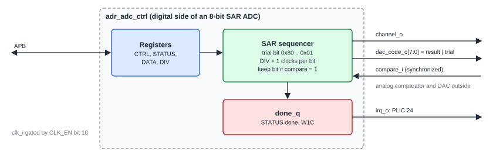
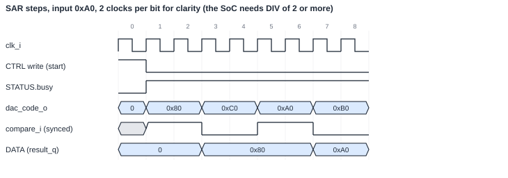

# ADC controller (`adr_adc_ctrl`) datasheet

| | |
|---|---|
| IP name | `adr_adc_ctrl`, controller for an 8-bit successive-approximation ADC |
| Type | ADR IP, our own RTL (digital side only) |
| Version | 1.0 (RTL), document revision 2.0 |
| Status | Verified at SoC level by `misc` (outside the regression); no IP-level bench |
| RTL | `rtl/adr_ip/adc/rtl/adr_adc_ctrl.sv` (one file) |
| SoC instance | `adr_soc_top.i_periph.i_adc` |
| Base address | `0x1001_1000` (APB slot 15, 4 KiB) |
| Interrupt | PLIC source 24, level |
| Owner | Vijay Bogati |
| Date | 2026-11-14 |

### Revision history

| Revision | Date | Change |
|---|---|---|
| 1.0 | 2026-11-08 | First issue, generated from the RTL header |
| 2.0 | 2026-11-14 | Rewritten as a datasheet |

### Conventions

RW read and write; RO read only; WO write only; W1C write 1 to clear. A clock is one rising edge of the ADC clock (the gated system clock). *Derived* marks values worked out from the RTL, not yet measured.

## 1. Introduction

The controller runs the binary search of an 8-bit successive-approximation (SAR) ADC. The analog part (input switch, DAC and comparator) is outside the chip model: the controller selects a channel, drives a DAC code, and reads back one comparator bit per step.

### 1.1 Features

- 8-bit result, 2 input channels.
- Software start, one conversion at a time; busy and done flags; interrupt on done.
- Conversion time 8 x (`DIV` + 1) clocks, `DIV` programmable (reset value 3: 32 clocks, 320 ns at 100 MHz).
- APB slave, zero wait states, never returns an error.

### 1.2 Not supported

- No scan, continuous or triggered mode; no FIFO; no averaging (LIMITATIONS item 60).
- No calibration or offset correction.
- No abort.

## 2. Functional description



### 2.1 Conversion

A write of `CTRL` with `start` = 1 while idle latches the channel, clears `DATA` and `done`, and sets `busy`. Then for each bit from 7 down to 0:

1. `dac_code_o` = result so far OR the trial bit.
2. Wait `DIV` + 1 clocks for the DAC, the comparator and the synchronizer.
3. On the last clock, if `compare_i` = 1 (input at or above the DAC code), keep the trial bit in the result.

After bit 0, `busy` clears and `done` sets. Outside a conversion, `dac_code_o` holds the last result.

### 2.2 Choosing `DIV`

`compare_i` reaches the controller through a 2-flop synchronizer in `adr_periph_subsys`, so the comparator decision arrives 2 clocks after the DAC code changes, plus the analog settling time. `DIV` must be at least 2; larger if the analog side needs more than one clock (10 ns) to settle. `DIV` = 0 or 1 gives wrong results in the SoC. A `DIV` change during a conversion takes effect from the next bit.

## 3. Parameters

None.

## 4. Signal description

| Signal | Dir | Width | Clock | Reset value | Description |
|---|---|---|---|---|---|
| `clk_i` | in | 1 | | | ADC clock: system clock gated by `CLK_EN` bit 10 |
| `rst_ni` | in | 1 | async | | System reset, active low |
| `psel_i`, `penable_i`, `pwrite_i` | in | 1 each | `clk_i` | | APB control |
| `paddr_i` | in | 4 | `clk_i` | | APB byte address, bits 3:0 only |
| `pwdata_i` | in | 32 | `clk_i` | | APB write data |
| `prdata_o` | out | 32 | comb. | | APB read data |
| `pready_o` / `pslverr_o` | out | 1 each | | 1 / 0 | Tied |
| `channel_o` | out | 1 | `clk_i` | 0 | Selected input channel; chip pin `adc_channel_o` |
| `dac_code_o` | out | 8 | comb. of flops | 0 | DAC code under test; chip pin `adc_dac_code_o` |
| `compare_i` | in | 1 | `clk_i` | | Comparator result, already synchronized: 1 = input at or above `dac_code_o` |
| `irq_o` | out | 1 | `clk_i` | 0 | Interrupt, level: `done` AND `irq_en` |

## 5. Clocks and resets

| Item | Value |
|---|---|
| Clock | `clk_i`, gated by `CLK_EN[10]` (`ClkAdc`). Gated mid-conversion, the conversion pauses |
| Reset | System reset |
| Clock-domain crossings | `adc_compare_i` chip pin to `clk_i`: 2-flop `sync` in the parent. `channel_o` and `dac_code_o` go to the analog side, which must treat them as static for `DIV` + 1 clocks |

## 6. Registers

### 6.1 Register map

Base address `0x1001_1000`.

| Offset | Name | Access | Reset value | Description |
|---|---|---|---|---|
| `0x00` | `CTRL` | RW (start WO) | `0x0000_0000` | Start, channel, interrupt enable |
| `0x04` | `STATUS` | RO / W1C | `0x0000_0000` | Busy, done |
| `0x08` | `DATA` | RO | `0x0000_0000` | Result |
| `0x0C` | `DIV` | RW | `0x0000_0003` | Clocks per bit minus 1 |

Only `paddr[3:0]` is decoded: the map repeats every 16 bytes.

### 6.2 `CTRL` (`0x00`)

| Bits | Field | Access | Reset | Description |
|---|---|---|---|---|
| 31:3 | | RO | 0 | Reserved |
| 2 | `irq_en` | RW | 0 | Interrupt when done. **Updated by every `CTRL` write**, including a start |
| 1 | `channel` | RW | 0 | Channel for the next conversion; latched at start, reads the latched value |
| 0 | `start` | WO | | Write 1 to start; ignored while busy. Reads 0 |

### 6.3 `STATUS` (`0x04`)

| Bits | Field | Access | Reset | Description |
|---|---|---|---|---|
| 31:2 | | RO | 0 | Reserved |
| 1 | `done` | RO, W1C | 0 | Conversion finished; cleared by writing 1 or by the next start |
| 0 | `busy` | RO | 0 | Conversion running |

### 6.4 `DATA` (`0x08`)

| Bits | Field | Access | Reset | Description |
|---|---|---|---|---|
| 31:8 | | RO | 0 | Reserved |
| 7:0 | `result` | RO | 0 | Result of the last conversion; valid when `done` = 1. Shows the partial result while busy |

### 6.5 `DIV` (`0x0C`)

| Bits | Field | Access | Reset | Description |
|---|---|---|---|---|
| 31:8 | | RO | 0 | Reserved |
| 7:0 | `div` | RW | 3 | Each bit takes `div` + 1 clocks. Minimum 2 in the SoC (section 2.2) |

## 7. Interrupts

| Interrupt | PLIC source | Type | Set by | Cleared by |
|---|---|---|---|---|
| `irq_o` | 24 | Level | End of a conversion, with `CTRL.irq_en` = 1 | Writing 1 to `STATUS.done`, a new start, or `irq_en` = 0 |

## 8. Programming guide

```c
#define ADC_BASE   0x10011000UL
#define ADC_CTRL   (*(volatile uint32_t *)(ADC_BASE + 0x00))
#define ADC_STATUS (*(volatile uint32_t *)(ADC_BASE + 0x04))
#define ADC_DATA   (*(volatile uint32_t *)(ADC_BASE + 0x08))
#define ADC_DIV    (*(volatile uint32_t *)(ADC_BASE + 0x0C))
```

### 8.1 One conversion, polling

1. If needed, write `ADC_DIV` (at least 2).
2. Write `ADC_CTRL = 1 | (channel << 1)` (bit 2 = 0: no interrupt).
3. Poll until `ADC_STATUS & 2`.
4. Read `ADC_DATA & 0xFF`, then write `ADC_STATUS = 2`.

### 8.2 With the interrupt

Enable PLIC source 24, then start with `ADC_CTRL = 1 | (channel << 1) | 4`. The handler reads `DATA`, writes `STATUS = 2`, then completes the claim. Remember that any later `CTRL` write without bit 2 turns the interrupt off.

## 9. Timing



| Path | Latency |
|---|---|
| Start write to `busy` and the first DAC code | 1 clock |
| Start write to `done` | 8 x (`DIV` + 1) clocks (*derived*) |
| DAC code to comparator decision sampled | `DIV` + 1 clocks, of which 2 are the synchronizer |

## 10. Integration

| Item | Detail |
|---|---|
| Parent | `adr_periph_subsys` |
| APB | Slot `SlotAdc` = 15, `paddr[3:0]` |
| Clock gate | `CLK_EN[10]` |
| Pins | `adc_channel_o`, `adc_dac_code_o[7:0]`, `adc_compare_i` (through `i_adc_compare_sync`) |
| Interrupt | `IrqAdc` = 24 |
| Analog side | On the benches: a one-line comparator in `tb_adr_soc` (channel 0 = 0x5A, channel 1 = 0xC3), or the UVM ADC agent's levels |

## 11. Verification

| Item | Status |
|---|---|
| SoC tests | `misc` (MISC-02: both channels give the expected value, fastest divider, done clears, interrupt), outside the regression |
| Planned | Cover group `cg_adc`; assertions ADC-A01, ADC-A02 |
| Not tested | Start while busy; `DIV` change during a conversion; codes 0x00 and 0xFF |

## 12. Known limitations

| Item | Limitation | Effect |
|---|---|---|
| LIMITATIONS 60 | 8 bits, 2 channels, manual start | Software starts each conversion |
| | `irq_en` shares the `CTRL` register with start | Every start must repeat the interrupt choice |

## 13. References

- `docs/MICROARCHITECTURE.md` section 13.7.
- [`../adr_soc/adr_periph_subsys.md`](../adr_soc/adr_periph_subsys.md), [`../protocols/APB.md`](../protocols/APB.md).
