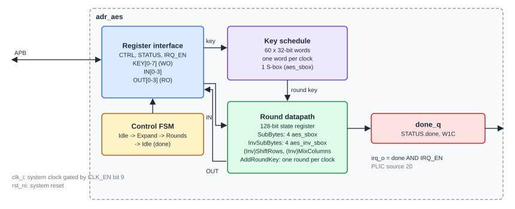
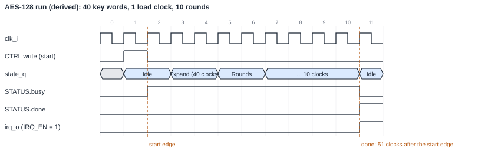

# AES engine (`adr_aes`) datasheet

| | |
|---|---|
| IP name | `adr_aes`, AES block cipher engine |
| Type | ADR IP, our own RTL, written from FIPS-197; S-boxes from `aes_sbox` (third party) |
| Version | 1.0 (RTL), document revision 2.0 |
| Status | Verified at SoC level with FIPS-197 vectors (RTL and gate-level smoke); no IP-level bench |
| RTL | `rtl/adr_ip/aes/rtl/adr_aes.sv`; sub-modules `aes_sbox`, `aes_inv_sbox` (`rtl/third_party_ip/aes_sbox/`) |
| SoC instance | `adr_soc_top.i_periph.i_aes` |
| Base address | `0x1000_B000` (APB slot 10, 4 KiB) |
| Interrupt | PLIC source 20, level |
| Owner | Vijay Bogati |
| Date | 2026-11-14 |

### Revision history

| Revision | Date | Change |
|---|---|---|
| 1.0 | 2026-11-08 | First issue, generated from the RTL header |
| 2.0 | 2026-11-14 | Rewritten as a datasheet |

### Conventions

RW read and write; RO read only; WO write only (reads 0); W1C write 1 to clear. A clock is one rising edge of the AES clock (the gated system clock, 10 ns). *Derived* marks values worked out from the RTL, not yet measured.

## 1. Introduction

`adr_aes` encrypts or decrypts one 128-bit block with the AES algorithm of FIPS-197. Software writes the key and the input block, starts the engine, and reads the result when it is done.

### 1.1 Features

- AES-128, AES-192 and AES-256; encryption and decryption with the same cipher key (the engine builds the schedule and runs it backwards for decryption).
- One round per clock; the key schedule is built at each start, one word per clock.
- Fixed latency: 51, 59 or 67 clocks for 128, 192 or 256-bit keys (*derived*), independent of the data.
- Key registers are write-only.
- Done flag with interrupt enable.
- APB slave, zero wait states, never returns an error.

### 1.2 Not supported

- Single blocks only: no ECB/CBC/CTR/GCM chaining, no DMA path, no FIFO (LIMITATIONS item 45).
- No side-channel countermeasures (no masking); the key schedule stays in registers after use, with no clear command (item 46).
- No abort: a run always finishes.
- No byte writes: PSTRB is not used.

## 2. Functional description



### 2.1 Operation

| State | Clocks | What happens |
|---|---|---|
| Idle | | Waits for `CTRL.start`. Register writes accepted |
| Expand | Nr x 4 + 4 - Nk, then 1 | Copies `KEY[0..7]` into the schedule, then computes one schedule word per clock (FIPS-197 section 5.2). On the last clock loads the block: `IN[0..3]` XOR the first round key (round key 0, or round key Nr for decryption) |
| Rounds | Nr | One full round per clock. The last round has no MixColumns. Then `STATUS.done` is set and the engine returns to Idle |

| Key size | `CTRL.key_size` | Nk (key words) | Nr (rounds) | Clocks from start to done (*derived*) |
|---|---|---|---|---|
| 128 | 0 (or 3) | 4 | 10 | 40 + 1 + 10 = 51 |
| 192 | 1 | 6 | 12 | 46 + 1 + 12 = 59 |
| 256 | 2 | 8 | 14 | 52 + 1 + 14 = 67 |

At 100 MHz, AES-128 takes 510 ns per block, about 250 Mbit/s, not counting the APB accesses to load and read the block.

### 2.2 Byte order

Key and data words are in FIPS-197 byte order: word 0 holds the first four bytes, and within a word the first byte is the most significant. For the FIPS-197 appendix C.1 key `000102...0f`, `KEY[0]` = `0x0001_0203`. 192-bit keys use `KEY[0..5]`, 128-bit keys `KEY[0..3]`; the other words are ignored.

### 2.3 What software must not do while busy

A start while busy is ignored. Writes to `KEY` and `IN` while busy are accepted: a write to `KEY` does not affect the running block (the key was copied at start), but **a write to `IN` during the Expand state changes the block being processed**, as `IN` is read at the end of Expand. `OUT` shows the intermediate state while busy.

### 2.4 State after reset

Idle, not done, interrupt disabled, all key, input, schedule and state registers 0.

## 3. Parameters

None.

## 4. Signal description

| Signal | Dir | Width | Clock | Reset value | Description |
|---|---|---|---|---|---|
| `clk_i` | in | 1 | | | AES clock: the system clock gated by `CLK_EN` bit 9 |
| `rst_ni` | in | 1 | async | | System reset, active low |
| `psel_i`, `penable_i`, `pwrite_i` | in | 1 each | `clk_i` | | APB control |
| `paddr_i` | in | 7 | `clk_i` | | APB byte address, bits 6:0 only |
| `pwdata_i` | in | 32 | `clk_i` | | APB write data |
| `prdata_o` | out | 32 | comb. | | APB read data |
| `pready_o` / `pslverr_o` | out | 1 each | | 1 / 0 | Tied |
| `irq_o` | out | 1 | `clk_i` | 0 | Interrupt, level: `STATUS.done` AND `IRQ_EN.enable` |

## 5. Clocks and resets

| Item | Value |
|---|---|
| Clock | `clk_i`, gated in `adr_periph_subsys` by `CLK_EN[9]` (`ClkAes`). Gated, a run stops and resumes when the clock returns; the bridge answers APB accesses with an error meanwhile |
| Reset | `rst_ni`, system reset, asynchronous assert |
| Clock-domain crossings | None |
| Storage | About 2,460 flops (*derived*: 60 x 32 schedule, 8 x 32 key, 4 x 32 input, 128 state, 25 control), no memories |

## 6. Registers

### 6.1 Register map

Base address `0x1000_B000`.

| Offset | Name | Access | Reset value | Description |
|---|---|---|---|---|
| `0x00` | `CTRL` | WO | (reads 0) | Start, direction, key size |
| `0x04` | `STATUS` | RO / W1C | `0x0000_0000` | Busy, done |
| `0x08` | `IRQ_EN` | RW | `0x0000_0000` | Interrupt enable |
| `0x0C` | | | reads 0 | Reserved |
| `0x10`-`0x2C` | `KEY0`-`KEY7` | WO | (reads 0) | Cipher key words |
| `0x30`-`0x3C` | `IN0`-`IN3` | RW | `0x0000_0000` | Input block |
| `0x40`-`0x4C` | `OUT0`-`OUT3` | RO | `0x0000_0000` | Output block |
| `0x50`-`0x7C` | | | reads 0 | Reserved |

Only `paddr[6:0]` is decoded: the map repeats every 128 bytes across the slot.

### 6.2 `CTRL` (`0x00`)

| Bits | Field | Access | Reset | Description |
|---|---|---|---|---|
| 31:4 | | WO | | Ignored |
| 3:2 | `key_size` | WO | 0 | 0 = 128, 1 = 192, 2 = 256 bits; 3 is taken as 128. Sampled at start |
| 1 | `decrypt` | WO | 0 | 0 = encrypt, 1 = decrypt. Sampled at start |
| 0 | `start` | WO | | Write 1 to start; ignored while busy. Also clears `STATUS.done` |

### 6.3 `STATUS` (`0x04`)

| Bits | Field | Access | Reset | Description |
|---|---|---|---|---|
| 31:2 | | RO | 0 | Reserved |
| 1 | `done` | RO, W1C | 0 | Set when a run ends; cleared by writing 1 or by the next start |
| 0 | `busy` | RO | 0 | 1 from the start until the end of the last round |

### 6.4 `IRQ_EN` (`0x08`)

| Bits | Field | Access | Reset | Description |
|---|---|---|---|---|
| 31:1 | | RO | 0 | Reserved |
| 0 | `enable` | RW | 0 | 1 = interrupt while `STATUS.done` is set |

### 6.5 `KEYn` (`0x10 + 4n`, n = 0..7)

| Bits | Field | Access | Reset | Description |
|---|---|---|---|---|
| 31:0 | `key` | WO | 0 | Key word n, FIPS-197 byte order (section 2.2). Reads return 0 |

### 6.6 `INn` (`0x30 + 4n`, n = 0..3)

| Bits | Field | Access | Reset | Description |
|---|---|---|---|---|
| 31:0 | `data` | RW | 0 | Input block word n: plaintext to encrypt or ciphertext to decrypt |

### 6.7 `OUTn` (`0x40 + 4n`, n = 0..3)

| Bits | Field | Access | Reset | Description |
|---|---|---|---|---|
| 31:0 | `data` | RO | 0 | Result word n, valid while `STATUS.done` is set; kept until the next start |

## 7. Interrupts

| Interrupt | PLIC source | Type | Set by | Cleared by |
|---|---|---|---|---|
| `irq_o` | 20 | Level | End of a run, with `IRQ_EN.enable` = 1 | Writing 1 to `STATUS.done`, a new start, or `IRQ_EN` = 0 |

## 8. Programming guide

As in `tb/verilator/c_tests/aes.c`:

```c
#define AES_BASE   0x1000B000UL
#define AES(off)   (*(volatile uint32_t *)(AES_BASE + (off)))
#define AES_CTRL   AES(0x00)
#define AES_STATUS AES(0x04)
#define AES_IRQ_EN AES(0x08)
#define AES_KEY(i) AES(0x10 + 4 * (i))
#define AES_IN(i)  AES(0x30 + 4 * (i))
#define AES_OUT(i) AES(0x40 + 4 * (i))
```

### 8.1 One block, polling

1. Wait until `STATUS.busy` = 0.
2. Write `KEY(0..Nk-1)` and `IN(0..3)`.
3. Write `CTRL = 1 | (decrypt << 1) | (key_size << 2)`.
4. Poll until `STATUS.done` = 1 (at most 67 clocks).
5. Read `OUT(0..3)`, then write `STATUS = 2` to clear done.

### 8.2 With the interrupt

Enable PLIC source 20 and write `IRQ_EN = 1` once. After step 3, the handler reads `OUT`, writes `STATUS = 2`, then completes the claim.

### 8.3 Several blocks with the same key

Write the key once. For each block: write `IN`, start, wait, read `OUT`. The schedule is rebuilt each time (40 to 52 clocks per block), so the key need not be written again.

### 8.4 After use

There is no clear command. To remove the key from the chip, write zeros to all `KEY` registers and run one block (this overwrites the schedule).

## 9. Timing



| Path | Latency |
|---|---|
| Start write to `STATUS.busy` | 1 clock |
| Start write to `STATUS.done` and `irq_o` | 51 / 59 / 67 clocks (*derived*) |
| `STATUS` write to `irq_o` low | 1 clock |

## 10. Integration

| Item | Detail |
|---|---|
| Parent | `adr_periph_subsys` |
| APB | Slot `SlotAes` = 10, `paddr[6:0]` |
| Clock gate | `CLK_EN[9]` (`ClkAes`), `pulp_clock_gating` in `adr_periph_subsys` |
| Interrupt | `IrqAes` = 20 |
| Timing | The longest path is one full round: S-box, ShiftRows, MixColumns and the round-key XOR, in one clock. It is the critical path of the block; the gate-level netlist meets zero-delay simulation only, no timing analysis yet |
| Area | About 2,460 flops and 9 S-boxes (LIMITATIONS item 47) |

## 11. Verification

| Item | Status |
|---|---|
| SoC tests | `aes` (AES-01: FIPS-197 C.1, C.2, C.3 and B vectors, each encrypted and decrypted; AES-02 to 04: busy, done, key not readable, different key, interrupt) |
| Benches | All three benches |
| Planned | `aes_kat` (NEW-15); assertion AES-A01 |
| Not tested | Start while busy; `IN` write during Expand; key size 3; gating during a run |

## 12. Known limitations

| Item | Limitation | Effect |
|---|---|---|
| LIMITATIONS 45 | Single blocks only | Chaining and data movement in software |
| LIMITATIONS 46 | No side-channel protection; key schedule kept | Not for high-security key handling |
| LIMITATIONS 47 | 60-word key schedule in flops | Large area |
| LIMITATIONS 48 | 4 published vectors tested | No KAT or Monte Carlo suite yet |
| | `IN` writes during Expand affect the running block | Software must wait for `busy` = 0 |

## 13. References

- FIPS-197, Advanced Encryption Standard.
- `docs/MICROARCHITECTURE.md` section 13.2.
- [`../third_party_ip/secworks_aes/ADR.md`](../third_party_ip/secworks_aes/ADR.md) (S-boxes), [`../adr_soc/adr_periph_subsys.md`](../adr_soc/adr_periph_subsys.md), [`../protocols/APB.md`](../protocols/APB.md).
