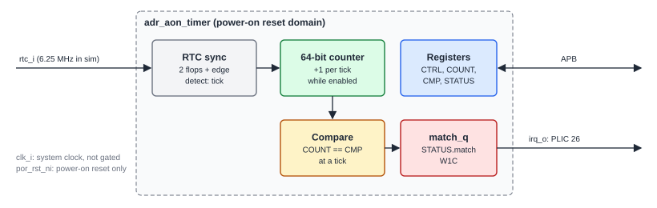
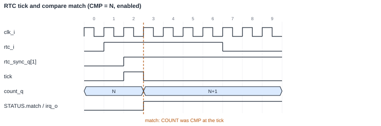

# Always-on timer (`adr_aon_timer`) datasheet

| | |
|---|---|
| IP name | `adr_aon_timer`, always-on timer |
| Type | ADR IP, our own RTL |
| Version | 1.0 (RTL), document revision 2.0 |
| Status | Verified at SoC level by `misc` (outside the regression); no IP-level bench |
| RTL | `rtl/adr_ip/aon_timer/rtl/adr_aon_timer.sv` (one file) |
| SoC instance | `adr_soc_top.i_periph.i_aon_timer` |
| Base address | `0x1001_3000` (APB slot 17, 4 KiB) |
| Interrupt | PLIC source 26, level |
| Owner | Vijay Bogati |
| Date | 2026-11-14 |

### Revision history

| Revision | Date | Change |
|---|---|---|
| 1.0 | 2026-11-08 | First issue, generated from the RTL header |
| 2.0 | 2026-11-14 | Rewritten as a datasheet |

### Conventions

RW read and write; RO read only; W1C write 1 to clear. A clock is one rising edge of `clk_i`; a tick is one rising edge of `rtc_i`. *Derived* marks values worked out from the RTL, not yet measured.

## 1. Introduction

A 64-bit timer that counts ticks of the slow real-time clock and raises an interrupt when it passes a compare value. It is on the power-on reset, so its count, compare value and enable survive watchdog, software and debug resets: software can measure time across a reset, or schedule a wake-up event that a reset does not cancel.

### 1.1 Features

- 64-bit up counter, one count per rising edge of `rtc_i` (6.25 MHz in simulation; a 32.768 kHz crystal on a real board).
- 64-bit compare value; sticky match flag drives the interrupt.
- `rtc_i` synchronized to the system clock inside the block.
- All state on the power-on reset.
- APB slave, zero wait states, never returns an error.

### 1.2 Not supported

- "Always-on" refers to the reset only: the block uses the system clock and has no separate power domain or clock. If the system clock stops, it stops counting (`MICROARCHITECTURE.md` section 7).
- The count cannot be written or cleared by software; only a power-on reset clears it.
- No atomic 64-bit read (section 8.2).
- No periodic mode: the compare value must be moved by software after each match.

## 2. Functional description



### 2.1 Tick

`rtc_i` passes through two flops; a third flop detects its rising edge, giving a one-clock `tick` 2 to 3 clocks after the edge. `rtc_i` must stay high and low for at least 2 system clocks each, so its frequency must be below a quarter of the system clock (*derived*).

### 2.2 Count and match

While `CTRL.enable` is 1, each tick adds 1 to `COUNT`. If `COUNT` equals `CMP` at the tick, `STATUS.match` is set; so the match is seen as `COUNT` moves from `CMP` to `CMP + 1`. A match is only detected at a tick while enabled: writing a `CMP` value below the current count gives no match until the counter wraps (after 2^64 ticks).

`STATUS.match` stays set until written with 1. If a clear and a new match come on the same clock, the match wins.

### 2.3 State after reset

| Reset | Effect |
|---|---|
| Power-on | Disabled, `COUNT` = 0, `CMP` = all-ones, no match |
| System (watchdog, software, debug) | None: the block keeps counting, and a pending match keeps its interrupt line high. The PLIC is reset, so software sees the pending source after it re-enables it |

## 3. Parameters

None.

## 4. Signal description

| Signal | Dir | Width | Clock | Reset value | Description |
|---|---|---|---|---|---|
| `clk_i` | in | 1 | | | System clock, not gated |
| `por_rst_ni` | in | 1 | async | | Power-on reset, active low |
| `rtc_i` | in | 1 | async | | Slow clock to count; synchronized inside |
| `psel_i`, `penable_i`, `pwrite_i` | in | 1 each | `clk_i` | | APB control |
| `paddr_i` | in | 5 | `clk_i` | | APB byte address, bits 4:0 only |
| `pwdata_i` | in | 32 | `clk_i` | | APB write data |
| `prdata_o` | out | 32 | comb. | | APB read data |
| `pready_o` / `pslverr_o` | out | 1 each | | 1 / 0 | Tied |
| `irq_o` | out | 1 | `clk_i` | 0 | Interrupt, level: `STATUS.match` |

## 5. Clocks and resets

| Item | Value |
|---|---|
| Clock | `clk_i`, not gated |
| Reset | `por_rst_ni` only |
| Clock-domain crossings | `rtc_i` to `clk_i`: 2-flop synchronizer plus edge detector; a single bit, so no further constraint |

## 6. Registers

### 6.1 Register map

Base address `0x1001_3000`. All registers are on the power-on reset.

| Offset | Name | Access | Reset value | Description |
|---|---|---|---|---|
| `0x00` | `CTRL` | RW | `0x0000_0000` | Enable |
| `0x04` | `COUNT_LO` | RO | `0x0000_0000` | Count, bits 31:0 |
| `0x08` | `COUNT_HI` | RO | `0x0000_0000` | Count, bits 63:32 |
| `0x0C` | `CMP_LO` | RW | `0xFFFF_FFFF` | Compare, bits 31:0 |
| `0x10` | `CMP_HI` | RW | `0xFFFF_FFFF` | Compare, bits 63:32 |
| `0x14` | `STATUS` | RW, W1C | `0x0000_0000` | Match flag |
| `0x18`-`0x1C` | | | reads 0 | Reserved |

Only `paddr[4:0]` is decoded: the map repeats every 32 bytes.

### 6.2 Fields

| Register | Bits | Field | Access | Reset | Description |
|---|---|---|---|---|---|
| `CTRL` | 0 | `enable` | RW | 0 | 1 = count ticks. 31:1 reserved |
| `COUNT_LO` / `COUNT_HI` | 31:0 | `count` | RO | 0 | Current count; the two halves are read separately |
| `CMP_LO` / `CMP_HI` | 31:0 | `cmp` | RW | all-ones | Compare value; each half written on its own |
| `STATUS` | 0 | `match` | RW, W1C | 0 | Set when the count passes `CMP`. 31:1 reserved |

## 7. Interrupts

| Interrupt | PLIC source | Type | Set by | Cleared by |
|---|---|---|---|---|
| `irq_o` | 26 | Level | A match | Writing 1 to `STATUS.match` (there is no enable bit: mask it in the PLIC) |

## 8. Programming guide

```c
#define AON_BASE   0x10013000UL
#define AON(off)   (*(volatile uint32_t *)(AON_BASE + (off)))
#define AON_CTRL   AON(0x00)
#define AON_CNT_LO AON(0x04)
#define AON_CNT_HI AON(0x08)
#define AON_CMP_LO AON(0x0C)
#define AON_CMP_HI AON(0x10)
#define AON_STATUS AON(0x14)
```

### 8.1 Start once after power-on

Check `CTRL.enable`. If 0, this is the first boot after power-on: write `AON_CTRL = 1`. After a system reset it is already running; do not touch it.

### 8.2 Reading the 64-bit count

```c
uint32_t hi, lo;
do { hi = AON_CNT_HI; lo = AON_CNT_LO; } while (hi != AON_CNT_HI);
```

### 8.3 Event after `n` ticks

1. Read the count `c` (section 8.2).
2. Write `AON_CMP_HI = 0xFFFFFFFF` first, so no false match can happen between the two halves, then `AON_CMP_LO = (c + n)` low half, then `AON_CMP_HI` = high half.
3. Write `AON_STATUS = 1`, then enable PLIC source 26.
4. In the handler: write `AON_STATUS = 1`, move `CMP` if another event is wanted, then complete the claim.

## 9. Timing



| Path | Latency |
|---|---|
| `rtc_i` rising edge to the count changing | 2 to 3 clocks |
| Tick with `COUNT` = `CMP` to `irq_o` | 1 clock |

## 10. Integration

| Item | Detail |
|---|---|
| Parent | `adr_periph_subsys` |
| APB | Slot `SlotAon` = 17, `paddr[4:0]` |
| `rtc_i` | Chip pin `rtc_i`, shared with the CLINT's time base |
| `por_rst_ni` | Chip pin `rst_ni` |
| Interrupt | `IrqAon` = 26 |
| Timing | Single-cycle; the 64-bit compare and increment are the longest paths |

## 11. Verification

| Item | Status |
|---|---|
| SoC tests | `misc` (MISC-04: stopped at reset, counts, no match before, match interrupt, status; MISC-06: kept enabled and counting through a system reset), outside the regression |
| Benches | Verilator; UVM bench when `misc` is run |
| Not tested | 64-bit carry (count above 2^32); torn reads; clear and match on the same clock |

## 12. Known limitations

| Limitation | Effect |
|---|---|
| Not on its own clock or power domain | Stops with the system clock |
| No interrupt enable bit | Mask at the PLIC |
| Not covered by the regression | Changes are only checked when `misc` is run |

## 13. References

- `docs/MICROARCHITECTURE.md` sections 6.4, 13.9.
- [`../adr_soc/adr_periph_subsys.md`](../adr_soc/adr_periph_subsys.md), [`../protocols/APB.md`](../protocols/APB.md).
