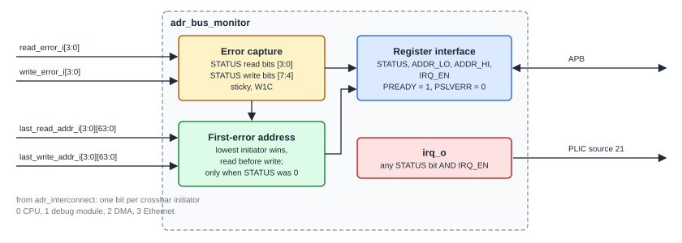
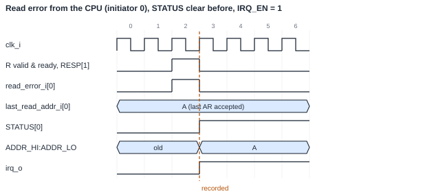

# Bus error monitor (`adr_bus_monitor`) datasheet

| | |
|---|---|
| IP name | `adr_bus_monitor`, bus error monitor |
| Type | ADR IP, our own RTL |
| Version | 1.0 (RTL), document revision 2.0 |
| Status | Verified at SoC level (RTL and gate-level smoke); no IP-level bench |
| RTL | `rtl/adr_ip/bus_monitor/rtl/adr_bus_monitor.sv` (one file) |
| SoC instance | `adr_soc_top.i_periph.i_bus_monitor` |
| Base address | `0x1000_C000` (APB slot 11, 4 KiB) |
| Interrupt | PLIC source 21, level |
| Owner | Vijay Bogati |
| Date | 2026-11-14 |

### Revision history

| Revision | Date | Change |
|---|---|---|
| 1.0 | 2026-11-08 | First issue, generated from the RTL header |
| 2.0 | 2026-11-14 | Rewritten as a datasheet |

### Conventions

RW read and write; RO read only; W1C write 1 to clear. A clock is one rising edge of `clk_i`. *Derived* marks values worked out from the RTL, not yet measured.

## 1. Introduction

The CVA6 CPU does not trap on AXI error responses: a load from a bad address completes with fixed error data. The bus error monitor watches the read and write responses of every initiator on the crossbar, records which one got an error and the address of the first error, and can raise an interrupt, so software can find wild pointers and failed DMA or Ethernet transfers.

### 1.1 Features

- One read and one write error flag per crossbar initiator (4 initiators: CPU, debug module, DMA, Ethernet).
- Address of the first error since the flags were last all clear, 64 bits.
- Interrupt while any flag is set, with an enable.
- Errors are SLVERR and DECERR responses (`RESP[1]` = 1), from any target: the crossbar's error target (unmapped addresses), the APB bridge (empty or gated slots), or a target.
- APB slave, zero wait states, never returns an error.

### 1.2 Not supported

- No trap: the interrupt arrives after the failing instruction has completed (LIMITATIONS item 1).
- No error count, no ID, no transaction type beyond read or write.
- At most 4 initiators with this register layout (LIMITATIONS item 111).
- The address may belong to a neighbouring transfer when several are outstanding (section 2.2).

## 2. Functional description



### 2.1 Error flags

`adr_interconnect` gives one pulse per accepted response beat with `RESP[1]` set: `read_error_i[i]` for an R beat, `write_error_i[i]` for a B response, at initiator port `i`. Each pulse sets the matching `STATUS` bit on the next clock. Bits stay set until written with 1. A clear and a new error of the same bit on the same clock leave the bit set. A read burst with several error beats sets the bit once.

### 2.2 Address capture

`adr_interconnect` also keeps, per initiator, the address of its last accepted AR (`last_read_addr_i`) and AW (`last_write_addr_i`). When an error arrives and **all `STATUS` bits are clear**, that address is stored in `ADDR`. Further errors do not change it until software clears every bit. If several initiators report an error on the same clock, the lowest-numbered one wins, and at one initiator a read error wins over a write error.

The address is the last one the initiator issued on that channel, not necessarily the one that failed: with several transfers outstanding (DMA and Ethernet bursts) it may be the next transfer's address. For the CPU, which has few outstanding accesses, it is normally exact.

`ADDR` is not cleared when `STATUS` is cleared; it keeps the old address until the next first error.

### 2.3 Interrupt

`irq_o` = (any `STATUS` bit set) AND `IRQ_EN.enable`. It is a level: clearing `STATUS` or `IRQ_EN` removes it.

## 3. Parameters

| Parameter | Type | Default | SoC value | Description |
|---|---|---|---|---|
| `NumInitiators` | `int unsigned` | 4 | 4 (`NumInitiators` in `adr_soc_pkg`) | Number of initiators watched. The register layout allows at most 4 |

## 4. Signal description

| Signal | Dir | Width | Clock | Reset value | Description |
|---|---|---|---|---|---|
| `clk_i` | in | 1 | | | System clock, not gated |
| `rst_ni` | in | 1 | async | | System reset, active low |
| `psel_i`, `penable_i`, `pwrite_i` | in | 1 each | `clk_i` | | APB control |
| `paddr_i` | in | 4 | `clk_i` | | APB byte address, bits 3:0 only |
| `pwdata_i` | in | 32 | `clk_i` | | APB write data |
| `prdata_o` | out | 32 | comb. | | APB read data |
| `pready_o` / `pslverr_o` | out | 1 each | | 1 / 0 | Tied |
| `read_error_i` | in | `NumInitiators` | `clk_i` | | One-clock pulse per R beat accepted with SLVERR or DECERR |
| `write_error_i` | in | `NumInitiators` | `clk_i` | | One-clock pulse per B response accepted with SLVERR or DECERR |
| `last_read_addr_i` | in | `NumInitiators` x 64 | `clk_i` | | Address of each initiator's last accepted AR |
| `last_write_addr_i` | in | `NumInitiators` x 64 | `clk_i` | | Address of each initiator's last accepted AW |
| `irq_o` | out | 1 | comb. of flops | 0 | Interrupt, level |

## 5. Clocks and resets

One clock, `clk_i`, not gated; system reset `rst_ni`; no clock-domain crossing. All flops have a reset.

## 6. Registers

### 6.1 Register map

Base address `0x1000_C000`.

| Offset | Name | Access | Reset value | Description |
|---|---|---|---|---|
| `0x00` | `STATUS` | RW, W1C | `0x0000_0000` | Error flags |
| `0x04` | `ADDR_LO` | RO | `0x0000_0000` | First error address, bits 31:0 |
| `0x08` | `ADDR_HI` | RO | `0x0000_0000` | First error address, bits 63:32 |
| `0x0C` | `IRQ_EN` | RW | `0x0000_0000` | Interrupt enable |

Only `paddr[3:0]` is decoded: the map repeats every 16 bytes across the slot. PSTRB is not used.

### 6.2 `STATUS` (`0x00`)

| Bits | Field | Access | Reset | Description |
|---|---|---|---|---|
| 31:8 | | RO | 0 | Reserved |
| 7 | `write_eth` | RW, W1C | 0 | Ethernet (initiator 3) got a write error |
| 6 | `write_dma` | RW, W1C | 0 | DMA (initiator 2) got a write error |
| 5 | `write_debug` | RW, W1C | 0 | Debug module (initiator 1) got a write error |
| 4 | `write_cpu` | RW, W1C | 0 | CPU (initiator 0) got a write error |
| 3 | `read_eth` | RW, W1C | 0 | Ethernet got a read error |
| 2 | `read_dma` | RW, W1C | 0 | DMA got a read error |
| 1 | `read_debug` | RW, W1C | 0 | Debug module got a read error |
| 0 | `read_cpu` | RW, W1C | 0 | CPU got a read error |

### 6.3 `ADDR_LO` (`0x04`), `ADDR_HI` (`0x08`)

| Register | Bits | Field | Access | Reset | Description |
|---|---|---|---|---|---|
| `ADDR_LO` | 31:0 | `addr_lo` | RO | 0 | Address of the first error, low half (section 2.2) |
| `ADDR_HI` | 31:0 | `addr_hi` | RO | 0 | High half |

### 6.4 `IRQ_EN` (`0x0C`)

| Bits | Field | Access | Reset | Description |
|---|---|---|---|---|
| 31:1 | | RO | 0 | Reserved |
| 0 | `enable` | RW | 0 | 1 = interrupt while any `STATUS` bit is set |

## 7. Interrupts

| Interrupt | PLIC source | Type | Set by | Cleared by |
|---|---|---|---|---|
| `irq_o` | 21 | Level | Any `STATUS` bit set with `IRQ_EN.enable` = 1 | Clearing all `STATUS` bits, or `IRQ_EN` = 0 |

## 8. Programming guide

```c
#define BUSMON_BASE   0x1000C000UL
#define BUSMON_STATUS (*(volatile uint32_t *)(BUSMON_BASE + 0x00))
#define BUSMON_ADDR_LO (*(volatile uint32_t *)(BUSMON_BASE + 0x04))
#define BUSMON_ADDR_HI (*(volatile uint32_t *)(BUSMON_BASE + 0x08))
#define BUSMON_IRQ_EN (*(volatile uint32_t *)(BUSMON_BASE + 0x0C))
```

### 8.1 Set-up

1. Write `BUSMON_STATUS = 0xFF` to clear old errors.
2. Enable PLIC source 21, then write `BUSMON_IRQ_EN = 1`.

### 8.2 Interrupt handler

1. Claim the PLIC.
2. Read `STATUS`, then `ADDR_HI` and `ADDR_LO`. Report or act on them.
3. Write the `STATUS` value read back to `STATUS`.
4. Complete the claim. If another error came in meanwhile, its bit is still set and the interrupt fires again; its address was not recorded (only the first one is).

### 8.3 Checking an access by polling

Clear `STATUS`, do the access, read `STATUS`. A load from a bad address returns `0xCA11_AB1E_BADC_AB1E` (unmapped) or `0xDEA1_10C8` (empty or gated APB slot); `STATUS` tells it apart from real data with that value.

## 9. Timing



| Path | Latency |
|---|---|
| Error response accepted to `STATUS`, `ADDR`, `irq_o` | 1 clock |
| `STATUS` write to `irq_o` low | 1 clock |

## 10. Integration

| Item | Detail |
|---|---|
| Parent | `adr_periph_subsys` |
| APB | Slot `SlotBusMon` = 11, `paddr[3:0]` |
| Error inputs | `adr_interconnect` outputs `read_error_o`, `write_error_o`, `last_read_addr_o`, `last_write_addr_o`, taken at the crossbar's initiator ports |
| Initiator order | 0 CPU, 1 debug module, 2 DMA, 3 Ethernet, as in the crossbar |
| Interrupt | `IrqBusMon` = 21 |
| Timing | The 64-bit address inputs are registered in `adr_interconnect`; single-cycle paths |
| Adding an initiator | Needs a new register layout (LIMITATIONS item 111) |

## 11. Verification

| Item | Status |
|---|---|
| SoC tests | `sys` (SYS-01 to SYS-03: read, write, empty slot, first address kept, clear, interrupt, settings reset), `eth` (ETH-05), `dma` (DMA-05) |
| Benches | All three benches |
| Planned | Assertion BUSMON-A01; AXI response coverage `cg_axi_port` |
| Not tested | Errors from two initiators on the same clock; error and clear on the same clock; debug-module errors |

## 12. Known limitations

| Item | Limitation | Effect |
|---|---|---|
| LIMITATIONS 1 | Bus errors do not trap the CPU | Software sees the error after the instruction finished |
| LIMITATIONS 69 | An Ethernet transmit bus error still sends a frame | The monitor records it, but the frame has already left |
| LIMITATIONS 111 | At most 4 initiators | A fifth bus master needs a new layout |
| | The address may be a neighbouring transfer's | Use the address as a hint for DMA and Ethernet errors |

## 13. References

- `docs/MICROARCHITECTURE.md`: section 4.3 (error responses), 13.4.
- [`../adr_soc/adr_interconnect.md`](../adr_soc/adr_interconnect.md), [`../protocols/AXI4.md`](../protocols/AXI4.md), [`../protocols/APB.md`](../protocols/APB.md).
