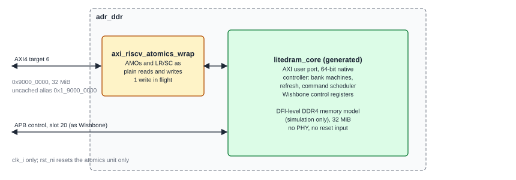

# DDR4 memory subsystem (`adr_ddr`) datasheet

| | |
|---|---|
| IP name | `adr_ddr`, DDR4 memory controller with AXI4 port (simulation model) |
| Type | ADR IP: our own wrapper around a generated LiteDRAM core and the PULP `axi_riscv_atomics_wrap` |
| Version | 1.1 (RTL), document revision 2.2 |
| Status | Verified at SoC level (`ddr` in the regression) on the DFI-level memory model; **not usable on silicon or FPGA as generated** |
| RTL | `rtl/adr_ip/ddr/rtl/adr_ddr.sv`; generated core `rtl/third_party_ip/ddr/` (`litedram_core`, `csr.csv`) |
| SoC instance | `adr_soc_top.i_mem.i_ddr` |
| Memory | Crossbar target 6: `0x9000_0000`, 32 MiB; uncached alias `0x1_9000_0000` |
| Control registers | `0x1002_0000`, 64 KiB (APB slot 20) |
| Interrupt | None |
| Owner | Vijay Bogati |
| Date | 2026-11-14 |

### Revision history

| Revision | Date | Change |
|---|---|---|
| 1.0 | 2026-11-08 | First issue, generated from the RTL header |
| 2.0 | 2026-11-14 | Rewritten as a datasheet |
| 2.1 | 2026-11-15 | Drain gate `adr_ddr_drain` before a warm reset; ports `drain_i`, `idle_o` |
| 2.2 | 2026-11-15 | `pslverr_o` is never set (core ties Wishbone `err` to 0); control-port bus timeout described |

### Conventions

RW read and write; RO read only. A clock is one rising edge of `clk_i`. *Derived* marks values worked out from the RTL, not yet measured.

## 1. Introduction

`adr_ddr` gives the SoC 32 MiB of DDR4 memory on the AXI4 fabric. It contains a LiteDRAM controller generated by `scripts/gen_ddr.py`, which here includes LiteDRAM's DFI-level DDR4 model in place of a PHY and memory device, and an atomics unit so the CPU's AMO and LR/SC instructions work on DDR4. The controller starts by itself after power-up; software has no initialisation to do.

### 1.1 Features

- 32 MiB DDR4 (reduced geometry for simulation), 64-bit native data path matching the bus (no width converter).
- AXI4 target with bursts; byte strobes.
- RISC-V atomics (AMO, LR/SC) through `axi_riscv_atomics_wrap`.
- Cached at `0x9000_0000`, uncached through the alias at `0x1_9000_0000` (decoded by the crossbar).
- Executable: the CPU can run code from DDR4.
- Controller starts under hardware control; `init_done` is set in the model.
- LiteDRAM control and status registers over APB (as Wishbone).

### 1.2 Not supported

- A real PHY, memory device, clock or init sequence (LIMITATIONS item 72).
- Reset of the controller by a system reset (item 73).
- LPDDR4 (item 92). ECC. Self-refresh or power-down control.
- Clock gating; the model is always built (item 101).

## 2. Functional description

### 2.1 Data path

Crossbar target 6 → `adr_ddr_drain` → `axi_riscv_atomics_wrap` → LiteDRAM AXI user port → controller (bank machines, refresh, scheduler) → DFI → memory model. Only address bits 24:0 reach the core (`AddrBits` = 25); the crossbar decodes the region, so no address outside the 32 MiB reaches it. An access just past the end goes to the crossbar's error target (`ddr` test, DDR-02).

### 2.2 Atomics

The atomics unit turns AXI atomic transactions (AMOs, from the CPU's AXI `atop` field) and exclusive accesses (LR/SC) into ordinary reads and writes, with one write in flight. Atomics are supported on SRAM and DDR4 only (LIMITATIONS item 12).

### 2.3 Reset

`rst_ni` (system reset) resets the drain gate and the atomics unit. The generated core has no reset input: it starts from its initial values at power-up, and a system reset leaves it and its contents alone.

So that a warm reset never cuts a transaction open in the core, `adr_ddr_drain` sits in front of the atomics unit. `adr_rst_gen` raises `drain_i` before a watchdog, software or debug-module reset. From then on the gate passes no new write or read address (an address already offered to the atomics unit is held until accepted, as AXI requires), and lets write data and responses through. `idle_o` is high when every accepted write has had its B response, every accepted read its last R beat, and no address is waiting. The reset generator asserts the system reset on `idle_o`, or after 1,024 clocks, which `RESET_CAUSE[4]` records (LIMITATIONS item 73).

| Signal | Dir | Width | Clock | Description |
|---|---|---|---|---|
| `drain_i` | in | 1 | `clk_i` | Stop new transactions; from `adr_rst_gen` (power-on domain) |
| `idle_o` | out | 1 | `clk_i` | No transaction outstanding at the atomics unit; to `adr_rst_gen` |

## 3. Parameters

| Parameter | Type | Default | SoC value | Description |
|---|---|---|---|---|
| `AddrBits` | `int unsigned` | 25 | 25 | Address bits used by the core: 32 MiB |
| `AddrWidth` | `int unsigned` | 64 | 64 | AXI address width |
| `DataWidth` | `int unsigned` | 64 | 64 | AXI data width; must equal the core's native width |
| `IdWidth` | `int unsigned` | 1 | crossbar target ID width | AXI ID width |
| `UserWidth` | `int unsigned` | 1 | 1 | AXI user width |
| `req_t`, `resp_t` | type | | target structs | AXI4 request and response |

Core settings come from `rtl/third_party_ip/ddr/ddr4_sim.yml` at generation time.

## 4. Signal description

| Signal | Dir | Width | Clock | Reset value | Description |
|---|---|---|---|---|---|
| `clk_i` | in | 1 | | | System clock; the core runs on it |
| `rst_ni` | in | 1 | async | | System reset, for the atomics unit only |
| `slv_req_i` / `slv_resp_o` | in / out | struct | `clk_i` | | AXI4 target port from the crossbar |
| `psel_i`, `penable_i`, `pwrite_i` | in | 1 each | `clk_i` | | APB control, mapped to Wishbone `cyc`/`stb`/`we` |
| `paddr_i` | in | 16 | `clk_i` | | Byte address; bits 15:2 are the Wishbone word address |
| `pwdata_i` | in | 32 | `clk_i` | | Write data |
| `prdata_o` | out | 32 | `clk_i` | | Read data (Wishbone `dat_r`) |
| `pready_o` | out | 1 | `clk_i` | | Wishbone `ack`: the access may take wait states |
| `pslverr_o` | out | 1 | `clk_i` | 0 | Wishbone `err`; tied to 0 inside the generated core, so never set. A stuck access ends on the core's 1,000,000-clock bus timeout with read data `0xFFFF_FFFF` |

## 5. Clocks and resets

| Item | Value |
|---|---|
| Clock | `clk_i`, not gated. A real part needs its own DRAM clock and a crossing |
| Reset | `rst_ni` for the atomics unit; none for the core |
| Crossings | None in this model |

## 6. Registers

LiteDRAM's control registers, generated with the core and listed in `rtl/third_party_ip/ddr/csr.csv`. Base `0x1002_0000`. 32-bit accesses (all byte lanes are written).

| Offset | Name | Access | Description |
|---|---|---|---|
| `0x0000` | `ddrctrl_init_done` | RW | Init done; set by the hardware start-up in this build |
| `0x0004` | `ddrctrl_init_error` | RW | Init error |
| `0x0800` | `ddrphy_reserved` | RW | PHY placeholder (the model has no PHY) |
| `0x1000` | `sdram_dfii_control` | RW | DFI injector control: hardware or software control of the DFI |
| `0x1004 + 0x18 p` | `sdram_dfii_pi
_command` | RW | Command for DFI phase p (0-3), for software init |
| `0x1008 + 0x18 p` | `sdram_dfii_pi
_command_issue` | RW | Issue that command |
| `0x100C + 0x18 p` | `sdram_dfii_pi
_address` | RW | Address for the command |
| `0x1010 + 0x18 p` | `sdram_dfii_pi
_baddress` | RW | Bank address |
| `0x1014 + 0x18 p` | `sdram_dfii_pi
_wrdata` | RW | Write data |
| `0x1018 + 0x18 p` | `sdram_dfii_pi
_rddata` | RO | Read data |

Software normally leaves these alone: `sdram_dfii_control` starts in hardware control, so memory is usable at once. Field details: LiteDRAM documentation.

## 7. Interrupts

None.

## 8. Programming guide

1. Nothing to initialise. Check `ddrctrl_init_done` if wanted (`ddr` test, DDR-01).
2. Access memory at `0x9000_0000` (cached) or `0x1_9000_0000` (uncached).
3. After a DMA or Ethernet write to DDR4, read through the uncached alias or invalidate the data cache first.
4. For a real board, the init sequence would program the DFI injector (`sdram_dfii_*`) with the DRAM's mode registers, then hand control to hardware; this build does not need it.

## 9. Timing

| Path | Latency |
|---|---|
| Access latency | Set by the LiteDRAM controller and model timings (bank open, CAS); not characterised. The `ddr` test takes 378,615 clocks (cycle-count baseline) |
| Refresh | Inserted by the controller; can delay an access |

## 10. Integration

| Item | Detail |
|---|---|
| Parent | `adr_mem_subsys` |
| AXI | Crossbar target 6; cacheable and executable range set in the CPU configuration |
| APB | Slot 20, 64 KiB at `0x1002_0000`, `paddr[15:0]` |
| Generation | `scripts/gen_ddr.py` with `ddr4_sim.yml`; LiteX and LiteDRAM at the commits in `THIRD_PARTY.md` |
| Atomics | `axi_riscv_atomics_wrap`, as in front of SRAM |
| Address space | 32 MiB fixed in `adr_soc_pkg`; CVA6's cached and executable rules end at `0xBFFF_FFFF`, so at most 768 MiB fits at this base (LIMITATIONS item 96) |

## 11. Verification

| Item | Status |
|---|---|
| SoC tests | `ddr` (DDR-01 to 05: start-up, uncached and cached access, byte lanes, end of memory and wrap, banks and rows, refills, DMA to and within DDR, cache rules, atomics, code from DDR) |
| Benches | All three; the UVM bench checks every AXI transaction on target 6 |
| Planned | `concurrent` (NEW-11); assertion DDR-A01; `cg_axi_port` on target 6 |
| Not tested | System reset during an access; long bursts from Ethernet; refresh collisions measured |

## 12. Known limitations

| Item | Limitation | Effect |
|---|---|---|
| LIMITATIONS 72 | Simulation model only | Not for silicon or FPGA |
| LIMITATIONS 73 | No reset of the core | Accesses during a system reset not handled |
| LIMITATIONS 92 | No LPDDR4 | |
| LIMITATIONS 96 | Address space limits | |
| LIMITATIONS 101 | Always built, no clock gate | Slower simulations |
| LIMITATIONS 106 | Tested on a DFI-level model | No real DRAM timing |
| LIMITATIONS 12 | Atomics only on SRAM and DDR4 | |

## 13. References

- JEDEC JESD79-4 (DDR4).
- `docs/MICROARCHITECTURE.md` section 13.11.
- [`../third_party_ip/litedram/ADR.md`](../third_party_ip/litedram/ADR.md), [`../third_party_ip/axi_riscv_atomics/ADR.md`](../third_party_ip/axi_riscv_atomics/ADR.md), [`../adr_soc/adr_mem_subsys.md`](../adr_soc/adr_mem_subsys.md).
