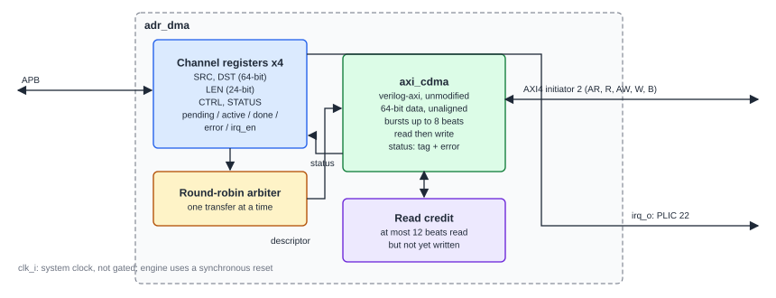
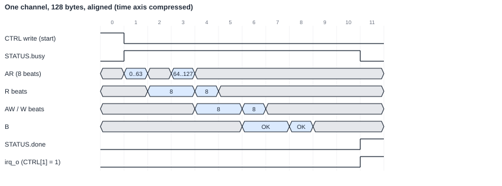

# DMA controller (`adr_dma`) datasheet

| | |
|---|---|
| IP name | `adr_dma`, memory-to-memory DMA, 4 channels |
| Type | ADR IP: our own channel registers, arbiter and read flow control around the unmodified `verilog-axi` `axi_cdma` engine |
| Version | 1.0 (RTL), document revision 2.0 |
| Status | Verified at SoC level (`ddr` in the regression; `dma` on request) |
| RTL | `rtl/adr_ip/dma/rtl/adr_dma.sv`; engine `rtl/third_party_ip/dma/` (`axi_cdma`) |
| SoC instance | `adr_soc_top.i_dma` |
| Base address | `0x1000_E000` (APB slot 13, 4 KiB) |
| Bus master | AXI4 crossbar initiator 2, 64-bit data, 64-bit address |
| Interrupt | PLIC source 22, level (one line for all channels) |
| Owner | Vijay Bogati |
| Date | 2026-11-14 |

### Revision history

| Revision | Date | Change |
|---|---|---|
| 1.0 | 2026-11-08 | First issue, generated from the RTL header |
| 2.0 | 2026-11-14 | Rewritten as a datasheet |

### Conventions

RW read and write; RO read only; WO write only; W1C write 1 to clear. A clock is one rising edge of `clk_i`. *Derived* marks values worked out from the RTL, not yet measured.

## 1. Introduction

`adr_dma` copies blocks of memory without the CPU. Software programs a source, a destination and a length into one of four channels and starts it; the engine reads the source and writes the destination over AXI4, then sets the channel's done flag and, if enabled, raises the interrupt.

### 1.1 Features

- 4 channels, each with 64-bit source and destination addresses and a 24-bit byte length (up to 16 MiB - 1).
- Any alignment of source, destination and length (byte granularity).
- AXI4 bursts of up to 8 beats of 64 bits (64 bytes).
- Round-robin between pending channels; one transfer at a time.
- Per-channel done and bus-error flags, per-channel interrupt enable, one interrupt line.
- Read flow control that cannot deadlock the single-ported SRAM (section 2.3).
- APB slave, zero wait states, never returns an error.

### 1.2 Not supported

- Peripheral request lines: memory-to-memory only (LIMITATIONS item 52).
- Hardware cache coherence: software must handle the CPU data cache (item 51).
- Concurrent channels: a long transfer delays the others (item 54).
- Descriptor chains, scatter-gather, 2-D transfers, fill or abort.

## 2. Functional description



### 2.1 Channel states

| State | `STATUS.busy` | Entered by | Left by |
|---|---|---|---|
| Idle | 0 | Reset, end of transfer | Start with `LEN` > 0 |
| Pending | 1 | Start | Chosen by the arbiter |
| Active | 1 | Chosen; descriptor accepted by the engine | Engine status: done, maybe error |

A start with `LEN` = 0 sets `done` at once, with no bus traffic. A start while the channel is pending or active is ignored.

### 2.2 Arbitration

When no transfer is open, the arbiter picks the first pending channel at or after the one following the last channel served (round robin), and hands its `SRC`, `DST` and `LEN` to the engine. The registers are read **at that moment**: changing them while the channel is pending changes the transfer. The next transfer starts only when the engine reports the previous one finished.

### 2.3 Read flow control

The SRAM serves one burst at a time. If the DMA refused read data because its FIFO was full, the SRAM would wait for it while the DMA waited to write to the SRAM: a deadlock. So a read burst is requested only when at most 12 beats (`ReadCredit`) would then be read but not yet written; read data is never refused. The engine's FIFO holds 16 beats.

### 2.4 Errors

The engine reports an error if any read or write response is SLVERR or DECERR. The channel then ends with `done` and `error` set. Data already written stays written; after a read error the engine is expected to still write the (error) read data to the destination (not checked). The bus error monitor records the access too (initiator 2).

### 2.5 Reset

The engine uses a synchronous reset (`~rst_ni`); the system clock runs during reset. A system reset in the middle of a transfer abandons it; the AXI fabric is reset at the same time.

## 3. Parameters

| Parameter | Type | Default | SoC value | Description |
|---|---|---|---|---|
| `NumChannels` | `int unsigned` | 4 | 4 | Number of channels; the register layout allows up to 4 |
| `IdWidth` | `int unsigned` | 4 | `CpuCfg.AxiIdWidth` | AXI ID width of the initiator port |
| `LenWidth` | `int unsigned` | 24 | default | Width of `LEN` |
| `MaxBurst` | `int unsigned` | 8 | default | Longest burst in beats |
| `ReadCredit` | `int unsigned` | 12 | default | Beats that may be read ahead of the writes (below the engine FIFO's 16) |
| `axi_req_t`, `axi_resp_t` | type | | `init_req_t`, `init_resp_t` | AXI4 request and response structs of a crossbar initiator |

## 4. Signal description

| Signal | Dir | Width | Clock | Reset value | Description |
|---|---|---|---|---|---|
| `clk_i` | in | 1 | | | System clock, not gated |
| `rst_ni` | in | 1 | async | | System reset (`sys_rst_n`) |
| `psel_i`, `penable_i`, `pwrite_i` | in | 1 each | `clk_i` | | APB control |
| `paddr_i` | in | 8 | `clk_i` | | APB byte address: bits 6:5 channel, 4:2 register |
| `pwdata_i` | in | 32 | `clk_i` | | APB write data |
| `prdata_o` | out | 32 | comb. | | APB read data |
| `pready_o` / `pslverr_o` | out | 1 each | | 1 / 0 | Tied |
| `axi_req_o` | out | struct | `clk_i` | valids 0 | AXI4 AW, W, AR channels and B, R ready. QoS, region, atomics and user fields are 0 |
| `axi_resp_i` | in | struct | `clk_i` | | AXI4 B, R channels and AW, W, AR ready |
| `irq_o` | out | 1 | comb. of flops | 0 | OR over channels of `done` AND `irq_en` |

## 5. Clocks and resets

One clock, `clk_i`, not gated (no `CLK_EN` bit); system reset, asynchronous for the registers and synchronous for the engine. No clock-domain crossings.

## 6. Registers

### 6.1 Register map

Base address `0x1000_E000`. Channel n (0-3) at `0x20 x n`.

| Offset | Name | Access | Reset value | Description |
|---|---|---|---|---|
| `0x20n + 0x00` | `SRCn_LO` | RW | 0 | Source address, bits 31:0 |
| `0x20n + 0x04` | `SRCn_HI` | RW | 0 | Source address, bits 63:32 |
| `0x20n + 0x08` | `DSTn_LO` | RW | 0 | Destination address, bits 31:0 |
| `0x20n + 0x0C` | `DSTn_HI` | RW | 0 | Destination address, bits 63:32 |
| `0x20n + 0x10` | `LENn` | RW | 0 | Length in bytes |
| `0x20n + 0x14` | `CTRLn` | RW (start WO) | 0 | Start, interrupt enable |
| `0x20n + 0x18` | `STATUSn` | RO / W1C | 0 | Busy, done, error |
| `0x20n + 0x1C` | | | reads 0 | Reserved |

Only `paddr[7:0]` reaches the block and bit 7 is not used: the map repeats every 128 bytes.

### 6.2 Fields

| Register | Bits | Field | Access | Reset | Description |
|---|---|---|---|---|---|
| `SRCn_LO/HI` | 31:0 | `src` | RW | 0 | Source byte address. Use the uncached alias (bit 32 set) or clean the cache as section 8.3 says |
| `DSTn_LO/HI` | 31:0 | `dst` | RW | 0 | Destination byte address |
| `LENn` | 23:0 | `len` | RW | 0 | Bytes to copy; 0 = nothing (done at once). 31:24 read 0 |
| `CTRLn` | 1 | `irq_en` | RW | 0 | Interrupt when this channel is done. **Updated by every `CTRL` write** |
| `CTRLn` | 0 | `start` | WO | | Write 1 to start; ignored while busy. Reads 0 |
| `STATUSn` | 2 | `error` | RO, W1C | 0 | The last transfer got a bus error; cleared by writing 1 or by a start |
| `STATUSn` | 1 | `done` | RO, W1C | 0 | The last transfer finished; cleared by writing 1 or by a start |
| `STATUSn` | 0 | `busy` | RO | 0 | Pending or active |

## 7. Interrupts

| Interrupt | PLIC source | Type | Set by | Cleared by |
|---|---|---|---|---|
| `irq_o` | 22 | Level | Any channel's `done` with its `irq_en` | Writing 1 to that channel's `STATUS.done` |

One source for all channels: the handler reads every `STATUSn` to find which finished.

## 8. Programming guide

```c
#define DMA_BASE 0x1000E000UL
#define DMA(ch, off) (*(volatile uint32_t *)(DMA_BASE + 0x20 * (ch) + (off)))
#define DMA_SRC_LO 0x00
#define DMA_SRC_HI 0x04
#define DMA_DST_LO 0x08
#define DMA_DST_HI 0x0C
#define DMA_LEN    0x10
#define DMA_CTRL   0x14
#define DMA_STATUS 0x18
```

### 8.1 One copy, polling

1. Wait until `STATUS.busy` = 0 on the channel.
2. Make sure the source is in memory (section 8.3).
3. Write `SRC_LO/HI`, `DST_LO/HI`, `LEN`.
4. Write `CTRL = 1` (or `3` for an interrupt).
5. Poll until `STATUS.done`; check `STATUS.error`; write `STATUS = 6`.
6. Read the destination through the uncached alias, or invalidate the data cache first.

### 8.2 With the interrupt

Enable PLIC source 22. In the handler, for each channel with `done` set: check `error`, write `STATUS = 6`; then complete the claim.

### 8.3 Cache rules

The CPU data cache is write-through, so the source is always in memory. But the cache may hold stale copies of the destination: read the destination through the uncached alias (address + `0x1_0000_0000`) or call `dcache_invalidate()` before reading it (LIMITATIONS item 51).

## 9. Timing



| Path | Latency |
|---|---|
| Start to the first AR | A few clocks: arbiter, descriptor, engine (*derived*) |
| Last B response to `done`, `irq_o` | 1 to 2 clocks (*derived*) |
| Peak data rate | One 64-bit beat per clock each way when the memory keeps up (800 MB/s at 100 MHz); SRAM serves one burst at a time, so a copy within SRAM is much slower (LIMITATIONS item 53). Not measured |

## 10. Integration

| Item | Detail |
|---|---|
| Parent | `adr_soc_top` |
| APB | Slot `SlotDma` = 13, `paddr[7:0]` |
| AXI | Crossbar initiator 2 (`init_req[2]`); can reach every target, including the peripherals |
| Interrupt | `IrqDma` = 22 |
| Bus errors | Recorded by `adr_bus_monitor` as initiator 2 |
| Third-party | `axi_cdma` from `verilog-axi`, unmodified, with `ENABLE_UNALIGNED` = 1 |

## 11. Verification

| Item | Status |
|---|---|
| SoC tests | `ddr` (DDR-04: copies to and within DDR4, cache rules), in the regression; `dma` (DMA-01 to 06: alignment, lengths, zero length, 4 channels, CPU running, cache rules, errors on source and destination, interrupts), on request |
| Benches | All three; the UVM bench checks every AXI transaction of initiator 2 |
| Planned | `dma_periph` (NEW-10), `concurrent` (NEW-11), `wdt_during_dma` (NEW-14); `cg_dma`; assertions DMA-A01, A02 |
| Not tested | Peripheral addresses; changing registers while pending; reset during a transfer; lengths above 64 KiB |

## 12. Known limitations

| Item | Limitation | Effect |
|---|---|---|
| LIMITATIONS 51 | Not cache-coherent | Software rule (section 8.3) |
| LIMITATIONS 52 | Memory-to-memory only | No paced peripheral transfers |
| LIMITATIONS 53 | SRAM serves one burst at a time | Low throughput within SRAM |
| LIMITATIONS 54 | One transfer at a time, 8-beat bursts | Long transfers delay other channels |
| LIMITATIONS 55 | Directed tests only | Random traffic not covered |
| | `irq_en` updated by every `CTRL` write | Repeat the interrupt choice with each start |

## 13. References

- `docs/MICROARCHITECTURE.md` sections 13.1, 15.
- [`../third_party_ip/verilog-axi/ADR.md`](../third_party_ip/verilog-axi/ADR.md), [`adr_bus_monitor.md`](adr_bus_monitor.md), [`../adr_soc/adr_interconnect.md`](../adr_soc/adr_interconnect.md), [`../protocols/AXI4.md`](../protocols/AXI4.md).
