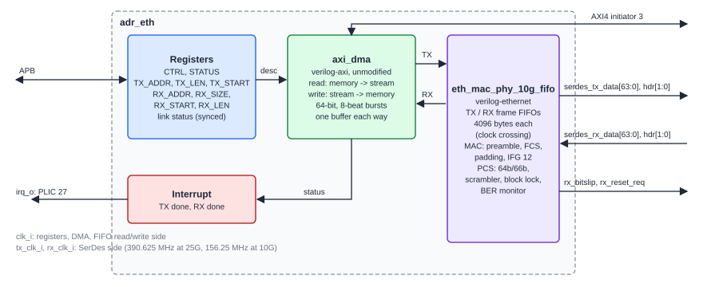
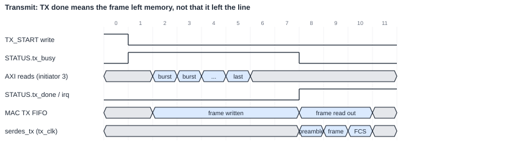

# Ethernet controller (`adr_eth`) datasheet

| | |
|---|---|
| IP name | `adr_eth`, 10G/25G Ethernet MAC and PCS with bus-master DMA |
| Type | ADR IP: our own registers and control around the unmodified `verilog-ethernet` `eth_mac_phy_10g_fifo` and `verilog-axi` `axi_dma` |
| Version | 1.0 (RTL), document revision 2.0 |
| Status | Verified at SoC level in SerDes loopback (`eth` in the regression), at 25G and 10G clocks; the analog SerDes is outside the SoC |
| RTL | `rtl/adr_ip/eth/rtl/adr_eth.sv`; MAC/PCS in `rtl/third_party_ip/ethernet/`, DMA engine in `rtl/third_party_ip/dma/` |
| SoC instance | `adr_soc_top.i_eth` |
| Base address | `0x1001_4000` (APB slot 18, 4 KiB) |
| Bus master | AXI4 crossbar initiator 3, 64-bit data, 64-bit address |
| Interrupt | PLIC source 27, level |
| Owner | Vijay Bogati |
| Date | 2026-11-14 |

### Revision history

| Revision | Date | Change |
|---|---|---|
| 1.0 | 2026-11-08 | First issue, generated from the RTL header |
| 2.0 | 2026-11-14 | Rewritten as a datasheet |

### Conventions

RW read and write; RO read only; WO write only; W1C write 1 to clear. A clock is one rising edge of `clk_i` unless a SerDes clock is named. *Derived* marks values worked out from the RTL, not yet measured.

## 1. Introduction

`adr_eth` sends and receives Ethernet frames over a 64b/66b SerDes interface. Software gives it one memory buffer for transmit and one for receive at a time; the block moves frames between memory and the MAC with its own AXI4 DMA, and the MAC and PCS do framing, CRC, 64b/66b coding and scrambling. The line rate follows the SerDes clock: 390.625 MHz for 25GBASE-R (default build), 156.25 MHz for 10GBASE-R (`make ETH_RATE=10`).

### 1.1 Features

- 10GBASE-R or 25GBASE-R digital PHY layer: 64b/66b encoding, scrambling, block lock, bit-error-rate monitor.
- MAC: preamble and start delimiter, FCS generated on transmit, checked and removed on receive, padding to 60 bytes, 12-byte inter-frame gap.
- Frames with a bad FCS are dropped in the receive FIFO and counted by a sticky flag.
- Store-and-forward frame FIFOs of 4096 bytes each way, which also cross between the system and SerDes clocks.
- Bus-master DMA: any byte alignment, frame lengths up to 65,535 bytes in the registers (frames are limited by the FIFO).
- Transmit-done and receive-done interrupts; bus-error flags per direction.
- Link status: block lock, high bit error rate, link good.

### 1.2 Not supported

- Descriptor rings, address filtering, multicast, VLAN, flow control (pause), statistics counters (LIMITATIONS item 68).
- Sustained 25G: the memory path is 64 bits at 100 MHz (6.4 Gbit/s), shared (item 109).
- Timing closure at 390.625 MHz and the analog SerDes (item 76).
- Clock gating (item 79). PTP time stamps (present upstream, not connected). PRBS test modes (tied off).

## 2. Functional description



### 2.1 Transmit

1. Software writes the frame (destination MAC to payload, without FCS) to memory, then `TX_ADDR`, `TX_LEN`, and 1 to `TX_START`. The start is accepted only if `CTRL.tx_en` = 1, `TX_LEN` > 0 and no transmit is busy.
2. The DMA reads `TX_LEN` bytes and streams them into the MAC's transmit FIFO. When the read finishes, `STATUS.tx_done` sets (`tx_error` too if a read got an error response).
3. The MAC sends the frame once it is whole in the FIFO: preamble, frame, padding to 60 bytes if shorter, FCS, then the gap.

**`tx_done` means the frame has left memory**, so the buffer can be reused; it does not mean the frame is on the line. A transmit bus error still sends a frame with the bus's error data (LIMITATIONS item 69).

### 2.2 Receive

1. Software writes `RX_ADDR`, `RX_SIZE` (buffer size) and 1 to `RX_START`, accepted only if `CTRL.rx_en` = 1, `RX_SIZE` > 0 and no receive is busy.
2. The MAC checks each incoming frame's FCS; good frames go into the receive FIFO without the FCS, bad ones are dropped and set `STATUS.bad_frame`.
3. The DMA writes the next frame from the FIFO to the buffer, cut at `RX_SIZE` if longer. `RX_LEN` gets the number of bytes written, and `STATUS.rx_done` sets (`rx_error` too on a write error).

Frames that arrive while no receive is started wait in the FIFO; a frame that does not fit in the FIFO is lost. With `CTRL.rx_en` = 0 the MAC receives nothing.

### 2.3 Link status

Block lock, high BER and link good come from the receive PCS on `rx_clk_i` and pass through 2 flops into `STATUS[10:8]`. In loopback the receive side locks within microseconds of reset (`eth` test, ETH-01).

### 2.4 Reset

Our registers use the asynchronous system reset; the DMA engine and the FIFOs' system side use a synchronous reset (`~rst_ni`); the SerDes sides use `tx_rst_ni` and `rx_rst_ni`, made by `adr_rst_gen` in each SerDes clock domain, so those clocks must run for the reset to complete (LIMITATIONS item 79).

## 3. Parameters

| Parameter | Type | Default | SoC value | Description |
|---|---|---|---|---|
| `IdWidth` | `int unsigned` | 4 | `CpuCfg.AxiIdWidth` | AXI ID width |
| `LenWidth` | `int unsigned` | 16 | default | Width of `TX_LEN`, `RX_SIZE`, `RX_LEN` |
| `MaxBurst` | `int unsigned` | 8 | default | Longest AXI burst in beats |
| `Count125us` | `real` | 125000/2.56 (25G) or 125000/6.4 (`ADR_ETH_10G`) | default | SerDes clocks in 125 us, for the BER monitor |
| `axi_req_t`, `axi_resp_t` | type | | `init_req_t`, `init_resp_t` | AXI4 structs |

Fixed inside: FIFO depths 4096 bytes, inter-frame gap 12 bytes.

## 4. Signal description

| Signal | Dir | Width | Clock | Reset value | Description |
|---|---|---|---|---|---|
| `clk_i` | in | 1 | | | System clock, not gated |
| `rst_ni` | in | 1 | async | | System reset |
| `psel_i`, `penable_i`, `pwrite_i` | in | 1 each | `clk_i` | | APB control. The block has no `pready`/`pslverr`: the SoC ties them to 1 and 0 |
| `paddr_i` | in | 8 | `clk_i` | | APB byte address, bits 7:0 |
| `pwdata_i` | in | 32 | `clk_i` | | APB write data |
| `prdata_o` | out | 32 | comb. | | APB read data |
| `axi_req_o` / `axi_resp_i` | out / in | struct | `clk_i` | valids 0 | AXI4 initiator; QoS, region, atomics, user are 0 |
| `irq_o` | out | 1 | comb. of flops | 0 | (`tx_done` AND `tx_irq_en`) OR (`rx_done` AND `rx_irq_en`) |
| `tx_clk_i`, `tx_rst_ni` | in | 1 each | | | SerDes transmit clock and its reset |
| `rx_clk_i`, `rx_rst_ni` | in | 1 each | | | SerDes receive clock and its reset |
| `serdes_tx_data_o` | out | 64 | `tx_clk_i` | | Scrambled 64-bit block payload |
| `serdes_tx_hdr_o` | out | 2 | `tx_clk_i` | | Sync header: `01` data, `10` control |
| `serdes_rx_data_i` | in | 64 | `rx_clk_i` | | Received block payload |
| `serdes_rx_hdr_i` | in | 2 | `rx_clk_i` | | Received sync header |
| `serdes_rx_bitslip_o` | out | 1 | `rx_clk_i` | | Asks the SerDes to slip one bit, while seeking block lock |
| `serdes_rx_reset_req_o` | out | 1 | `rx_clk_i` | | Asks the SerDes to reset its receiver |

## 5. Clocks and resets

| Item | Value |
|---|---|
| Clock domains | `clk_i` (registers, DMA, FIFO system side); `tx_clk_i`; `rx_clk_i` |
| Clock gating | None |
| Crossings | Frame data: asynchronous FIFOs inside `eth_mac_phy_10g_fifo` (upstream). Link status: 3 bits through 2 flops; each bit is a slow level, so bits may change on different clocks |
| Resets | `rst_ni` (async for registers, sync for the engine); `tx_rst_ni`, `rx_rst_ni` per SerDes domain |

## 6. Registers

### 6.1 Register map

Base address `0x1001_4000`.

| Offset | Name | Access | Reset value | Description |
|---|---|---|---|---|
| `0x00` | `CTRL` | RW | `0x0000_0000` | Enables and interrupt enables |
| `0x04` | `STATUS` | RO / W1C | `0x0000_0000` | Busy, done, errors, link |
| `0x08` | `TX_ADDR_LO` | RW | 0 | Transmit buffer address, bits 31:0 |
| `0x0C` | `TX_ADDR_HI` | RW | 0 | Bits 63:32 |
| `0x10` | `TX_LEN` | RW | 0 | Transmit length in bytes |
| `0x14` | `TX_START` | WO | (reads 0) | Write 1 to send |
| `0x18` | `RX_ADDR_LO` | RW | 0 | Receive buffer address, bits 31:0 |
| `0x1C` | `RX_ADDR_HI` | RW | 0 | Bits 63:32 |
| `0x20` | `RX_SIZE` | RW | 0 | Receive buffer size in bytes |
| `0x24` | `RX_START` | WO | (reads 0) | Write 1 to receive the next frame |
| `0x28` | `RX_LEN` | RO | 0 | Bytes written by the last receive |
| `0x2C`-`0xFC` | | | reads 0 | Reserved |

Only `paddr[7:0]` reaches the block: the map repeats every 256 bytes.

### 6.2 `CTRL` (`0x00`)

| Bits | Field | Access | Reset | Description |
|---|---|---|---|---|
| 31:4 | | RO | 0 | Reserved |
| 3 | `rx_irq_en` | RW | 0 | Interrupt on receive done |
| 2 | `tx_irq_en` | RW | 0 | Interrupt on transmit done |
| 1 | `rx_en` | RW | 0 | Receive enable (MAC and DMA write side) |
| 0 | `tx_en` | RW | 0 | Transmit enable (MAC and DMA read side) |

### 6.3 `STATUS` (`0x04`)

| Bits | Field | Access | Reset | Description |
|---|---|---|---|---|
| 31:11 | | RO | 0 | Reserved |
| 10 | `link_good` | RO | 0 | PCS reports the link up (synchronized) |
| 9 | `high_ber` | RO | 0 | High bit error rate (synchronized) |
| 8 | `block_lock` | RO | 0 | Receive block lock (synchronized) |
| 7 | | RO | 0 | Reserved |
| 6 | `bad_frame` | RO, W1C | 0 | A received frame was dropped (bad FCS or error) |
| 5 | `rx_error` | RO, W1C | 0 | The last receive got a bus error |
| 4 | `rx_done` | RO, W1C | 0 | The last receive finished |
| 3 | `rx_busy` | RO | 0 | Receive started, not finished |
| 2 | `tx_error` | RO, W1C | 0 | The last transmit got a bus error |
| 1 | `tx_done` | RO, W1C | 0 | The last transmit has been read from memory |
| 0 | `tx_busy` | RO | 0 | Transmit started, not finished |

`tx_done`/`tx_error` and `rx_done`/`rx_error` also clear on an accepted start.

### 6.4 Buffer registers

| Register | Bits | Field | Access | Reset | Description |
|---|---|---|---|---|---|
| `TX_ADDR_LO/HI`, `RX_ADDR_LO/HI` | 31:0 | `addr` | RW | 0 | Byte address; any alignment |
| `TX_LEN` | 15:0 | `len` | RW | 0 | Frame length without FCS. Below 60, the MAC pads |
| `RX_SIZE` | 15:0 | `size` | RW | 0 | Buffer size; a longer frame is cut |
| `RX_LEN` | 15:0 | `len` | RO | 0 | Bytes written by the last receive (frame without FCS, or `RX_SIZE` if cut) |
| `TX_START`, `RX_START` | 0 | `start` | WO | | Write 1 to start (section 2) |

## 7. Interrupts

| Interrupt | PLIC source | Type | Set by | Cleared by |
|---|---|---|---|---|
| `irq_o` | 27 | Level | `tx_done` with `tx_irq_en`, or `rx_done` with `rx_irq_en` | Writing 1 to the done bit, or a new start in that direction |

Bad frames, errors and link changes have no interrupt of their own.

## 8. Programming guide

```c
#define ETH_BASE 0x10014000UL
#define ETH(off) (*(volatile uint32_t *)(ETH_BASE + (off)))
```

### 8.1 Bring-up

1. Wait for `STATUS.block_lock` and `link_good`.
2. Clear old flags: `ETH(0x04) = 0x76`.
3. `ETH(0x00) = 0xF` (both directions and both interrupts), or `0x3` for polling.

### 8.2 Receive one frame

1. `RX_ADDR` = buffer, `RX_SIZE` = its size (at least 1518 for a full frame), `RX_START` = 1.
2. Wait for `rx_done`. Check `rx_error`. Read `RX_LEN`.
3. Read the buffer **through the uncached alias** or after `dcache_invalidate()`: the block writes memory behind the data cache.
4. Write 1 to `rx_done`, give the next buffer.

### 8.3 Send one frame

1. Build the frame in memory (destination, source, type, payload; no FCS).
2. `TX_ADDR`, `TX_LEN`, `TX_START` = 1.
3. Wait for `tx_done`; check `tx_error`; write 1 to `tx_done`. The buffer may now be reused.

## 9. Timing



| Path | Latency / rate |
|---|---|
| Line rate | 25.78125 Gbaud at 390.625 MHz x 66 bits; 10.3125 Gbaud at 156.25 MHz |
| Memory path | 64 bits per `clk_i`: 6.4 Gbit/s at 100 MHz, shared with other masters |
| Single frame | Read into the FIFO at the memory rate, then sent at line rate (store and forward) |
| `eth` test, 25G, whole test | 287,990 clocks on both benches (cycle-count baseline) |

## 10. Integration

| Item | Detail |
|---|---|
| Parent | `adr_soc_top` |
| APB | Slot `SlotEth` = 18, `paddr[7:0]`; `pready` = 1, `pslverr` = 0 tied in the top |
| AXI | Crossbar initiator 3 |
| Clocks and resets | `eth_tx_clk_i`, `eth_rx_clk_i` chip pins; `eth_tx_rst_n`, `eth_rx_rst_n` from `adr_rst_gen` |
| SerDes pins | `eth_serdes_tx_data_o/hdr_o`, `eth_serdes_rx_data_i/hdr_i`, `eth_serdes_rx_bitslip_o`, `eth_serdes_rx_reset_req_o` |
| Interrupt | `IrqEth` = 27 |
| Build option | `ADR_ETH_10G` (from `make ETH_RATE=10`) selects the 10G `Count125us` |
| Timing | 390.625 MHz in the SerDes domains: not closed (LIMITATIONS item 76) |

## 11. Verification

| Item | Status |
|---|---|
| SoC tests | `eth` (ETH-01 to 05: start-up and lock, loopback frame, length and data, unaligned, padding, buffer limit, receive off, interrupt, bus errors and recovery), 25G and 10G |
| Benches | Baseline bench (SerDes loopback); UVM bench (transmit and receive monitors check every frame's sync headers, preamble, start delimiter and FCS; receive driver available without `+loopback_eth`) |
| Planned | `eth_rx` (NEW-07), `concurrent` (NEW-11); `cg_eth`; assertions ETH-A01 to A04 |
| Not tested | Bad FCS from the line; frames above 1518 bytes; FIFO overflow; link loss; bit slip |

## 12. Known limitations

| Item | Limitation | Effect |
|---|---|---|
| LIMITATIONS 68 | No descriptor rings or filter | One buffer at a time; frames lost when the FIFO is full |
| LIMITATIONS 69 | Transmit bus error still sends a frame | Bad data with a valid FCS on the line |
| LIMITATIONS 76 | 25G unproven in timing and with a real SerDes | Loopback only |
| LIMITATIONS 109 | Memory path below 25G | Sustained line rate impossible |
| LIMITATIONS 79 | No clock gating; resets need the SerDes clocks | Power; reset needs those clocks |
| LIMITATIONS 70 | Final MIT `verilog-ethernet` | No upstream fixes |
| LIMITATIONS 71, 107 | Sanity tests only; DDR4 not used | |

## 13. References

- IEEE 802.3 clauses 49 (10GBASE-R PCS) and 107 (25GBASE-R).
- `docs/MICROARCHITECTURE.md` section 13.10.
- [`../third_party_ip/verilog-ethernet/ADR.md`](../third_party_ip/verilog-ethernet/ADR.md), [`../third_party_ip/verilog-axi/ADR.md`](../third_party_ip/verilog-axi/ADR.md), [`../protocols/AXI4.md`](../protocols/AXI4.md).
