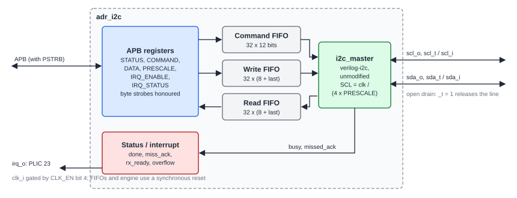
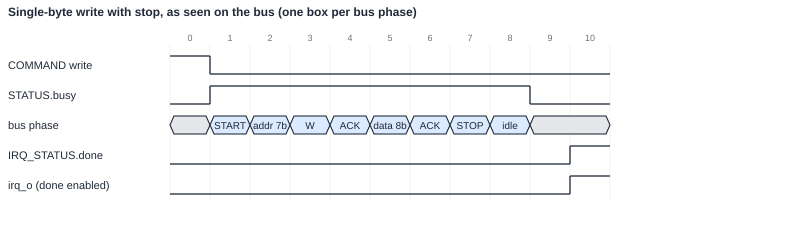

# I2C controller (`adr_i2c`) datasheet

| | |
|---|---|
| IP name | `adr_i2c`, I2C master with APB registers |
| Type | ADR IP: our own APB register layer and interrupt around the unmodified `verilog-i2c` engine (`i2c_master`, 3 x `axis_fifo`) |
| Version | 1.0 (RTL), document revision 2.0 |
| Status | Verified at SoC level (`serial` in the regression; `i2c`, `uart_i2c` on request), on Verilator |
| RTL | `rtl/adr_ip/i2c/rtl/adr_i2c.sv`; engine in `rtl/third_party_ip/i2c/` |
| SoC instance | `adr_soc_top.i_lsio.i_i2c` |
| Base address | `0x1000_7000` (APB slot 7, 4 KiB) |
| Interrupt | PLIC source 23, level |
| Owner | Vijay Bogati |
| Date | 2026-11-14 |

### Revision history

| Revision | Date | Change |
|---|---|---|
| 1.0 | 2026-11-08 | First issue, generated from the RTL header |
| 2.0 | 2026-11-14 | Rewritten as a datasheet |

### Conventions

RW read and write; RO read only; WO write only; W1C write 1 to clear. A clock is one rising edge of the I2C clock (the gated system clock). *Derived* marks values worked out from the RTL, not yet measured.

## 1. Introduction

`adr_i2c` is an I2C bus master. Software queues commands (start, read a byte, write a byte or a block, stop) and data bytes in FIFOs; the `verilog-i2c` engine runs them on the bus and puts received bytes in a read FIFO. The register map is that of the upstream project's AXI4-Lite wrapper, here on APB, with an interrupt added.

### 1.1 Features

- I2C master, 7-bit addresses, standard and fast mode by prescaler (SCL = clock / (4 x `PRESCALE`)).
- Command, write and read FIFOs, 32 entries each.
- Repeated start: implied by a change of address or direction, or forced with the `start` bit.
- Clock stretching by the slave (the engine waits while SCL is held low).
- Missed-acknowledge detection.
- Level interrupt from four sources: done, missed ACK, received data, FIFO overflow.
- Byte strobes honoured on APB writes, as in the upstream wrapper.
- Open-drain pins as separate output, tri-state and input.

### 1.2 Not supported

- Slave mode, 10-bit addresses, SMBus features, arbitration-lost reporting (multi-master).
- The engine does not stop after an address NACK: it still sends the data byte, so a write to an absent device reports two missed ACKs (LIMITATIONS item 112).
- No DMA requests.

## 2. Functional description



### 2.1 Commands

A write to `COMMAND` with any of bits 8-12 set (and byte 1 enabled) pushes one command: the 7-bit address (from byte 0, or the last address written if byte 0 is not enabled) and the command bits.

| Bit | Command | Engine behaviour (from the upstream notes) |
|---|---|---|
| 8 | `start` | Force a (repeated) start before this command |
| 9 | `read` | Read one byte into the read FIFO. A start is implied if the bus is idle, or was writing, or the address changed. With `stop`, the byte is marked last |
| 10 | `write` | Write one byte from the write FIFO. A start is implied if the bus is idle, or was reading, or the address changed |
| 11 | `write_multiple` | Write bytes from the write FIFO until one marked last |
| 12 | `stop` | Stop after the command, or alone: stop if the bus is active |

### 2.2 Data

- **Write:** a `DATA` write with byte 0 enabled pushes `DATA[7:0]`; `DATA[9]` marks the last byte of a `write_multiple` and is only taken when byte 1 is also enabled.
- **Read:** a `DATA` read returns the oldest received byte with `valid` = 1 and removes it; with nothing received it returns 0 and removes nothing.

### 2.3 Status and interrupt

| Event | Flag | Set when | Cleared by |
|---|---|---|---|
| Done | `IRQ_STATUS.done` | The engine goes from busy to idle with no command queued | Writing 1 to `IRQ_STATUS[0]` |
| Missed ACK | `STATUS.miss_ack` = `IRQ_STATUS.miss_ack` | The slave did not acknowledge | Writing 1 to `STATUS[3]` or `IRQ_STATUS[1]` |
| Received data | `IRQ_STATUS.rx_ready` | The read FIFO is not empty | Reading the bytes |
| Overflow | `IRQ_STATUS.overflow` | A push to a full command or write FIFO (the entry is lost) | Writing 1 to `STATUS[10]` / `STATUS[13]` |

A new event wins over a clear on the same clock. `irq_o` is registered: high one clock after any enabled `IRQ_STATUS` bit is set.

### 2.4 Reset

The third-party FIFOs and engine use a **synchronous** active-high reset (`~rst_ni`), so the clock must run during reset; the SoC keeps it running (the clock enable returns to 1 asynchronously at reset). Our registers use the asynchronous reset.

## 3. Parameters

| Parameter | Type | Default | SoC value | Description |
|---|---|---|---|---|
| `FifoDepth` | `int unsigned` | 32 | default | Depth of each of the three FIFOs |
| `DefaultPrescale` | `logic [15:0]` | 1 | default | `PRESCALE` after reset. Software must set a real value |

## 4. Signal description

| Signal | Dir | Width | Clock | Reset value | Description |
|---|---|---|---|---|---|
| `clk_i` | in | 1 | | | I2C clock: system clock gated by `CLK_EN` bit 4 |
| `rst_ni` | in | 1 | async | | System reset, active low |
| `psel_i`, `penable_i`, `pwrite_i` | in | 1 each | `clk_i` | | APB control |
| `paddr_i` | in | 5 | `clk_i` | | APB byte address, bits 4:0 only |
| `pwdata_i` | in | 32 | `clk_i` | | APB write data |
| `pstrb_i` | in | 4 | `clk_i` | | APB byte strobes; bytes 0 and 1 are used |
| `prdata_o` | out | 32 | comb. | | APB read data |
| `pready_o` / `pslverr_o` | out | 1 each | | 1 / 0 | Tied |
| `irq_o` | out | 1 | `clk_i` | 0 | Interrupt, level, registered |
| `scl_i` | in | 1 | async | | SCL level on the bus |
| `scl_o`, `scl_t` | out | 1 each | `clk_i` | | SCL drive: the line is released when `scl_t` = 1, pulled low when `scl_t` = 0 and `scl_o` = 0 |
| `sda_i` | in | 1 | async | | SDA level on the bus |
| `sda_o`, `sda_t` | out | 1 each | `clk_i` | | SDA drive, as for SCL |

## 5. Clocks and resets

| Item | Value |
|---|---|
| Clock | `clk_i`, gated by `CLK_EN[4]` (`ClkI2c`) |
| Resets | `rst_ni` asynchronous (our registers); `~rst_ni` synchronous (FIFOs and engine) |
| Clock-domain crossings | `scl_i`, `sda_i` from the bus: sampled by the engine, which filters them (upstream design). The chip has no pads; the bench forms the wired-AND bus |

## 6. Registers

### 6.1 Register map

Base address `0x1000_7000`.

| Offset | Name | Access | Reset value | Description |
|---|---|---|---|---|
| `0x00` | `STATUS` | RO / W1C | `0x0000_4900` | Engine and FIFO state (empty FIFOs after reset) |
| `0x04` | `COMMAND` | RW | `0x0000_0000` | Queue a command; reads the last command written |
| `0x08` | `DATA` | RW | `0x0000_0000` | Write: queue a byte. Read: take a byte |
| `0x0C` | `PRESCALE` | RW | `0x0000_0001` | Quarter SCL period in clocks |
| `0x10` | `IRQ_ENABLE` | RW | `0x0000_0000` | Interrupt enables |
| `0x14` | `IRQ_STATUS` | RO / W1C | `0x0000_0000` | Interrupt sources |
| `0x18`-`0x1C` | | | reads 0 | Reserved |

Only `paddr[4:0]` is decoded: the map repeats every 32 bytes. The `STATUS` reset value is *derived* (bits 8, 11 and 14 set: all FIFOs empty).

### 6.2 `STATUS` (`0x00`)

| Bits | Field | Access | Reset | Description |
|---|---|---|---|---|
| 31:16 | | RO | 0 | Reserved |
| 15 | `rd_full` | RO | 0 | Read FIFO full: the engine waits |
| 14 | `rd_empty` | RO | 1 | Read FIFO empty |
| 13 | `wr_ovf` | RO, W1C | 0 | A byte was pushed to a full write FIFO and lost |
| 12 | `wr_full` | RO | 0 | Write FIFO full |
| 11 | `wr_empty` | RO | 1 | Write FIFO empty |
| 10 | `cmd_ovf` | RO, W1C | 0 | A command was pushed to a full command FIFO and lost |
| 9 | `cmd_full` | RO | 0 | Command FIFO full |
| 8 | `cmd_empty` | RO | 1 | Command FIFO empty |
| 7:4 | | RO | 0 | Reserved |
| 3 | `miss_ack` | RO, W1C | 0 | A slave did not acknowledge |
| 2 | `bus_act` | RO | 0 | The bus is busy (start seen, no stop yet), by any master |
| 1 | `bus_cont` | RO | 0 | This master controls the bus |
| 0 | `busy` | RO | 0 | The engine is running a command |

### 6.3 `COMMAND` (`0x04`)

| Bits | Field | Access | Reset | Description |
|---|---|---|---|---|
| 31:13 | | RO | 0 | Reserved |
| 12 | `stop` | RW | 0 | Stop condition (section 2.1) |
| 11 | `write_multiple` | RW | 0 | Write bytes until one marked last |
| 10 | `write` | RW | 0 | Write one byte |
| 9 | `read` | RW | 0 | Read one byte |
| 8 | `start` | RW | 0 | Force a start |
| 7 | | RO | 0 | Reserved |
| 6:0 | `address` | RW | 0 | 7-bit slave address |

A write with bits 12:8 all 0 only updates the stored address.

### 6.4 `DATA` (`0x08`)

| Bits | Field | Access | Reset | Description |
|---|---|---|---|---|
| 31:10 | | RO | 0 | Reserved |
| 9 | `last` | RW | 0 | Write: last byte of a `write_multiple` (needs byte 1 enabled). Read: last byte of a read with stop |
| 8 | `valid` | RO | 0 | Read: a byte was taken from the FIFO |
| 7:0 | `data` | RW | 0 | Write: byte to send. Read: received byte |

### 6.5 `PRESCALE` (`0x0C`)

| Bits | Field | Access | Reset | Description |
|---|---|---|---|---|
| 31:16 | | RO | 0 | Reserved |
| 15:0 | `prescale` | RW | 1 | Clocks per quarter SCL period. At 100 MHz: 250 for 100 kHz, 63 for about 400 kHz. Byte-writable |

### 6.6 `IRQ_ENABLE` (`0x10`) and `IRQ_STATUS` (`0x14`)

| Bits | Field | `IRQ_ENABLE` | `IRQ_STATUS` | Description |
|---|---|---|---|---|
| 31:4 | | RO, 0 | RO, 0 | Reserved |
| 3 | `overflow` | RW | RO | `cmd_ovf` OR `wr_ovf`; clear them in `STATUS` |
| 2 | `rx_ready` | RW | RO | Read FIFO not empty; clears when emptied |
| 1 | `miss_ack` | RW | RO, W1C | Same flag as `STATUS[3]` |
| 0 | `done` | RW | RO, W1C | Went idle with nothing queued |

## 7. Interrupts

| Interrupt | PLIC source | Type | Set by | Cleared by |
|---|---|---|---|---|
| `irq_o` | 23 | Level | Any `IRQ_STATUS` bit set with its enable | Clearing the cause (section 2.3) |

Clear the cause **before** completing the PLIC claim. Enabling `done` while it is already set raises the interrupt at once (`uart_i2c` test history).

## 8. Programming guide

```c
#define I2C_BASE    0x10007000UL
#define I2C(off)    (*(volatile uint32_t *)(I2C_BASE + (off)))
#define I2C_STATUS  I2C(0x00)
#define I2C_COMMAND I2C(0x04)
#define I2C_DATA    I2C(0x08)
#define I2C_PRESCALE I2C(0x0C)
#define I2C_IRQ_EN  I2C(0x10)
#define I2C_IRQ_ST  I2C(0x14)
#define CMD_START (1u << 8)
#define CMD_READ  (1u << 9)
#define CMD_WRITE (1u << 10)
#define CMD_WMULT (1u << 11)
#define CMD_STOP  (1u << 12)
```

### 8.1 Set-up

Write `I2C_PRESCALE` (250 for 100 kHz at 100 MHz). Write `I2C_IRQ_ST = 3` and `I2C_STATUS = (1 << 3) | (1 << 10) | (1 << 13)` to clear old flags.

### 8.2 Write one byte to register `r` of device `a`

```c
I2C_DATA = r;
I2C_DATA = value | (1u << 9);                  /* last byte */
I2C_COMMAND = a | CMD_WMULT | CMD_STOP;
while (!(I2C_IRQ_ST & 1)) ;                     /* done */
ok = !(I2C_STATUS & (1u << 3));                 /* no missed ACK */
```

### 8.3 Read one byte from register `r` of device `a`

```c
I2C_DATA = r;
I2C_COMMAND = a | CMD_WRITE;                    /* register address, no stop */
I2C_COMMAND = a | CMD_READ | CMD_STOP;          /* repeated start, read, stop */
while (!(I2C_IRQ_ST & 1)) ;
uint32_t d = I2C_DATA;                           /* bit 8 = valid */
```

### 8.4 With the interrupt

Enable PLIC source 23 and the wanted `IRQ_ENABLE` bits. In the handler: read `IRQ_STATUS`; drain `DATA` while bit 2 is set; clear `done` and `miss_ack` by writing them back; clear overflows in `STATUS`; then complete the claim.

## 9. Timing



| Path | Latency |
|---|---|
| SCL period | 4 x `PRESCALE` clocks, longer if the slave stretches SCL |
| One byte on the bus (address or data, with ACK) | 9 SCL periods |
| Engine idle to `IRQ_STATUS.done` | 2 clocks (*derived*: `busy` is registered first) |
| `IRQ_STATUS` bit to `irq_o` | 1 clock |

## 10. Integration

| Item | Detail |
|---|---|
| Parent | `adr_lsio_subsys` |
| APB | Slot `SlotI2c` = 7, `paddr[4:0]`, `pstrb` connected |
| Clock gate | `CLK_EN[4]` (`ClkI2c`) |
| Pins | `i2c_scl_i/o/t`, `i2c_sda_i/o/t` on the chip; a board pulls both lines up and wires the drivers as open drain |
| Interrupt | `IrqI2c` = 23 |
| Third-party | `verilog-i2c`, unmodified (see its ADR note) |

## 11. Verification

| Item | Status |
|---|---|
| SoC tests | `serial` (SERIAL-06, 07: write and read at 0x50, missed ACK), `i2c` and `uart_i2c` (UARTI2C-02: prescale, transfer, interrupts on source 23, missed-ACK clear) |
| Benches | Verilator bench (`adr_tb_i2c_dev` model), proven on Verilator; UVM bench (I2C slave agent, with optional clock stretching `+i2c_stretch_ns`), not validated in this release |
| Planned | `i2c` with stretching (NEW-01), `i2c_full` (NEW-05); cover group `cg_i2c`; assertions I2C-A01 to A07 (first stage) |
| Not tested | Multi-byte reads, NACK on data, FIFO overflow, prescale other than the test value |

## 12. Known limitations

| Item | Limitation | Effect |
|---|---|---|
| LIMITATIONS 112 | Two missed ACKs for a write to an absent device | Software must not count interrupts |
| LIMITATIONS 40 | Tested against our own simple models, one clock setting | Real devices not proven |
| | No arbitration-lost report | Single-master buses only |

## 13. References

- NXP UM10204, I2C-bus specification.
- `docs/MICROARCHITECTURE.md` section 12.5.
- [`../third_party_ip/verilog-i2c/ADR.md`](../third_party_ip/verilog-i2c/ADR.md), [`../adr_soc/adr_lsio_subsys.md`](../adr_soc/adr_lsio_subsys.md), [`../protocols/APB.md`](../protocols/APB.md).
