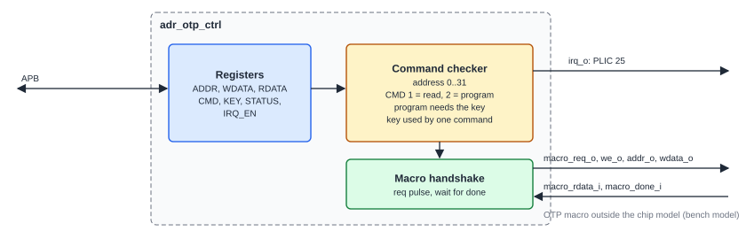
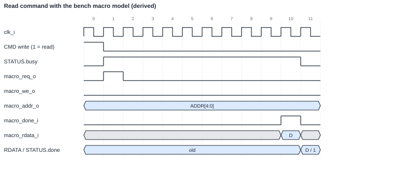

# OTP controller (`adr_otp_ctrl`) datasheet

| | |
|---|---|
| IP name | `adr_otp_ctrl`, controller for a one-time-programmable memory macro |
| Type | ADR IP, our own RTL (the macro is outside the chip model) |
| Version | 1.0 (RTL), document revision 2.0 |
| Status | Verified at SoC level by `misc` (outside the regression), against a bench model of the macro |
| RTL | `rtl/adr_ip/otp/rtl/adr_otp_ctrl.sv` (one file) |
| SoC instance | `adr_soc_top.i_periph.i_otp` |
| Base address | `0x1001_2000` (APB slot 16, 4 KiB) |
| Interrupt | PLIC source 25, level |
| Owner | Vijay Bogati |
| Date | 2026-11-14 |

### Revision history

| Revision | Date | Change |
|---|---|---|
| 1.0 | 2026-11-08 | First issue, generated from the RTL header |
| 2.0 | 2026-11-14 | Rewritten as a datasheet |

### Conventions

RW read and write; RO read only; WO write only; W1C write 1 to clear. A clock is one rising edge of `clk_i`. *Derived* marks values worked out from the RTL, not yet measured.

## 1. Introduction

The controller gives software access to a 32 x 32-bit one-time-programmable (OTP) memory: it reads a word, or programs bits of a word, through a simple request/done handshake with the macro. Programming can only set bits, and each program command must be unlocked by a key written just before it.

### 1.1 Features

- 32 words of 32 bits; word read and bit program commands.
- Program protected by a 32-bit key (`0x4F54_5021`, "OTP!"), used up by the next command.
- Address range and command checks, reported as an error without touching the macro.
- Busy, done and error flags; interrupt on done.
- Request/done handshake to the macro; any macro latency.
- APB slave, zero wait states, never returns an error.

### 1.2 Not supported

- No read protection or lock of words; no ECC; no redundancy (LIMITATIONS item 61).
- The key is a fixed value: a guard against accidents, not a security feature.
- The macro interface is our own assumption; a real macro needs an adapter (item 61).
- No program-verify loop in hardware.

## 2. Functional description



### 2.1 Commands

Software writes `ADDR` (and `WDATA` for a program), then `CMD`. While idle, a `CMD` write:

| Condition | Result |
|---|---|
| `ADDR` > 31, or `CMD` = 0 or 3 | `STATUS.error` and `STATUS.done` set; nothing sent to the macro |
| `CMD` = 2 (program) without the key written since the last command | Same: error and done |
| `CMD` = 1 (read) | Busy; one request to the macro with `we` = 0 |
| `CMD` = 2 with the key | Busy; one request with `we` = 1 and `WDATA` |

Every accepted `CMD` write (while idle) clears `done` and uses up the key, whether it was a read, a program or an error. `CMD` writes while busy are ignored, as are writes to `ADDR` and `WDATA`.

### 2.2 Macro handshake

`macro_req_o` is high for one clock at the start of the command; `macro_we_o`, `macro_addr_o` and `macro_wdata_o` stay stable until the command ends. The controller then waits for `macro_done_i`; on that clock a read takes `macro_rdata_i` into `RDATA`, `busy` clears and `done` sets. Programming must set bits only (OR with the stored word); that is the macro's job. The bench model takes 8 clocks for a read and 32 for a program.

### 2.3 Key

A write to `KEY` unlocks if the value is the key, and locks otherwise. The unlock is cleared by the next accepted `CMD` write.

## 3. Parameters

| Parameter | Type | Default | SoC value | Description |
|---|---|---|---|---|
| `ProgramKey` | `logic [31:0]` | `32'h4F54_5021` | default | Value to write to `KEY` before a program command |

## 4. Signal description

| Signal | Dir | Width | Clock | Reset value | Description |
|---|---|---|---|---|---|
| `clk_i` | in | 1 | | | System clock, not gated |
| `rst_ni` | in | 1 | async | | System reset, active low |
| `psel_i`, `penable_i`, `pwrite_i` | in | 1 each | `clk_i` | | APB control |
| `paddr_i` | in | 5 | `clk_i` | | APB byte address, bits 4:0 only |
| `pwdata_i` | in | 32 | `clk_i` | | APB write data |
| `prdata_o` | out | 32 | comb. | | APB read data |
| `pready_o` / `pslverr_o` | out | 1 each | | 1 / 0 | Tied |
| `macro_req_o` | out | 1 | `clk_i` | 0 | One-clock request to the macro |
| `macro_we_o` | out | 1 | `clk_i` | 0 | 1 = program, 0 = read; stable through a command |
| `macro_addr_o` | out | 5 | `clk_i` | 0 | Word address, `ADDR[4:0]` |
| `macro_wdata_o` | out | 32 | `clk_i` | 0 | Bits to program, `WDATA` |
| `macro_rdata_i` | in | 32 | `clk_i` | | Read data, valid with `macro_done_i` |
| `macro_done_i` | in | 1 | `clk_i` | | One-clock pulse: command finished |
| `irq_o` | out | 1 | `clk_i` | 0 | Interrupt, level: `done` AND `IRQ_EN.enable` |

## 5. Clocks and resets

One clock, `clk_i`, not gated (programming must never be cut short by clock gating); system reset; the macro is assumed synchronous to `clk_i`. A system reset during a program command ends the handshake from the controller's side only; the macro must finish or abort safely on its own.

## 6. Registers

### 6.1 Register map

Base address `0x1001_2000`.

| Offset | Name | Access | Reset value | Description |
|---|---|---|---|---|
| `0x00` | `ADDR` | RW | `0x0000_0000` | Word address (0-31) |
| `0x04` | `WDATA` | RW | `0x0000_0000` | Bits to program |
| `0x08` | `RDATA` | RO | `0x0000_0000` | Last word read |
| `0x0C` | `CMD` | WO | (reads 0) | Command |
| `0x10` | `KEY` | WO | (reads 0) | Program key |
| `0x14` | `STATUS` | RO / W1C | `0x0000_0000` | Busy, done, error |
| `0x18` | `IRQ_EN` | RW | `0x0000_0000` | Interrupt enable |
| `0x1C` | | | reads 0 | Reserved |

Only `paddr[4:0]` is decoded: the map repeats every 32 bytes.

### 6.2 Fields

| Register | Bits | Field | Access | Reset | Description |
|---|---|---|---|---|---|
| `ADDR` | 31:0 | `addr` | RW | 0 | Word address. All 32 bits are stored; any value above 31 makes the next command an error. Ignored while busy |
| `WDATA` | 31:0 | `wdata` | RW | 0 | Bits to set by a program command. Ignored while busy |
| `RDATA` | 31:0 | `rdata` | RO | 0 | Word from the last successful read |
| `CMD` | 1:0 | `cmd` | WO | | 1 = read, 2 = program; 0 and 3 are errors. 31:2 ignored |
| `KEY` | 31:0 | `key` | WO | | `0x4F54_5021` unlocks one program command; other values lock |
| `STATUS` | 2 | `error` | RO, W1C | 0 | Last command was rejected |
| `STATUS` | 1 | `done` | RO, W1C | 0 | Last command finished (or was rejected) |
| `STATUS` | 0 | `busy` | RO | 0 | Command in progress |
| `IRQ_EN` | 0 | `enable` | RW | 0 | Interrupt while `done` is set |

## 7. Interrupts

| Interrupt | PLIC source | Type | Set by | Cleared by |
|---|---|---|---|---|
| `irq_o` | 25 | Level | A command finishing or being rejected, with `IRQ_EN.enable` = 1 | Writing 1 to `STATUS.done`, or the next command |

## 8. Programming guide

```c
#define OTP_BASE   0x10012000UL
#define OTP(off)   (*(volatile uint32_t *)(OTP_BASE + (off)))
#define OTP_ADDR   OTP(0x00)
#define OTP_WDATA  OTP(0x04)
#define OTP_RDATA  OTP(0x08)
#define OTP_CMD    OTP(0x0C)
#define OTP_KEY    OTP(0x10)
#define OTP_STATUS OTP(0x14)
#define OTP_PROGRAM_KEY 0x4F545021U
```

### 8.1 Read a word

1. Wait until `busy` = 0. Write `OTP_STATUS = 6` to clear old flags.
2. Write `OTP_ADDR = n`, then `OTP_CMD = 1`.
3. Poll until `done`. If `error`, the address was bad. Else read `OTP_RDATA`.

### 8.2 Program bits

1. Wait until `busy` = 0; clear the flags.
2. Write `OTP_ADDR = n` and `OTP_WDATA = bits`.
3. Write `OTP_KEY = OTP_PROGRAM_KEY`, then **immediately** `OTP_CMD = 2`. No other `CMD` write in between.
4. Poll until `done`; check `error`.
5. Read the word back (8.1): it must equal the old value OR `bits`.

Bits cannot be cleared. Program only the bits that must change.

## 9. Timing



| Path | Latency |
|---|---|
| `CMD` write to `busy` and `macro_req_o` | 1 clock |
| `macro_done_i` to `done`, `RDATA`, `irq_o` | 1 clock |
| Rejected command to `done` and `error` | 1 clock |
| Whole read / program with the bench model | 11 / 35 clocks (*derived*) |

## 10. Integration

| Item | Detail |
|---|---|
| Parent | `adr_periph_subsys` |
| APB | Slot `SlotOtp` = 16, `paddr[4:0]` |
| Macro | Chip pins `otp_req_o`, `otp_we_o`, `otp_addr_o[4:0]`, `otp_wdata_o[31:0]`, `otp_rdata_i[31:0]`, `otp_done_i`; the bench connects `adr_tb_otp_macro` (or the UVM OTP agent) |
| Interrupt | `IrqOtp` = 25 |
| State across reset | The OTP contents are in the macro, so they survive any reset; the controller's registers do not |

## 11. Verification

| Item | Status |
|---|---|
| SoC tests | `misc` (MISC-03: blank reads 0, program and read back, another word unaffected, bits only set, program without key is an error and changes nothing, key used up, address above 31, interrupt; MISC-06: contents survive a system reset), outside the regression |
| Planned | Cover group `cg_otp`; assertions OTP-A01 to A05 |
| Not tested | `CMD` = 0 or 3; writes to `ADDR`, `WDATA`, `CMD` while busy; reset during a program |

## 12. Known limitations

| Item | Limitation | Effect |
|---|---|---|
| LIMITATIONS 61 | No read protection; fixed key; assumed macro interface | Secrets in OTP are readable; a real macro needs adapting |
| | Not in the regression | Changes are only checked when `misc` is run |

## 13. References

- `docs/MICROARCHITECTURE.md` section 13.8.
- `rtl/adr_ip/otp/tb/adr_tb_otp_macro.sv` (bench model) and its walkthrough PDF.
- [`../adr_soc/adr_periph_subsys.md`](../adr_soc/adr_periph_subsys.md), [`../protocols/APB.md`](../protocols/APB.md).
