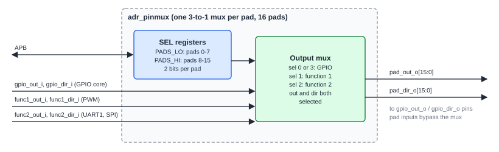

# Pin mux (`adr_pinmux`) datasheet

| | |
|---|---|
| IP name | `adr_pinmux`, pad output multiplexer |
| Type | ADR IP, our own RTL |
| Version | 1.0 (RTL), document revision 2.0 |
| Status | Verified at SoC level by `misc` (outside the regression), in part; no IP-level bench |
| RTL | `rtl/adr_ip/pinmux/rtl/adr_pinmux.sv` (one file) |
| SoC instance | `adr_soc_top.i_lsio.i_pinmux` |
| Base address | `0x1001_0000` (APB slot 14, 4 KiB) |
| Interrupt | None |
| Owner | Vijay Bogati |
| Date | 2026-11-14 |

### Revision history

| Revision | Date | Change |
|---|---|---|
| 1.0 | 2026-11-08 | First issue, generated from the RTL header |
| 2.0 | 2026-11-14 | Rewritten as a datasheet |

### Conventions

RW read and write; RO read only. A clock is one rising edge of `clk_i`.

## 1. Introduction

The 16 GPIO pads can carry other peripherals' outputs. For each pad, the pin mux selects which block drives the pad's output and output enable: the GPIO controller, alternate function 1 or alternate function 2.

### 1.1 Features

- 16 pads, 3 sources each, chosen with 2 bits per pad.
- Output value and direction switched together.
- Pad inputs reach every block at all times (no input muxing).
- Reset state: every pad is GPIO, so the chip starts with the GPIO controller in charge.
- APB slave, zero wait states, never returns an error.

### 1.2 Not supported

- Input selection: a function's input is not taken from a pad (SPI MISO, UART1 RX keep their own pins).
- Pull-ups, drive strength, slew rate, open-drain: the chip has no pad ring.
- No lock on the configuration.
- Alternate functions 1 and 2 on pads 8-15, and function 2 on pads 4-7, are not connected (output 0, input direction).

## 2. Functional description



The mux is combinational from the select registers: a new selection reaches the pad on the clock after the APB write. The peripherals carried as alternate functions also keep their own dedicated top-level pins, which are always driven.

### 2.1 Function table (in the SoC)

| Pad | Select 0 or 3 | Select 1 (function 1) | Select 2 (function 2) |
|---|---|---|---|
| 0 | GPIO 0 | PWM 0, output | UART1 TX, output |
| 1 | GPIO 1 | PWM 1, output | SPI SCLK, output |
| 2 | GPIO 2 | PWM 2, output | SPI CSN0, output |
| 3 | GPIO 3 | PWM 3, output | SPI MOSI, output |
| 4-7 | GPIO 4-7 | PWM 4-7, output | Not connected |
| 8-15 | GPIO 8-15 | Not connected | Not connected |

"Not connected" drives the pad's output with 0 and its direction with 0 (input).

## 3. Parameters

| Parameter | Type | Default | SoC value | Description |
|---|---|---|---|---|
| `NumPads` | `int unsigned` | 16 | `NumGpioPins` = 16 | Number of pads. The register layout supports up to 16 |

## 4. Signal description

| Signal | Dir | Width | Clock | Reset value | Description |
|---|---|---|---|---|---|
| `clk_i` | in | 1 | | | System clock, not gated |
| `rst_ni` | in | 1 | async | | System reset, active low |
| `psel_i`, `penable_i`, `pwrite_i` | in | 1 each | `clk_i` | | APB control |
| `paddr_i` | in | 3 | `clk_i` | | APB byte address, bits 2:0 only; bit 2 selects the register |
| `pwdata_i` | in | 32 | `clk_i` | | APB write data |
| `prdata_o` | out | 32 | comb. | | APB read data |
| `pready_o` / `pslverr_o` | out | 1 each | | 1 / 0 | Tied |
| `gpio_out_i`, `gpio_dir_i` | in | `NumPads` each | `clk_i` | | GPIO controller output and direction (1 = output) |
| `func1_out_i`, `func1_dir_i` | in | `NumPads` each | `clk_i` | | Alternate function 1 |
| `func2_out_i`, `func2_dir_i` | in | `NumPads` each | `clk_i` | | Alternate function 2 |
| `pad_out_o`, `pad_dir_o` | out | `NumPads` each | comb. | GPIO values | To the chip's `gpio_out_o` and `gpio_dir_o` pins |

## 5. Clocks and resets

One clock, `clk_i`, not gated; system reset; no clock-domain crossings. The outputs are combinational paths from the inputs to the pins.

## 6. Registers

### 6.1 Register map

Base address `0x1001_0000`.

| Offset | Name | Access | Reset value | Description |
|---|---|---|---|---|
| `0x00` | `PADS_LO` | RW | `0x0000_0000` | Selection for pads 0-7 |
| `0x04` | `PADS_HI` | RW | `0x0000_0000` | Selection for pads 8-15 |

Only `paddr[2:0]` reaches the block and only bit 2 is used: the two registers repeat every 8 bytes, and unaligned addresses select the same register as the aligned word.

### 6.2 `PADS_LO` (`0x00`) and `PADS_HI` (`0x04`)

| Bits | Field | Access | Reset | Description |
|---|---|---|---|---|
| 31:16 | | RO | 0 | Reserved, read 0 |
| 2k+1 : 2k | `pad_k` (k = 0..7) | RW | 0 | Source of pad k (`PADS_LO`) or pad k+8 (`PADS_HI`): 0 = GPIO, 1 = function 1, 2 = function 2, 3 = GPIO |

## 7. Interrupts

None.

## 8. Programming guide

```c
#define MUX_PADS_LO (*(volatile uint32_t *)0x10010000UL)
#define MUX_PADS_HI (*(volatile uint32_t *)0x10010004UL)
```

To put PWM 2 on pad 2 (read-modify-write):

```c
MUX_PADS_LO = (MUX_PADS_LO & ~(3u << 4)) | (1u << 4);
```

Before switching a pad, put the new source in its idle state (for example, start the PWM with a 0 duty cycle), so the pad does not glitch.

## 9. Timing

| Path | Latency |
|---|---|
| APB write to the pad's new source | 1 clock |
| Source output to pad | Combinational |

## 10. Integration

| Item | Detail |
|---|---|
| Parent | `adr_lsio_subsys` |
| APB | Slot `SlotMux` = 14, `paddr[2:0]` |
| Function 1 | `pwm_i` (8 PWM outputs), direction all outputs |
| Function 2 | `{spi_mosi_o, spi_csn_o[0], spi_sclk_o, uart1_tx_o}`, direction outputs |
| Timing | The pad outputs are combinational from the GPIO, PWM, SPI and UART1 registers; constrain them as chip outputs |

## 11. Verification

| Item | Status |
|---|---|
| SoC tests | `misc` (MISC-01: default GPIO, read-back, function 1 replaces GPIO on its pad only, PWM reaches its pad, UART1 TX idle level on pad 0, back to GPIO), outside the regression |
| Planned | `pinmux_data` (NEW-12): data through every function |
| Not tested | SPI on pads 1-3; data through UART1 on pad 0; select value 3 |

## 12. Known limitations

| Item | Limitation | Effect |
|---|---|---|
| LIMITATIONS 62 | Checked only in part | Data paths through the mux not proven |
| | No input muxing | A function's input still needs its own pin |

## 13. References

- `docs/MICROARCHITECTURE.md` section 13.6.
- [`../adr_soc/adr_lsio_subsys.md`](../adr_soc/adr_lsio_subsys.md), [`../third_party_ip/apb_gpio/ADR.md`](../third_party_ip/apb_gpio/ADR.md).
