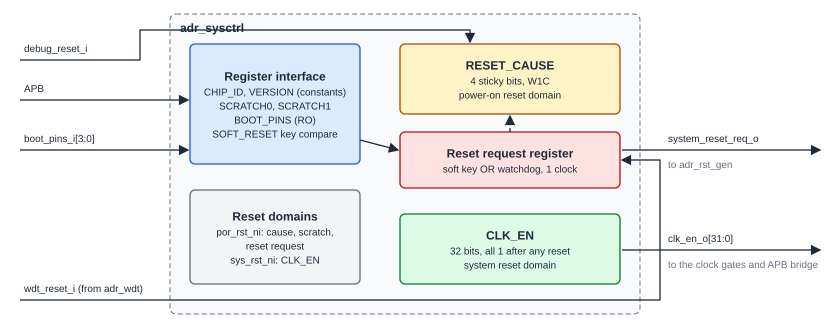
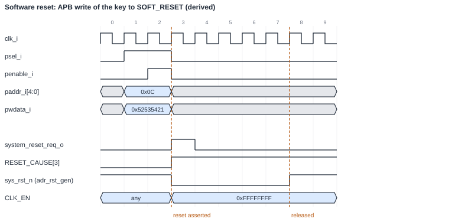

# System control (`adr_sysctrl`) datasheet

| | |
|---|---|
| IP name | `adr_sysctrl`, system control |
| Type | ADR IP, our own RTL |
| Version | 1.1 (RTL), document revision 2.1 |
| Status | Verified at SoC level (RTL and gate-level smoke); no IP-level bench |
| RTL | `rtl/adr_ip/sysctrl/rtl/adr_sysctrl.sv` (one file, no sub-modules) |
| SoC instance | `adr_soc_top.i_periph.i_sysctrl` |
| Base address | `0x1000_D000` (APB slot 12, 4 KiB) |
| Interrupt | None |
| Owner | Vijay Bogati |
| Date | 2026-11-14 |

### Revision history

| Revision | Date | Change |
|---|---|---|
| 1.0 | 2026-11-08 | First issue, generated from the RTL header |
| 2.0 | 2026-11-14 | Rewritten as a datasheet |
| 2.1 | 2026-11-15 | `RESET_CAUSE[4]`: DDR4 drain timeout, input `ddr_drain_timeout_i` (RTL 1.1) |

### Conventions

RW read and write; RO read only (writes ignored); WO write only (reads 0); W1C write 1 to clear. A clock is one rising edge of `clk_i` (10 ns in the SoC). *Derived* marks values worked out from the RTL, not yet measured.

## 1. Introduction

System control holds the chip-wide state that software and the reset logic need: the chip's identity, the boot pins, why the last reset happened, a software reset, two words that survive system resets, and the clock enables of the gated peripherals.

### 1.1 Features

- Chip ID `0x4144_5231` ("ADR1") and version `0x0001_0000` (1.0), read-only.
- Reset cause: five sticky bits (power-on, debug module, watchdog, software, DDR4 drain timeout), write 1 to clear.
- Software reset, protected by a 32-bit key (`0x5253_5421`, "RST!").
- One registered system reset request for the watchdog and software resets.
- Two 32-bit scratch registers kept across system resets (cleared only at power-on).
- Boot pins readable (4 bits, synchronized outside the block).
- 32 clock-enable bits for the peripheral clock gates; all on after any reset.
- APB slave, zero wait states, never returns an error.

### 1.2 Not supported

- The chip ID and version are placeholders (LIMITATIONS item 49).
- The boot pins are only readable: the CPU always boots from the boot ROM, whatever they say.
- No lock on `CLK_EN` or `SOFT_RESET` beyond the key.
- No reset of individual blocks; the software reset resets the whole system.

## 2. Functional description



### 2.1 Two reset domains

| Domain | Reset | State |
|---|---|---|
| Power-on | `por_rst_ni` (the chip's `rst_ni` pin) | `RESET_CAUSE`, `SCRATCH0`, `SCRATCH1`, the reset request register |
| System | `sys_rst_ni` | `CLK_EN` |

So a watchdog, software or debug reset leaves the cause and the scratch words for the software that boots next, while the clock enables go back to all on, which every block needs to be reset properly.

### 2.2 Reset requests

A write of the key to `SOFT_RESET`, or `wdt_reset_i` from the watchdog, sets the request register on the next clock. `system_reset_req_o` goes to `adr_rst_gen`, which asserts the system reset at once. The register is on the power-on reset, so it stays valid while the system reset clears the requester: a requester cleared by the reset it caused would otherwise drop its request before it could be recorded. The request lasts as long as its source: one clock for a software reset; for the watchdog, until the system reset clears the watchdog's own request (*derived*, see the watchdog datasheet).

The debug module's `ndmreset` does not pass through this register: `adr_rst_gen` takes it directly. System control only records it.

### 2.3 Reset cause

| Bit | Cause | Set when |
|---|---|---|
| 0 | Power-on | `por_rst_ni` is low (reset value 1) |
| 1 | Debug module | `debug_reset_i` (`ndmreset`) is high, on every clock while it is high |
| 2 | Watchdog | `wdt_reset_i` is high |
| 3 | Software | The key is written to `SOFT_RESET` |
| 4 | DDR4 drain timeout | `ddr_drain_timeout_i` pulses: `adr_rst_gen` went ahead with a warm reset before the DDR4 port was idle. Set together with the cause of that reset |

Bits only clear by writing 1 or at power-on, so causes accumulate. If a hardware event and a clear of the same bit happen on the same clock, the event wins.

### 2.4 Clock enables

`clk_en_o[n]` enables the clock gate of one peripheral. A gated peripheral cannot answer APB, so the SoC APB bridge answers for it with an error (`MICROARCHITECTURE.md` section 5.2). Bits in use:

| Bit | Block | Bit | Block |
|---|---|---|---|
| 0 | UART1 | 6 | PWM |
| 1 | SPI | 7 | GPIO |
| 2 | Not used | 8 | Timer |
| 3 | QSPI | 9 | AES |
| 4 | I2C | 10 | ADC |
| 5 | Not used | 11-31 | Not used (stored, no effect) |

## 3. Parameters

| Parameter | Type | Default | SoC value | Description |
|---|---|---|---|---|
| `ChipId` | `logic [31:0]` | `32'h4144_5231` | default | Value of `CHIP_ID` |
| `Version` | `logic [31:0]` | `32'h0001_0000` | default | Value of `VERSION`: major in 31:16, minor in 15:0 |
| `SoftResetKey` | `logic [31:0]` | `32'h5253_5421` | default | Value to write to `SOFT_RESET` |

## 4. Signal description

| Signal | Dir | Width | Clock | Reset value | Description |
|---|---|---|---|---|---|
| `clk_i` | in | 1 | | | System clock, not gated |
| `por_rst_ni` | in | 1 | async | | Power-on reset, active low |
| `sys_rst_ni` | in | 1 | async | | System reset, active low (resets `CLK_EN` only) |
| `psel_i`, `penable_i`, `pwrite_i` | in | 1 each | `clk_i` | | APB control |
| `paddr_i` | in | 5 | `clk_i` | | APB byte address; bits 4:0 only (section 6.1) |
| `pwdata_i` | in | 32 | `clk_i` | | APB write data |
| `prdata_o` | out | 32 | comb. | | APB read data |
| `pready_o` | out | 1 | | 1 | Tied 1 |
| `pslverr_o` | out | 1 | | 0 | Tied 0 |
| `boot_pins_i` | in | 4 | `clk_i` | | Boot pins, already synchronized (2-flop `sync` cells in `adr_periph_subsys`) |
| `debug_reset_i` | in | 1 | `clk_i` | | `ndmreset` from the debug module; recorded only |
| `wdt_reset_i` | in | 1 | `clk_i` | | Reset request from the watchdog |
| `ddr_drain_timeout_i` | in | 1 | `clk_i` | | One-clock pulse from `adr_rst_gen`: a warm reset went ahead before the DDR4 port drained; recorded only |
| `system_reset_req_o` | out | 1 | `clk_i` | 0 (power-on) | System reset request to `adr_rst_gen`, registered |
| `clk_en_o` | out | 32 | `clk_i` | `0xFFFF_FFFF` (system) | Clock enables, registered |

## 5. Clocks and resets

| Item | Value |
|---|---|
| Clock domains | One: `clk_i` |
| Clock gating | None; not gated by the SoC |
| Resets | `por_rst_ni` and `sys_rst_ni`, both asynchronous assert, synchronous release from `adr_rst_gen` |
| Clock-domain crossings | None inside. `boot_pins_i` is synchronized by the parent |

## 6. Registers

### 6.1 Register map

Base address `0x1000_D000`. All registers 32 bits.

| Offset | Name | Access | Reset value | Reset domain | Description |
|---|---|---|---|---|---|
| `0x00` | `CHIP_ID` | RO | `0x4144_5231` | | Chip identity |
| `0x04` | `VERSION` | RO | `0x0001_0000` | | Version 1.0 |
| `0x08` | `RESET_CAUSE` | RW, W1C | `0x0000_0001` | Power-on | Why the last resets happened |
| `0x0C` | `SOFT_RESET` | WO | (reads 0) | | Write the key to reset the system |
| `0x10` | `SCRATCH0` | RW | `0x0000_0000` | Power-on | Kept across system resets |
| `0x14` | `SCRATCH1` | RW | `0x0000_0000` | Power-on | Kept across system resets |
| `0x18` | `BOOT_PINS` | RO | pins | | Boot pin levels |
| `0x1C` | `CLK_EN` | RW | `0xFFFF_FFFF` | System | Peripheral clock enables |

Only `paddr[4:0]` is decoded, so the map repeats every 32 bytes across the slot. PSTRB is not used: every write writes the whole register. No access returns an error.

### 6.2 `CHIP_ID` (`0x00`) and `VERSION` (`0x04`)

| Register | Bits | Field | Access | Reset | Description |
|---|---|---|---|---|---|
| `CHIP_ID` | 31:0 | `id` | RO | `0x4144_5231` | ASCII "ADR1" |
| `VERSION` | 31:16 | `major` | RO | 1 | Major version |
| `VERSION` | 15:0 | `minor` | RO | 0 | Minor version |

### 6.3 `RESET_CAUSE` (`0x08`)

| Bits | Field | Access | Reset | Description |
|---|---|---|---|---|
| 31:5 | | RO | 0 | Reserved |
| 4 | `ddr_drain_timeout` | RW, W1C | 0 | A warm reset went ahead before the DDR4 port was idle (1,024 clocks); DDR4 contents and state may be inconsistent until a power-on reset |
| 3 | `software` | RW, W1C | 0 | A software reset happened |
| 2 | `watchdog` | RW, W1C | 0 | A watchdog reset happened |
| 1 | `debug` | RW, W1C | 0 | The debug module reset the system (`ndmreset`) |
| 0 | `power_on` | RW, W1C | 1 | Power-on reset |

### 6.4 `SOFT_RESET` (`0x0C`)

| Bits | Field | Access | Reset | Description |
|---|---|---|---|---|
| 31:0 | `key` | WO | | Writing `0x5253_5421` resets the system and sets `RESET_CAUSE.software`. Other values do nothing. Reads 0 |

### 6.5 `SCRATCH0` (`0x10`) and `SCRATCH1` (`0x14`)

| Bits | Field | Access | Reset | Description |
|---|---|---|---|---|
| 31:0 | `data` | RW | 0 | Free for software; survives system resets. The UVM bench's C-UVM handshake uses both (tagged words in `SCRATCH0`, acknowledge in `SCRATCH1`) |

### 6.6 `BOOT_PINS` (`0x18`)

| Bits | Field | Access | Reset | Description |
|---|---|---|---|---|
| 31:4 | | RO | 0 | Reserved |
| 3:0 | `pins` | RO | | Current level of `boot_pins_i[3:0]`, 2 clocks behind the pins. Not latched at reset. Reads 0 for 2 clocks after a system reset, as the synchronizers are on the system reset |

### 6.7 `CLK_EN` (`0x1C`)

| Bits | Field | Access | Reset | Description |
|---|---|---|---|---|
| 31:0 | `en` | RW | `0xFFFF_FFFF` | 1 = the block's clock runs. Bit use in section 2.4. Unused bits are stored and read back |

## 7. Interrupts

None.

## 8. Programming guide

```c
#define SYS_BASE        0x1000D000UL
#define SYS_RESET_CAUSE (*(volatile uint32_t *)(SYS_BASE + 0x08))
#define SYS_SOFT_RESET  (*(volatile uint32_t *)(SYS_BASE + 0x0C))
#define SYS_CLK_EN      (*(volatile uint32_t *)(SYS_BASE + 0x1C))
#define SYS_RESET_KEY   0x52535421U
```

### 8.1 At boot

1. Read `RESET_CAUSE`. More than one bit may be set if earlier causes were never cleared.
2. Act on it (for example, log a watchdog reset kept in `SCRATCH0`).
3. Write the value read back to `RESET_CAUSE` to clear exactly those bits.

### 8.2 Software reset

1. Make sure no DMA or Ethernet transfer is running, if their data matters.
2. Optionally store a reason in `SCRATCH0` or `SCRATCH1`.
3. Write `SYS_SOFT_RESET = SYS_RESET_KEY`. The write completes; the reset follows one clock later. Instructions after the store may start but never finish usefully: follow it with a loop.

### 8.3 Gating a peripheral clock

1. Make sure the peripheral is idle and mask its PLIC source.
2. Clear its `CLK_EN` bit (read-modify-write). Any access to it now returns a bus error.
3. To restart, set the bit again; the block keeps the state it had.

## 9. Timing



| Path | Latency |
|---|---|
| Key written to `SOFT_RESET` to `system_reset_req_o` | 1 clock |
| `system_reset_req_o` to system reset | Asynchronous, at once |
| System reset length (software reset) | About 5 clocks (*derived*: 1 request clock, then 4 synchronizer clocks) |
| `CLK_EN` write to the clock gate | 1 clock, plus the gate's own latch |
| Boot pin change to `BOOT_PINS` | 2 clocks |

## 10. Integration

| Item | Detail |
|---|---|
| Parent | `adr_periph_subsys` |
| APB | Slot `SlotSys` = 12, `paddr[4:0]` |
| `por_rst_ni` | The chip's `rst_ni` pin; `sys_rst_ni` is `sys_rst_n` from `adr_rst_gen` |
| `boot_pins_i` | Chip pins `boot_pins_i[3:0]` through 2-flop `sync` cells (`adr_periph_subsys`, `gen_boot_sync`) |
| `debug_reset_i` | `ndmreset` from the debug module |
| `wdt_reset_i` | `adr_wdt.reset_req_o` |
| `system_reset_req_o` | `adr_rst_gen.system_reset_req_i` |
| `clk_en_o` | The clock gates in `adr_lsio_subsys` and `adr_periph_subsys`, and the APB bridge's gated-slot replies |
| Constants | `ClkUart1`..`ClkAdc` bit numbers, `SlotSys`, `SysBase` in `adr_soc_pkg.sv` |
| Timing | Single-cycle paths. `system_reset_req_o` feeds the reset synchronizer's asynchronous input: treat as a reset path in timing |
| DFT | Two asynchronous reset domains; in scan both resets must be controllable from a test pin (not provided yet) |

## 11. Verification

| Item | Status |
|---|---|
| SoC tests | `sys` (SYS-04: identity, boot pins, scratch; SYS-05: reset causes over three boots, software reset key), `timers` (TIMERS-07), `debug` (DEBUG-09), `misc` (MISC-05, MISC-06: clock gating, state kept across reset) |
| Benches | Verilator bench, proven on Verilator; UVM bench (also uses the scratch registers for the handshake), not validated in this release |
| Planned | `clkgate_all` (NEW-13); assertions SYS-A01, RST-A01, CG-A01; `cg_reset`, `cg_clkgate` |
| Not tested | Clear and hardware event on the same clock; boot pins changing while running |

## 12. Known limitations

| Item | Limitation | Effect |
|---|---|---|
| LIMITATIONS 49 | Chip ID and version are placeholders; boot pins are not used for boot | Boot source can't be chosen in hardware |
| | Register map repeats every 32 bytes | A stray write in the slot can hit a register, though `SOFT_RESET` still needs the key |
| | `CLK_EN` bits 2, 5, 11-31 have no effect | Software must not rely on them |

## 13. References

- `docs/MICROARCHITECTURE.md`: sections 5.2 (clock gating), 6 (resets).
- [`adr_wdt.md`](adr_wdt.md), [`../adr_soc/adr_rst_gen.md`](../adr_soc/adr_rst_gen.md), [`../adr_soc/adr_periph_subsys.md`](../adr_soc/adr_periph_subsys.md), [`../protocols/APB.md`](../protocols/APB.md).
