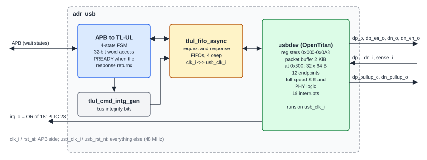
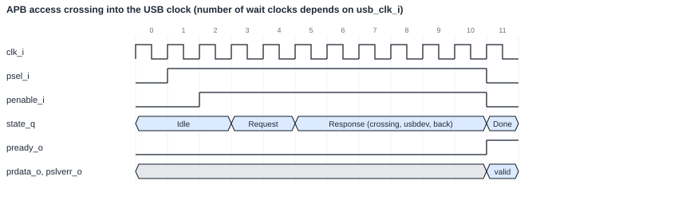

# USB device controller (`adr_usb`) datasheet

| | |
|---|---|
| IP name | `adr_usb`, USB 2.0 full-speed device |
| Type | ADR IP: our own APB-to-TL-UL bridge and clock crossing around the unmodified OpenTitan `usbdev` |
| Version | 1.0 (RTL), document revision 2.0 |
| Status | Verified at SoC level (`usb` in the regression) against our own host model; the transceiver is outside the SoC |
| RTL | `rtl/adr_ip/usb/rtl/adr_usb.sv`, `adr_usb_prims.sv` (primitive wrappers); `usbdev` and TL-UL in `rtl/third_party_ip/usb/` |
| SoC instance | `adr_soc_top.i_usb` |
| Base address | `0x1001_5000` (APB slot 19, 4 KiB): registers at `+0x000`, packet buffer at `+0x800` |
| Interrupt | PLIC source 28, level (OR of 18 upstream interrupts) |
| Owner | Vijay Bogati |
| Date | 2026-11-14 |

### Revision history

| Revision | Date | Change |
|---|---|---|
| 1.0 | 2026-11-08 | First issue, generated from the RTL header |
| 2.0 | 2026-11-14 | Rewritten as a datasheet |

### Conventions

RW read and write; RO read only. *Derived* marks values worked out from the RTL, not yet measured. Field-level register details are those of the upstream `usbdev` release used, documented in its `registers.md` (copied under `docs/ip/third_party_ip/opentitan_usbdev/upstream/`).

## 1. Introduction

`adr_usb` makes the chip a USB 2.0 full-speed (12 Mbit/s) device. The OpenTitan `usbdev` core handles the bus protocol, the endpoints and a 2 KiB packet buffer. Our wrapper gives it an APB register port and moves each access across into the USB clock, on which the whole core runs.

### 1.1 Features

- USB 2.0 full speed, device only; 12 endpoints, IN and OUT, control, bulk, interrupt and isochronous.
- 2 KiB packet buffer of 32 buffers of 64 bytes, in the register space.
- Hardware handles SETUP, data toggles, handshakes (ACK, NAK, STALL), CRC and bit stuffing.
- 18 interrupt causes, one PLIC line.
- D+ pull-up control, VBUS sense input, separate output, enable and input pins (no transceiver in the chip).
- Not a bus master: no DMA, no cache coherency concern.

### 1.2 Not supported

- High speed, low speed or host mode (LIMITATIONS item 65).
- Wake from suspend: the always-on wake logic is not included (item 85).
- Clock gating (item 88); register access with `usb_clk_i` stopped hangs (item 67).
- Byte or halfword writes: every write writes the full word.
- Alerts (bus-integrity faults) are not collected.
- No device software stack (item 91).

## 2. Functional description



### 2.1 Register access path

An APB access starts a 4-state machine on `clk_i`:

| State | What happens |
|---|---|
| Idle | Waits for `psel_i` and `penable_i` |
| Request | Sends a TL-UL `Get` (read) or `PutFullData` (write) of the full 32-bit word at `paddr[11:2]`, with integrity bits, into the asynchronous FIFO |
| Response | Waits for the response from the USB clock domain; latches read data and `d_error` |
| Done | `pready_o` = 1 for one clock with `prdata_o` and `pslverr_o` |

So each access takes several system clocks and several USB clocks (*derived*: roughly 2 to 3 synchronizer clocks each way plus the core's own cycle). `pslverr_o` reports a TL-UL error from the core, for example an access the core does not accept.

### 2.2 The device core

`usbdev` works as its upstream documents describe: software makes buffers available for OUT and SETUP packets (`AVOUTBUFFER`, `AVSETUPBUFFER`), received packets are reported through `RXFIFO` with buffer, length and endpoint, and IN packets are offered with `CONFIGIN_n` (buffer, size, ready) and acknowledged in `IN_SENT`. See `programmers_guide.md` and `theory_of_operation.md` upstream.

### 2.3 Connection

`USBCTRL.enable` turns on the D+ pull-up (`dp_pullup_o`), which tells the host a full-speed device is present. `sense_i` (VBUS) must be high. The device drives D+ and D- only while sending (`dp_en_o`, `dn_en_o`).

## 3. Parameters

None at the wrapper. The core is used with its default configuration (12 endpoints, 2 KiB buffer).

## 4. Signal description

| Signal | Dir | Width | Clock | Reset value | Description |
|---|---|---|---|---|---|
| `clk_i` | in | 1 | | | System clock (APB side) |
| `rst_ni` | in | 1 | async | | System reset (APB side) |
| `psel_i`, `penable_i`, `pwrite_i` | in | 1 each | `clk_i` | | APB control |
| `paddr_i` | in | 12 | `clk_i` | | APB byte address; bits 11:2 used |
| `pwdata_i` | in | 32 | `clk_i` | | APB write data |
| `prdata_o` | out | 32 | `clk_i` | 0 | Read data, valid with `pready_o` |
| `pready_o` | out | 1 | `clk_i` | 0 | High for one clock when the access ends |
| `pslverr_o` | out | 1 | `clk_i` | 0 | Error response from the core |
| `irq_o` | out | 1 | `usb_clk_i` | 0 | OR of the 18 core interrupts; crosses to the PLIC, which samples it on `clk_i` |
| `usb_clk_i` | in | 1 | | | USB clock, 48 MHz (4 per bit) |
| `usb_rst_ni` | in | 1 | async | | Reset in the USB domain, from `adr_rst_gen` |
| `dp_i`, `dn_i` | in | 1 each | async | | Bus levels from the transceiver |
| `dp_o`, `dn_o` | out | 1 each | `usb_clk_i` | | Levels to drive |
| `dp_en_o`, `dn_en_o` | out | 1 each | `usb_clk_i` | 0 | Drive enables |
| `sense_i` | in | 1 | async | | VBUS present |
| `dp_pullup_o` | out | 1 | `usb_clk_i` | 0 | D+ pull-up enable: full-speed connect |
| `dn_pullup_o` | out | 1 | `usb_clk_i` | 0 | D- pull-up (low speed); unused |

## 5. Clocks and resets

| Item | Value |
|---|---|
| Clock domains | `clk_i` (APB state machine and FIFO side); `usb_clk_i` (everything else, including the core's always-on part, tied to the same clock) |
| Clock gating | None |
| Crossings | Register traffic: `tlul_fifo_async`, 4-deep each way. `irq_o`: a level from the USB domain; the PLIC gateway treats it as level. Bus pins: synchronized inside the core |
| Resets | `rst_ni` (APB side), `usb_rst_ni` (USB side, synchronized release in `usb_clk_i`); the USB clock must run for the reset to complete |

## 6. Registers

### 6.1 Register map (summary)

Base address `0x1001_5000`. All accesses are 32-bit words.

| Offset | Name | Description |
|---|---|---|
| `0x000` | `INTR_STATE` | Interrupt state, W1C (18 bits) |
| `0x004` | `INTR_ENABLE` | Interrupt enables |
| `0x008` | `INTR_TEST` | Force interrupts, for test |
| `0x00C` | `ALERT_TEST` | Force an alert (alerts not collected here) |
| `0x010` | `USBCTRL` | Enable (pull-up), device address, resume link |
| `0x014` | `EP_OUT_ENABLE` | OUT endpoint enables |
| `0x018` | `EP_IN_ENABLE` | IN endpoint enables |
| `0x01C` | `USBSTAT` | Frame number, link state, sense, FIFO levels |
| `0x020` | `AVOUTBUFFER` | Push a free buffer for OUT packets |
| `0x024` | `AVSETUPBUFFER` | Push a free buffer for SETUP packets |
| `0x028` | `RXFIFO` | Pop a received packet: buffer, size, SETUP flag, endpoint |
| `0x02C` | `RXENABLE_SETUP` | Accept SETUP per endpoint |
| `0x030` | `RXENABLE_OUT` | Accept OUT per endpoint |
| `0x034` | `SET_NAK_OUT` | NAK OUT after each packet, per endpoint |
| `0x038` | `IN_SENT` | IN packet acknowledged by the host, per endpoint, W1C |
| `0x03C` | `OUT_STALL` | STALL OUT per endpoint |
| `0x040` | `IN_STALL` | STALL IN per endpoint |
| `0x044`-`0x070` | `CONFIGIN_0`-`11` | IN packet per endpoint: buffer, size, ready, pending |
| `0x074` | `OUT_ISO` | Isochronous OUT endpoints |
| `0x078` | `IN_ISO` | Isochronous IN endpoints |
| `0x07C` | `OUT_DATA_TOGGLE` | OUT data toggles |
| `0x080` | `IN_DATA_TOGGLE` | IN data toggles |
| `0x084` | `PHY_PINS_SENSE` | Pin levels, for test |
| `0x088` | `PHY_PINS_DRIVE` | Drive pins directly, for test |
| `0x08C` | `PHY_CONFIG` | PHY options (differential receiver, pin swap, etc.) |
| `0x090` | `WAKE_CONTROL` | Wake logic control (wake logic not included) |
| `0x094` | `WAKE_EVENTS` | Wake events (wake logic not included) |
| `0x098` | `FIFO_CTRL` | Reset the available-buffer and receive FIFOs |
| `0x09C`-`0x0A8` | `COUNT_OUT`, `COUNT_IN`, `COUNT_NODATA_IN`, `COUNT_ERRORS` | Event counters |
| `0x800`-`0xFFC` | `BUFFER` | Packet buffer: buffer b, word w at `0x800 + 64 b + 4 w` |

Fields, access types and reset values: upstream `registers.md`.

## 7. Interrupts

| Interrupt | PLIC source | Type | Causes |
|---|---|---|---|
| `irq_o` | 28 | Level | OR of: packet received, packet sent, powered, disconnected, host lost, link reset, link suspend, link resume, available-OUT empty, receive FIFO full, available-buffer overflow, link IN error, link OUT error, CRC error, PID error, bit-stuff error, frame (SOF), available-SETUP empty |

Read `INTR_STATE` to find the causes and clear them there (W1C), before completing the PLIC claim.

## 8. Programming guide

As used by `tb/verilator/c_tests/usb.c`:

```c
#define USB_BASE 0x10015000UL
#define USB(off) (*(volatile uint32_t *)(USB_BASE + (off)))
#define USB_INTR_STATE    USB(0x00)
#define USB_INTR_ENABLE   USB(0x04)
#define USB_CTRL          USB(0x10)
#define USB_EP_OUT_ENABLE USB(0x14)
#define USB_EP_IN_ENABLE  USB(0x18)
#define USB_STAT          USB(0x1C)
#define USB_AV_OUT        USB(0x20)
#define USB_AV_SETUP      USB(0x24)
#define USB_RX_FIFO       USB(0x28)
#define USB_RX_EN_SETUP   USB(0x2C)
#define USB_RX_EN_OUT     USB(0x30)
#define USB_IN_SENT       USB(0x38)
#define USB_CONFIG_IN(ep) USB(0x44 + 4 * (ep))
#define USB_BUFFER(id, w) USB(0x800 + 64 * (id) + 4 * (w))
```

### 8.1 Bring-up

1. Make sure `usb_clk_i` runs (any access hangs otherwise).
2. Enable the endpoints in `EP_OUT_ENABLE`, `EP_IN_ENABLE`; allow SETUP on endpoint 0 (`RXENABLE_SETUP`) and OUT where needed (`RXENABLE_OUT`).
3. Push free buffers to `AVSETUPBUFFER` and `AVOUTBUFFER`.
4. Enable interrupts, then set `USBCTRL.enable` to connect.

### 8.2 Receiving

On "packet received": pop `RXFIFO`, read the bytes from the buffer it names, give the buffer back with `AVOUTBUFFER` or `AVSETUPBUFFER`.

### 8.3 Sending

Write the bytes to a free buffer, then `CONFIGIN_n` with the buffer, size and ready bit. On "packet sent", check and clear `IN_SENT` bit n.

A full device needs enumeration and descriptors on top (LIMITATIONS item 91).

## 9. Timing



| Path | Latency |
|---|---|
| APB access | Several `clk_i` and `usb_clk_i` clocks (*derived*); no fixed value. Avoid polling in tight loops on time-critical paths |
| Bit time | 4 `usb_clk_i` clocks at 48 MHz (83.3 ns) |
| `usb` test | 176,988 clocks on both benches (cycle-count baseline) |

## 10. Integration

| Item | Detail |
|---|---|
| Parent | `adr_soc_top` |
| APB | Slot `SlotUsb` = 19, `paddr[11:0]`; unlike our other APB blocks it inserts wait states and can return errors |
| Pins | `usb_clk_i`, `usb_dp_i/o/en_o`, `usb_dn_i/o/en_o`, `usb_sense_i`, `usb_dp_pullup_o`, `usb_dn_pullup_o`; an external full-speed transceiver and a 1.5 kOhm D+ pull-up switched by `usb_dp_pullup_o` |
| Reset | `usb_rst_n` from `adr_rst_gen`, released in `usb_clk_i` |
| Interrupt | `IrqUsb` = 28 |
| Primitives | `adr_usb_prims.sv` maps OpenTitan primitives to generic ones; a technology library would replace them |
| Third-party | OpenTitan `usbdev` (release before Oct 2024, LIMITATIONS item 66) |

## 11. Verification

| Item | Status |
|---|---|
| SoC tests | `usb` (USB-01 to 05: start disabled, buffer read-back, bus sense, SOF frame number, SETUP on endpoint 0, OUT on endpoint 1, IN accepted, sent flag) |
| Benches | Baseline bench (host model `adr_tb_usb_host`); UVM bench (USB agent: monitor checks every packet; host driver and sequence replace the model, not yet run) |
| Planned | `usb_ep` (NEW-08), `concurrent` (NEW-11); `cg_usb`; assertions USB-A01 to A06 |
| Not tested | NAK, STALL, DATA1, other endpoints, isochronous, suspend and resume, errors from the host |

## 12. Known limitations

| Item | Limitation | Effect |
|---|---|---|
| LIMITATIONS 65 | Full speed, device only | |
| LIMITATIONS 66 | Older OpenTitan release | Later fixes missing |
| LIMITATIONS 67 | Registers hang if `usb_clk_i` stops | CPU stalls |
| LIMITATIONS 85 | No wake from USB | |
| LIMITATIONS 88 | No clock gating | |
| LIMITATIONS 91 | No USB software | Not a real USB device yet |
| LIMITATIONS 71, 107, 108 | Sanity test against our own host | |

## 13. References

- USB 2.0 specification, chapters 7 and 8.
- OpenTitan `usbdev`: `docs/ip/third_party_ip/opentitan_usbdev/upstream/hw/ip/usbdev/` (`README.md`, `doc/registers.md`, `doc/programmers_guide.md`, `doc/theory_of_operation.md`).
- `docs/MICROARCHITECTURE.md` section 12.7.
- [`../third_party_ip/opentitan_usbdev/ADR.md`](../third_party_ip/opentitan_usbdev/ADR.md).
