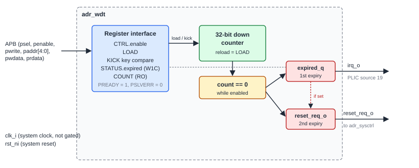
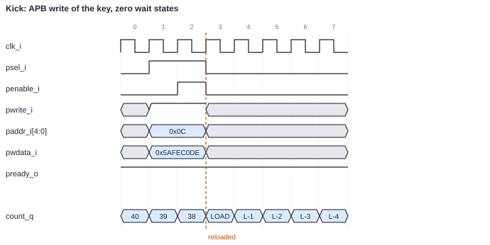
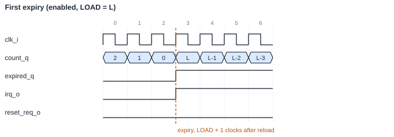
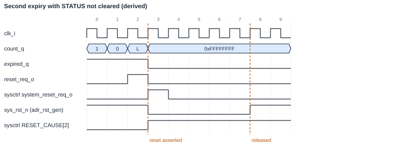

# Watchdog timer (`adr_wdt`) datasheet

| | |
|---|---|
| IP name | `adr_wdt`, watchdog timer |
| Type | ADR IP, our own RTL |
| Version | 1.0 (RTL), document revision 2.0 |
| Status | Verified at SoC level (RTL and gate-level smoke); no IP-level bench |
| RTL | `rtl/adr_ip/wdt/rtl/adr_wdt.sv` (one file, no sub-modules) |
| SoC instance | `adr_soc_top.i_periph.i_wdt` |
| Base address | `0x1000_A000` (APB slot 9, 4 KiB) |
| Interrupt | PLIC source 19, level |
| Owner | Vijay Bogati |
| Date | 2026-11-14 |

### Revision history

| Revision | Date | Change |
|---|---|---|
| 1.0 | 2026-11-08 | First issue, generated from the RTL header |
| 2.0 | 2026-11-14 | Rewritten as a datasheet: features, block diagram, signal descriptions, field-level registers with access and reset values, timing diagrams, programming guide, integration and verification sections |

### Conventions

| Term | Meaning |
|---|---|
| RW | Read and write |
| RO | Read only; writes are ignored |
| WO | Write only; reads return 0 |
| W1C | Write 1 to clear; writing 0 has no effect |
| Clock | One rising edge of `clk_i` (10 ns in the SoC) |
| *Derived* | Worked out from the RTL, not yet measured in simulation |

## 1. Introduction

The watchdog detects software that has stopped running. Software must reload the counter (a "kick") before it reaches zero. The first time it reaches zero the watchdog raises an interrupt, so software gets one chance to recover; if it reaches zero a second time without the interrupt being cleared, the watchdog requests a system reset.

### 1.1 Features

- 32-bit down counter clocked by the system clock: timeouts from 1 clock to 2^32 clocks (42.9 s at 100 MHz).
- Two-stage response: interrupt on the first expiry, system reset request on the second.
- Kick protected by a 32-bit key (`0x5AFE_C0DE`); any other value is ignored.
- Counter value readable at any time.
- APB slave, zero wait states, never returns an error.
- Single clock, single asynchronous reset, no clock-domain crossing.

### 1.2 Not supported

- No lock: software can disable the watchdog at any time (LIMITATIONS item 43).
- No windowed mode (kicks are accepted at any count).
- No separate clock: the watchdog stops if the system clock stops.
- No pause in debug mode: the counter runs while the CPU is halted by the debugger.
- No byte or halfword writes: PSTRB is not used, every write writes the whole register.

## 2. Functional description



### 2.1 Counter

While `CTRL.enable` is 1, the counter decrements by one on every clock. When it is 0 on a clock edge, it reloads from `LOAD` instead of decrementing. So after a reload the next expiry comes **`LOAD + 1` clocks** later.

The counter is reloaded from `LOAD`, without counting, by:

| Event | Effect on the counter |
|---|---|
| Any write to `CTRL` (enable or disable) | Reloads from the old `LOAD`; starting and stopping always begin from a full count |
| Any write to `LOAD` | Takes the new value |
| A write of the key to `KICK` | Reloads from `LOAD` |
| Expiry (count 0 while enabled) | Reloads from `LOAD` |

While `CTRL.enable` is 0 the counter holds its value.

If several happen on the same clock, the priority is: `CTRL` write, then `LOAD` write, then kick, then counting.

### 2.2 Expiry and reset

```
count = 0 and STATUS.expired = 0  ->  reload, set STATUS.expired (interrupt)
count = 0 and STATUS.expired = 1  ->  reload, set reset_req_o (system reset)
```

`STATUS.expired` drives `irq_o` directly. **A kick does not clear it**: the interrupt handler must write 1 to `STATUS`, or the next expiry resets the system.

`reset_req_o` is a register. Once set, it stays set until the system reset it causes clears it (the watchdog is on the system reset). System control (`adr_sysctrl`) registers the request, records the watchdog as the reset cause (`RESET_CAUSE[2]`), and `adr_rst_gen` asserts the system reset. With a 4-stage reset synchronizer, the system reset is low for about 5 clocks (*derived*, Figure 4).

### 2.3 State after reset

After any system reset (power-on, software, watchdog, debug): disabled, `LOAD` and the count all-ones, no interrupt, no reset request. Software must enable it again after every boot.

## 3. Parameters

| Parameter | Type | Default | SoC value | Description |
|---|---|---|---|---|
| `KickKey` | `logic [31:0]` | `32'h5AFE_C0DE` | default | Value that must be written to `KICK` to reload the counter |

## 4. Signal description

| Signal | Dir | Width | Clock | Reset value | Description |
|---|---|---|---|---|---|
| `clk_i` | in | 1 | | | System clock. Not gated in the SoC |
| `rst_ni` | in | 1 | async | | System reset, active low, asynchronous assert. In the SoC it is `sys_rst_n`, so the watchdog is reset by its own reset request |
| `psel_i` | in | 1 | `clk_i` | | APB select |
| `penable_i` | in | 1 | `clk_i` | | APB enable (access phase) |
| `pwrite_i` | in | 1 | `clk_i` | | APB direction, 1 = write |
| `paddr_i` | in | 5 | `clk_i` | | APB byte address within the block. Only bits 4:0 are decoded (section 6.1) |
| `pwdata_i` | in | 32 | `clk_i` | | APB write data |
| `prdata_o` | out | 32 | comb. | | APB read data, decoded from `paddr_i` only (valid whenever `paddr_i` is) |
| `pready_o` | out | 1 | | 1 | Tied 1: no wait states |
| `pslverr_o` | out | 1 | | 0 | Tied 0: no errors |
| `irq_o` | out | 1 | `clk_i` | 0 | Interrupt, level, active high; equals `STATUS.expired` |
| `reset_req_o` | out | 1 | `clk_i` | 0 | System reset request, registered, active high; held until reset |

## 5. Clocks and resets

| Item | Value |
|---|---|
| Clock domains | One: `clk_i` |
| Clock gating | None inside; the SoC does not gate this block (it has no `CLK_EN` bit) |
| Reset | `rst_ni`, asynchronous assert; release must be synchronous to `clk_i` (done by `adr_rst_gen`) |
| Flops with reset | All: `enable_q`, `load_q`, `count_q`, `expired_q`, `reset_req_o` |
| Clock-domain crossings | None |

## 6. Registers

### 6.1 Register map

Base address `0x1000_A000`. All registers are 32 bits, at word offsets.

| Offset | Name | Access | Reset value | Description |
|---|---|---|---|---|
| `0x00` | `CTRL` | RW | `0x0000_0000` | Enable |
| `0x04` | `LOAD` | RW | `0xFFFF_FFFF` | Reload value |
| `0x08` | `COUNT` | RO | `0xFFFF_FFFF` | Current count |
| `0x0C` | `KICK` | WO | (reads 0) | Reload when written with the key |
| `0x10` | `STATUS` | RW, W1C | `0x0000_0000` | Expired flag |
| `0x14`-`0x1C` | | | reads 0 | Reserved; writes ignored |

Address decoding: only `paddr[4:0]` reaches the block, so the five registers repeat every 32 bytes across the 4 KiB slot (`0x1000_A020` is `CTRL` again). Software must use the offsets above only. Address bits 1:0 are not checked: an unaligned offset reads 0 and writes nothing. No access ever returns an error.

### 6.2 `CTRL` (offset `0x00`)

| Bits | Field | Access | Reset | Description |
|---|---|---|---|---|
| 31:1 | | RO | 0 | Reserved, read 0 |
| 0 | `enable` | RW | 0 | 1 = the counter runs. Any write to `CTRL` also reloads the counter from `LOAD` |

### 6.3 `LOAD` (offset `0x04`)

| Bits | Field | Access | Reset | Description |
|---|---|---|---|---|
| 31:0 | `load` | RW | `0xFFFF_FFFF` | Reload value. Timeout = `load + 1` clocks. A write also loads the counter with the new value at once |

### 6.4 `COUNT` (offset `0x08`)

| Bits | Field | Access | Reset | Description |
|---|---|---|---|---|
| 31:0 | `count` | RO | `0xFFFF_FFFF` | Current counter value. Read at any time; the value returned is the count during the APB access clock |

### 6.5 `KICK` (offset `0x0C`)

| Bits | Field | Access | Reset | Description |
|---|---|---|---|---|
| 31:0 | `key` | WO | | Writing `0x5AFE_C0DE` reloads the counter from `LOAD`. Any other value does nothing. Reads return 0. Does not clear `STATUS.expired` |

### 6.6 `STATUS` (offset `0x10`)

| Bits | Field | Access | Reset | Description |
|---|---|---|---|---|
| 31:1 | | RO | 0 | Reserved, read 0 |
| 0 | `expired` | RW, W1C | 0 | Set by the first expiry; drives the interrupt. Write 1 to clear. If a write of 1 and an expiry happen on the same clock, the clear wins and the expiry is lost (*derived*) |

## 7. Interrupts

| Interrupt | PLIC source | Type | Set by | Cleared by |
|---|---|---|---|---|
| `irq_o` | 19 | Level, active high | First expiry | Writing 1 to `STATUS.expired` |

The handler must clear `STATUS` **before** completing the PLIC claim, or the level source is pending again at once.

## 8. Programming guide

Registers as used by the SoC tests (`tb/verilator/c_tests/timers.c`):

```c
#define WDT_BASE   0x1000A000UL
#define WDT_CTRL   (*(volatile uint32_t *)(WDT_BASE + 0x00))
#define WDT_LOAD   (*(volatile uint32_t *)(WDT_BASE + 0x04))
#define WDT_COUNT  (*(volatile uint32_t *)(WDT_BASE + 0x08))
#define WDT_KICK   (*(volatile uint32_t *)(WDT_BASE + 0x0C))
#define WDT_STATUS (*(volatile uint32_t *)(WDT_BASE + 0x10))
#define WDT_KEY    0x5AFEC0DEU
```

### 8.1 Start

1. Choose the timeout in clocks, `T`. Write `WDT_LOAD = T - 1`.
2. Enable PLIC source 19 with a priority above the threshold, if the interrupt is wanted.
3. Write `WDT_STATUS = 1` to clear any old flag.
4. Write `WDT_CTRL = 1`. The first expiry comes `T` clocks later.

### 8.2 Kick

Write `WDT_KICK = WDT_KEY` at intervals shorter than `T`. Writing `CTRL` or `LOAD` also reloads, but the key write is the intended way, because a stray store is unlikely to write the key to the right address.

### 8.3 Interrupt handler

1. Claim the PLIC (source 19).
2. Do the recovery work, kick the watchdog.
3. Write `WDT_STATUS = 1`.
4. Complete the claim.

If the handler does not clear `STATUS` within `T` clocks of the first expiry, the system resets.

### 8.4 Stop

Write `WDT_CTRL = 0`. The counter reloads and holds. `STATUS` is not cleared.

### 8.5 After a reset

Read system control `RESET_CAUSE` (`0x1000_D008`): bit 2 set means the last reset was a watchdog reset. Clear it by writing 1 to that bit. The watchdog itself is disabled again.

## 9. Timing







| Path | Latency |
|---|---|
| APB write to `CTRL`, `LOAD`, `KICK` to the counter | Takes effect on the clock edge that ends the access phase |
| Count 0 to `STATUS.expired` and `irq_o` | 1 clock |
| `irq_o` to the CPU | PLIC gateway and target logic, see `MICROARCHITECTURE.md` section 11 |
| Second expiry to `reset_req_o` | 1 clock |
| `reset_req_o` to system reset asserted | 1 clock (system control register), then asynchronous |
| System reset length | About 5 clocks (*derived*) |

## 10. Integration

| Item | Detail |
|---|---|
| Parent | `adr_periph_subsys` (`rtl/adr_soc/periph/adr_periph_subsys.sv`) |
| APB | From the SoC APB bridge, slot `SlotWdt` = 9; `paddr[4:0]` connected |
| `irq_o` | `wdt_irq_o`, PLIC source `IrqWdt` = 19 in `adr_soc_pkg.sv`, level |
| `reset_req_o` | `adr_sysctrl.wdt_reset_i`, which drives `system_reset_req_o` to `adr_rst_gen` |
| Constants | `WdtBase`, `SlotWdt`, `IrqWdt` in `rtl/adr_soc/adr_soc_pkg.sv` |
| Timing constraints | None beyond the system clock; all paths are single-cycle |
| Synthesis | Plain flops and a 32-bit decrementer; no memories, no latches, no clock gates |
| Test (DFT) | All flops on one clock with asynchronous reset; scan-friendly. No test-mode bypass needed |

## 11. Verification

| Item | Status |
|---|---|
| SoC tests | `timers` (TIMERS-04 to 07: registers, counting, key, kicks, expiry interrupt, watchdog reset, state after reset) and `sys` (SYS-05: watchdog reset cause), both in the regression |
| Benches | Verilator bench, proven on Verilator; UVM bench, not validated in this release |
| Gate level | Covered by the netlist runs as they are extended (`ADR_VERIFICATION_PLAN.pdf` section 10) |
| Planned | `wdt_during_dma` (NEW-14); coverage and assertions WDT-A01, WDT-A02, RST-A02 (`ADR_COVERAGE_PLAN.pdf`, `ADR_ASSERTIONS_PLAN.pdf`) |
| Not tested | Clear and expiry on the same clock; `LOAD = 0` (expiry every clock) |

## 12. Known limitations

| Item | Limitation | Effect |
|---|---|---|
| LIMITATIONS 43 | No lock against disabling | Runaway software could turn the watchdog off |
| | Kick does not clear `STATUS.expired` | By design; the handler must clear it (section 8.3) |
| | Register aliasing every 32 bytes | A stray write in the slot can hit a register |
| | Counts while the CPU is halted by the debugger | Long debug sessions reset the chip unless the watchdog is stopped first |

## 13. References

- `docs/MICROARCHITECTURE.md`: section 6 (resets), 11 (interrupts), 13.3 (watchdog).
- [`adr_sysctrl.md`](adr_sysctrl.md): reset cause and system reset request.
- [`../adr_soc/adr_rst_gen.md`](../adr_soc/adr_rst_gen.md): reset generation.
- [`../adr_soc/adr_periph_subsys.md`](../adr_soc/adr_periph_subsys.md): where the block sits.
- [`../protocols/APB.md`](../protocols/APB.md): the bus.
