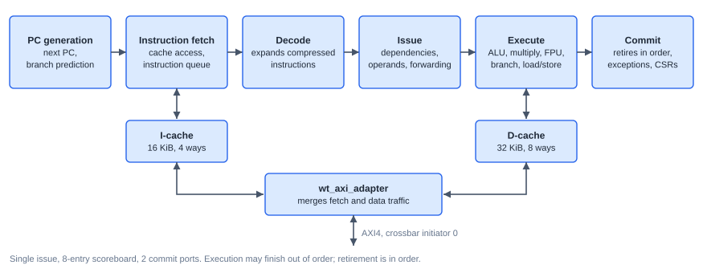
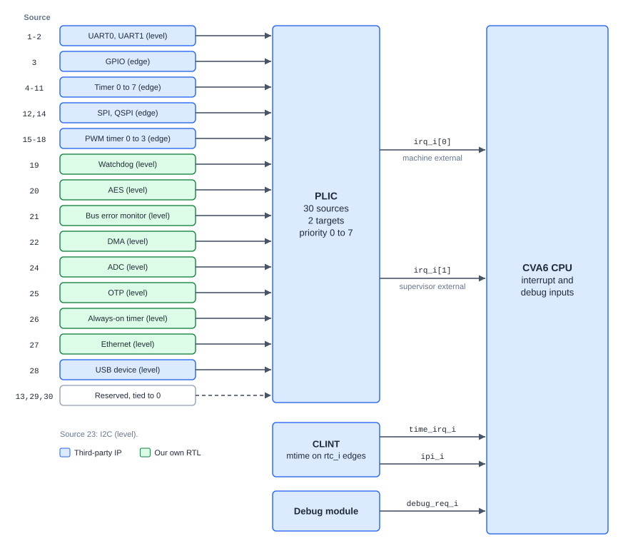

# Core complex (`adr_core_complex`) integration specification

The CVA6 CPU with its CLINT and PLIC.

| | |
|---|---|
| Type | ADR SoC subsystem, our own RTL |
| RTL | `rtl/adr_soc/core/adr_core_complex.sv` |
| Instance | `i_core` |
| AXI | CPU on crossbar initiator 0; CLINT on target 3 |
| APB slot | 4, the PLIC, at `0x0C00_0000` |
| Version | 1.0 (RTL), document revision 2.0 |
| Owner | Vijay Bogati |
| Date | 2026-11-14 |

### Revision history

| Revision | Date | Change |
|---|---|---|
| 1.0 | 2026-11-08 | First issue, generated from the RTL header and the microarchitecture document |
| 2.0 | 2026-11-14 | Integration specification: contents table, port descriptions for every port, integration rules |
| 2.1 | 2026-11-15 | `axi_atop_filter` in front of the CLINT (LIMITATIONS item 12) |

## 1. Overview

From the RTL header of `rtl/adr_soc/core/adr_core_complex.sv`:

```
ADR SoC - core complex: the CPU and its two interrupt controllers.

  cva6  RV64GC CPU, one AXI4 initiator port
  clint machine timer and software interrupts, on a crossbar target port, behind an
        axi_atop_filter: the CLINT ignores AXI atomics, so they get an error response
        (with the read beat an atomic needs) instead of being taken as plain writes
  plic  external interrupts from every block, on an APB slot

The interrupt sources arrive as one vector, already mapped to PLIC source numbers.
```


### Contents

| Instance | Module | Source | Role | Document |
|---|---|---|---|---|
| `i_cpu` | `cva6` | OpenHW CVA6 | RV64GC CPU, write-through data cache, AXI4 initiator 0 | [cva6](../third_party_ip/cva6/ADR.md) |
| `i_clint_atop_filter` | `axi_atop_filter` | PULP AXI | Answers AXI atomics to the CLINT with SLVERR (and the R beat an atomic needs); passes everything else | [axi](../third_party_ip/axi/ADR.md) |
| `i_clint` | `clint` | PULP | Machine timer and software interrupts, AXI4 target 3, behind the filter | [clint](../third_party_ip/clint/ADR.md) |
| `i_plic_apb_to_reg` | `apb_to_reg` | PULP | APB slot 4 to the PLIC's register interface | [register_interface](../third_party_ip/register_interface/ADR.md) |
| `i_plic` | `plic_top` | PULP rv_plic | 30 sources, 2 targets (machine and supervisor external interrupts) | [rv_plic](../third_party_ip/rv_plic/ADR.md) |

## 2. CPU

### Configuration

The CPU is CVA6 `v5.3.0`, using upstream `cv64a6_imafdc_sv39`, with two changes made by `cpu_user_cfg()`: the non-idempotent rules are set for the device regions, and the coprocessor port is turned off.

| Item | Setting |
|---|---|
| ISA | RV64IMAFDC, plus `B`, `Zcb`, `Zicond`, `Zicntr` and `Zihpm` |
| Not enabled | `H`, `V`, `Zcmp`, `Zcmt`, half-precision and 8-bit floating point |
| Privilege modes | Machine, supervisor, user |
| Issue width | Single issue (`SuperscalarEn` = 0), with 2 commit ports |
| Scoreboard | 8 entries |
| Instruction cache | 16 KiB, 4 ways, 128-bit lines |
| Data cache | 32 KiB, 8 ways, 128-bit lines, write-through, 8-entry write buffer |
| Load buffer, outstanding stores | 2, 7 |
| Branch prediction | 128-entry BHT, 32-entry BTB, 2-entry return address stack |
| MMU | Sv39, 16-entry instruction TLB, 16-entry data TLB, no shared TLB |
| PMP | 8 entries, NAPOT enabled |
| Performance counters | Enabled |
| AXI | 64-bit, ID width 4, with atomics. CPU writes are single beats (`AxiBurstWriteEn` = 0) |
| Reset vector | `0x0001_0000` |
| Hart ID | 0 |

`FEATURES.md` lists the CPU as RV64GC. The extra extensions above are enabled by the upstream configuration, and no test exercises them directly.

### Pipeline



CVA6 has six stages. This table maps them to the upstream source in `rtl/third_party_ip/cva6/core`.

| Stage | Source | Function |
|---|---|---|
| PC generation | `frontend/frontend.sv`, `bht.sv`, `btb.sv`, `ras.sv` | Next PC, and branch prediction |
| Instruction fetch | `frontend/frontend.sv`, `instr_queue.sv`, `instr_scan.sv` | Fetch from the instruction cache, and queue instructions |
| Decode | `id_stage.sv`, `decoder.sv`, `compressed_decoder.sv` | Decode, and expand compressed instructions |
| Issue | `issue_stage.sv`, `scoreboard.sv`, `issue_read_operands.sv` | Track dependencies, read operands and forward results |
| Execute | `ex_stage.sv`, `alu.sv`, `branch_unit.sv`, `mult.sv`, `load_store_unit.sv`, `fpu_wrap.sv`, `csr_buffer.sv` | Functional units, which may finish out of order |
| Commit | `commit_stage.sv`, `csr_regfile.sv` | Retire in order, raise exceptions and update CSRs |

`controller.sv` handles flushes for mispredicts, exceptions and fences.

### Caches and memory ordering

The cache subsystem is `wt_cache_subsystem`. Every store goes to the bus through the write buffer, and `wt_axi_adapter` merges instruction and data traffic onto the single AXI port.

In this configuration `DcacheFlushOnFence` is 0, so **`fence` and `fence.i` do not flush the data cache**. `fence.i` flushes the instruction cache.

**DMA coherency:** there is no hardware coherency, so the data cache doesn't see writes from DMA or any other bus master. A cached read of a buffer that DMA just wrote can return stale data. `test_coherency()` in `tb/verilator/c_tests/dma.c` shows this, and checks both ways of avoiding it:

| Method | How | Use it for |
|---|---|---|
| Uncached alias | Add `0x1_0000_0000` to an SRAM or DDR4 address. It reaches the same memory, with no caching. `UNCACHED()` in `tb/verilator/c_tests/adr_lib.h` does this | Descriptors and DMA buffers. The buffer must only be read through the alias |
| Invalidate | `dcache_invalidate()` in `tb/verilator/c_tests/adr_lib.h` writes 0 then 1 to CSR `0x7C1`, CVA6's data cache enable. Enabling the cache invalidates all of it | Large buffers that benefit from caching. Machine mode only, and it costs the whole cache |

CPU writes are always safe for DMA to read, because the cache is write-through, but a write to an address leaves any cached line of its alias unchanged. Software must not mix both views of one buffer without invalidating. `fence` doesn't help, as noted above.

### Interrupt inputs

| CVA6 input | Source |
|---|---|
| `irq_i[0]` | PLIC target 0, machine external |
| `irq_i[1]` | PLIC target 1, supervisor external |
| `time_irq_i` | CLINT machine timer |
| `ipi_i` | CLINT machine software |
| `debug_req_i` | Debug module |

### Coprocessor port

`CvxifEn` is 1 in the upstream configuration, and `cpu_user_cfg()` sets it to 0 because no coprocessor is connected. `adr_soc_top` ties `cvxif_resp_i` to 0. An illegal instruction therefore traps with `mcause` 2, which `smoke` checks. See section 18, item 1, for what happened with the port on. A future coprocessor would need the setting turned back on and a real connection to this port.

### What has been exercised

The tests run in machine mode. Supervisor mode, user mode, the MMU, and Linux boot have not been run, and neither have the RISC-V architecture tests.


## 3. Interrupts



### Interrupt map

Source `n` is bit `n-1` of the PLIC source vector. Source 0 means "no interrupt".

| Source | Block | Type | Signal |
|---|---|---|---|
| 1 | UART0 | Level | `INT` |
| 2 | UART1 | Level | `INT` |
| 3 | GPIO | Edge | `interrupt` |
| 4-11 | Timer 0-7 | Edge | Overflow OR compare, per timer |
| 12 | SPI | Edge | Threshold OR end of transfer |
| 13 | Reserved for graphics | | Tied to 0 |
| 14 | QSPI | Edge | Threshold OR end of transfer |
| 15-18 | PWM timer 0-3 | Edge | `events_o` |
| 19 | Watchdog | Level | `EXPIRED` |
| 20 | AES | Level | Done AND enable |
| 21 | Bus error monitor | Level | Any status AND enable |
| 22 | DMA | Level | Any channel done AND enable |
| 23 | I2C | Level | Any IRQ_STATUS bit AND its enable |
| 24 | ADC | Level | Done AND enable |
| 25 | OTP | Level | Done AND enable |
| 26 | Always-on timer | Level | Match |
| 27 | Ethernet | Level | Done AND enable |
| 28 | USB device | Level | Any enabled USB event |
| 29 | Reserved for PCIe | | Tied to 0 |
| 30 | Reserved for MIPI | | Tied to 0 |

Clear a level source's cause in the peripheral before completing it in the PLIC, or it fires again.

### PLIC

`plic_top` connects through `apb_to_reg`. The register block is generated for exactly 30 sources and 2 targets, and supports 32-bit accesses only.

| Offset from `0x0C00_0000` | Register |
|---|---|
| `0x0000 + 4 * source` | Priority, 0 to 7 |
| `0x1000` | Pending |
| `0x2000 + 0x80 * context` | Enable |
| `0x20_0000 + 0x1000 * context` | Threshold |
| `0x20_0004 + 0x1000 * context` | Claim and complete |

Context 0 is machine mode, and context 1 is supervisor mode.

**Edge sources have no event counter.** An edge that arrives while the same source is waiting to be completed is lost, so software should re-check the peripheral's state after completing an interrupt.

### CLINT

Machine software and timer interrupts for one hart. `mtime` counts rising edges of `rtc_i`, and resets with the system.

| Offset from `0x0200_0000` | Register |
|---|---|
| `0x0000` | `msip` |
| `0x4000` | `mtimecmp` |
| `0xBFF8` | `mtime` |


## 4. Interface

Generated from the RTL with `python3 scripts/ip_ports.py <file> <module>`; rerun it after a port change.

### `adr_core_complex`

Module `adr_core_complex`, file `rtl/adr_soc/core/adr_core_complex.sv`.

| Parameter | Declaration | Description |
|---|---|---|
| `CpuCfg` | `config_pkg::cva6_cfg_t CpuCfg = config_pkg::cva6_cfg_empty` |  |
| `TgtIdWidth` | `int unsigned TgtIdWidth = 1` |  |
| `init_aw_chan_t` | `type init_aw_chan_t = logic` |  |
| `init_w_chan_t` | `type init_w_chan_t = logic` |  |
| `init_b_chan_t` | `type init_b_chan_t = logic` |  |
| `init_ar_chan_t` | `type init_ar_chan_t = logic` |  |
| `init_r_chan_t` | `type init_r_chan_t = logic` |  |
| `init_req_t` | `type init_req_t = logic` |  |
| `init_resp_t` | `type init_resp_t = logic` |  |
| `tgt_req_t` | `type tgt_req_t = logic` |  |
| `tgt_resp_t` | `type tgt_resp_t = logic` |  |

| Port | Direction | Type | Description |
|---|---|---|---|
| `clk_i` | input | `logic` | System clock |
| `rst_ni` | input | `logic` | system reset |
| `rtc_i` | input | `logic` | CLINT time base |
| `debug_req_i` | input | `logic` | from the debug module |
| *CPU initiator port* | | | |
| `cpu_req_o` | output | `init_req_t` | AXI4 request, the CPU port |
| `cpu_resp_i` | input | `init_resp_t` | AXI4 response, the CPU port |
| *CLINT target port* | | | |
| `clint_req_i` | input | `tgt_req_t` | AXI4 request, the CLINT port |
| `clint_resp_o` | output | `tgt_resp_t` | AXI4 response, the CLINT port |
| *PLIC APB slot and interrupt sources* | | | |
| `plic_apb_req_i` | input | `apb_req_t` | APB request to the PLIC |
| `plic_apb_resp_o` | output | `apb_resp_t` | APB response from the PLIC |
| `irq_sources_i` | input | `logic [NumIrqSources-1:0]` | Interrupt sources to the PLIC, bit n-1 = source n |


## 5. Integration rules

1. Interrupt source n is bit n-1 of `irq_sources_i`; source 0 means none. Pulse sources (today GPIO, timer, SPI, PWM) must be marked in `irq_edge_mask()` in `adr_soc_pkg.sv`.
2. `rtc_i` must be synchronous enough to `clk_i` for both simulators to agree; the SoC uses `clk_i` / 16 in simulation.
3. The CPU's cacheable and executable regions come from the CVA6 configuration: new memories must fall inside them, peripherals outside.
4. The CPU, CLINT and PLIC are on the system reset; the debug request comes from `adr_debug`.

## 6. Verification

SoC-level C tests in `tb/verilator/c_tests/` (the UVM bench has its own copy in `tb/uvm/c_tests/`), run with `make sim TEST=<name>`. The regression is proven on Verilator; see `docs/STATUS.md` for the latest results.

| Test | Covers | Checks |
|---|---|---|
| `smoke` | CPU, memories, illegal instruction trap, UART0, error target | 18 |
| `irq` | CLINT, PLIC | 31 |

## 7. Known limitations

From `docs/LIMITATIONS.md`, where each item has its impact and the suggested fix:

- Item 1: Bus errors do not trap the CPU.
- Item 2: PLIC is fixed at 30 sources and 2 targets.
- Item 3: PLIC edge sources have no event counter.
- Item 30: GPIO has edge interrupts only.
- Item 31: Timer has no interrupt status register.
- Item 37: I2C had no interrupt output.
- Item 5: CLINT time base needs a real clock.
- Item 64: The CPU has more extensions than the feature list says.
- Item 6: One CPU AXI port.
- Item 8: Round-robin arbitration, with no CPU priority.
- Item 14: PLIC needs 32-bit accesses.
- Item 17: No CPU compliance run.
- Item 87: All 18 interrupts share PLIC source 28.

## 8. Related documents

- [`../third_party_ip/cva6/ADR.md`](../third_party_ip/cva6/ADR.md)
- [`../third_party_ip/rv_plic/ADR.md`](../third_party_ip/rv_plic/ADR.md)
- [`../third_party_ip/clint/ADR.md`](../third_party_ip/clint/ADR.md)
- `docs/MICROARCHITECTURE.md`: section numbers quoted above refer to it.
