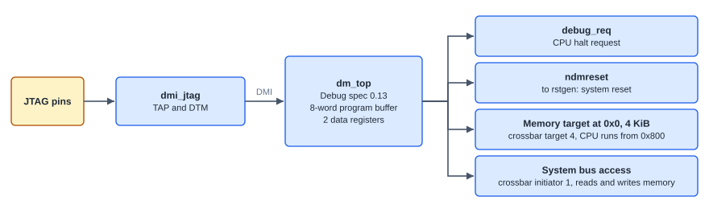

# Debug subsystem (`adr_debug`) integration specification

| | |
|---|---|
| Block | `adr_debug`, RISC-V external debug support (JTAG, debug module, bus adapters) |
| Type | ADR SoC subsystem: our own integration of `pulp-platform/riscv-dbg` (`dmi_jtag`, `dm_top`) with `axi2mem` and CVA6's `axi_adapter` |
| Version | 1.0 (RTL), document revision 2.0 |
| RTL | `rtl/adr_soc/debug/adr_debug.sv`; debug IP in `rtl/third_party_ip/debug/` |
| SoC instance | `adr_soc_top.i_debug` |
| Address | Target port: `0x0000_0000`, 4 KiB (`DebugBase`, crossbar target 4) |
| Bus master | Crossbar initiator 1 (system bus access) |
| Standard | RISC-V External Debug Support 0.13 |
| Owner | Vijay Bogati |
| Date | 2026-11-14 |

### Revision history

| Revision | Date | Change |
|---|---|---|
| 1.0 | 2026-11-08 | First issue |
| 2.0 | 2026-11-14 | Rewritten as an integration specification |
| 2.1 | 2026-11-15 | `axi_atop_filter` in front of the debug memory port (LIMITATIONS item 12) |

## 1. Purpose

`adr_debug` lets an external debugger, through the JTAG pins, halt and resume the CPU, read and write its registers, run code in the program buffer, read and write memory without halting the CPU, and reset the rest of the SoC while staying attached.

## 2. Contents

| Instance | Module | Source | Reset | Role |
|---|---|---|---|---|
| `i_dmi_jtag` | `dmi_jtag` | riscv-dbg | `rst_ni` (power-on), TAP on `jtag_trst_ni` | JTAG TAP and debug transport module (DTM): turns DMI scans into debug module requests; crosses from TCK to `clk_i` |
| `i_debug_module` | `dm_top` | riscv-dbg | `rst_ni` (power-on) | Debug module: halt, resume, abstract commands, program buffer, system bus access, `ndmreset` |
| `i_atop_filter` | `axi_atop_filter` | PULP AXI | `sys_rst_ni` | Answers AXI atomics to the debug memory with SLVERR (and the R beat an atomic needs); `axi2mem` ignores `aw.atop` |
| `i_debug_slave` | `axi2mem` | CVA6 | `sys_rst_ni` | AXI4 target port to the debug module's memory (debug ROM, program buffer, data), behind the filter |
| `i_debug_master` | `axi_adapter` | CVA6 | `sys_rst_ni` | AXI4 initiator for system bus access, single 64-bit accesses |

## 3. Configuration

| Item | Setting |
|---|---|
| JTAG IDCODE | `0x0000_0001` (placeholder) |
| DTM version | 0.13; DMI address 7 bits |
| Harts | 1 (`SelectableHarts` = 1) |
| Program buffer | 8 words |
| Data registers | 2, memory-mapped |
| Halt, resume, exception entry | `0x800`, `0x804`, `0x808` in the debug region |
| System bus access | 64-bit, single beats, through initiator 1 |
| Authentication, triggers | None |

## 4. How it works

- **Halt:** the debugger sets `haltreq`; the debug module raises `debug_req_o`; the CPU enters debug mode and runs from `0x800`, fetching through crossbar target 4 into `i_debug_slave`. Abstract commands run as code generated in that region.
- **System bus access:** the debug module drives `i_debug_master`, which issues AXI single reads and writes on initiator 1, with the CPU running.
- **SoC reset:** `ndmreset` drives `debug_reset_o` into `adr_rst_gen`. The JTAG logic and the debug module are on the power-on reset, so the debugger stays attached; the two bus adapters are on the system reset with the rest of the fabric.
- **TDO:** `jtag_tdo_oe_o` is high only in the Shift-DR and Shift-IR states (checked by the UVM bench's JTAG monitor).

## 5. Signal description

| Signal | Dir | Width | Clock | Description |
|---|---|---|---|---|
| `clk_i` | in | 1 | | System clock |
| `rst_ni` | in | 1 | async | Power-on reset (JTAG logic, debug module) |
| `sys_rst_ni` | in | 1 | async | System reset (bus adapters) |
| `jtag_tck_i` | in | 1 | | JTAG clock; must be slower than `clk_i` (only `clk_i` / 8 tested) |
| `jtag_tms_i`, `jtag_tdi_i` | in | 1 each | TCK | JTAG mode select and data in |
| `jtag_trst_ni` | in | 1 | async | JTAG TAP reset, active low |
| `jtag_tdo_o` | out | 1 | TCK falling | JTAG data out |
| `jtag_tdo_oe_o` | out | 1 | TCK | TDO output enable (Shift-DR, Shift-IR) |
| `debug_req_o` | out | 1 | `clk_i` | Debug request to the CPU |
| `debug_reset_o` | out | 1 | `clk_i` | `ndmreset` to `adr_rst_gen` and `adr_sysctrl` |
| `slv_req_i` / `slv_resp_o` | in / out | struct | `clk_i` | AXI4 target port (crossbar target 4) |
| `mst_req_o` / `mst_resp_i` | out / in | struct | `clk_i` | AXI4 initiator port (crossbar initiator 1) |

| Parameter | SoC value | Description |
|---|---|---|
| `CpuCfg` | CVA6 configuration | Address and data widths |
| `TgtIdWidth`, `UserWidth` | crossbar target widths | AXI widths of the target port |
| `tgt_req_t` .. `init_resp_t` | crossbar structs | AXI4 request/response types |

## 6. Clocks, resets and crossings

| Item | Value |
|---|---|
| Clocks | `clk_i`; `jtag_tck_i` inside `dmi_jtag` |
| Crossing | TCK to `clk_i` in `dmi_jtag` (upstream CDC); TCK must be slower than `clk_i` (LIMITATIONS item 27) |
| Resets | `rst_ni` for the TAP side and debug module (survives `ndmreset`); `sys_rst_ni` for the adapters; `jtag_trst_ni` for the TAP |

## 7. Integration rules

1. Keep the debug module and `dmi_jtag` on the power-on reset; otherwise `ndmreset` would detach the debugger.
2. The debug region at `0x0` must be reachable by the CPU for instruction fetch and must never be cached.
3. The system bus initiator can reach every target, including peripherals; its errors are recorded by the bus error monitor as initiator 1.
4. A real chip needs a proper IDCODE (manufacturer and part) and, where required, debug authentication.

## 8. Verification

| Item | Status |
|---|---|
| SoC tests | `debug` (DEBUG-01 to 10: TAP, IDCODE, DTM, halt, abstract commands, program buffer, errors, resume, system bus access, `ndmreset` and reset cause; UVM: TDO enable) |
| Benches | Baseline bench (debugger in `tb_top`, `+jtag_test`); UVM bench (JTAG agent, RISC-V debug sequence layer, `adr_debug_test`) |
| Planned | `debug_tck` (NEW-17); `cg_jtag`, `cg_dbg`; assertions JTAG-A01, A02 |
| Not tested | OpenOCD or GDB; other TCK ratios; debugging during interrupts or DMA; debug-mode CSR corner cases |

## 9. Known limitations

| Item | Limitation |
|---|---|
| LIMITATIONS 27 | Debug bus at most 64-bit; JTAG slower than `clk_i`, one ratio tested |
| LIMITATIONS 29 | Tested with our own JTAG driver, not OpenOCD or GDB |
| | Placeholder IDCODE, no authentication, no triggers |

## 10. References

- RISC-V External Debug Support, version 0.13.2.
- `docs/MICROARCHITECTURE.md` section 9.
- [`../third_party_ip/riscv-dbg/ADR.md`](../third_party_ip/riscv-dbg/ADR.md), [`adr_rst_gen.md`](adr_rst_gen.md), [`adr_interconnect.md`](adr_interconnect.md).
