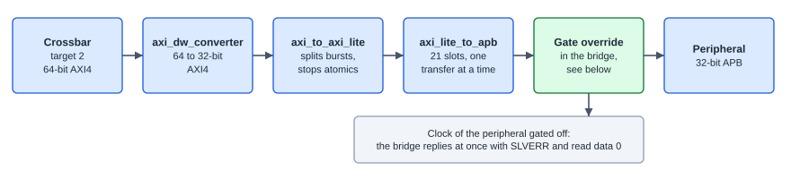

# Interconnect (`adr_interconnect`, `adr_apb_bridge`) integration specification

The AXI4 crossbar, the error target, bus observation for the bus monitor, and the APB bridge.

| | |
|---|---|
| Type | ADR SoC subsystem, our own RTL |
| RTL | `rtl/adr_soc/interconnect/adr_interconnect.sv`, `rtl/adr_soc/interconnect/adr_apb_bridge.sv` |
| Instance | `i_interconnect`, with `i_interconnect.i_apb_bridge` |
| Third-party inside | [PULP `axi`](../third_party_ip/axi/ADR.md): `axi_xbar`, `axi_err_slv`, `axi_dw_converter`, `axi_to_axi_lite`, `axi_lite_to_apb` |
| Version | 1.0 (RTL), document revision 2.0 |
| Owner | Vijay Bogati |
| Date | 2026-11-14 |

### Revision history

| Revision | Date | Change |
|---|---|---|
| 1.0 | 2026-11-08 | First issue, generated from the RTL header and the microarchitecture document |
| 2.0 | 2026-11-14 | Integration specification: contents table, port descriptions for every port, integration rules |

## 1. Overview

From the RTL header of `rtl/adr_soc/interconnect/adr_interconnect.sv`:

```
ADR SoC - interconnect: every bus bridge in the SoC.

  axi_xbar        64-bit AXI4 crossbar, 4 initiators to 7 targets, with the address map
  axi_err_slv     default target: an address that matches no range gets a decode error
  adr_apb_bridge  the peripheral target port, down to the APB slots of every block
  bus observation each initiator's last address and error responses, for the bus monitor

Initiator and target ports are named per block. The peripheral and error targets are served
inside, so they have no ports.
```


### Contents

| Instance | Module | Source | Role | Document |
|---|---|---|---|---|
| `i_xbar` | `axi_xbar` | PULP axi | 64-bit AXI4 crossbar, 4 initiators x 7 targets, 9 address rules, ATOPs passed | [axi](../third_party_ip/axi/ADR.md) |
| `i_error_target` | `axi_err_slv` | PULP axi | Default target: DECERR with data `0xCA11AB1EBADCAB1E` | [axi](../third_party_ip/axi/ADR.md) |
| `i_apb_bridge` | `adr_apb_bridge` | ours | Target 2 down to 21 APB slots: `axi_dw_converter` 64 to 32, `axi_to_axi_lite`, `axi_lite_to_apb`, gated-slot replies | this document |
| `bus observation` | `(logic)` | ours | Per initiator: error pulses on R and B, last AR and AW address, for the bus error monitor | This document |

## 2. Interconnect

### Crossbar

The crossbar is `axi_xbar`, configured in `adr_soc_top`:

| Setting | Value | Meaning |
|---|---|---|
| `MaxMstTrans`, `MaxSlvTrans` | 8, 8 | Outstanding transactions per port |
| `LatencyMode` | `CUT_ALL_AX` | Registers on the address channels |
| `FallThrough` | 0 | Internal FIFOs do not fall through |
| `UniqueIds` | 0 | Initiators may reuse IDs |
| `ATOPs` | 1 | AXI atomic operations are passed through |
| Address rules | 9 | PLIC and peripheral window both go to target 2. SRAM and DDR4 each have a second rule for their uncached alias |
| Default target | Error target | Enabled on all initiator ports |

| Initiator port | Block | Notes |
|---|---|---|
| 0 | CVA6 | Instruction and data misses share this port |
| 1 | Debug system bus access | Through `axi_adapter`; always issues 8-byte size |
| 2 | DMA | |
| 3 | Ethernet | |

Each target arbitrates between initiators round-robin, with no CPU priority.

### APB bridge



`adr_apb_bridge`, inside `adr_interconnect`, takes the crossbar's peripheral port down to the APB slots. An access passes through:

1. `axi_dw_converter`: 64-bit to 32-bit AXI4. A 64-bit access becomes two 32-bit ones.
2. `axi_to_axi_lite`: splits bursts, and stops atomics at this point.
3. `axi_lite_to_apb`: decodes 21 slots and runs one APB transfer at a time, with registers on request and response.
4. The clock-gate response override (section 5.2), then the block's own APB slot, in whichever subsystem it sits.

A UART register read takes about 8 clocks through this path (see `LIMITATIONS.md`).

**Software rules for this bus:**
- Use 32-bit, word-aligned accesses. Only the I2C path carries APB byte strobes. Every other block, including the PLIC, ignores them, so a byte or halfword write can change a whole register.
- Our own blocks decode only the low address bits they need, so registers repeat within a slot. Don't rely on these aliases.
- Reserved registers in our own blocks read as 0, and writes to them are ignored. All of our blocks are always ready and never report an APB error.

### Error responses

| Case | AXI response | Read data | Source |
|---|---|---|---|
| Address hits no crossbar rule | DECERR | `0xCA11AB1EBADCAB1E` | `axi_err_slv` |
| Empty slot in the peripheral window | DECERR | `0xDEA110C8` | `axi_lite_to_apb` |
| Peripheral with its clock gated off | SLVERR | 0 | Override in `adr_apb_bridge` |

**The CPU does not trap on any of these.** The write-through cache ignores AXI error responses, so the instruction completes with the data above. The bus error monitor records the error and can raise an interrupt, but only after the instruction has finished. Use PMP where a precise fault is needed.

### Atomic operations

| Target | Behaviour |
|---|---|
| SRAM | Resolved by `axi_riscv_atomics_wrap` in front of the memory, inside `adr_sram`, with a 64-bit word width |
| DDR4 | The same, with its own `axi_riscv_atomics_wrap` inside `adr_ddr` |
| Boot ROM | Stopped by `axi_atop_filter_intf` inside `adr_rom` |
| Other targets | Not supported, and not tested |


## 3. Interface

Generated from the RTL with `python3 scripts/ip_ports.py <file> <module>`; rerun it after a port change.

### `adr_interconnect`

Module `adr_interconnect`, file `rtl/adr_soc/interconnect/adr_interconnect.sv`.

| Parameter | Declaration | Description |
|---|---|---|
| `InitIdWidth` | `int unsigned InitIdWidth = 1` |  |
| `TgtIdWidth` | `int unsigned TgtIdWidth = 1` |  |
| `UserWidth` | `int unsigned UserWidth = 1` |  |
| `init_aw_chan_t` | `type init_aw_chan_t = logic` |  |
| `init_w_chan_t` | `type init_w_chan_t = logic` |  |
| `init_b_chan_t` | `type init_b_chan_t = logic` |  |
| `init_ar_chan_t` | `type init_ar_chan_t = logic` |  |
| `init_r_chan_t` | `type init_r_chan_t = logic` |  |
| `init_req_t` | `type init_req_t = logic` |  |
| `init_resp_t` | `type init_resp_t = logic` |  |
| `tgt_aw_chan_t` | `type tgt_aw_chan_t = logic` |  |
| `tgt_w_chan_t` | `type tgt_w_chan_t = logic` |  |
| `tgt_b_chan_t` | `type tgt_b_chan_t = logic` |  |
| `tgt_ar_chan_t` | `type tgt_ar_chan_t = logic` |  |
| `tgt_r_chan_t` | `type tgt_r_chan_t = logic` |  |
| `tgt_req_t` | `type tgt_req_t = logic` |  |
| `tgt_resp_t` | `type tgt_resp_t = logic` |  |

| Port | Direction | Type | Description |
|---|---|---|---|
| `clk_i` | input | `logic` | System clock |
| `rst_ni` | input | `logic` | system reset |
| *Initiator ports* | | | |
| `cpu_req_i` | input | `init_req_t` | AXI4 request, the CPU port |
| `cpu_resp_o` | output | `init_resp_t` | AXI4 response, the CPU port |
| `debug_req_i` | input | `init_req_t` | AXI4 request, the debug module port |
| `debug_resp_o` | output | `init_resp_t` | AXI4 response, the debug module port |
| `dma_req_i` | input | `init_req_t` | AXI4 request, the DMA port |
| `dma_resp_o` | output | `init_resp_t` | AXI4 response, the DMA port |
| `eth_req_i` | input | `init_req_t` | AXI4 request, Ethernet port |
| `eth_resp_o` | output | `init_resp_t` | AXI4 response, Ethernet port |
| *Target ports* | | | |
| `rom_req_o` | output | `tgt_req_t` | AXI4 request, the boot ROM port |
| `rom_resp_i` | input | `tgt_resp_t` | AXI4 response, the boot ROM port |
| `sram_req_o` | output | `tgt_req_t` | AXI4 request, the SRAM port |
| `sram_resp_i` | input | `tgt_resp_t` | AXI4 response, the SRAM port |
| `ddr_req_o` | output | `tgt_req_t` | AXI4 request, DDR4 port |
| `ddr_resp_i` | input | `tgt_resp_t` | AXI4 response, DDR4 port |
| `clint_req_o` | output | `tgt_req_t` | AXI4 request, the CLINT port |
| `clint_resp_i` | input | `tgt_resp_t` | AXI4 response, the CLINT port |
| `debug_req_o` | output | `tgt_req_t` | AXI4 request, the debug module port |
| `debug_resp_i` | input | `tgt_resp_t` | AXI4 response, the debug module port |
| *APB slots, and CLK_EN for the replies of gated peripherals* | | | |
| `clk_en_i` | input | `logic [31:0]` | Peripheral clock enables from system control |
| `apb_req_o` | output | `apb_req_t [NumApbSlots-1:0]` | APB requests, one per slot |
| `apb_resp_i` | input | `apb_resp_t [NumApbSlots-1:0]` | APB responses, one per slot |
| *Bus observation, one per initiator, for the bus error monitor* | | | |
| `read_error_o` | output | `logic [NumInitiators-1:0]` | One pulse per read response with an error, per initiator |
| `write_error_o` | output | `logic [NumInitiators-1:0]` | One pulse per write response with an error, per initiator |
| `last_read_addr_o` | output | `logic [NumInitiators-1:0][63:0]` | Last accepted read address, per initiator |
| `last_write_addr_o` | output | `logic [NumInitiators-1:0][63:0]` | Last accepted write address, per initiator |

### `adr_apb_bridge`

Module `adr_apb_bridge`, file `rtl/adr_soc/interconnect/adr_apb_bridge.sv`.

| Parameter | Declaration | Description |
|---|---|---|
| `IdWidth` | `int unsigned IdWidth = 1` |  |
| `UserWidth` | `int unsigned UserWidth = 1` |  |
| `slv_aw_chan_t` | `type slv_aw_chan_t = logic` |  |
| `slv_w_chan_t` | `type slv_w_chan_t = logic` |  |
| `slv_b_chan_t` | `type slv_b_chan_t = logic` |  |
| `slv_ar_chan_t` | `type slv_ar_chan_t = logic` |  |
| `slv_r_chan_t` | `type slv_r_chan_t = logic` |  |
| `slv_req_t` | `type slv_req_t = logic` |  |
| `slv_resp_t` | `type slv_resp_t = logic` |  |

| Port | Direction | Type | Description |
|---|---|---|---|
| `clk_i` | input | `logic` | System clock |
| `rst_ni` | input | `logic` | Reset, active low, asynchronous assert |
| `slv_req_i` | input | `slv_req_t` | AXI4 target port, request |
| `slv_resp_o` | output | `slv_resp_t` | AXI4 target port, response |
| `clk_en_i` | input | `logic [31:0]` | CLK_EN from system control |
| `apb_req_o` | output | `apb_req_t [NumApbSlots-1:0]` | APB requests, one per slot |
| `apb_resp_i` | input | `apb_resp_t [NumApbSlots-1:0]` | APB responses, one per slot |


## 4. Integration rules

1. Every new target needs a crossbar rule in `adr_interconnect.sv` and its constants in `adr_soc_pkg.sv`; every new APB block needs a slot rule in `adr_apb_bridge.sv`, an `apb_req`/`apb_resp` connection and, if gated, a `slot_clk_on` line.
2. A new initiator changes `NumInitiators`, the crossbar configuration and the bus error monitor's register layout (LIMITATIONS item 111).
3. Targets behind the APB bridge never see bursts or atomics; atomics to them are stopped by `axi_to_axi_lite`.
4. All initiators share `InitIdWidth`; the crossbar widens IDs towards the targets (`TgtIdWidth`).
5. Latency: the crossbar registers the address channels (`CUT_ALL_AX`); the APB path registers request and response, so a 32-bit peripheral read costs about 8 clocks.

## 5. Verification

SoC-level C tests in `tb/verilator/c_tests/` (the UVM bench has its own copy in `tb/uvm/c_tests/`), run with `make sim TEST=<name>`. The regression is proven on Verilator; see `docs/STATUS.md` for the latest results.

| Test | Covers | Checks |
|---|---|---|
| `smoke` | CPU, memories, illegal instruction trap, UART0, error target | 18 |
| `serial` | SPI, QSPI, I2C, free slots | 19 |
| `sys` | Bus error monitor, system control | 23 |

## 6. Known limitations

From `docs/LIMITATIONS.md`, where each item has its impact and the suggested fix:

- Item 1: Bus errors do not trap the CPU.
- Item 69: A transmit bus error still sends a frame

## 7. Related documents

- [`../protocols/AXI4.md`](../protocols/AXI4.md)
- [`../protocols/APB.md`](../protocols/APB.md)
- [`../adr_ip/adr_bus_monitor.md`](../adr_ip/adr_bus_monitor.md)
- `docs/MICROARCHITECTURE.md`: section numbers quoted above refer to it.
