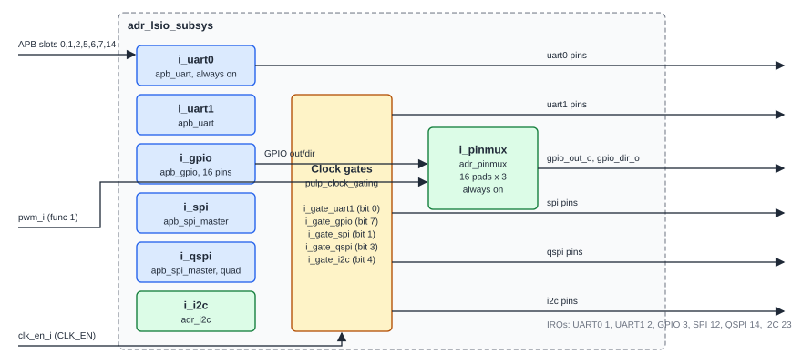

# Low-speed I/O subsystem (`adr_lsio_subsys`) integration specification

The serial and pin interfaces, with their clock gates.

| | |
|---|---|
| Type | ADR SoC subsystem, our own RTL |
| RTL | `rtl/adr_soc/lsio/adr_lsio_subsys.sv` |
| Instance | `i_lsio` |
| APB slots | 0 (UART0), 1 (UART1), 2 (GPIO), 5 (SPI), 6 (QSPI), 7 (I2C), 14 (pin mux) |
| Clock gates | `CLK_EN` bits 0 (UART1), 1 (SPI), 3 (QSPI), 4 (I2C), 7 (GPIO); UART0 and the pin mux always run |
| Version | 1.0 (RTL), document revision 2.0 |
| Owner | Vijay Bogati |
| Date | 2026-11-14 |

### Revision history

| Revision | Date | Change |
|---|---|---|
| 1.0 | 2026-11-08 | First issue, generated from the RTL header and the microarchitecture document |
| 2.0 | 2026-11-14 | Integration specification: contents table, port descriptions for every port, integration rules |

## 1. Overview

From the RTL header of `rtl/adr_soc/lsio/adr_lsio_subsys.sv`:

```
ADR SoC - low-speed I/O subsystem: the serial bus interfaces and the GPIO pads.

  UART0, UART1, GPIO, SPI, QSPI, I2C, and the pin mux that shares the GPIO pads with PWM,
  UART1 and SPI.

Each block has its own APB slot from the APB bridge. UART1, GPIO, SPI, QSPI and I2C run on
gated clocks, switched by CLK_EN in system control; UART0 carries the console and the pin mux
holds the pad setting, so both stay on clk_i.
```




### Contents

| Instance | Module | Source | Role | Document |
|---|---|---|---|---|
| `i_uart0` | `apb_uart` | PULP | Console UART, slot 0, IRQ 1, not gated | [apb_uart](../third_party_ip/apb_uart/ADR.md) |
| `i_uart1` | `apb_uart` | PULP | UART, slot 1, IRQ 2, gated by `CLK_EN[0]` | [apb_uart](../third_party_ip/apb_uart/ADR.md) |
| `i_gpio` | `apb_gpio` | PULP | 16 GPIO, slot 2, IRQ 3, gated by `CLK_EN[7]` | [apb_gpio](../third_party_ip/apb_gpio/ADR.md) |
| `i_spi` | `apb_spi_master` | PULP | SPI master, slot 5, IRQ 12, gated by `CLK_EN[1]` | [apb_spi_master](../third_party_ip/apb_spi_master/ADR.md) |
| `i_qspi` | `apb_spi_master` | PULP | Quad SPI master, slot 6, IRQ 14, gated by `CLK_EN[3]` | [apb_spi_master](../third_party_ip/apb_spi_master/ADR.md) |
| `i_i2c` | `adr_i2c` | ours + verilog-i2c | I2C master, slot 7, IRQ 23, gated by `CLK_EN[4]` | [adr_i2c](../adr_ip/adr_i2c.md) |
| `i_pinmux` | `adr_pinmux` | ours | Pad output mux, slot 14, not gated | [adr_pinmux](../adr_ip/adr_pinmux.md) |
| `i_gate_*` | `pulp_clock_gating` | PULP | One latch-based clock gate per gated block | [tech_cells_generic](../third_party_ip/tech_cells_generic/ADR.md) |

## 2. Clock gating

Each gate is a `pulp_clock_gating` cell, enabled by a bit of `CLK_EN` in system control. The gates sit beside their blocks: UART1, SPI, QSPI, I2C and GPIO in `adr_lsio_subsys`; timer, PWM, AES and ADC in `adr_periph_subsys`. The bit numbers are `ClkXxx` in `adr_soc_pkg`. All bits are 1 after any reset. Bits 2, 5 and 11 to 31 are stored but have no effect.

| `CLK_EN` bit | Block | `CLK_EN` bit | Block |
|---|---|---|---|
| 0 | UART1 | 6 | PWM |
| 1 | SPI | 7 | GPIO |
| 2 | Free | 8 | Timer |
| 3 | QSPI | 9 | AES |
| 4 | I2C | 10 | ADC |
| 5 | Free | | |

These blocks have no gate and always run: CPU, fabric, memories, DDR4, UART0, watchdog, bus monitor, system control, DMA, pin mux, OTP, always-on timer, PLIC, CLINT, Ethernet and USB.

A gated peripheral can't answer the bus, so the bridge replies for it at once with SLVERR and read data 0. Without this, the access would wait forever. The block's interrupt and output pins hold their last values while it is gated.


## 3. Interface

Generated from the RTL with `python3 scripts/ip_ports.py <file> <module>`; rerun it after a port change.

### `adr_lsio_subsys`

Module `adr_lsio_subsys`, file `rtl/adr_soc/lsio/adr_lsio_subsys.sv`.

| Port | Direction | Type | Description |
|---|---|---|---|
| `clk_i` | input | `logic` | System clock |
| `rst_ni` | input | `logic` | system reset |
| `clk_en_i` | input | `logic [31:0]` | CLK_EN from system control |
| *APB slots* | | | |
| `uart0_apb_req_i` | input | `apb_req_t` | APB request to UART0 |
| `uart0_apb_resp_o` | output | `apb_resp_t` | APB response from UART0 |
| `uart1_apb_req_i` | input | `apb_req_t` | APB request to UART1 |
| `uart1_apb_resp_o` | output | `apb_resp_t` | APB response from UART1 |
| `gpio_apb_req_i` | input | `apb_req_t` | APB request to GPIO |
| `gpio_apb_resp_o` | output | `apb_resp_t` | APB response from GPIO |
| `spi_apb_req_i` | input | `apb_req_t` | APB request to SPI |
| `spi_apb_resp_o` | output | `apb_resp_t` | APB response from SPI |
| `qspi_apb_req_i` | input | `apb_req_t` | APB request to QSPI |
| `qspi_apb_resp_o` | output | `apb_resp_t` | APB response from QSPI |
| `i2c_apb_req_i` | input | `apb_req_t` | APB request to I2C |
| `i2c_apb_resp_o` | output | `apb_resp_t` | APB response from I2C |
| `mux_apb_req_i` | input | `apb_req_t` | APB request to the pin mux |
| `mux_apb_resp_o` | output | `apb_resp_t` | APB response from the pin mux |
| *UARTs* | | | |
| `uart0_rx_i` | input | `logic` | UART0 receive data pin |
| `uart0_tx_o` | output | `logic` | UART0 transmit data pin |
| `uart1_rx_i` | input | `logic` | UART1 receive data pin |
| `uart1_tx_o` | output | `logic` | UART1 transmit data pin |
| *GPIO pads, through the pin mux* | | | |
| `gpio_in_i` | input | `logic [NumGpioPins-1:0]` | GPIO input pins |
| `gpio_out_o` | output | `logic [NumGpioPins-1:0]` | GPIO output pins |
| `gpio_dir_o` | output | `logic [NumGpioPins-1:0]` | 1: output |
| `pwm_i` | input | `logic [NumPwmPins-1:0]` | PWM outputs, pin mux function 1 |
| *SPI master: single data line, four chip selects* | | | |
| `spi_sclk_o` | output | `logic` | SPI serial clock pin |
| `spi_csn_o` | output | `logic [3:0]` | SPI chip selects, active low |
| `spi_mosi_o` | output | `logic` | SPI data out pin |
| `spi_miso_i` | input | `logic` | SPI data in pin |
| *QSPI master* | | | |
| `qspi_sclk_o` | output | `logic` | QSPI serial clock pin |
| `qspi_csn_o` | output | `logic [3:0]` | QSPI chip selects, active low |
| `qspi_mode_o` | output | `logic [1:0]` | 0: single line, 1: quad output, 2: quad input |
| `qspi_sdo_o` | output | `logic [3:0]` | QSPI data out pins |
| `qspi_sdi_i` | input | `logic [3:0]` | QSPI data in pins |
| *I2C master: open-drain, a line is released when its _t output is high* | | | |
| `i2c_scl_i` | input | `logic` | I2C SCL level from the bus |
| `i2c_scl_o` | output | `logic` | I2C SCL output level |
| `i2c_scl_t` | output | `logic` | I2C SCL tri-state, 1 = released |
| `i2c_sda_i` | input | `logic` | I2C SDA level from the bus |
| `i2c_sda_o` | output | `logic` | I2C SDA output level |
| `i2c_sda_t` | output | `logic` | I2C SDA tri-state, 1 = released |
| *Interrupts, to the PLIC* | | | |
| `uart0_irq_o` | output | `logic` | Interrupt from UART0, to the PLIC |
| `uart1_irq_o` | output | `logic` | Interrupt from UART1, to the PLIC |
| `gpio_irq_o` | output | `logic` | Interrupt from GPIO, to the PLIC |
| `spi_irq_o` | output | `logic` | threshold or end of transfer |
| `qspi_irq_o` | output | `logic` | Interrupt from QSPI, to the PLIC |
| `i2c_irq_o` | output | `logic` | Interrupt from I2C, to the PLIC |


## 4. Integration rules

1. Each gated block's APB slot needs its `CLK_EN` bit in the bridge's `slot_clk_on` list, or an access to the gated block hangs.
2. Inputs from pins (UART RX, SPI MISO, GPIO inputs, I2C SCL/SDA) are synchronized inside the third-party blocks; a new pin input without that needs a `sync` cell.
3. Only the I2C slot uses APB byte strobes; the others write whole words.
4. Peripherals carried by the pin mux keep their own dedicated pins too.

## 5. Verification

SoC-level C tests in `tb/verilator/c_tests/` (the UVM bench has its own copy in `tb/uvm/c_tests/`), run with `make sim TEST=<name>`. The regression is proven on Verilator; see `docs/STATUS.md` for the latest results.

| Test | Covers | Checks |
|---|---|---|
| `periph` | UART1, GPIO, timer | 31 |
| `serial` | SPI, QSPI, I2C, free slots | 19 |
| `misc` | Pin mux, ADC, OTP, always-on timer, clock gating | 35 |
| `uart_i2c` | UART0, UART1 and I2C register write and read-back, I2C interrupt through the PLIC | 37 |

## 6. Known limitations

From `docs/LIMITATIONS.md`, where each item has its impact and the suggested fix:

- Item 30: GPIO has edge interrupts only.
- Item 36: QSPI has no memory-mapped flash access (XIP).
- Item 57: No power management beyond clock gating.
- Item 11: UART rejects a divisor of 1.
- Item 33: GPIO status clears on read, and an input needs its enable bit set.
- Item 38: SPI is half-duplex with a fixed clock mode.
- Item 39: Quad mode covers the whole QSPI transfer,
- Item 40: SPI and I2C are tested against our own simple device models,
- Item 44: PWM tested by sampling through GPIO inputs,
- Item 34: UART tested at 8N1 and divisor 2 only.
- Item 79: Ethernet is outside clock gating,
- Item 88: USB is outside clock gating,
- Item 101: DDR4 is outside clock gating and always built.

## 7. Related documents

- [`../protocols/APB.md`](../protocols/APB.md)
- [`adr_periph_subsys.md`](adr_periph_subsys.md)
- `docs/MICROARCHITECTURE.md`: section numbers quoted above refer to it.
