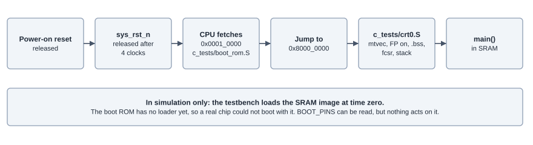

# Memory subsystem (`adr_mem_subsys`) integration specification

Boot ROM, SRAM and DDR4, each with what it needs in front of it.

| | |
|---|---|
| Type | ADR SoC subsystem, our own RTL |
| RTL | `rtl/adr_soc/mem/adr_mem_subsys.sv`, `rtl/adr_soc/mem/adr_rom.sv`, `rtl/adr_soc/mem/adr_sram.sv`, `rtl/adr_soc/mem/adr_axi_mem.sv`, `rtl/adr_soc/mem/adr_mem_model.sv` |
| Instance | `i_mem` |
| AXI | ROM on target 0, SRAM on target 1, DDR4 on target 6 |
| Storage | `adr_mem_model` is a behavioural array loaded with `$readmemh`; a real chip uses memory macros here |
| Version | 1.0 (RTL), document revision 2.0 |
| Owner | Vijay Bogati |
| Date | 2026-11-14 |

### Revision history

| Revision | Date | Change |
|---|---|---|
| 1.0 | 2026-11-08 | First issue, generated from the RTL header and the microarchitecture document |
| 2.0 | 2026-11-14 | Integration specification: contents table, port descriptions for every port, integration rules |

## 1. Overview

From the RTL header of `rtl/adr_soc/mem/adr_mem_subsys.sv`:

```
ADR SoC - memory subsystem: every memory on the crossbar.

  boot ROM (adr_rom), SRAM (adr_sram) and DDR4 (adr_ddr), each on its own crossbar target
  port, with the DDR4 controller's registers on an APB slot.

Each memory holds its own adapter for RISC-V atomics: ROM rejects them, SRAM and DDR4 carry
them out.
```


### Contents

| Instance | Module | Source | Role | Document |
|---|---|---|---|---|
| `i_rom` | `adr_rom` | ours | Boot ROM, 32 KiB at `0x0001_0000`, target 0; atomics filtered | this document |
| `i_sram` | `adr_sram` | ours | SRAM, 512 KiB at `0x8000_0000` (alias `0x1_8000_0000`), target 1; atomics unit in front | this document |
| `i_ddr` | `adr_ddr` | ours + LiteDRAM | DDR4, 32 MiB at `0x9000_0000` (alias `0x1_9000_0000`), target 6 | [adr_ddr](../adr_ip/adr_ddr.md) |
| `(inside ROM and SRAM)` | `adr_axi_mem, adr_mem_model` | ours | AXI4 to single-port memory adapter; behavioural memory loaded by `$readmemh` (`+rom=`, `+sram=`) | This document |

## 2. Memories and boot

### Boot ROM and SRAM

DDR4 is described in section 13.11.

| | Boot ROM | SRAM |
|---|---|---|
| Size | 32 KiB | 512 KiB |
| Organization | 4096 x 64 bits | 65536 x 64 bits |
| Module | `adr_rom` | `adr_sram` |
| Path | `axi_atop_filter`, write buffer, `axi2mem`, `adr_mem_model` | `axi_riscv_atomics_wrap`, write buffer, `axi2mem`, `adr_mem_model` |
| Writes | Ignored, with no error | Byte writes supported |
| Image | `+rom=<hex>` | `+sram=<hex>` |

`adr_mem_model` is a single-port synchronous behavioural model, and needs replacing with a technology macro wrapper for implementation. `axi2mem` serves one burst at a time, so accesses to SRAM from the CPU, DMA and Ethernet are fully serialized. Because of that, `adr_axi_mem` has a write buffer, which collects each write and only starts it when its whole burst has arrived, up to 16 beats. Otherwise the memory could wait for write data while that data waits for a read which the memory won't serve until the write ends.

### Boot flow




The stack starts at the top of SRAM, `0x8008_0000`, and the linker places everything in SRAM.

**In simulation only, the SRAM image is loaded by the testbench at time zero.** The current boot ROM has no loader, so a real chip could not boot with it. `BOOT_PINS` is readable, but nothing acts on it, and QSPI has no memory-mapped flash access.


## 3. Interface

Generated from the RTL with `python3 scripts/ip_ports.py <file> <module>`; rerun it after a port change.

### `adr_mem_subsys`

Module `adr_mem_subsys`, file `rtl/adr_soc/mem/adr_mem_subsys.sv`.

| Parameter | Declaration | Description |
|---|---|---|
| `IdWidth` | `int unsigned IdWidth = 1` |  |
| `UserWidth` | `int unsigned UserWidth = 1` |  |
| `req_t` | `type req_t = logic` |  |
| `resp_t` | `type resp_t = logic` |  |

| Port | Direction | Type | Description |
|---|---|---|---|
| `clk_i` | input | `logic` | System clock |
| `rst_ni` | input | `logic` | system reset |
| *Crossbar target ports* | | | |
| `rom_req_i` | input | `req_t` | AXI4 request, the boot ROM port |
| `rom_resp_o` | output | `resp_t` | AXI4 response, the boot ROM port |
| `sram_req_i` | input | `req_t` | AXI4 request, the SRAM port |
| `sram_resp_o` | output | `resp_t` | AXI4 response, the SRAM port |
| `ddr_req_i` | input | `req_t` | AXI4 request, DDR4 port |
| `ddr_resp_o` | output | `resp_t` | AXI4 response, DDR4 port |
| *DDR4 controller registers* | | | |
| `ddr_apb_req_i` | input | `apb_req_t` | APB request to DDR4 |
| `ddr_apb_resp_o` | output | `apb_resp_t` | APB response from DDR4 |

### `adr_rom`

Module `adr_rom`, file `rtl/adr_soc/mem/adr_rom.sv`.

| Parameter | Declaration | Description |
|---|---|---|
| `AddrWidth` | `int unsigned AddrWidth = 64` |  |
| `DataWidth` | `int unsigned DataWidth = 64` |  |
| `IdWidth` | `int unsigned IdWidth = 1` |  |
| `UserWidth` | `int unsigned UserWidth = 1` |  |
| `NumWords` | `int unsigned NumWords = 1024` |  |
| `req_t` | `type req_t = logic` |  |
| `resp_t` | `type resp_t = logic` |  |

| Port | Direction | Type | Description |
|---|---|---|---|
| `clk_i` | input | `logic` | System clock |
| `rst_ni` | input | `logic` | Reset, active low, asynchronous assert |
| `slv_req_i` | input | `req_t` | AXI4 target port, request |
| `slv_resp_o` | output | `resp_t` | AXI4 target port, response |

### `adr_sram`

Module `adr_sram`, file `rtl/adr_soc/mem/adr_sram.sv`.

| Parameter | Declaration | Description |
|---|---|---|
| `AddrWidth` | `int unsigned AddrWidth = 64` |  |
| `DataWidth` | `int unsigned DataWidth = 64` |  |
| `IdWidth` | `int unsigned IdWidth = 1` |  |
| `UserWidth` | `int unsigned UserWidth = 1` |  |
| `NumWords` | `int unsigned NumWords = 1024` |  |
| `req_t` | `type req_t = logic` |  |
| `resp_t` | `type resp_t = logic` |  |

| Port | Direction | Type | Description |
|---|---|---|---|
| `clk_i` | input | `logic` | System clock |
| `rst_ni` | input | `logic` | Reset, active low, asynchronous assert |
| `slv_req_i` | input | `req_t` | AXI4 target port, request |
| `slv_resp_o` | output | `resp_t` | AXI4 target port, response |

### `adr_axi_mem`

Module `adr_axi_mem`, file `rtl/adr_soc/mem/adr_axi_mem.sv`.

| Parameter | Declaration | Description |
|---|---|---|
| `IdWidth` | `int unsigned IdWidth = 1` |  |
| `UserWidth` | `int unsigned UserWidth = 1` |  |
| `NumWords` | `int unsigned NumWords = 1024` |  |
| `ReadOnly` | `bit ReadOnly = 1'b0` |  |
| `ImageArg` | `string ImageArg = ""` |  |
| `MaxWriteBeats` | `int unsigned MaxWriteBeats = 16` |  |

| Port | Direction | Type | Description |
|---|---|---|---|
| `clk_i` | input | `logic` | System clock |
| `rst_ni` | input | `logic` | Reset, active low, asynchronous assert |
| `slv` | input | `AXI_BUS.Slave` | AXI4 target port (SystemVerilog interface) |

### `adr_mem_model`

Module `adr_mem_model`, file `rtl/adr_soc/mem/adr_mem_model.sv`.

| Parameter | Declaration | Description |
|---|---|---|
| `NumWords` | `int unsigned NumWords = 1024` |  |
| `ReadOnly` | `bit ReadOnly = 1'b0` |  |
| `ImageArg` | `string ImageArg = ""` |  |
| `IdxWidth` | `localparam int unsigned IdxWidth = $clog2(NumWords)` |  |

| Port | Direction | Type | Description |
|---|---|---|---|
| `clk_i` | input | `logic` | System clock |
| `req_i` | input | `logic` | Memory request, one clock per access |
| `we_i` | input | `logic` | Write enable, 1 = write |
| *Fixed 32-bit width, so every size has the same port list: synthesis keeps* | | | |
| *this module as a black box and builds its ports only once. Bits above* | | | |
| *IdxWidth must be zero.* | | | |
| `idx_i` | input | `logic [31:0]` | Word index (address in 64-bit words) |
| `be_i` | input | `logic [7:0]` | Byte enables for the write |
| `wdata_i` | input | `logic [63:0]` | Write data |
| `rdata_o` | output | `logic [63:0]` | Read data, the clock after the request |


## 4. Integration rules

1. `adr_mem_model` stands for a memory macro; synthesis keeps it as a black box so the same images load on the netlist.
2. SRAM serves one burst at a time and collects each write burst before starting it, so write bursts are limited to 16 beats (LIMITATIONS item 53).
3. Atomics are supported on SRAM and DDR4 only (item 12).
4. The DDR4 core is not reset by the system reset (item 73).

## 5. Verification

SoC-level C tests in `tb/verilator/c_tests/` (the UVM bench has its own copy in `tb/uvm/c_tests/`), run with `make sim TEST=<name>`. The regression is proven on Verilator; see `docs/STATUS.md` for the latest results.

| Test | Covers | Checks |
|---|---|---|
| `smoke` | CPU, memories, illegal instruction trap, UART0, error target | 18 |
| `dma` | DMA, and cache coherency methods | 26 |
| `ddr` | DDR4 from the CPU and DMA, atomics, running code | 18 |

## 6. Known limitations

From `docs/LIMITATIONS.md`, where each item has its impact and the suggested fix:

- Item 36: QSPI has no memory-mapped flash access (XIP).
- Item 52: DMA is memory-to-memory only.
- Item 4: Memories are simulation models.
- Item 53: SRAM serves one burst at a time.
- Item 12: Atomics work on SRAM and DDR4 only.
- Item 13: Boot ROM writes are ignored.
- Item 74: TX done means the memory read finished, not that the frame was sent.
- Item 109: Sustained 25G isn't possible with this memory path.
- Item 85: No wake from USB.
- Item 104: SRAM write buffer.

## 7. Related documents

- [`../adr_ip/adr_ddr.md`](../adr_ip/adr_ddr.md)
- [`../third_party_ip/axi_riscv_atomics/ADR.md`](../third_party_ip/axi_riscv_atomics/ADR.md)
- [`../third_party_ip/axi_mem_if/ADR.md`](../third_party_ip/axi_mem_if/ADR.md)
- `docs/MICROARCHITECTURE.md`: section numbers quoted above refer to it.
