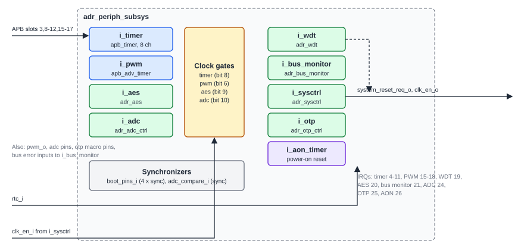

# Peripheral subsystem (`adr_periph_subsys`) integration specification

Timers, security, system control, and the blocks that face analog or always-on logic, with their clock gates and input synchronizers.

| | |
|---|---|
| Type | ADR SoC subsystem, our own RTL |
| RTL | `rtl/adr_soc/periph/adr_periph_subsys.sv` |
| Instance | `i_periph` |
| APB slots | 3 (timer), 8 (PWM), 9 (WDT), 10 (AES), 11 (bus monitor), 12 (sysctrl), 15 (ADC), 16 (OTP), 17 (AON timer) |
| Clock gates | `CLK_EN` bits 6 (PWM), 8 (timer), 9 (AES), 10 (ADC) |
| Synchronizers | `boot_pins_i` and `adc_compare_i`, two stages each |
| Version | 1.0 (RTL), document revision 2.0 |
| Owner | Vijay Bogati |
| Date | 2026-11-14 |

### Revision history

| Revision | Date | Change |
|---|---|---|
| 1.0 | 2026-11-08 | First issue, generated from the RTL header and the microarchitecture document |
| 2.0 | 2026-11-14 | Integration specification: contents table, port descriptions for every port, integration rules |

## 1. Overview

From the RTL header of `rtl/adr_soc/periph/adr_periph_subsys.sv`:

```
ADR SoC - peripheral subsystem: timers, security, system control and the analog-side blocks.

  timer, PWM, watchdog, AES, bus error monitor, system control, ADC controller,
  OTP controller, always-on timer, and the synchronizers on the asynchronous inputs.

Each block has its own APB slot from the APB bridge. System control holds CLK_EN, which
gates the timer, PWM, AES and ADC clocks here and the low-speed I/O clocks in adr_lsio_subsys.
```




### Contents

| Instance | Module | Source | Role | Document |
|---|---|---|---|---|
| `i_timer` | `apb_timer` | PULP | 8-channel timer, slot 3, IRQ 4-11, gated by `CLK_EN[8]` | [apb_timer](../third_party_ip/apb_timer/ADR.md) |
| `i_pwm` | `apb_adv_timer` | PULP | PWM, 8 outputs, slot 8, IRQ 15-18, gated by `CLK_EN[6]` | [apb_adv_timer](../third_party_ip/apb_adv_timer/ADR.md) |
| `i_wdt` | `adr_wdt` | ours | Watchdog, slot 9, IRQ 19 | [adr_wdt](../adr_ip/adr_wdt.md) |
| `i_aes` | `adr_aes` | ours | AES, slot 10, IRQ 20, gated by `CLK_EN[9]` | [adr_aes](../adr_ip/adr_aes.md) |
| `i_bus_monitor` | `adr_bus_monitor` | ours | Bus error monitor, slot 11, IRQ 21 | [adr_bus_monitor](../adr_ip/adr_bus_monitor.md) |
| `i_sysctrl` | `adr_sysctrl` | ours | System control, slot 12; power-on and system resets | [adr_sysctrl](../adr_ip/adr_sysctrl.md) |
| `i_adc` | `adr_adc_ctrl` | ours | ADC controller, slot 15, IRQ 24, gated by `CLK_EN[10]` | [adr_adc_ctrl](../adr_ip/adr_adc_ctrl.md) |
| `i_otp` | `adr_otp_ctrl` | ours | OTP controller, slot 16, IRQ 25 | [adr_otp_ctrl](../adr_ip/adr_otp_ctrl.md) |
| `i_aon_timer` | `adr_aon_timer` | ours | Always-on timer, slot 17, IRQ 26, power-on reset | [adr_aon_timer](../adr_ip/adr_aon_timer.md) |
| `gen_boot_sync, i_adc_compare_sync` | `sync` | PULP | 2-flop synchronizers for the boot pins and the ADC comparator | [common_cells](../third_party_ip/common_cells/ADR.md) |
| `i_gate_*` | `pulp_clock_gating` | PULP | Clock gates for timer, PWM, AES, ADC | [tech_cells_generic](../third_party_ip/tech_cells_generic/ADR.md) |

## 2. Clock gating

Each gate is a `pulp_clock_gating` cell, enabled by a bit of `CLK_EN` in system control. The gates sit beside their blocks: UART1, SPI, QSPI, I2C and GPIO in `adr_lsio_subsys`; timer, PWM, AES and ADC in `adr_periph_subsys`. The bit numbers are `ClkXxx` in `adr_soc_pkg`. All bits are 1 after any reset. Bits 2, 5 and 11 to 31 are stored but have no effect.

| `CLK_EN` bit | Block | `CLK_EN` bit | Block |
|---|---|---|---|
| 0 | UART1 | 6 | PWM |
| 1 | SPI | 7 | GPIO |
| 2 | Free | 8 | Timer |
| 3 | QSPI | 9 | AES |
| 4 | I2C | 10 | ADC |
| 5 | Free | | |

These blocks have no gate and always run: CPU, fabric, memories, DDR4, UART0, watchdog, bus monitor, system control, DMA, pin mux, OTP, always-on timer, PLIC, CLINT, Ethernet and USB.

A gated peripheral can't answer the bus, so the bridge replies for it at once with SLVERR and read data 0. Without this, the access would wait forever. The block's interrupt and output pins hold their last values while it is gated.


## 3. Clock domain crossings

| Signal | Handling |
|---|---|
| JTAG to `clk_i` | Inside `dmi_jtag` |
| `rtc_i` | Two-stage synchronizer and edge detector, separately in the CLINT and the always-on timer |
| GPIO inputs | Two-stage synchronizer inside `apb_gpio` |
| `boot_pins_i` | Two-stage synchronizer per pin, in `adr_periph_subsys`. Fixed on 2026-11-07 |
| `adc_compare_i` | Two-stage synchronizer in `adr_periph_subsys`, so DIV must be at least 2. Fixed on 2026-11-07 |
| `otp_done_i`, `otp_rdata_i` | **None.** The macro is assumed to be synchronous to `clk_i` |
| Ethernet frames | Asynchronous FIFOs inside `eth_mac_phy_10g_fifo` |
| USB registers | `tlul_fifo_async` in `adr_usb` |

No crossing analysis has been run, and gating timing has not been analysed.


## 4. Interface

Generated from the RTL with `python3 scripts/ip_ports.py <file> <module>`; rerun it after a port change.

### `adr_periph_subsys`

Module `adr_periph_subsys`, file `rtl/adr_soc/periph/adr_periph_subsys.sv`.

| Port | Direction | Type | Description |
|---|---|---|---|
| `clk_i` | input | `logic` | System clock |
| `rst_ni` | input | `logic` | system reset |
| `por_rst_ni` | input | `logic` | power-on reset, for state that survives system resets |
| *APB slots* | | | |
| `timer_apb_req_i` | input | `apb_req_t` | APB request to the 8-channel timer |
| `timer_apb_resp_o` | output | `apb_resp_t` | APB response from the 8-channel timer |
| `pwm_apb_req_i` | input | `apb_req_t` | APB request to PWM |
| `pwm_apb_resp_o` | output | `apb_resp_t` | APB response from PWM |
| `wdt_apb_req_i` | input | `apb_req_t` | APB request to the watchdog |
| `wdt_apb_resp_o` | output | `apb_resp_t` | APB response from the watchdog |
| `aes_apb_req_i` | input | `apb_req_t` | APB request to AES |
| `aes_apb_resp_o` | output | `apb_resp_t` | APB response from AES |
| `bus_mon_apb_req_i` | input | `apb_req_t` | APB request to the bus error monitor |
| `bus_mon_apb_resp_o` | output | `apb_resp_t` | APB response from the bus error monitor |
| `sys_apb_req_i` | input | `apb_req_t` | APB request to system control |
| `sys_apb_resp_o` | output | `apb_resp_t` | APB response from system control |
| `adc_apb_req_i` | input | `apb_req_t` | APB request to the ADC controller |
| `adc_apb_resp_o` | output | `apb_resp_t` | APB response from the ADC controller |
| `otp_apb_req_i` | input | `apb_req_t` | APB request to the OTP controller |
| `otp_apb_resp_o` | output | `apb_resp_t` | APB response from the OTP controller |
| `aon_apb_req_i` | input | `apb_req_t` | APB request to the always-on timer |
| `aon_apb_resp_o` | output | `apb_resp_t` | APB response from the always-on timer |
| *PWM outputs, to the pins and the pin mux* | | | |
| `pwm_o` | output | `logic [NumPwmPins-1:0]` | PWM outputs |
| *Always-on timer clock* | | | |
| `rtc_i` | input | `logic` | Real-time clock input (CLINT and always-on timer time base) |
| *ADC analog side* | | | |
| `adc_channel_o` | output | `logic` | ADC controller input channel select, to the analog side |
| `adc_dac_code_o` | output | `logic [7:0]` | ADC controller DAC code, to the analog side |
| `adc_compare_i` | input | `logic` | ADC controller comparator result from the analog side |
| *OTP macro* | | | |
| `otp_req_o` | output | `logic` | OTP controller macro request, one clock |
| `otp_we_o` | output | `logic` | OTP controller macro write (program) select |
| `otp_addr_o` | output | `logic [4:0]` | OTP controller macro word address |
| `otp_wdata_o` | output | `logic [31:0]` | OTP controller macro bits to program |
| `otp_rdata_i` | input | `logic [31:0]` | OTP controller macro read data |
| `otp_done_i` | input | `logic` | OTP controller macro command done, one clock |
| *System control* | | | |
| `boot_pins_i` | input | `logic [3:0]` | Boot pins, read by system control |
| `debug_reset_i` | input | `logic` | ndmreset from the debug module |
| `system_reset_req_o` | output | `logic` | Watchdog or software system reset request, to adr_rst_gen |
| `clk_en_o` | output | `logic [31:0]` | Peripheral clock enables, to the clock gates and the APB bridge |
| *Bus error monitor inputs, one per crossbar initiator* | | | |
| `read_error_i` | input | `logic [NumInitiators-1:0]` | One pulse per read response with an error, per initiator |
| `write_error_i` | input | `logic [NumInitiators-1:0]` | One pulse per write response with an error, per initiator |
| `last_read_addr_i` | input | `logic [NumInitiators-1:0][63:0]` | Last accepted read address, per initiator |
| `last_write_addr_i` | input | `logic [NumInitiators-1:0][63:0]` | Last accepted write address, per initiator |
| *Interrupts, to the PLIC* | | | |
| `timer_irq_o` | output | `logic [NumTimers-1:0]` | overflow or compare, one per timer |
| `pwm_irq_o` | output | `logic [3:0]` | one per PWM timer |
| `wdt_irq_o` | output | `logic` | Interrupt from the watchdog, to the PLIC |
| `aes_irq_o` | output | `logic` | Interrupt from AES, to the PLIC |
| `bus_mon_irq_o` | output | `logic` | Interrupt from the bus error monitor, to the PLIC |
| `adc_irq_o` | output | `logic` | Interrupt from the ADC controller, to the PLIC |
| `otp_irq_o` | output | `logic` | Interrupt from the OTP controller, to the PLIC |
| `aon_irq_o` | output | `logic` | Interrupt from the always-on timer, to the PLIC |


## 5. Integration rules

1. State that must survive a system reset uses `por_rst_ni` (system control's cause, scratch and request registers; the always-on timer).
2. The watchdog's reset request reaches `adr_rst_gen` only through system control's registered request.
3. Pin inputs with no relation to `clk_i` pass through `sync` cells here before they reach a block.
4. The PWM outputs leave on `pwm_o` to the pins and to the pin mux (function 1).

## 6. Verification

SoC-level C tests in `tb/verilator/c_tests/` (the UVM bench has its own copy in `tb/uvm/c_tests/`), run with `make sim TEST=<name>`. The regression is proven on Verilator; see `docs/STATUS.md` for the latest results.

| Test | Covers | Checks |
|---|---|---|
| `periph` | UART1, GPIO, timer | 31 |
| `timers` | PWM, watchdog | 18 |
| `aes` | AES, with FIPS-197 vectors | 17 |
| `sys` | Bus error monitor, system control | 23 |
| `misc` | Pin mux, ADC, OTP, always-on timer, clock gating | 35 |

## 7. Known limitations

From `docs/LIMITATIONS.md`, where each item has its impact and the suggested fix:

- Item 31: Timer has no interrupt status register.
- Item 32: Timer behaviour is fixed.
- Item 42: PWM channels share timers.
- Item 44: PWM tested by sampling through GPIO inputs,
- Item 35: Timer tests cover one compare and one overflow per scenario.

## 8. Related documents

- [`../protocols/APB.md`](../protocols/APB.md)
- [`adr_lsio_subsys.md`](adr_lsio_subsys.md)
- `docs/MICROARCHITECTURE.md`: section numbers quoted above refer to it.
