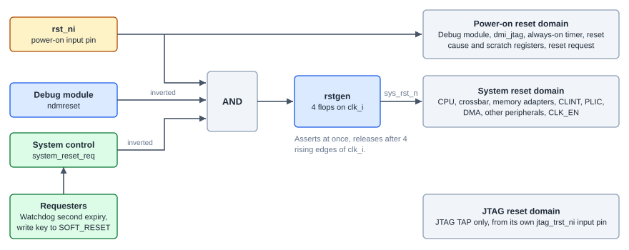
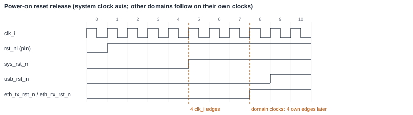

# Reset generation (`adr_rst_gen`) integration specification

| | |
|---|---|
| Block | `adr_rst_gen`, reset generator for all clock domains |
| Type | ADR SoC subsystem, our own RTL; four `rstgen` cells from `common_cells` |
| Version | 1.0 (RTL), document revision 2.0 |
| RTL | `rtl/adr_soc/rst/adr_rst_gen.sv` |
| SoC instance | `adr_soc_top.i_rst_gen` |
| Owner | Vijay Bogati |
| Date | 2026-11-14 |

### Revision history

| Revision | Date | Change |
|---|---|---|
| 1.0 | 2026-11-08 | First issue |
| 2.0 | 2026-11-14 | Rewritten as an integration specification: sources, domains, timing, rules |
| 2.1 | 2026-11-15 | Warm resets drain the DDR4 port first: sequencer, `ddr_drain_o`, `ddr_idle_i`, `ddr_drain_timeout_o`, parameter `DrainTimeout` |

## 1. Purpose

All resets of the SoC except the power-on and JTAG resets are made here, so the whole reset tree is in one file. The system reset is asserted at once by any source and released in step with the system clock; each other clock domain gets its own copy, released in step with its own clock, so no flop leaves reset at a different time from its neighbours.

## 2. Reset sources

| Source | Signal | Active | Effect | Recorded in `RESET_CAUSE` |
|---|---|---|---|---|
| Power-on | `rst_ni` (chip pin) | Low | System reset, plus everything on the power-on reset | Bit 0 |
| Debug module | `debug_reset_i` (`ndmreset`) | High | System reset; the debug module stays attached | Bit 1 |
| Watchdog | `system_reset_req_i` from `adr_sysctrl` | High | System reset | Bit 2 |
| Software | `system_reset_req_i` from `adr_sysctrl` | High | System reset | Bit 3 |

Power-on reset goes to the system reset at once. The three warm sources pass through a sequencer on the power-on reset:

| State | Entered when | Does | Leaves when |
|---|---|---|---|
| Run | Power-on, or the request has gone | Nothing | A request (`debug_reset_i` or `system_reset_req_i`) is high |
| Drain | Request seen | `ddr_drain_o` high: the DDR4 port takes no new transaction | `ddr_idle_i` high (to Reset), or `DrainTimeout` clocks passed (to Reset, with a one-clock `ddr_drain_timeout_o` pulse) |
| Reset | Port idle or timeout | System reset asserted | The request is low (at least one clock) |

The request is held from its first clock, so the one-clock software request still resets the system. The system reset input is `rst_ni AND (state != Reset)`. The DDR4 core is not reset by the system reset, so without the drain a transaction open in it would answer initiators that had been reset.

## 3. Reset domains

| Reset | Made by | Clock | Resets |
|---|---|---|---|
| `rst_ni` (power-on) | Chip pin, passed through | Asynchronous | Debug module and `dmi_jtag`, system control's cause, scratch and request registers, always-on timer, the warm-reset sequencer here |
| `sys_rst_n` | `i_sys_rst` | `clk_i` | CPU, crossbar, APB bridge, memory adapters, CLINT, PLIC, DMA, Ethernet and USB system sides, all other peripherals, `CLK_EN` |
| `usb_rst_n` | `i_usb_rst`, from `sys_rst_n` | `usb_clk_i` | USB device core and its side of the clock crossing |
| `eth_tx_rst_n` | `i_eth_tx_rst`, from `sys_rst_n` | `eth_tx_clk_i` | Ethernet transmit PCS and FIFO side |
| `eth_rx_rst_n` | `i_eth_rx_rst`, from `sys_rst_n` | `eth_rx_clk_i` | Ethernet receive PCS and FIFO side |
| `jtag_trst_ni` | Chip pin | Asynchronous | JTAG TAP only |
| None | | | DDR4 core (no reset input; drained before a warm reset, LIMITATIONS item 73) |

## 4. Behaviour and timing

| Event | Timing |
|---|---|
| Power-on asserts | Every derived reset goes low at once (asynchronous) |
| Warm request | System reset asserted 2 `clk_i` clocks later if the DDR4 port is idle; at most `DrainTimeout` + 1 clocks later otherwise |
| System reset release | 4 rising edges of `clk_i` after the last source is released (`rstgen`, 4-stage synchronizer) |
| Domain reset release | 4 rising edges of that domain's clock after `sys_rst_n` rises |
| Software or watchdog reset length | About 5 `clk_i` clocks (*derived*: at least 1 clock in Reset, then 4) |

Blocks with **synchronous** resets (I2C engine and FIFOs, DMA engine, Ethernet DMA engine and MAC) need clock edges during reset: the system clock keeps running, and `CLK_EN` returns to all-ones asynchronously at reset, so gated clocks run too. The Ethernet and USB resets complete only if their clocks run (LIMITATIONS item 79).

## 5. Signal description

| Signal | Dir | Width | Description |
|---|---|---|---|
| `clk_i` | in | 1 | System clock |
| `rst_ni` | in | 1 | Power-on reset, active low, asynchronous |
| `debug_reset_i` | in | 1 | `ndmreset` from the debug module, active high |
| `system_reset_req_i` | in | 1 | Watchdog or software request from `adr_sysctrl`, active high, registered |
| `ddr_drain_o` | out | 1 | Stop new DDR4 transactions (to `adr_ddr`) |
| `ddr_idle_i` | in | 1 | No DDR4 transaction outstanding (from `adr_ddr`) |
| `ddr_drain_timeout_o` | out | 1 | One-clock pulse: a warm reset went ahead before the DDR4 port was idle (to `adr_sysctrl`, `RESET_CAUSE[4]`) |
| `usb_clk_i` | in | 1 | USB clock |
| `eth_tx_clk_i`, `eth_rx_clk_i` | in | 1 each | Ethernet SerDes clocks |
| `sys_rst_no` | out | 1 | System reset, active low |
| `usb_rst_no` | out | 1 | USB domain reset, active low |
| `eth_tx_rst_no`, `eth_rx_rst_no` | out | 1 each | Ethernet domain resets, active low |

Parameter `DrainTimeout` (`int unsigned`, default 1024): clocks to wait for the DDR4 port. `rstgen` is used with `test_mode_i` = 0.

## 6. Integration rules

1. A new clock domain gets its own `rstgen` here, fed from `sys_rst_no`, and nowhere else.
2. Nothing that must survive a system reset may use `sys_rst_n`; it uses `rst_ni` (as system control and the always-on timer do).
3. A reset request from a block that the system reset clears must pass through a register on the power-on reset (as in `adr_sysctrl`), or it disappears before it takes effect.
4. Timing: the reset outputs are asynchronous-assert paths; their release is synchronous and must be timed as a normal path in each domain (reset recovery and removal checks).
5. DFT (not provided yet): `test_mode_i` would bypass the synchronizers so the reset is controllable from a pin during scan.

## 7. Verification

| Item | Status |
|---|---|
| SoC tests | `sys` (SYS-05: power-on, software and watchdog resets over three boots, settings reset), `timers` (TIMERS-07: watchdog reset), `debug` (DEBUG-09: `ndmreset`), `misc` (MISC-06: state kept across a reset) |
| Gate level | Reset sequence exercised by every netlist run |
| Planned | Assertions RST-A01, RST-A02; `wdt_during_dma` (NEW-14); `cg_reset` |
| Not tested | Reset while DDR4, Ethernet or USB traffic is in flight (DDR4 case planned in NEW-14); the drain timeout; SerDes or USB clock stopped during reset |

## 8. Known limitations

| Item | Limitation |
|---|---|
| LIMITATIONS 73 | The DDR4 core is not reset by a system reset |
| LIMITATIONS 79 | Ethernet resets need the SerDes clocks running |
| | No reset of a single block; no test-mode bypass |

## 9. References

- `docs/MICROARCHITECTURE.md` section 6.
- [`../adr_ip/adr_sysctrl.md`](../adr_ip/adr_sysctrl.md), [`../adr_ip/adr_wdt.md`](../adr_ip/adr_wdt.md), [`adr_debug.md`](adr_debug.md), [`adr_soc_top.md`](adr_soc_top.md).
