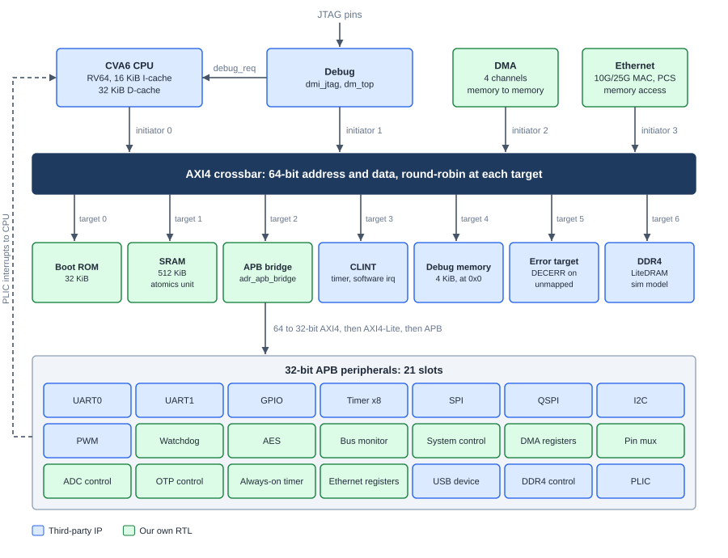
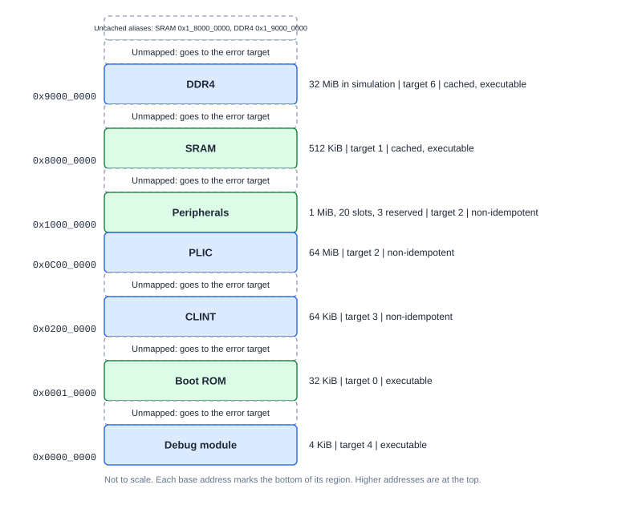

# SoC top level (`adr_soc_top`) integration specification

Connections only: every function sits in one of the subsystems below.

| | |
|---|---|
| Type | ADR SoC subsystem, our own RTL |
| RTL | `rtl/adr_soc/adr_soc_top.sv` |
| Package | `rtl/adr_soc/adr_soc_pkg.sv`: address map, APB slots, interrupt numbers, `CLK_EN` bits, bus types |
| Testbench | `tb/verilator/tb_top.sv` and `tb/verilator/tb_adr_soc.sv` |
| Version | 1.0 (RTL), document revision 2.0 |
| Owner | Vijay Bogati |
| Date | 2026-11-14 |

### Revision history

| Revision | Date | Change |
|---|---|---|
| 1.0 | 2026-11-08 | First issue, generated from the RTL header and the microarchitecture document |
| 2.0 | 2026-11-14 | Integration specification: contents table, port descriptions for every port, integration rules |

## 1. Overview

From the RTL header of `rtl/adr_soc/adr_soc_top.sv`:

```
ADR SoC - top level. This file only connects the subsystems; it holds no logic of its own.

  i_rst_gen       adr_rst_gen        every reset
  i_core          adr_core_complex   CPU, CLINT, PLIC
  i_debug         adr_debug          JTAG and the debug module
  i_interconnect  adr_interconnect   AXI4 crossbar, error target, APB bridge
  i_mem           adr_mem_subsys     boot ROM, SRAM, DDR4
  i_dma           adr_dma            DMA engine
  i_eth           adr_eth            10G/25G Ethernet
  i_usb           adr_usb            USB 2.0 full-speed device
  i_lsio          adr_lsio_subsys    UARTs, GPIO, SPI, QSPI, I2C, pin mux
  i_periph        adr_periph_subsys  timer, PWM, watchdog, AES, bus monitor, system control,
                                     ADC, OTP, always-on timer

rst_ni is the power-on reset. It resets the debug module and JTAG logic, so a debugger
stays attached while the debug module resets the rest of the SoC through sys_rst_n.
Every reset is made in adr_rst_gen.
```


### Contents

| Instance | Module | Source | Role | Document |
|---|---|---|---|---|
| `i_rst_gen` | `adr_rst_gen` | ours | Every reset | [adr_rst_gen](adr_rst_gen.md) |
| `i_core` | `adr_core_complex` | ours | CPU, CLINT, PLIC | [adr_core_complex](adr_core_complex.md) |
| `i_debug` | `adr_debug` | ours + riscv-dbg | JTAG, debug module, system bus access | [adr_debug](adr_debug.md) |
| `i_interconnect` | `adr_interconnect` | ours + PULP axi | Crossbar, error target, APB bridge, bus observation | [adr_interconnect](adr_interconnect.md) |
| `i_mem` | `adr_mem_subsys` | ours | Boot ROM, SRAM, DDR4 | [adr_mem_subsys](adr_mem_subsys.md) |
| `i_dma` | `adr_dma` | ours + verilog-axi | 4-channel DMA, initiator 2 | [adr_dma](../adr_ip/adr_dma.md) |
| `i_eth` | `adr_eth` | ours + verilog-ethernet | 10G/25G Ethernet, initiator 3 | [adr_eth](../adr_ip/adr_eth.md) |
| `i_usb` | `adr_usb` | ours + OpenTitan | USB full-speed device | [adr_usb](../adr_ip/adr_usb.md) |
| `i_lsio` | `adr_lsio_subsys` | ours | UARTs, GPIO, SPI, QSPI, I2C, pin mux | [adr_lsio_subsys](adr_lsio_subsys.md) |
| `i_periph` | `adr_periph_subsys` | ours | Timers, PWM, watchdog, AES, bus monitor, system control, ADC, OTP, always-on timer | [adr_periph_subsys](adr_periph_subsys.md) |

## 2. Hierarchy and main parameters

The SoC has one RV64 CVA6 CPU on a 64-bit AXI4 crossbar, with a boot ROM, SRAM, DDR4, CLINT, JTAG debug, a DMA engine and an Ethernet MAC. A chain of bridges connects the crossbar to 32-bit APB, which carries the peripherals and the PLIC.



### SoC hierarchy

`adr_soc_top` only connects the subsystems below; it holds no logic of its own apart from the mapping of interrupt sources to PLIC numbers and the Ethernet register-ready tie-off. Each subsystem has its own folder under `rtl/adr_soc/`. Our IP blocks are in `rtl/adr_ip/<ip>/`.

```
adr_soc_top
├─ i_rst_gen      adr_rst_gen        every reset: system, USB, Ethernet TX and RX
├─ i_core         adr_core_complex   cva6 CPU, CLINT, PLIC
├─ i_debug        adr_debug          dmi_jtag, dm_top, its target and initiator ports
├─ i_interconnect adr_interconnect   axi_xbar, axi_err_slv, bus observation,
│                                    adr_apb_bridge (64 to 32-bit AXI4, AXI4-Lite, APB,
│                                    21-slot decode, replies for gated peripherals)
├─ i_mem          adr_mem_subsys     adr_rom, adr_sram, adr_ddr
├─ i_dma          adr_dma            DMA engine
├─ i_eth          adr_eth            10G/25G Ethernet
├─ i_usb          adr_usb            USB 2.0 full-speed device
├─ i_lsio         adr_lsio_subsys    UART0, UART1, GPIO, SPI, QSPI, I2C, pin mux
└─ i_periph       adr_periph_subsys  timer, PWM, watchdog, AES, bus monitor, system control,
                                     ADC, OTP, always-on timer, input synchronizers
```

| Connection | How |
|---|---|
| AXI4 | Each initiator and target has its own named port on `adr_interconnect`. The peripheral and error targets are inside it. |
| APB | `adr_apb_bridge` decodes the slots in `adr_soc_pkg` (`SlotXxx`). Each block takes its own slot. |
| Interrupts | Each block's interrupt goes to the PLIC in `adr_core_complex`, mapped to source numbers `IrqXxx` in the top. |
| Clock gating | `CLK_EN` from system control in `adr_periph_subsys` goes to the gates in both peripheral subsystems and to the APB bridge. |


### Main parameters

Defined in `rtl/adr_soc/adr_soc_pkg.sv`, unless noted.

| Parameter | Value |
|---|---|
| Fabric address and data width | 64 bits each |
| Peripheral data width | 32 bits |
| Crossbar initiators and targets | 4 and 7 |
| AXI ID width | 4 bits at initiators, 6 bits at targets |
| AXI user width | 64 bits, unused |
| Harts | 1 |
| PLIC sources and targets | 30 and 2, with 7 as the highest priority |
| GPIO pins, timers, PWM pins | 16, 8, 8 |
| Clock inputs | `clk_i`, the slow `rtc_i` time base, JTAG `jtag_tck_i`, `eth_tx_clk_i`, `eth_rx_clk_i` and `usb_clk_i` |


## 3. Memory map



| Region | Base | Size | Crossbar target | Executable | Cached | Non-idempotent |
|---|---|---|---|---|---|---|
| Debug module | `0x0000_0000` | 4 KiB | 4 | Yes | No | No |
| Boot ROM | `0x0001_0000` | 32 KiB | 0 | Yes | No | No |
| CLINT | `0x0200_0000` | 64 KiB | 3 | No | No | Yes |
| PLIC | `0x0C00_0000` | 64 MiB | 2 | No | No | Yes |
| Peripherals | `0x1000_0000` | 1 MiB | 2 | No | No | Yes |
| SRAM | `0x8000_0000` | 512 KiB | 1 | Yes | Yes | No |
| SRAM, uncached alias | `0x1_8000_0000` | 512 KiB | 1 | No | No | No |
| DDR4 | `0x9000_0000` | 32 MiB in simulation | 6 | Yes | Yes | No |
| DDR4, uncached alias | `0x1_9000_0000` | 32 MiB in simulation | 6 | No | No | No |
| Anything else | | | 5 (error) | | | |

The last three columns come from the CPU configuration, not from the crossbar:
- **Non-idempotent:** `cpu_user_cfg()` sets `0x0200_0000` to `0x0FFF_FFFF` and `0x1000_0000` to `0x1FFF_FFFF`, so reads with side effects are never speculated.
- **Executable:** upstream rules allow `0x0` for 4 KiB, `0x1_0000` for 64 KiB and `0x8000_0000` for 1 GiB. These are wider than the ROM and SRAM, and the 1 GiB rule also covers DDR4.
- **Cached:** upstream rule of `0x8000_0000` for 1 GiB, which covers SRAM and DDR4. The aliases are outside it, so they are uncached. See section 8.3.

### Peripheral slots

Each slot is 4 KiB, at `0x1000_0000` plus the offset, except DDR4 control. A free or reserved slot has no block behind it, so an access returns a decode error, with no trap.

| Offset | Block | IP | PLIC source |
|---|---|---|---|
| `0x00000` | UART0 | Third-party | 1 |
| `0x01000` | UART1 | Third-party | 2 |
| `0x02000` | GPIO | Third-party | 3 |
| `0x03000` | Timer | Third-party | 4-11 |
| `0x04000` | SPI | Third-party | 12 |
| `0x05000` | Free | | |
| `0x06000` | QSPI | Third-party | 14 |
| `0x07000` | I2C | Third-party engine, our own registers | 23 |
| `0x08000` | Free | | |
| `0x09000` | PWM | Third-party | 15-18 |
| `0x0A000` | Watchdog | Our own | 19 |
| `0x0B000` | AES | Our own | 20 |
| `0x0C000` | Bus error monitor | Our own | 21 |
| `0x0D000` | System control | Our own | None |
| `0x0E000` | DMA registers | Our own | 22 |
| `0x0F000` | Free | | |
| `0x10000` | Pin mux | Our own | None |
| `0x11000` | ADC | Our own | 24 |
| `0x12000` | OTP | Our own | 25 |
| `0x13000` | Always-on timer | Our own | 26 |
| `0x14000` | Ethernet registers | Our own wrapper, third-party MAC | 27 |
| `0x15000` | USB device, with its packet buffer at `+0x800` | Our own wrapper, third-party core | 28 |
| `0x16000` | **Reserved:** PCIe placeholder | Stub, not connected | 29, reserved |
| `0x17000` | **Reserved:** MIPI placeholder | Stub, not connected | 30, reserved |
| `0x18000` | **Reserved:** graphics placeholder | Stub, not connected | 13, reserved |
| `0x19000` to `0x1FFFF` | Free | | |
| `0x20000` to `0x2FFFF` | DDR4 control registers, 64 KiB | Generated, third-party | None |
| `0x30000` to `0xFFFFF` | Free | | |

The reservations only hold the addresses and interrupt sources, as constants in `adr_soc_pkg.sv`, so nothing in the RTL decodes them yet. Every PLIC source is now used or reserved: source 23, the last free one, went to I2C on 2026-11-07. The PLIC itself isn't in this window: it has its own 64 MiB at `0x0C00_0000`, and shares crossbar target 2. Real PCIe and graphics blocks would also need memory windows and crossbar ports, which aren't reserved here, as their sizes depend on the IP chosen.


## 4. Top-level ports

`adr_soc_top` has no pad ring.

| Group | Ports |
|---|---|
| Clock, reset | `clk_i`, `rst_ni`, `rtc_i` |
| UART | `uart0_rx_i`, `uart0_tx_o`, `uart1_rx_i`, `uart1_tx_o` |
| GPIO | `gpio_in_i[15:0]`, `gpio_out_o[15:0]`, `gpio_dir_o[15:0]` (1 = output) |
| SPI | `spi_sclk_o`, `spi_csn_o[3:0]`, `spi_mosi_o`, `spi_miso_i` |
| QSPI | `qspi_sclk_o`, `qspi_csn_o[3:0]`, `qspi_mode_o[1:0]`, `qspi_sdo_o[3:0]`, `qspi_sdi_i[3:0]` |
| I2C | `i2c_scl_i/o/t`, `i2c_sda_i/o/t` |
| PWM | `pwm_o[7:0]` |
| Boot | `boot_pins_i[3:0]` |
| ADC analog side | `adc_channel_o`, `adc_dac_code_o[7:0]`, `adc_compare_i` |
| OTP macro | `otp_req_o`, `otp_we_o`, `otp_addr_o[4:0]`, `otp_wdata_o[31:0]`, `otp_rdata_i[31:0]`, `otp_done_i` |
| Ethernet (SerDes) | `eth_tx_clk_i`, `eth_rx_clk_i`, `eth_serdes_tx_data_o[63:0]`, `eth_serdes_tx_hdr_o[1:0]`, `eth_serdes_rx_data_i[63:0]`, `eth_serdes_rx_hdr_i[1:0]`, `eth_serdes_rx_bitslip_o`, `eth_serdes_rx_reset_req_o` |
| USB | `usb_clk_i`, `usb_dp_i`, `usb_dn_i`, `usb_dp_o`, `usb_dp_en_o`, `usb_dn_o`, `usb_dn_en_o`, `usb_sense_i`, `usb_dp_pullup_o`, `usb_dn_pullup_o` |
| JTAG | `jtag_tck_i`, `jtag_tms_i`, `jtag_trst_ni`, `jtag_tdi_i`, `jtag_tdo_o`, `jtag_tdo_oe_o` |


## 5. Interface

Generated from the RTL with `python3 scripts/ip_ports.py <file> <module>`; rerun it after a port change.

### `adr_soc_top`

Module `adr_soc_top`, file `rtl/adr_soc/adr_soc_top.sv`.

| Port | Direction | Type | Description |
|---|---|---|---|
| `clk_i` | input | `logic` | System clock |
| `rst_ni` | input | `logic` | power-on reset |
| `rtc_i` | input | `logic` | CLINT time base; mtime counts its rising edges |
| `uart0_rx_i` | input | `logic` | UART0 receive data pin |
| `uart0_tx_o` | output | `logic` | UART0 transmit data pin |
| `uart1_rx_i` | input | `logic` | UART1 receive data pin |
| `uart1_tx_o` | output | `logic` | UART1 transmit data pin |
| *GPIO* | | | |
| `gpio_in_i` | input | `logic [NumGpioPins-1:0]` | GPIO input pins |
| `gpio_out_o` | output | `logic [NumGpioPins-1:0]` | GPIO output pins |
| `gpio_dir_o` | output | `logic [NumGpioPins-1:0]` | 1: output |
| *SPI* | | | |
| `spi_sclk_o` | output | `logic` | SPI serial clock pin |
| `spi_csn_o` | output | `logic [3:0]` | SPI chip selects, active low |
| `spi_mosi_o` | output | `logic` | SPI data out pin |
| `spi_miso_i` | input | `logic` | SPI data in pin |
| *QSPI* | | | |
| `qspi_sclk_o` | output | `logic` | QSPI serial clock pin |
| `qspi_csn_o` | output | `logic [3:0]` | QSPI chip selects, active low |
| `qspi_mode_o` | output | `logic [1:0]` | 0: single line, 1: quad output, 2: quad input |
| `qspi_sdo_o` | output | `logic [3:0]` | QSPI data out pins |
| `qspi_sdi_i` | input | `logic [3:0]` | QSPI data in pins |
| *Ethernet: 64-bit data and 2-bit sync header to an external SerDes. 390.625 MHz gives 25G.* | | | |
| `eth_tx_clk_i` | input | `logic` | Ethernet SerDes transmit clock |
| `eth_rx_clk_i` | input | `logic` | Ethernet SerDes receive clock |
| `eth_serdes_tx_data_o` | output | `logic [63:0]` | Ethernet SerDes transmit block payload |
| `eth_serdes_tx_hdr_o` | output | `logic [1:0]` | Ethernet SerDes transmit sync header |
| `eth_serdes_rx_data_i` | input | `logic [63:0]` | Ethernet SerDes receive block payload |
| `eth_serdes_rx_hdr_i` | input | `logic [1:0]` | Ethernet SerDes receive sync header |
| `eth_serdes_rx_bitslip_o` | output | `logic` | Ethernet SerDes bit-slip request |
| `eth_serdes_rx_reset_req_o` | output | `logic` | Ethernet SerDes receiver reset request |
| *USB full-speed device, to an external transceiver. A real part needs 48 MHz on usb_clk_i.* | | | |
| `usb_clk_i` | input | `logic` | USB clock, 48 MHz |
| `usb_dp_i` | input | `logic` | USB device D+ level |
| `usb_dn_i` | input | `logic` | USB device D- level |
| `usb_dp_o` | output | `logic` | USB device D+ drive level |
| `usb_dp_en_o` | output | `logic` | USB device D+ drive enable |
| `usb_dn_o` | output | `logic` | USB device D- drive level |
| `usb_dn_en_o` | output | `logic` | USB device D- drive enable |
| `usb_sense_i` | input | `logic` | USB device VBUS sense |
| `usb_dp_pullup_o` | output | `logic` | USB device D+ pull-up enable |
| `usb_dn_pullup_o` | output | `logic` | USB device D- pull-up enable (unused) |
| *I2C: open-drain, a line is released when its _t output is high* | | | |
| `i2c_scl_i` | input | `logic` | I2C SCL level from the bus |
| `i2c_scl_o` | output | `logic` | I2C SCL output level |
| `i2c_scl_t` | output | `logic` | I2C SCL tri-state, 1 = released |
| `i2c_sda_i` | input | `logic` | I2C SDA level from the bus |
| `i2c_sda_o` | output | `logic` | I2C SDA output level |
| `i2c_sda_t` | output | `logic` | I2C SDA tri-state, 1 = released |
| *PWM* | | | |
| `pwm_o` | output | `logic [NumPwmPins-1:0]` | PWM outputs |
| *Boot configuration pins, readable by software* | | | |
| `boot_pins_i` | input | `logic [3:0]` | Boot pins, read by system control |
| *ADC analog side* | | | |
| `adc_channel_o` | output | `logic` | ADC controller input channel select, to the analog side |
| `adc_dac_code_o` | output | `logic [7:0]` | ADC controller DAC code, to the analog side |
| `adc_compare_i` | input | `logic` | ADC controller comparator result from the analog side |
| *OTP macro* | | | |
| `otp_req_o` | output | `logic` | OTP controller macro request, one clock |
| `otp_we_o` | output | `logic` | OTP controller macro write (program) select |
| `otp_addr_o` | output | `logic [4:0]` | OTP controller macro word address |
| `otp_wdata_o` | output | `logic [31:0]` | OTP controller macro bits to program |
| `otp_rdata_i` | input | `logic [31:0]` | OTP controller macro read data |
| `otp_done_i` | input | `logic` | OTP controller macro command done, one clock |
| *JTAG debug port* | | | |
| `jtag_tck_i` | input | `logic` | JTAG TCK |
| `jtag_tms_i` | input | `logic` | JTAG TMS |
| `jtag_trst_ni` | input | `logic` | JTAG TRST, active low |
| `jtag_tdi_i` | input | `logic` | JTAG TDI |
| `jtag_tdo_o` | output | `logic` | JTAG TDO |
| `jtag_tdo_oe_o` | output | `logic` | JTAG TDO output enable |


## 6. Integration rules

1. All constants (addresses, slots, interrupt numbers, `CLK_EN` bits, bus types) live in `adr_soc_pkg.sv`; the top only connects.
2. Interrupt sources are collected in `irq_sources` in the top; pulse sources must be marked in `irq_edge_mask()` in `adr_soc_pkg.sv`.
3. The chip has no pad ring: every pin is a core-level signal (separate output, enable, input); a pad ring would replace the board wiring the benches do.
4. Clock inputs: `clk_i`, `rtc_i`, `usb_clk_i`, `eth_tx_clk_i`, `eth_rx_clk_i`, `jtag_tck_i`; each has its reset made in `adr_rst_gen` (or the TAP's own).
5. `adr_soc_top` is the synthesis top; the testbench connects only to its ports, so the same tests run on RTL and netlist.

## 7. Verification

SoC-level C tests in `tb/verilator/c_tests/` (the UVM bench has its own copy in `tb/uvm/c_tests/`), run with `make sim TEST=<name>`. The regression is proven on Verilator; see `docs/STATUS.md` for the latest results.

| Test | Covers | Checks |
|---|---|---|
| `smoke` | CPU, memories, illegal instruction trap, UART0, error target | 18 |

## 8. Known limitations

None recorded for this block in `docs/LIMITATIONS.md`.

## 9. Related documents

- [`../protocols/AXI4.md`](../protocols/AXI4.md)
- [`../protocols/APB.md`](../protocols/APB.md)
- [`../README.md`](../README.md): every IP document
- `docs/MICROARCHITECTURE.md`: section numbers quoted above refer to it.
