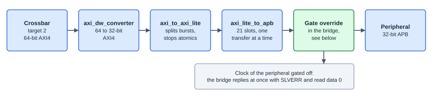

# APB in the ADR SoC

How the ADR SoC uses the AMBA APB protocol for its peripheral registers. The protocol is defined by Arm in *AMBA APB Protocol Specification* (Arm IHI 0024), available from developer.arm.com. ADR uses the APB4 signal set (with `PPROT` and `PSTRB`), as defined by the PULP `apb` library. This document does not reproduce the specification; read it for the setup and access phases.

The types come from the PULP `apb` library (`rtl/third_party_ip/common/apb`), whose own README is in [`../third_party_ip/apb/upstream/`](../third_party_ip/apb/upstream/). The bridge from AXI4 is built from the PULP `axi` library; see [`AXI4.md`](AXI4.md).

## 1. Where APB is used

All peripheral registers sit on APB, in a 1 MiB window at `0x1000_0000`, plus the PLIC's register interface. `adr_apb_bridge` (`i_interconnect.i_apb_bridge`) converts the crossbar's target 2 to APB:

1. `axi_dw_converter`: 64-bit to 32-bit AXI4. A 64-bit access becomes two 32-bit ones.
2. `axi_to_axi_lite`: splits bursts into single beats and stops atomics.
3. `axi_lite_to_apb`: decodes 21 slots and runs one APB transfer at a time, with registers on request and response.
4. Clock-gate override: if the slot's clock is gated off, the bridge answers at once with SLVERR and read data 0 instead of forwarding the access.

The PLIC sits on slot 4 and uses `apb_to_reg` (register interface library) in `adr_core_complex`. Every other slot goes to a block in `adr_lsio_subsys` or `adr_periph_subsys`, or to Ethernet, USB, DMA or DDR4 control.

## 2. Signals and widths

The library groups each slot into a request struct `apb_req_t` (bridge to peripheral) and a response struct `apb_resp_t`, declared with `APB_TYPEDEF_ALL` in `adr_soc_pkg`. The top level holds one array of each, `apb_req[0:20]` and `apb_resp[0:20]`.

| APB4 signal | Width | ADR field | Notes |
|---|---|---|---|
| PCLK | 1 | the block's `clk_i` | `clk_i`, or the block's gated clock |
| PRESETn | 1 | the block's `rst_ni` | System reset |
| PADDR | 64 | `apb_req.paddr` | Blocks use only the low bits they decode |
| PPROT | 3 | `apb_req.pprot` | Carried, not used by any block |
| PSELx | 1 | `apb_req.psel` | One per slot, from the array index |
| PENABLE | 1 | `apb_req.penable` | |
| PWRITE | 1 | `apb_req.pwrite` | |
| PWDATA | 32 | `apb_req.pwdata` | |
| PSTRB | 4 | `apb_req.pstrb` | Used only by I2C, see below |
| PREADY | 1 | `apb_resp.pready` | |
| PRDATA | 32 | `apb_resp.prdata` | |
| PSLVERR | 1 | `apb_resp.pslverr` | |

Our own blocks have flat ports with the same names in lower case, for example `psel_i`, `penable_i`, `pwrite_i`, `paddr_i`, `pwdata_i`, `prdata_o`, `pready_o` and `pslverr_o`. The subsystems connect the struct fields to them.

## 3. Slots

Each slot is 4 KiB, at `0x1000_0000 + 0x1000 * n`, except DDR4 control. The slot numbers are the `Slot*` constants in `adr_soc_pkg`, and the bridge's address map is built from them.

| Slot | Offset | Block | Document |
|---|---|---|---|
| 0 | `0x00000` | UART0 | [apb_uart](../third_party_ip/apb_uart/ADR.md) |
| 1 | `0x01000` | UART1 | [apb_uart](../third_party_ip/apb_uart/ADR.md) |
| 2 | `0x02000` | GPIO | [apb_gpio](../third_party_ip/apb_gpio/ADR.md) |
| 3 | `0x03000` | Timer | [apb_timer](../third_party_ip/apb_timer/ADR.md) |
| 4 | PLIC, at `0x0C00_0000` | PLIC | [rv_plic](../third_party_ip/rv_plic/ADR.md) |
| 5 | `0x04000` | SPI | [apb_spi_master](../third_party_ip/apb_spi_master/ADR.md) |
| 6 | `0x06000` | QSPI | [apb_spi_master](../third_party_ip/apb_spi_master/ADR.md) |
| 7 | `0x07000` | I2C | [adr_i2c](../adr_ip/adr_i2c.md) |
| 8 | `0x09000` | PWM | [apb_adv_timer](../third_party_ip/apb_adv_timer/ADR.md) |
| 9 | `0x0A000` | Watchdog | [adr_wdt](../adr_ip/adr_wdt.md) |
| 10 | `0x0B000` | AES | [adr_aes](../adr_ip/adr_aes.md) |
| 11 | `0x0C000` | Bus error monitor | [adr_bus_monitor](../adr_ip/adr_bus_monitor.md) |
| 12 | `0x0D000` | System control | [adr_sysctrl](../adr_ip/adr_sysctrl.md) |
| 13 | `0x0E000` | DMA registers | [adr_dma](../adr_ip/adr_dma.md) |
| 14 | `0x10000` | Pin mux | [adr_pinmux](../adr_ip/adr_pinmux.md) |
| 15 | `0x11000` | ADC controller | [adr_adc_ctrl](../adr_ip/adr_adc_ctrl.md) |
| 16 | `0x12000` | OTP controller | [adr_otp_ctrl](../adr_ip/adr_otp_ctrl.md) |
| 17 | `0x13000` | Always-on timer | [adr_aon_timer](../adr_ip/adr_aon_timer.md) |
| 18 | `0x14000` | Ethernet registers | [adr_eth](../adr_ip/adr_eth.md) |
| 19 | `0x15000` | USB device | [adr_usb](../adr_ip/adr_usb.md) |
| 20 | `0x20000`, 64 KiB | DDR4 control | [adr_ddr](../adr_ip/adr_ddr.md) |

Offsets `0x05000`, `0x08000`, `0x0F000`, `0x19000` to `0x1FFFF` and `0x30000` upward have no slot: an access there gets DECERR and read data `0xDEA110C8` from `axi_lite_to_apb`.

## 4. Behaviour and software rules

| Topic | ADR behaviour |
|---|---|
| Transfers | One at a time across all slots. A UART register read takes about 8 clocks from the CPU |
| Wait states | Our own blocks hold `pready` at 1 and never stall. Third-party blocks may add wait states |
| Errors | Our own blocks never raise `pslverr`. A gated slot gets SLVERR from the bridge. Error responses do not trap the CPU; see [`AXI4.md`](AXI4.md) |
| Access size | Use 32-bit, word-aligned accesses. Only I2C uses `PSTRB`; every other block, including the PLIC, ignores it, so a byte or halfword write can change a whole register |
| Address aliases | Our own blocks decode only the low address bits they need, so registers repeat within a slot. Don't rely on this |
| Reserved registers | In our own blocks they read as 0 and ignore writes |
| Clock gating | `CLK_EN` in system control gates UART1, SPI, QSPI, I2C, GPIO, timer, PWM, AES and ADC; see [`../adr_soc/adr_lsio_subsys.md`](../adr_soc/adr_lsio_subsys.md) and [`../adr_soc/adr_periph_subsys.md`](../adr_soc/adr_periph_subsys.md) |

## 5. Verification

Every peripheral test uses this path. `serial` also checks that free slots return the decode error data, and `misc` checks that reading a gated peripheral reports a bus error (seen through the bus error monitor) and that the timer runs again once its clock returns. See `MICROARCHITECTURE.md` section 17.

## 6. Related documents

- [`AXI4.md`](AXI4.md): the fabric in front of the bridge.
- [`../adr_soc/adr_interconnect.md`](../adr_soc/adr_interconnect.md): `adr_interconnect` and `adr_apb_bridge`.
- `docs/MICROARCHITECTURE.md` sections 3 (peripheral slots), 4.2 and 5.2.
