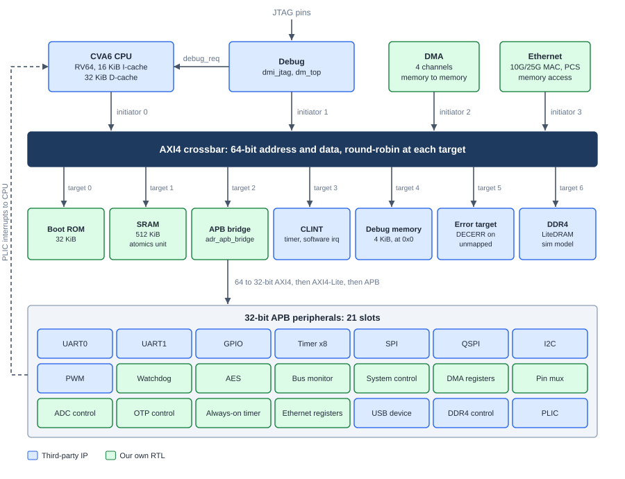

# AXI4 in the ADR SoC

How the ADR SoC uses the AMBA AXI4 protocol: where it runs, the signal set, widths, and what each target supports. The protocol itself is defined by Arm in *AMBA AXI Protocol Specification* (Arm IHI 0022), available from developer.arm.com. This document does not reproduce that specification; read it for handshake, ordering and burst rules.

The RTL types and blocks come from the PULP `axi` library (`rtl/third_party_ip/common/axi`). Its own documents are in [`../third_party_ip/axi/upstream/`](../third_party_ip/axi/upstream/). How ADR uses that library is in [`../third_party_ip/axi/ADR.md`](../third_party_ip/axi/ADR.md).

## 1. Where AXI4 is used

AXI4 is the main fabric inside the chip. `adr_soc_top` has no AXI ports: everything outside connects through JTAG, UART, SPI, QSPI, I2C, GPIO, Ethernet SerDes, USB and the other pins.

| Initiator port | Block | Instance |
|---|---|---|
| 0 | CVA6 CPU, instruction and data misses on one port | `i_core.i_cpu` |
| 1 | Debug system bus access, through `axi_adapter` | `i_debug.i_debug_master` |
| 2 | DMA copy engine | `i_dma` |
| 3 | Ethernet memory engine | `i_eth` |

| Target port | Block | Base address | Atomics (ATOP) |
|---|---|---|---|
| 0 | Boot ROM | `0x0001_0000` | Stopped by `axi_atop_filter`, inside `adr_rom` |
| 1 | SRAM, plus its uncached alias | `0x8000_0000`, `0x1_8000_0000` | Done by `axi_riscv_atomics_wrap`, inside `adr_sram` |
| 2 | Peripheral window (APB bridge) and PLIC | `0x1000_0000`, `0x0C00_0000` | Stopped by `axi_to_axi_lite` in the APB bridge |
| 3 | CLINT | `0x0200_0000` | Not supported |
| 4 | Debug module memory | `0x0000_0000` | Not supported |
| 5 | Error target `axi_err_slv`, the default for unmapped addresses | | Answers with DECERR |
| 6 | DDR4, plus its uncached alias | `0x9000_0000`, `0x1_9000_0000` | Done by `axi_riscv_atomics_wrap`, inside `adr_ddr` |

The crossbar is `axi_xbar` in `adr_interconnect` (`i_interconnect.i_xbar`). See [`../adr_soc/adr_interconnect.md`](../adr_soc/adr_interconnect.md).

## 2. Widths

| Item | Width | Set by |
|---|---|---|
| Address (`AxADDR`) | 64 bits | `AddrWidth` in `adr_soc_pkg` |
| Data (`xDATA`) | 64 bits | `DataWidth` in `adr_soc_pkg` |
| Write strobe (`WSTRB`) | 8 bits | `DataWidth / 8` |
| ID at an initiator port | 4 bits | CVA6 configuration, `AxiIdWidth` |
| ID at a target port | 6 bits | 4 + 2, as the crossbar adds 2 bits to tell its 4 initiators apart |
| User (`xUSER`) | 64 bits, not used by any block | CVA6 configuration, `AxiUserWidth` |

## 3. Signals

The PULP library groups the five channels into two packed structs per port, declared with `AXI_TYPEDEF_ALL` in `adr_soc_top`: a **request** (`init_req_t`, `tgt_req_t`) driven by the initiator, and a **response** (`init_resp_t`, `tgt_resp_t`) driven by the target. A port called `cpu_req` / `cpu_resp` carries every signal of the spec, under these names:

### Write address channel (AW)

| AXI4 signal | Width | ADR field |
|---|---|---|
| AWID | 4 or 6 | `req.aw.id` |
| AWADDR | 64 | `req.aw.addr` |
| AWLEN | 8 | `req.aw.len` |
| AWSIZE | 3 | `req.aw.size` |
| AWBURST | 2 | `req.aw.burst` |
| AWLOCK | 1 | `req.aw.lock` |
| AWCACHE | 4 | `req.aw.cache` |
| AWPROT | 3 | `req.aw.prot` |
| AWQOS | 4 | `req.aw.qos` |
| AWREGION | 4 | `req.aw.region` |
| AWUSER | 64 | `req.aw.user` |
| AWVALID | 1 | `req.aw_valid` |
| AWREADY | 1 | `resp.aw_ready` |
| *AWATOP (AXI5, not in AXI4)* | 6 | `req.aw.atop` |

### Write data channel (W)

| AXI4 signal | Width | ADR field |
|---|---|---|
| WDATA | 64 | `req.w.data` |
| WSTRB | 8 | `req.w.strb` |
| WLAST | 1 | `req.w.last` |
| WUSER | 64 | `req.w.user` |
| WVALID | 1 | `req.w_valid` |
| WREADY | 1 | `resp.w_ready` |

There is no WID: it exists only in AXI3.

### Write response channel (B)

| AXI4 signal | Width | ADR field |
|---|---|---|
| BID | 4 or 6 | `resp.b.id` |
| BRESP | 2 | `resp.b.resp` |
| BUSER | 64 | `resp.b.user` |
| BVALID | 1 | `resp.b_valid` |
| BREADY | 1 | `req.b_ready` |

### Read address channel (AR)

| AXI4 signal | Width | ADR field |
|---|---|---|
| ARID | 4 or 6 | `req.ar.id` |
| ARADDR | 64 | `req.ar.addr` |
| ARLEN | 8 | `req.ar.len` |
| ARSIZE | 3 | `req.ar.size` |
| ARBURST | 2 | `req.ar.burst` |
| ARLOCK | 1 | `req.ar.lock` |
| ARCACHE | 4 | `req.ar.cache` |
| ARPROT | 3 | `req.ar.prot` |
| ARQOS | 4 | `req.ar.qos` |
| ARREGION | 4 | `req.ar.region` |
| ARUSER | 64 | `req.ar.user` |
| ARVALID | 1 | `req.ar_valid` |
| ARREADY | 1 | `resp.ar_ready` |

### Read data channel (R)

| AXI4 signal | Width | ADR field |
|---|---|---|
| RID | 4 or 6 | `resp.r.id` |
| RDATA | 64 | `resp.r.data` |
| RRESP | 2 | `resp.r.resp` |
| RLAST | 1 | `resp.r.last` |
| RUSER | 64 | `resp.r.user` |
| RVALID | 1 | `resp.r_valid` |
| RREADY | 1 | `req.r_ready` |

**Not present:** the optional low-power interface (CSYSREQ, CSYSACK, CACTIVE). The global clock and reset are each block's `clk_i` and active-low `rst_ni`.

**In waveforms:** Questa shows each struct as one signal that expands into these fields, for example `/tb_top/i_dut/i_interconnect/init_req[0].aw.addr` for the CPU's write address.

Some blocks use the library's `AXI_BUS` SystemVerilog interface instead of the structs (for example `adr_rom`, `adr_sram` and the inside of `adr_ddr`). It has flat members with the same meaning: `aw_id`, `aw_addr`, …, `r_ready`. The library's `AXI_ASSIGN_FROM_REQ` and `AXI_ASSIGN_TO_RESP` macros convert between the two.

## 4. Behaviour in ADR

| Topic | ADR behaviour |
|---|---|
| Outstanding transactions | Up to 8 per crossbar port (`MaxMstTrans`, `MaxSlvTrans`) |
| ID reuse | Allowed (`UniqueIds = 0`) |
| Arbitration | Round-robin per target, no CPU priority |
| Registers in the crossbar | On the address channels (`CUT_ALL_AX`) |
| Unmapped address | DECERR from the error target, read data `0xCA11AB1EBADCAB1E` |
| Empty peripheral slot | DECERR from `axi_lite_to_apb`, read data `0xDEA110C8` |
| Peripheral with its clock gated off | SLVERR and read data 0, from the APB bridge |
| CPU and error responses | The CPU does not trap on an AXI error; the bus error monitor (`adr_bus_monitor`) records it. See `MICROARCHITECTURE.md` section 4.3 |
| Atomics and exclusive accesses | RISC-V AMOs travel as ATOPs. LR and SC travel as AXI exclusive accesses, with `AxLOCK = 1` (`wt_axi_adapter.sv` in CVA6). Both are resolved by `axi_riscv_atomics_wrap` (its `axi_riscv_amos` and `axi_riscv_lrsc` parts) in front of SRAM and DDR4; no other target supports them |
| QoS and region | Carried, not used for decisions |

## 5. Verification

Every test drives AXI traffic. `smoke` checks the error target, `sys` the bus error monitor, `dma` and `eth` the second and fourth initiators, `debug` the second, and `ddr` atomics and bursts on DDR4. The PULP library ships its own testbenches, which ADR does not run. See `MICROARCHITECTURE.md` section 17.

## 6. Related documents

- [`APB.md`](APB.md): the peripheral bus, behind the APB bridge.
- [`../adr_soc/adr_interconnect.md`](../adr_soc/adr_interconnect.md): crossbar, error target and APB bridge.
- `docs/MICROARCHITECTURE.md` sections 3 and 4.
