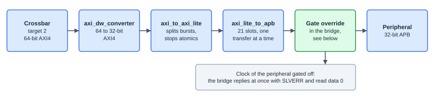

# PULP AXI library in the ADR SoC

The AXI4 types, crossbar and converters that make up the ADR fabric. This note says how ADR uses it. The upstream documents, at the exact commit vendored, are in [`upstream/`](upstream/).

| | |
|---|---|
| Upstream | github.com/pulp-platform/axi |
| Vendored in | `rtl/third_party_ip/common/axi` |
| Modules used | `axi_pkg`, `typedef.svh`, `assign.svh`, `AXI_BUS`, `axi_xbar` (with `axi_demux`, `axi_mux`), `axi_err_slv`, `axi_dw_converter`, `axi_to_axi_lite`, `axi_lite_to_apb`, `axi_atop_filter`, `axi_cut` and others they need |
| Where in ADR | `i_interconnect` (crossbar, error target, APB bridge), `i_mem.i_rom` (ATOP filter), and the bus types of the whole SoC |
| Changes | None: the vendored files are unmodified. |
| Integration owner | Vijay Bogati |
| Document revision | 2.0 |
| Date | 2026-11-14 |

### Revision history

| Revision | Date | Change |
|---|---|---|
| 1.0 | 2026-11-08 | First issue: version, license, configuration, upstream documents |
| 2.0 | 2026-11-14 | Integration section generated from the RTL (instances, parameters, tied and open ports, reset style); standard cover table |

## 1. Version and license

From `docs/THIRD_PARTY.md`, the record of every vendored file:

| Block | Path | Upstream | Version / commit | License |
|---|---|---|---|---|
| AXI | `common/axi` | github.com/pulp-platform/axi | `697f13ff` (as vendored by CVA6) | Solderpad 0.51 |

## 2. ADR configuration: Interconnect

### Crossbar

The crossbar is `axi_xbar`, configured in `adr_soc_top`:

| Setting | Value | Meaning |
|---|---|---|
| `MaxMstTrans`, `MaxSlvTrans` | 8, 8 | Outstanding transactions per port |
| `LatencyMode` | `CUT_ALL_AX` | Registers on the address channels |
| `FallThrough` | 0 | Internal FIFOs do not fall through |
| `UniqueIds` | 0 | Initiators may reuse IDs |
| `ATOPs` | 1 | AXI atomic operations are passed through |
| Address rules | 9 | PLIC and peripheral window both go to target 2. SRAM and DDR4 each have a second rule for their uncached alias |
| Default target | Error target | Enabled on all initiator ports |

| Initiator port | Block | Notes |
|---|---|---|
| 0 | CVA6 | Instruction and data misses share this port |
| 1 | Debug system bus access | Through `axi_adapter`; always issues 8-byte size |
| 2 | DMA | |
| 3 | Ethernet | |

Each target arbitrates between initiators round-robin, with no CPU priority.

### APB bridge

`adr_apb_bridge`, inside `adr_interconnect`, takes the crossbar's peripheral port down to the APB slots. An access passes through:

1. `axi_dw_converter`: 64-bit to 32-bit AXI4. A 64-bit access becomes two 32-bit ones.
2. `axi_to_axi_lite`: splits bursts, and stops atomics at this point.
3. `axi_lite_to_apb`: decodes 21 slots and runs one APB transfer at a time, with registers on request and response.
4. The clock-gate response override (section 5.2), then the block's own APB slot, in whichever subsystem it sits.

A UART register read takes about 8 clocks through this path (see `LIMITATIONS.md`).

**Software rules for this bus:**
- Use 32-bit, word-aligned accesses. Only the I2C path carries APB byte strobes. Every other block, including the PLIC, ignores them, so a byte or halfword write can change a whole register.
- Our own blocks decode only the low address bits they need, so registers repeat within a slot. Don't rely on these aliases.
- Reserved registers in our own blocks read as 0, and writes to them are ignored. All of our blocks are always ready and never report an APB error.

### Error responses

| Case | AXI response | Read data | Source |
|---|---|---|---|
| Address hits no crossbar rule | DECERR | `0xCA11AB1EBADCAB1E` | `axi_err_slv` |
| Empty slot in the peripheral window | DECERR | `0xDEA110C8` | `axi_lite_to_apb` |
| Peripheral with its clock gated off | SLVERR | 0 | Override in `adr_apb_bridge` |

**The CPU does not trap on any of these.** The write-through cache ignores AXI error responses, so the instruction completes with the data above. The bus error monitor records the error and can raise an interrupt, but only after the instruction has finished. Use PMP where a precise fault is needed.

### Atomic operations

| Target | Behaviour |
|---|---|
| SRAM | Resolved by `axi_riscv_atomics_wrap` in front of the memory, inside `adr_sram`, with a 64-bit word width |
| DDR4 | The same, with its own `axi_riscv_atomics_wrap` inside `adr_ddr` |
| Boot ROM | Stopped by `axi_atop_filter_intf` inside `adr_rom` |
| Other targets | Not supported, and not tested |

<!-- integration: generated, do not edit -->
## 3. Integration in ADR

Generated from the RTL by `tp_integration.py` on 2026-11-14. Instances of `AXI_BUS`, `axi_xbar`, `axi_demux`, `axi_mux`, `axi_err_slv`, `axi_dw_converter`, `axi_to_axi_lite`, `axi_lite_to_apb`, `axi_atop_filter`, `axi_cut` in our own RTL (`rtl/adr_soc`, `rtl/adr_ip`).

| Item | Value |
|---|---|
| Instances in our RTL | 12 |
| Reset style of the vendored code | Asynchronous, active-low (`negedge` reset in 8 of 14 files) |

#### `AXI_BUS` as `bus_in` (`rtl/adr_ip/ddr/rtl/adr_ddr.sv:62`)

| Parameter | Value in ADR |
|---|---|
| `AXI_ADDR_WIDTH` | `AddrWidth` |
| `AXI_DATA_WIDTH` | `DataWidth` |
| `AXI_ID_WIDTH` | `IdWidth` |
| `AXI_USER_WIDTH` | `UserWidth` |

Ports: 0 connected by name; none tied to constants; none left open.

#### `AXI_BUS` as `dm_slave_bus` (`rtl/adr_soc/debug/adr_debug.sv:171`)

| Parameter | Value in ADR |
|---|---|
| `AXI_ADDR_WIDTH` | `AddrWidth` |
| `AXI_DATA_WIDTH` | `DataWidth` |
| `AXI_ID_WIDTH` | `TgtIdWidth` |
| `AXI_USER_WIDTH` | `UserWidth` |

Ports: 0 connected by name; none tied to constants; none left open.

#### `AXI_BUS` as `mem_bus` (`rtl/adr_soc/mem/adr_axi_mem.sv:41`)

| Parameter | Value in ADR |
|---|---|
| `AXI_ADDR_WIDTH` | `64` |
| `AXI_DATA_WIDTH` | `64` |
| `AXI_ID_WIDTH` | `IdWidth` |
| `AXI_USER_WIDTH` | `UserWidth` |

Ports: 0 connected by name; none tied to constants; none left open.

#### `AXI_BUS` as `bus_in` (`rtl/adr_soc/mem/adr_rom.sv:34`)

| Parameter | Value in ADR |
|---|---|
| `AXI_ADDR_WIDTH` | `AddrWidth` |
| `AXI_DATA_WIDTH` | `DataWidth` |
| `AXI_ID_WIDTH` | `IdWidth` |
| `AXI_USER_WIDTH` | `UserWidth` |

Ports: 0 connected by name; none tied to constants; none left open.

#### `AXI_BUS` as `bus_in` (`rtl/adr_soc/mem/adr_sram.sv:34`)

| Parameter | Value in ADR |
|---|---|
| `AXI_ADDR_WIDTH` | `AddrWidth` |
| `AXI_DATA_WIDTH` | `DataWidth` |
| `AXI_ID_WIDTH` | `IdWidth` |
| `AXI_USER_WIDTH` | `UserWidth` |

Ports: 0 connected by name; none tied to constants; none left open.

#### `axi_xbar` as `i_xbar` (`rtl/adr_soc/interconnect/adr_interconnect.sv:148`)

| Parameter | Value in ADR |
|---|---|
| `Cfg` | `XbarCfg` |
| `ATOPs` | `1'b1` |
| `slv_aw_chan_t` | `init_aw_chan_t` |
| `mst_aw_chan_t` | `tgt_aw_chan_t` |
| `w_chan_t` | `init_w_chan_t` |
| `slv_b_chan_t` | `init_b_chan_t` |
| `mst_b_chan_t` | `tgt_b_chan_t` |
| `slv_ar_chan_t` | `init_ar_chan_t` |
| `mst_ar_chan_t` | `tgt_ar_chan_t` |
| `slv_r_chan_t` | `init_r_chan_t` |
| `mst_r_chan_t` | `tgt_r_chan_t` |
| `slv_req_t` | `init_req_t` |
| `slv_resp_t` | `init_resp_t` |
| `mst_req_t` | `tgt_req_t` |
| `mst_resp_t` | `tgt_resp_t` |
| `rule_t` | `axi_pkg::xbar_rule_64_t` |

Ports: 10 connected by name; tied to constants: `test_i` = `1'b0`, `en_default_mst_port_i` = `'1`; none left open.

#### `axi_err_slv` as `i_error_target` (`rtl/adr_soc/interconnect/adr_interconnect.sv:171`)

| Parameter | Value in ADR |
|---|---|
| `AxiIdWidth` | `TgtIdWidth` |
| `req_t` | `tgt_req_t` |
| `resp_t` | `tgt_resp_t` |
| `Resp` | `axi_pkg::RESP_DECERR` |
| `ATOPs` | `1'b1` |
| `MaxTrans` | `4` |

Ports: 5 connected by name; tied to constants: `test_i` = `1'b0`; none left open.

#### `axi_dw_converter` as `i_width_down` (`rtl/adr_soc/interconnect/adr_apb_bridge.sv:75`)

| Parameter | Value in ADR |
|---|---|
| `AxiMaxReads` | `4` |
| `AxiSlvPortDataWidth` | `DataWidth` |
| `AxiMstPortDataWidth` | `ApbDataWidth` |
| `AxiAddrWidth` | `AddrWidth` |
| `AxiIdWidth` | `IdWidth` |
| `aw_chan_t` | `slv_aw_chan_t` |
| `mst_w_chan_t` | `narrow_w_chan_t` |
| `slv_w_chan_t` | `slv_w_chan_t` |
| `b_chan_t` | `slv_b_chan_t` |
| `ar_chan_t` | `slv_ar_chan_t` |
| `mst_r_chan_t` | `narrow_r_chan_t` |
| `slv_r_chan_t` | `slv_r_chan_t` |
| `axi_mst_req_t` | `narrow_req_t` |
| `axi_mst_resp_t` | `narrow_resp_t` |
| `axi_slv_req_t` | `slv_req_t` |
| `axi_slv_resp_t` | `slv_resp_t` |

Ports: 6 connected by name; none tied to constants; none left open.

#### `axi_to_axi_lite` as `i_to_lite` (`rtl/adr_soc/interconnect/adr_apb_bridge.sv:96`)

| Parameter | Value in ADR |
|---|---|
| `AxiAddrWidth` | `AddrWidth` |
| `AxiDataWidth` | `ApbDataWidth` |
| `AxiIdWidth` | `IdWidth` |
| `AxiUserWidth` | `UserWidth` |
| `AxiMaxWriteTxns` | `4` |
| `AxiMaxReadTxns` | `4` |
| `FallThrough` | `1'b0` |
| `full_req_t` | `narrow_req_t` |
| `full_resp_t` | `narrow_resp_t` |
| `lite_req_t` | `lite_req_t` |
| `lite_resp_t` | `lite_resp_t` |

Ports: 7 connected by name; tied to constants: `test_i` = `1'b0`; none left open.

#### `axi_lite_to_apb` as `i_to_apb` (`rtl/adr_soc/interconnect/adr_apb_bridge.sv:141`)

| Parameter | Value in ADR |
|---|---|
| `NoApbSlaves` | `NumApbSlots` |
| `NoRules` | `NumApbSlots` |
| `AddrWidth` | `AddrWidth` |
| `DataWidth` | `ApbDataWidth` |
| `PipelineRequest` | `1'b1` |
| `PipelineResponse` | `1'b1` |
| `axi_lite_req_t` | `lite_req_t` |
| `axi_lite_resp_t` | `lite_resp_t` |
| `apb_req_t` | `apb_req_t` |
| `apb_resp_t` | `apb_resp_t` |
| `rule_t` | `axi_pkg::xbar_rule_64_t` |

Ports: 7 connected by name; none tied to constants; none left open.

#### `axi_atop_filter` as `i_clint_atop_filter` (`rtl/adr_soc/core/adr_core_complex.sv:97`)

| Parameter | Value in ADR |
|---|---|
| `AxiIdWidth` | `TgtIdWidth` |
| `AxiMaxWriteTxns` | `1` |
| `req_t` | `tgt_req_t` |
| `resp_t` | `tgt_resp_t` |

Ports: 6 connected by name; none tied to constants; none left open.

#### `axi_atop_filter` as `i_atop_filter` (`rtl/adr_soc/debug/adr_debug.sv:157`)

| Parameter | Value in ADR |
|---|---|
| `AxiIdWidth` | `TgtIdWidth` |
| `AxiMaxWriteTxns` | `1` |
| `req_t` | `tgt_req_t` |
| `resp_t` | `tgt_resp_t` |

Ports: 6 connected by name; none tied to constants; none left open.

<!-- integration: end -->

## 4. Upstream documents

Copied unchanged from the upstream repository at the vendored commit, with its license:

- [`upstream/CHANGELOG.md`](upstream/CHANGELOG.md)
- [`upstream/LICENSE`](upstream/LICENSE)
- [`upstream/README.md`](upstream/README.md)
- [`upstream/doc/README.md`](upstream/doc/README.md)
- [`upstream/doc/axi_demux.md`](upstream/doc/axi_demux.md)
- [`upstream/doc/axi_lite_demux.md`](upstream/doc/axi_lite_demux.md)
- [`upstream/doc/axi_lite_mailbox.md`](upstream/doc/axi_lite_mailbox.md)
- [`upstream/doc/axi_lite_mux.md`](upstream/doc/axi_lite_mux.md)
- [`upstream/doc/axi_lite_xbar.md`](upstream/doc/axi_lite_xbar.md)
- [`upstream/doc/axi_mux.md`](upstream/doc/axi_mux.md)
- [`upstream/doc/axi_xbar.md`](upstream/doc/axi_xbar.md)
- and 10 figures used by them

Upstream `doc/` has module documents for the crossbar (`axi_xbar.md`), demux and mux, and their AXI4-Lite versions.

## 5. Verification in ADR

| Test | Covers | Checks |
|---|---|---|
| `smoke` | CPU, memories, illegal instruction trap, UART0, error target | 18 |
| `serial` | SPI, QSPI, I2C, free slots | 19 |
| `sys` | Bus error monitor, system control | 23 |
| `dma` | DMA, and cache coherency methods | 26 |

## 6. Known limitations in ADR

From `docs/LIMITATIONS.md`:

- Item 1: Bus errors do not trap the CPU.
- Item 69: A transmit bus error still sends a frame

## 7. Related documents

- [`../../protocols/AXI4.md`](../../protocols/AXI4.md)
- [`../../protocols/APB.md`](../../protocols/APB.md)
- [`../../adr_soc/adr_interconnect.md`](../../adr_soc/adr_interconnect.md)
- `docs/MICROARCHITECTURE.md`: section numbers quoted above refer to it.
