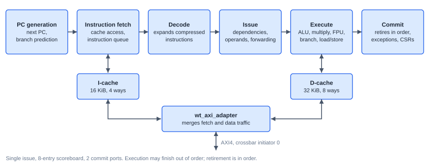

# CVA6 CPU in the ADR SoC

The 64-bit RISC-V application-class CPU, configuration `cv64a6_imafdc_sv39`. This note says how ADR uses it. The upstream documents, at the exact commit vendored, are in [`upstream/`](upstream/).

| | |
|---|---|
| Upstream | github.com/openhwgroup/cva6 |
| Vendored in | `rtl/third_party_ip/cva6` |
| Modules used | `cva6` and its pipeline, the write-through cache (`wt_*`), `axi_adapter` (also used by the debug subsystem) |
| Where in ADR | `i_core.i_cpu`, crossbar initiator 0; `i_debug.i_debug_master` uses its `axi_adapter` |
| Changes | A modified copy for the commercial simulators (Questa, VCS, Xcelium) of `core/cache_subsystem/wt_dcache_wbuffer.sv` is in `sim/compat_fixes/`, with a formal equivalence proof; Verilator builds the unmodified file. See `docs/THIRD_PARTY.md`. |
| Integration owner | Vijay Bogati |
| Document revision | 2.0 |
| Date | 2026-11-14 |

### Revision history

| Revision | Date | Change |
|---|---|---|
| 1.0 | 2026-11-08 | First issue: version, license, configuration, upstream documents |
| 2.0 | 2026-11-14 | Integration section generated from the RTL (instances, parameters, tied and open ports, reset style); standard cover table |

## 1. Version and license

From `docs/THIRD_PARTY.md`, the record of every vendored file:

| Block | Path | Upstream | Version / commit | License |
|---|---|---|---|---|
| CVA6 CPU | `cva6/core`, `cva6/common` | github.com/openhwfoundation/cva6 | `v5.3.0` / `2ef1c1b1` | See `cva6/LICENSE` (Solderpad 0.51), `LICENSE.Berkeley`, `LICENSE.SiFive` |
| CLINT | `clint` | github.com/openhwfoundation/cva6 | `v5.3.0` / `2ef1c1b1` | Solderpad 0.51 (file headers) |
| AXI types package | `clint/rtl/ariane_axi_pkg.sv` | github.com/openhwfoundation/cva6 | `v5.3.0` / `2ef1c1b1` | See `cva6/LICENSE` and file header. Needed only because the CLINT's default parameters refer to it |

## 2. ADR configuration: CPU

### Configuration

The CPU is CVA6 `v5.3.0`, using upstream `cv64a6_imafdc_sv39`, with two changes made by `cpu_user_cfg()`: the non-idempotent rules are set for the device regions, and the coprocessor port is turned off.

| Item | Setting |
|---|---|
| ISA | RV64IMAFDC, plus `B`, `Zcb`, `Zicond`, `Zicntr` and `Zihpm` |
| Not enabled | `H`, `V`, `Zcmp`, `Zcmt`, half-precision and 8-bit floating point |
| Privilege modes | Machine, supervisor, user |
| Issue width | Single issue (`SuperscalarEn` = 0), with 2 commit ports |
| Scoreboard | 8 entries |
| Instruction cache | 16 KiB, 4 ways, 128-bit lines |
| Data cache | 32 KiB, 8 ways, 128-bit lines, write-through, 8-entry write buffer |
| Load buffer, outstanding stores | 2, 7 |
| Branch prediction | 128-entry BHT, 32-entry BTB, 2-entry return address stack |
| MMU | Sv39, 16-entry instruction TLB, 16-entry data TLB, no shared TLB |
| PMP | 8 entries, NAPOT enabled |
| Performance counters | Enabled |
| AXI | 64-bit, ID width 4, with atomics. CPU writes are single beats (`AxiBurstWriteEn` = 0) |
| Reset vector | `0x0001_0000` |
| Hart ID | 0 |

`FEATURES.md` lists the CPU as RV64GC. The extra extensions above are enabled by the upstream configuration, and no test exercises them directly.

### Pipeline

CVA6 has six stages. This table maps them to the upstream source in `rtl/third_party_ip/cva6/core`.

| Stage | Source | Function |
|---|---|---|
| PC generation | `frontend/frontend.sv`, `bht.sv`, `btb.sv`, `ras.sv` | Next PC, and branch prediction |
| Instruction fetch | `frontend/frontend.sv`, `instr_queue.sv`, `instr_scan.sv` | Fetch from the instruction cache, and queue instructions |
| Decode | `id_stage.sv`, `decoder.sv`, `compressed_decoder.sv` | Decode, and expand compressed instructions |
| Issue | `issue_stage.sv`, `scoreboard.sv`, `issue_read_operands.sv` | Track dependencies, read operands and forward results |
| Execute | `ex_stage.sv`, `alu.sv`, `branch_unit.sv`, `mult.sv`, `load_store_unit.sv`, `fpu_wrap.sv`, `csr_buffer.sv` | Functional units, which may finish out of order |
| Commit | `commit_stage.sv`, `csr_regfile.sv` | Retire in order, raise exceptions and update CSRs |

`controller.sv` handles flushes for mispredicts, exceptions and fences.

### Caches and memory ordering

The cache subsystem is `wt_cache_subsystem`. Every store goes to the bus through the write buffer, and `wt_axi_adapter` merges instruction and data traffic onto the single AXI port.

In this configuration `DcacheFlushOnFence` is 0, so **`fence` and `fence.i` do not flush the data cache**. `fence.i` flushes the instruction cache.

**DMA coherency:** there is no hardware coherency, so the data cache doesn't see writes from DMA or any other bus master. A cached read of a buffer that DMA just wrote can return stale data. `test_coherency()` in `tb/verilator/c_tests/dma.c` shows this, and checks both ways of avoiding it:

| Method | How | Use it for |
|---|---|---|
| Uncached alias | Add `0x1_0000_0000` to an SRAM or DDR4 address. It reaches the same memory, with no caching. `UNCACHED()` in `tb/verilator/c_tests/adr_lib.h` does this | Descriptors and DMA buffers. The buffer must only be read through the alias |
| Invalidate | `dcache_invalidate()` in `tb/verilator/c_tests/adr_lib.h` writes 0 then 1 to CSR `0x7C1`, CVA6's data cache enable. Enabling the cache invalidates all of it | Large buffers that benefit from caching. Machine mode only, and it costs the whole cache |

CPU writes are always safe for DMA to read, because the cache is write-through, but a write to an address leaves any cached line of its alias unchanged. Software must not mix both views of one buffer without invalidating. `fence` doesn't help, as noted above.

### Interrupt inputs

| CVA6 input | Source |
|---|---|
| `irq_i[0]` | PLIC target 0, machine external |
| `irq_i[1]` | PLIC target 1, supervisor external |
| `time_irq_i` | CLINT machine timer |
| `ipi_i` | CLINT machine software |
| `debug_req_i` | Debug module |

### Coprocessor port

`CvxifEn` is 1 in the upstream configuration, and `cpu_user_cfg()` sets it to 0 because no coprocessor is connected. `adr_soc_top` ties `cvxif_resp_i` to 0. An illegal instruction therefore traps with `mcause` 2, which `smoke` checks. See section 18, item 1, for what happened with the port on. A future coprocessor would need the setting turned back on and a real connection to this port.

### What has been exercised

The tests run in machine mode. Supervisor mode, user mode, the MMU, and Linux boot have not been run, and neither have the RISC-V architecture tests.

<!-- integration: generated, do not edit -->
## 3. Integration in ADR

Generated from the RTL by `tp_integration.py` on 2026-11-14. Instances of `cva6`, `axi_adapter` in our own RTL (`rtl/adr_soc`, `rtl/adr_ip`).

| Item | Value |
|---|---|
| Instances in our RTL | 2 |
| Reset style of the vendored code | Mixed: asynchronous in 81 files, synchronous in 3 of 160 files |

#### `cva6` as `i_cpu` (`rtl/adr_soc/core/adr_core_complex.sv:67`)

| Parameter | Value in ADR |
|---|---|
| `CVA6Cfg` | `CpuCfg` |
| `axi_ar_chan_t` | `init_ar_chan_t` |
| `axi_aw_chan_t` | `init_aw_chan_t` |
| `axi_w_chan_t` | `init_w_chan_t` |
| `b_chan_t` | `init_b_chan_t` |
| `r_chan_t` | `init_r_chan_t` |
| `noc_req_t` | `init_req_t` |
| `noc_resp_t` | `init_resp_t` |

Ports: 13 connected by name; tied to constants: `hart_id_i` = `'0`, `cvxif_resp_i` = `'0`; left open: `rvfi_probes_o`, `cvxif_req_o`.

#### `axi_adapter` as `i_debug_master` (`rtl/adr_soc/debug/adr_debug.sv:203`)

| Parameter | Value in ADR |
|---|---|
| `CVA6Cfg` | `CpuCfg` |
| `DATA_WIDTH` | `DataWidth` |
| `axi_req_t` | `init_req_t` |
| `axi_rsp_t` | `init_resp_t` |

Ports: 19 connected by name; tied to constants: `size_i` = `2'b11`, `id_i` = `'0`; left open: `id_o`, `critical_word_o`, `critical_word_valid_o`.

<!-- integration: end -->

## 4. Upstream documents

Copied unchanged from the upstream repository at the vendored commit, with its license:

- [`upstream/CHANGELOG.md`](upstream/CHANGELOG.md)
- [`upstream/LICENSE`](upstream/LICENSE)
- [`upstream/LICENSE.Berkeley`](upstream/LICENSE.Berkeley)
- [`upstream/LICENSE.SiFive`](upstream/LICENSE.SiFive)
- [`upstream/README.md`](upstream/README.md)
- [`upstream/docs/01_cva6_user/AXI_Interface.rst`](upstream/docs/01_cva6_user/AXI_Interface.rst)
- [`upstream/docs/01_cva6_user/CSR_CV32A60AX.rst`](upstream/docs/01_cva6_user/CSR_CV32A60AX.rst)
- [`upstream/docs/01_cva6_user/CSR_CV32A60AX_list.rst`](upstream/docs/01_cva6_user/CSR_CV32A60AX_list.rst)
- [`upstream/docs/01_cva6_user/CSR_CV32A60X.rst`](upstream/docs/01_cva6_user/CSR_CV32A60X.rst)
- [`upstream/docs/01_cva6_user/CSR_CV32A60X_list.rst`](upstream/docs/01_cva6_user/CSR_CV32A60X_list.rst)
- [`upstream/docs/01_cva6_user/CSR_CV64A6_MMU.rst`](upstream/docs/01_cva6_user/CSR_CV64A6_MMU.rst)
- [`upstream/docs/01_cva6_user/CSR_CV64A6_MMU_list.rst`](upstream/docs/01_cva6_user/CSR_CV64A6_MMU_list.rst)
- [`upstream/docs/01_cva6_user/CSR_Cache_Control.rst`](upstream/docs/01_cva6_user/CSR_Cache_Control.rst)
- [`upstream/docs/01_cva6_user/CSR_Performance_Counters.rst`](upstream/docs/01_cva6_user/CSR_Performance_Counters.rst)
- [`upstream/docs/01_cva6_user/CV32A6_Control_Status_Registers.rst`](upstream/docs/01_cva6_user/CV32A6_Control_Status_Registers.rst)
- [`upstream/docs/01_cva6_user/CV64A6_Control_Status_Registers.rst`](upstream/docs/01_cva6_user/CV64A6_Control_Status_Registers.rst)
- [`upstream/docs/01_cva6_user/CVA6_user_guide.rst`](upstream/docs/01_cva6_user/CVA6_user_guide.rst)
- [`upstream/docs/01_cva6_user/CVX_Interface_Coprocessor.rst`](upstream/docs/01_cva6_user/CVX_Interface_Coprocessor.rst)
- [`upstream/docs/01_cva6_user/Compiler_Command_Lines.rst`](upstream/docs/01_cva6_user/Compiler_Command_Lines.rst)
- [`upstream/docs/01_cva6_user/Core_Integration.rst`](upstream/docs/01_cva6_user/Core_Integration.rst)
- [`upstream/docs/01_cva6_user/Custom_Instructions.rst`](upstream/docs/01_cva6_user/Custom_Instructions.rst)
- [`upstream/docs/01_cva6_user/Interfaces.rst`](upstream/docs/01_cva6_user/Interfaces.rst)
- [`upstream/docs/01_cva6_user/Introduction.rst`](upstream/docs/01_cva6_user/Introduction.rst)
- [`upstream/docs/01_cva6_user/PMA.rst`](upstream/docs/01_cva6_user/PMA.rst)
- [`upstream/docs/01_cva6_user/PMP.rst`](upstream/docs/01_cva6_user/PMP.rst)
- [`upstream/docs/01_cva6_user/Parameters_Configuration.rst`](upstream/docs/01_cva6_user/Parameters_Configuration.rst)
- [`upstream/docs/01_cva6_user/Programmer_View.rst`](upstream/docs/01_cva6_user/Programmer_View.rst)
- [`upstream/docs/01_cva6_user/RISCV_Instructions.rst`](upstream/docs/01_cva6_user/RISCV_Instructions.rst)
- [`upstream/docs/01_cva6_user/RISCV_Instructions_RV32A.rst`](upstream/docs/01_cva6_user/RISCV_Instructions_RV32A.rst)
- [`upstream/docs/01_cva6_user/RISCV_Instructions_RV32C.rst`](upstream/docs/01_cva6_user/RISCV_Instructions_RV32C.rst)
- [`upstream/docs/01_cva6_user/RISCV_Instructions_RV32I.rst`](upstream/docs/01_cva6_user/RISCV_Instructions_RV32I.rst)
- [`upstream/docs/01_cva6_user/RISCV_Instructions_RV32M.rst`](upstream/docs/01_cva6_user/RISCV_Instructions_RV32M.rst)
- [`upstream/docs/01_cva6_user/RISCV_Instructions_RV32ZCb.rst`](upstream/docs/01_cva6_user/RISCV_Instructions_RV32ZCb.rst)
- [`upstream/docs/01_cva6_user/RISCV_Instructions_RVZba.rst`](upstream/docs/01_cva6_user/RISCV_Instructions_RVZba.rst)
- [`upstream/docs/01_cva6_user/RISCV_Instructions_RVZbb.rst`](upstream/docs/01_cva6_user/RISCV_Instructions_RVZbb.rst)
- [`upstream/docs/01_cva6_user/RISCV_Instructions_RVZbc.rst`](upstream/docs/01_cva6_user/RISCV_Instructions_RVZbc.rst)
- [`upstream/docs/01_cva6_user/RISCV_Instructions_RVZbkb.rst`](upstream/docs/01_cva6_user/RISCV_Instructions_RVZbkb.rst)
- [`upstream/docs/01_cva6_user/RISCV_Instructions_RVZbs.rst`](upstream/docs/01_cva6_user/RISCV_Instructions_RVZbs.rst)
- [`upstream/docs/01_cva6_user/RISCV_Instructions_RVZcmp.rst`](upstream/docs/01_cva6_user/RISCV_Instructions_RVZcmp.rst)
- [`upstream/docs/01_cva6_user/RISCV_Instructions_RVZicond.rst`](upstream/docs/01_cva6_user/RISCV_Instructions_RVZicond.rst)
- [`upstream/docs/01_cva6_user/RISCV_Instructions_RVZicsr.rst`](upstream/docs/01_cva6_user/RISCV_Instructions_RVZicsr.rst)
- [`upstream/docs/01_cva6_user/RISCV_Instructions_RVZifencei.rst`](upstream/docs/01_cva6_user/RISCV_Instructions_RVZifencei.rst)
- [`upstream/docs/01_cva6_user/Traps_Interrupts_Exceptions.rst`](upstream/docs/01_cva6_user/Traps_Interrupts_Exceptions.rst)
- [`upstream/docs/01_cva6_user/index.rst`](upstream/docs/01_cva6_user/index.rst)
- [`upstream/docs/01_cva6_user/user_cfg_doc.rst`](upstream/docs/01_cva6_user/user_cfg_doc.rst)
- [`upstream/docs/06_cv64a6_mmu/index.rst`](upstream/docs/06_cv64a6_mmu/index.rst)
- [`upstream/docs/06_cv64a6_mmu/riscv/priv.rst`](upstream/docs/06_cv64a6_mmu/riscv/priv.rst)
- [`upstream/docs/06_cv64a6_mmu/riscv/unpriv.rst`](upstream/docs/06_cv64a6_mmu/riscv/unpriv.rst)
- [`upstream/docs/README.md`](upstream/docs/README.md)
- and 2 figures used by them

Only the user manual (`docs/01_cva6_user`) and the 64-bit MMU chapter (`docs/06_cv64a6_mmu`) were copied. The CV32A65X design document in upstream `docs/03_cva6_design` describes a different 32-bit configuration and is left out.

## 5. Verification in ADR

| Test | Covers | Checks |
|---|---|---|
| `smoke` | CPU, memories, illegal instruction trap, UART0, error target | 18 |
| `irq` | CLINT, PLIC | 31 |
| `debug` | JTAG, debug module, system bus access | 30 |
| `ddr` | DDR4 from the CPU and DMA, atomics, running code | 18 |

## 6. Known limitations in ADR

From `docs/LIMITATIONS.md`:

- Item 1: Bus errors do not trap the CPU.
- Item 51: DMA is not cache-coherent in hardware.
- Item 64: The CPU has more extensions than the feature list says.
- Item 6: One CPU AXI port.
- Item 8: Round-robin arbitration, with no CPU priority.
- Item 9: Write-through data cache.
- Item 17: No CPU compliance run.

## 7. Related documents

- [`../../adr_soc/adr_core_complex.md`](../../adr_soc/adr_core_complex.md)
- [`../cvfpu/ADR.md`](../cvfpu/ADR.md)
- [`../../protocols/AXI4.md`](../../protocols/AXI4.md)
- `docs/MICROARCHITECTURE.md`: section numbers quoted above refer to it.
