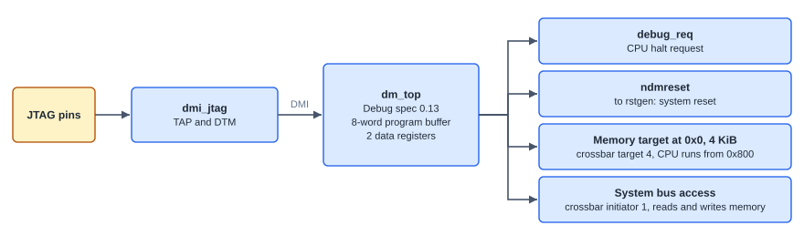

# RISC-V debug module (`riscv-dbg`) in the ADR SoC

The RISC-V External Debug Support 0.13 debug module and JTAG transport. This note says how ADR uses it. The upstream documents, at the exact commit vendored, are in [`upstream/`](upstream/).

| | |
|---|---|
| Upstream | github.com/pulp-platform/riscv-dbg |
| Vendored in | `rtl/third_party_ip/debug` |
| Modules used | `dmi_jtag` (with `dmi_jtag_tap`, `dmi_cdc`), `dm_top` (`dm_csrs`, `dm_mem`, `dm_sba`) |
| Where in ADR | `i_debug.i_dmi_jtag` and `i_debug.i_debug_module` |
| Changes | A modified copy for the commercial simulators (Questa, VCS, Xcelium) of `src/dm_mem.sv` is in `sim/compat_fixes/`, with a formal equivalence proof; Verilator builds the unmodified file. See `docs/THIRD_PARTY.md`. |
| Integration owner | Vijay Bogati |
| Document revision | 2.0 |
| Date | 2026-11-14 |

### Revision history

| Revision | Date | Change |
|---|---|---|
| 1.0 | 2026-11-08 | First issue: version, license, configuration, upstream documents |
| 2.0 | 2026-11-14 | Integration section generated from the RTL (instances, parameters, tied and open ports, reset style); standard cover table |

## 1. Version and license

From `docs/THIRD_PARTY.md`, the record of every vendored file:

| Block | Path | Upstream | Version / commit | License |
|---|---|---|---|---|
| Debug module | `debug` | github.com/pulp-platform/riscv-dbg | `e19d69ef` | Solderpad 0.51, see its `LICENSE` and `LICENSE.SiFive` |

## 2. ADR configuration: Debug

The debug system follows version 0.13 of the RISC-V debug specification, using `pulp-platform/riscv-dbg`.

| Item | Setting |
|---|---|
| JTAG IDCODE | `0x0000_0001`, a placeholder |
| Program buffer | 8 words |
| Data registers | 2 words, memory-mapped |
| Halt, resume, exception entry | `0x800`, `0x804`, `0x808` in the debug module region |
| Bus width | 64 bits |
| Reset | Power-on reset only, so it survives `ndmreset` |

**How a halt works:** the debugger sets `haltreq`, and the debug module raises `debug_req`. The CPU then enters debug mode and runs from the debug module's memory at `0x800`, fetching through crossbar target 4. Abstract commands run as generated code from the same region. **System bus access** reads and writes memory through initiator 1 without halting the CPU.

**Constraints:**
- There is no authentication and no trigger module.
- JTAG must run slower than the system clock. Only TCK at one eighth of `clk_i` has been tested.
- The `debug` test uses our own JTAG driver in `tb/verilator/tb_top.sv`. OpenOCD and GDB have not been connected.

<!-- integration: generated, do not edit -->
## 3. Integration in ADR

Generated from the RTL by `tp_integration.py` on 2026-11-14. Instances of `dmi_jtag`, `dmi_jtag_tap`, `dmi_cdc`, `dm_top`, `dm_csrs`, `dm_mem`, `dm_sba` in our own RTL (`rtl/adr_soc`, `rtl/adr_ip`).

| Item | Value |
|---|---|
| Instances in our RTL | 2 |
| Reset style of the vendored code | Mixed: asynchronous in 5 files, synchronous in 1 of 10 files |

#### `dmi_jtag` as `i_dmi_jtag` (`rtl/adr_soc/debug/adr_debug.sv:70`)

| Parameter | Value in ADR |
|---|---|
| `IdcodeValue` | `JtagIdcode` |

Ports: 16 connected by name; tied to constants: `testmode_i` = `1'b0`; none left open.

#### `dm_top` as `i_debug_module` (`rtl/adr_soc/debug/adr_debug.sv:112`)

| Parameter | Value in ADR |
|---|---|
| `NrHarts` | `1` |
| `BusWidth` | `DataWidth` |
| `DmBaseAddress` | `int'(DebugBase)` |
| `SelectableHarts` | `1'b1` |

Ports: 29 connected by name; tied to constants: `testmode_i` = `1'b0`, `unavailable_i` = `1'b0`; left open: `dmactive_o`.

<!-- integration: end -->

## 4. Upstream documents

Copied unchanged from the upstream repository at the vendored commit, with its license:

- [`upstream/CHANGELOG.md`](upstream/CHANGELOG.md)
- [`upstream/LICENSE`](upstream/LICENSE)
- [`upstream/LICENSE.SiFive`](upstream/LICENSE.SiFive)
- [`upstream/README.md`](upstream/README.md)
- [`upstream/doc/debug-system.md`](upstream/doc/debug-system.md)
- and 2 figures used by them

## 5. Verification in ADR

| Test | Covers | Checks |
|---|---|---|
| `debug` | JTAG, debug module, system bus access | 30 |

## 6. Known limitations in ADR

From `docs/LIMITATIONS.md`:

- Item 26: Debug has no authentication or trigger module.
- Item 27: Debug bus is 64-bit at most, and JTAG must run slower than the system clock.
- Item 28: JTAG IDCODE is a placeholder.
- Item 29: Debug test uses our own JTAG driver, not OpenOCD or GDB.

## 7. Related documents

- [`../../adr_soc/adr_debug.md`](../../adr_soc/adr_debug.md)
- `docs/MICROARCHITECTURE.md`: section numbers quoted above refer to it.
