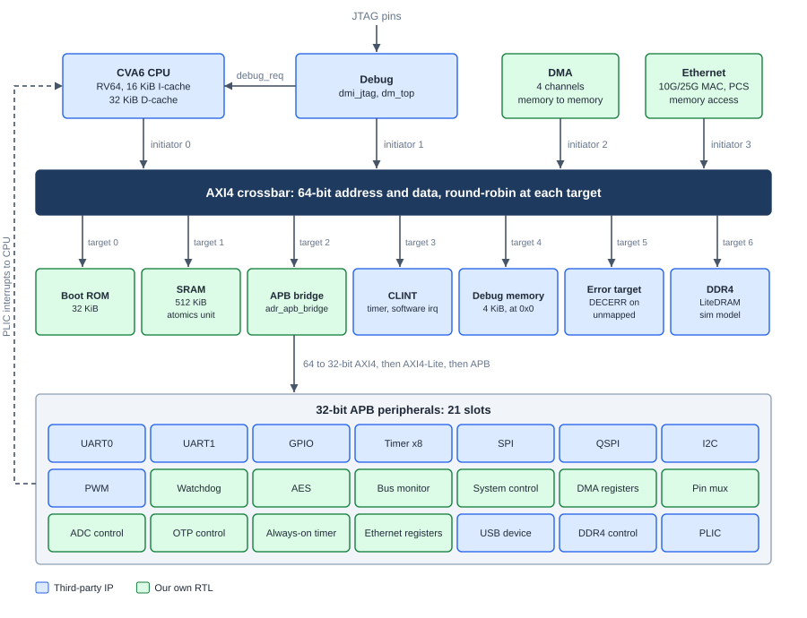
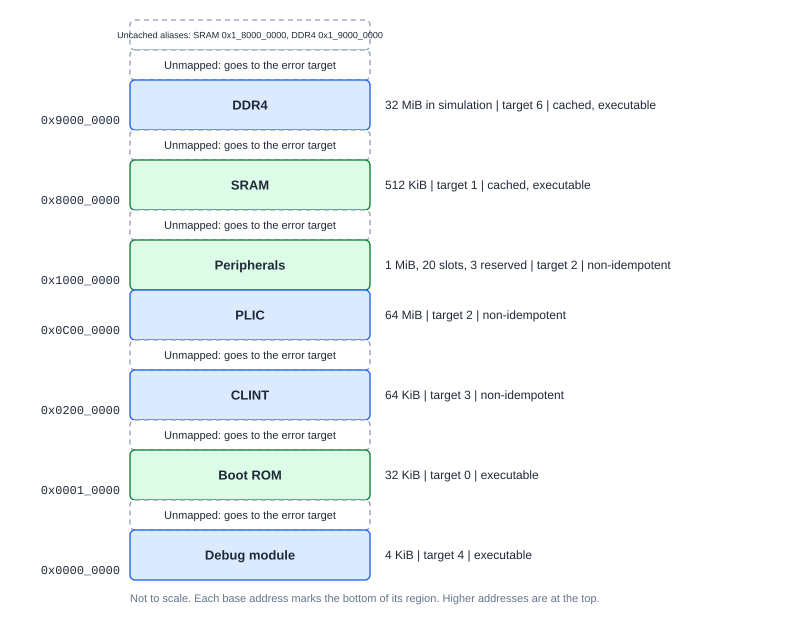
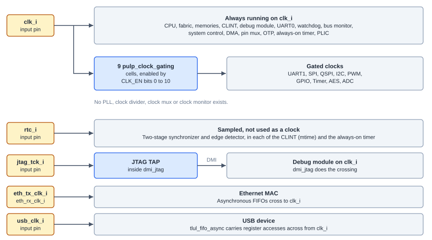
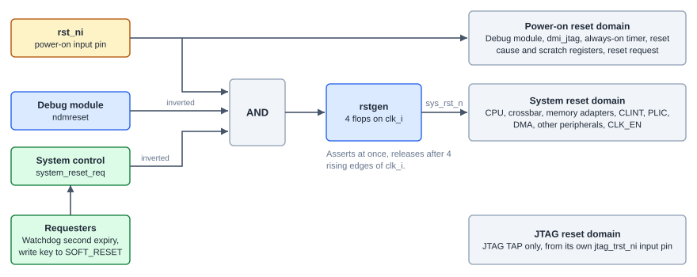
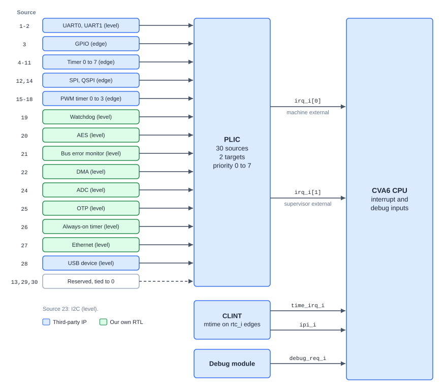
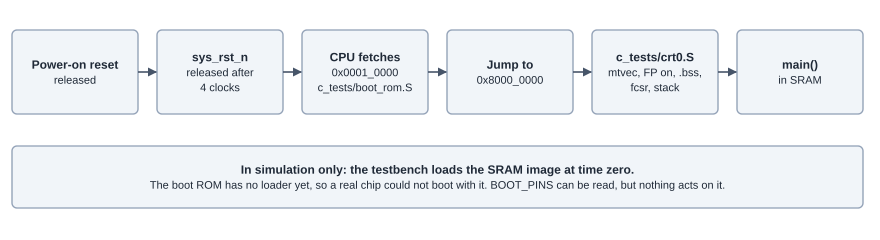
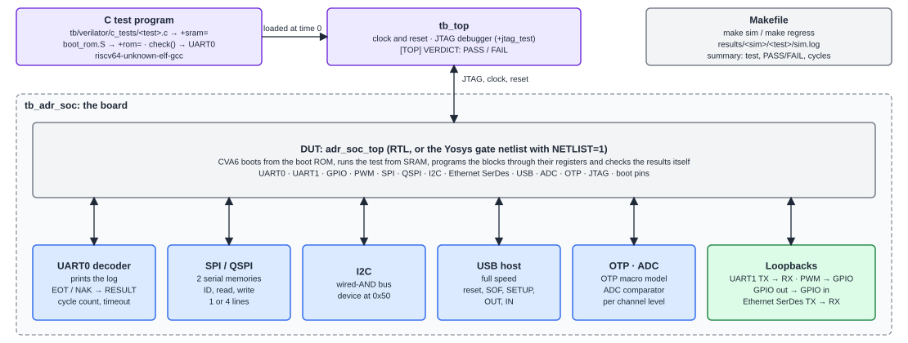
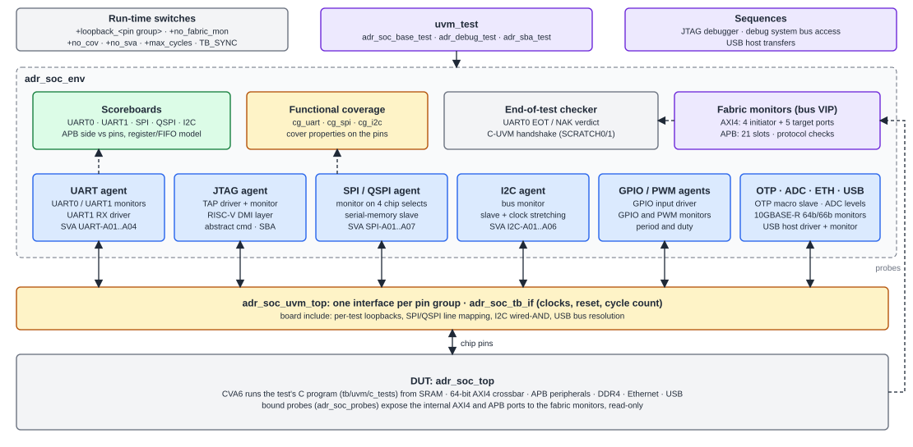

# ADR SoC: a 64-bit RISC-V system-on-chip, from architecture to verification

ADR (*Aadhar*, "foundation") is a complete RV64GC SoC: a CVA6 application core on a 64-bit AXI4 fabric with boot ROM, SRAM and DDR4, PLIC and CLINT interrupt control, JTAG debug, DMA, a 10G/25G Ethernet MAC and PCS, a USB 2.0 device, and a full set of APB peripherals. It is built the way a production SoC is assembled:
- proven open-source IP is integrated behind clean, documented interfaces;
- the integration logic, our own peripherals and the full verification environment are designed in-house;
- every decision and limitation is written down.

The design is digital and verified in simulation. The SoC regression passes on **Verilator 5.020**. The same flow drives Questa, Synopsys VCS and Cadence Xcelium for anyone who has them, and a UVM environment is included for those simulators.

The project lives in [`ADR_SOC/`](ADR_SOC/). Start with the [project README](ADR_SOC/README.md), then the [microarchitecture specification](ADR_SOC/docs/MICROARCHITECTURE.md) and the [verification plan](ADR_SOC/docs/pdf/ADR_VERIFICATION_PLAN.pdf).

---

## 1. Architecture at a glance



| Area | Implementation |
|---|---|
| CPU | CVA6 v5.3.0 (`cv64a6_imafdc_sv39`): 6-stage, single-issue, in-order issue with out-of-order completion. 16 KiB I-cache, 32 KiB write-through D-cache, Sv39 MMU, 8-entry PMP, machine/supervisor/user modes |
| Interconnect | 64-bit AXI4 crossbar, 4 initiators x 7 targets, AXI atomics (ATOPs) passed through, round-robin arbitration, 8 outstanding transactions per port; default route to an error target |
| Peripheral bus | AXI4 → 32-bit AXI4 → AXI4-Lite → APB bridge chain decoding 21 slots, with an automatic SLVERR reply for clock-gated peripherals |
| Memory | 32 KiB boot ROM, 512 KiB SRAM, DDR4 controller (LiteDRAM, simulation model), with uncached aliases of SRAM and DDR4 for DMA-coherent buffers |
| Interrupts | PLIC (30 sources, 2 contexts: machine and supervisor external), CLINT (software and timer) |
| Debug | RISC-V Debug 0.13 over JTAG: halt/resume, abstract commands, program buffer, and system bus access with full `sberror` reporting |
| High-speed | 10G/25G Ethernet MAC + PCS on a 64-bit SerDes interface with its own DMA engine; USB 2.0 full-speed device (OpenTitan `usbdev`) |
| Peripherals | 2 UARTs, SPI, QSPI, I2C, 16-pin GPIO with pin mux, 8-channel timer, 8-channel PWM, watchdog, always-on timer, AES-128/192/256, 4-channel DMA, ADC and OTP controllers, bus error monitor, system control |
| Expansion | Address windows and interrupt sources reserved for PCIe, MIPI and graphics |

### Subsystem partitioning

The top level `adr_soc_top` contains **connections only**. All logic sits in one subsystem per concern, so each can be understood, verified and replaced on its own:

```
adr_soc_top
├─ adr_rst_gen        every reset: power-on, warm (with DDR4 drain), per-clock-domain synchronizers
├─ adr_core_complex   CVA6, CLINT, PLIC
├─ adr_debug          JTAG DTM, debug module, its bus target and system-bus initiator
├─ adr_interconnect   AXI4 crossbar, address map, error target, APB bridge chain
├─ adr_mem_subsys     boot ROM, SRAM, DDR4
├─ adr_dma            4-channel DMA
├─ adr_eth            10G/25G Ethernet
├─ adr_usb            USB 2.0 full-speed device
├─ adr_lsio_subsys    UART0/1, GPIO, SPI, QSPI, I2C, pin mux, their clock gates
└─ adr_periph_subsys  timer, PWM, watchdog, AES, bus monitor, system control, ADC, OTP, always-on timer
```

## 2. Memory map



| Region | Base | Size | Notes |
|---|---|---|---|
| Debug module | `0x0000_0000` | 4 KiB | Debug ROM and program buffer, executed in debug mode |
| Boot ROM | `0x0001_0000` | 32 KiB | Reset vector |
| CLINT | `0x0200_0000` | 64 KiB | Non-idempotent: never speculated |
| PLIC | `0x0C00_0000` | 64 MiB | Non-idempotent |
| Peripherals | `0x1000_0000` | 1 MiB | 4 KiB APB slots, DDR4 control at `+0x20000` |
| SRAM | `0x8000_0000` | 512 KiB | Cached; uncached alias at `0x1_8000_0000` |
| DDR4 | `0x9000_0000` | 32 MiB (simulation) | Cached; uncached alias at `0x1_9000_0000` |

Any other address returns a decode error from the crossbar's error target. Because CVA6 does not trap on bus errors, a **bus error monitor** records the failing initiator and address and raises an interrupt.

## 3. Key architectural decisions

- **Coherency without hardware coherence.** The D-cache is write-through and the DMA engines are not snooped. Software gets two documented ways to stay correct:
  - uncached address aliases, which reach the same memory with no caching;
  - a whole-cache invalidate.

  Both are exercised by the `dma` test.
- **Atomics only where memory can perform them.** SRAM and DDR4 resolve AXI ATOPs in front of the memory. Every other target sits behind an ATOP filter that answers with SLVERR instead of hanging the requester.
- **Safe warm reset.** The DDR4 core keeps its state across a warm reset. Before the system reset is asserted, the reset generator drains the DDR4 port: no new address is accepted, open transactions finish, and there is a bounded timeout recorded in `RESET_CAUSE`. This ensures no transaction answers an initiator that has been reset.
- **Clock gating with a defined bus response.** Nine peripherals can be gated through `CLK_EN`. The APB bridge replies for a gated block, so software never stalls on a sleeping peripheral.
- **Synchronous design, explicit crossings.** One system clock drives everything except the JTAG, Ethernet and USB domains. Every crossing is a known structure:
  - the JTAG DTM;
  - asynchronous FIFOs for Ethernet;
  - an asynchronous TL-UL FIFO for USB;
  - 2-flop synchronizers for every asynchronous input.
- **Open-source IP, kept clean.** Third-party code is kept exactly as upstream released it. ADR needs three kinds of change, each kept outside the upstream files and documented with its reason:
  - backported upstream fixes (the debug module's system bus access fixes from riscv-dbg v0.5.0);
  - simulator-compatibility copies, with formal equivalence proofs;
  - one synthesis drop-in.

| | |
|---|---|
| Clocks |  |
| Resets |  |
| Interrupts |  |
| Boot |  |

## 4. Verification

ADR is verified the way silicon is brought up: **real software on the real CPU, inside the whole SoC**. Each test is a bare-metal C program that CVA6 runs from SRAM. It programs the blocks through their registers exactly as a driver would, checks every result itself, and reports through UART0. A test passes only on its own self-checks *and* the bench's verdict line, so a crash or a hang can never pass.

### Verilator SoC bench (the regression)



The bench surrounds the chip with small, readable device models on its pins and drives JTAG like an external debugger. The same bench runs unchanged on the synthesized gate-level netlist.

- **Device models:** SPI and QSPI serial memories, an I2C device on a wired-AND bus, a USB full-speed host, the OTP macro and the ADC comparator.
- **Loopbacks** for UART1, GPIO, PWM and the Ethernet SerDes.

| Test | Covers | Checks |
|---|---|---|
| `smoke` | CPU, memories, FPU, atomics, PMP, illegal-instruction trap, UART0, error responses | 18 |
| `irq` | CLINT, PLIC priority/threshold/claim in machine and supervisor contexts | 31 |
| `debug` | JTAG TAP, debug module halt/resume, registers, program buffer, system bus access, SoC reset from the debugger | 30 |
| `periph` | UART1, GPIO, 8-channel timer | 31 |
| `serial` | SPI, QSPI (quad mode), I2C, empty slots | 19 |
| `timers` | PWM, watchdog and watchdog reset | 18 |
| `aes` | AES with FIPS-197 vectors | 17 |
| `sys` | Bus error monitor, system control, reset causes | 23 |
| `eth` | Ethernet MAC and PCS, frames through the SerDes loopback | 18 |
| `usb` | USB device against the host model | 12 |
| `ddr` | DDR4 from CPU and DMA, atomics, code running from DDR4 | 18 |

These are the 11 regression tests, with **235 self-checks**, all passing on Verilator. The latest summary is [`ADR_SOC/results/summary_verilator.txt`](ADR_SOC/results/summary_verilator.txt).

Further tests (`dma`, `misc`, `uart_i2c`, `i2c`, `amo`) cover DMA and cache coherency, the pin mux, ADC, OTP and the always-on timer, clock gating, and atomics to targets that reject them.

### UVM SoC environment



A layered UVM 1.2 environment runs the same C programs on the same chip pins, with a UVM agent on every pin group. It needs a commercial simulator and is **provided, not validated in this release**.

- **Reusable agents, kept with their IP** (`rtl/*/*/tb/uvm/`), so each block can later get its own IP-level bench:
  - UART, SPI/QSPI and I2C (with SVA and functional coverage);
  - JTAG with a RISC-V debug (DMI, abstract command, system bus access) sequence layer;
  - GPIO and PWM;
  - OTP and ADC;
  - a 10GBASE-R 64b/66b Ethernet monitor and driver;
  - a USB full-speed host driver and monitor.
- **Bus VIP:**
  - AXI4 protocol monitors on all 9 crossbar ports;
  - APB monitors on all 21 slots;
  - both bound read-only into the DUT.
- **Scoreboards** for UART0, UART1, SPI, QSPI and I2C. Each compares the block's APB register traffic with its pins, through a register and FIFO model.
- **C-UVM handshake.** The C program and the UVM test coordinate through tagged words in a system-control register: end of test with its failure count, checkpoints, and requests to the bench. For example, the `sba` test asks the JTAG agent to run 44 debug system-bus-access checks mid-program, then verifies their effect from software.

Plans: [verification](ADR_SOC/docs/pdf/ADR_VERIFICATION_PLAN.pdf) · [test](ADR_SOC/docs/pdf/ADR_TEST_PLAN.pdf) · [coverage](ADR_SOC/docs/pdf/ADR_COVERAGE_PLAN.pdf) · [assertions](ADR_SOC/docs/pdf/ADR_ASSERTIONS_PLAN.pdf).

### Synthesis and gate level

The full chip synthesizes with Yosys (yosys-slang front end) to generic gates: about 432,000 cells, with the ROM and SRAM kept as memory macros. The same C-test bench runs on the netlist (`NETLIST=1`), where every test must reproduce the RTL cycle count.

## 5. Quick start

```sh
cd ADR_SOC
make sim TEST=smoke          # one test on Verilator (builds what it needs)
make regress                 # the 11-test regression
make sim TEST=irq SIM=vcs    # the same on VCS (or SIM=xcelium, SIM=questa)
make sim SIM=xcelium TB=uvm TEST=irq   # the UVM environment on a commercial simulator
```

Requirements: Verilator 5.020, `riscv64-unknown-elf-gcc`, `make`, `g++`, `python3`. All commands and switches: [`ADR_SOC/sim/README.md`](ADR_SOC/sim/README.md).

## 6. Repository map

| Path | Contents |
|---|---|
| [`ADR_SOC/rtl/adr_soc/`](ADR_SOC/rtl/adr_soc/) | SoC top and subsystems |
| [`ADR_SOC/rtl/adr_ip/`](ADR_SOC/rtl/adr_ip/) | Blocks designed for ADR |
| [`ADR_SOC/rtl/third_party_ip/`](ADR_SOC/rtl/third_party_ip/) | Integrated open-source IP |
| [`ADR_SOC/tb/`](ADR_SOC/tb/) | Verilator SoC bench and UVM environment |
| [`ADR_SOC/sim/`](ADR_SOC/sim/) | File lists and run commands for Verilator, Questa, VCS, Xcelium |
| [`ADR_SOC/syn/`](ADR_SOC/syn/) | Yosys synthesis |
| [`ADR_SOC/docs/`](ADR_SOC/docs/) | Specification, features, limitations, third-party records, per-block datasheets, plans (PDF) |
| [`ADR_SOC/results/`](ADR_SOC/results/) | Sample Verilator results |

## 7. Status and limitations

ADR is a working base in simulation, not yet a chip.
- There is no timing closure, FPGA or silicon result.
- The analog parts (DDR4 PHY, SerDes, USB transceiver, ADC, OTP macro) are modelled in the testbench.
- Supervisor mode, the MMU and a Linux boot have not been run.

Every known gap is tracked, item by item, in [`LIMITATIONS.md`](ADR_SOC/docs/LIMITATIONS.md); the current verification state is in [`STATUS.md`](ADR_SOC/docs/STATUS.md).

## 8. Third-party IP and licences

CVA6 and CVFPU (OpenHW), pulp-platform AXI, APB, common cells, peripherals, PLIC and RISC-V debug, OpenTitan `usbdev` (lowRISC), LiteDRAM/LiteX, alexforencich `verilog-axi`, `verilog-ethernet` and `verilog-i2c`, and secworks AES S-boxes. Each is used under its own licence, which is kept with the code. The versions, licences and every documented change are in [`THIRD_PARTY.md`](ADR_SOC/docs/THIRD_PARTY.md).

---

Author: Vijay Bogati
